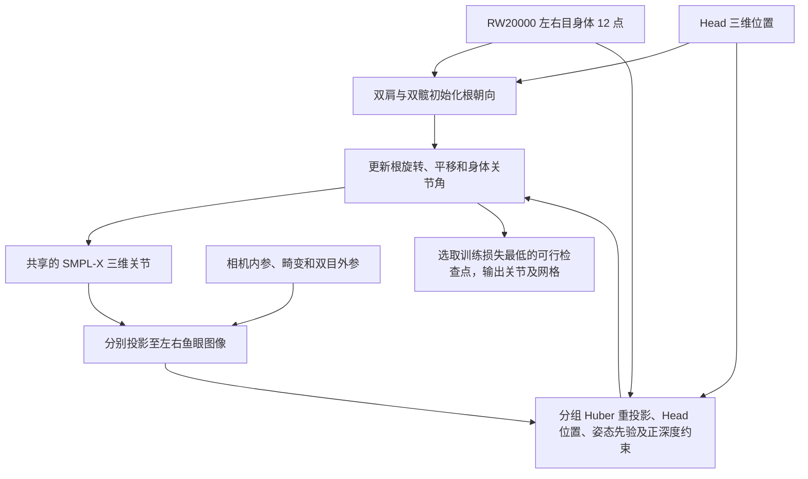

# DownSight

DownSight 探索从头戴下视双目图像恢复人体姿态与体型。

> **当前黄金 D 为 `golden-d-2d-v2`。** RW20000 的双目身体 12 点共同约束一具 SMPL-X 人体。逐帧用双肩和双髋初始化根朝向，用 Head 三维位置初始化平移。拟合中头随上胸，双脚自由。

[方法与版本对照](docs/downsight/GOLDEN_D_2D_zh.md) · [默认配置清单](configs/golden_d.current.json) · [100 对冻结集结果](runs/2026-11-19_rw_frozen200_free12/report.md) · [本次基线切换](runs/2026-11-20_golden_d_v2/report.md)

## 双目拟合流程

[双目联合优化图解：从一个腕点看懂两眼如何共同拟合人体](docs/downsight/golden-d-v2/README.md)



参考实验固定均值体型及手指局部姿态，采用标注辅助的 Head 位置、外参和画内掩码。地面参考仅用于展示。[单帧正侧视图](runs/2026-11-20_rw20000_floor12/report.md) · [原 EgoSMPLX 部署入口](README_LEGACY.md)

| 版本 | 识别特征 | 用途 |
|---|---|---|
| 黄金 D v2 | RW20000、肩髋起步、Head 位置约束、头随上胸 | 当前研究基线 |
| 黄金 D v1 | 全二维重投影、历史 Head 朝向初始化并参与拟合 | [前版清单](configs/golden_d.2d-v1.json) |
| 三维黄金 D | 三角化目标的协方差加权三维残差 | [历史合成归档](experiments/synthetic_template_head_stereo_20261109/METHOD.md) |

## 历史黄金 D：三维损失合成样本

| 固定项 | 身份 |
|---|---|
| 样本 | [DownSightSmplxdata](https://github.com/cdh290718-oss/DownSightSmplxdata) 的 `000001`，同一姿态的 cam3 / cam4 |
| 组别 | 初始化消融中的 `D`：标准体型、模板姿态；与早期 ABCD 实验中的 D 不同 |
| 固定归档 | [`d26b9ee`](https://github.com/cdh290718-oss/DownSight/tree/d26b9ee292204506492fb9e1d221d683531465ea/experiments/synthetic_template_head_stereo_20261109)；拟合代码发布于 [`485fc71`](https://github.com/cdh290718-oss/DownSight/tree/485fc71ca37d3c68a74bf99338fe247c197bf6eb/runs/2026-11-09_initialization-ablation) |
| 选择规则 | 20000 步预算内，按训练目标选择最小可行检查点；选中第 19960 步 |
| 资源与结果 | [固定清单](experiments/synthetic_template_head_stereo_20261109/golden_d.json) · [资源和 SHA-256](experiments/synthetic_template_head_stereo_20261109/manifest.json) · [精确数值](experiments/synthetic_template_head_stereo_20261109/evidence/results.json) |

```bash
python3 tools/check_golden_d.py
```

此检查核对固定身份、仓库文件摘要及其与固定归档提交的字节一致性；**不运行拟合、不检查外部模型资源，也不证明数值复现或精度**。外部资产的获取与授权要求见[复现条件](experiments/synthetic_template_head_stereo_20261109/REPRODUCE.md)。未来方法或样本需要变化时，应建立新版本并保留本参考的固定身份。

### 合成样本投影

绿点为真值，红点为预测，网格为预测。显示结果不能单独证明身体轮廓、扭转、手指或自碰撞正确。

| cam3 / left | cam4 / right |
|---|---|
|  |  |

该合成样本的真值体型恰好是模型均值；归档结果未通过全部预设稳定性门槛。不能据此认定 D 已经在真实设备、多姿态或非均值体型上验证。详见[使用边界](experiments/synthetic_template_head_stereo_20261109/BOUNDARIES.md)。

## 后续研究与原流程

- [真实样本 D 适配探索](runs/2026-11-15_real-d-stereo/report.md)：估计 Head 锚点及鱼眼适配的局限。
- [UnrealEgo-RW 官方二维点实验](runs/2026-11-15_unrealego-gt2d/report.md)：官方二维身体点、标注 Head 位置与拟合后的三维评测。
- [Sapiens 与官方二维点诊断](runs/2026-11-15_gt2d-vs-sapiens/report.md)：自动点、双目筛选及相同可用点的拟合对照。
- [原首页与默认 EgoSmplx 流程](README_LEGACY.md)：逐视角处理、部署及使用说明；它与 D 实验是不同流程。
- [开发与协作流程](docs/downsight/WORKFLOW_zh.md) · [黄金回归候选与容差](docs/downsight/GOLDEN_REGRESSION_zh.md)：后者仍是待测量的回归方案。
