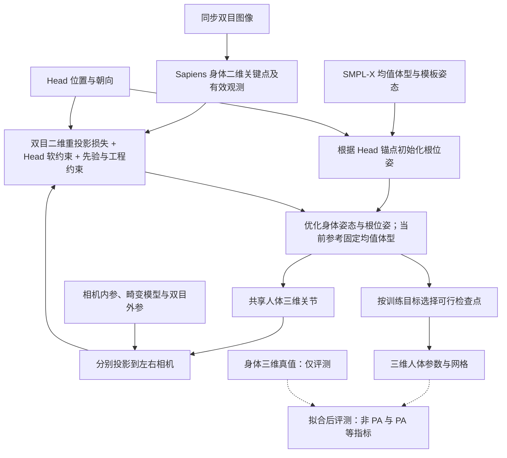
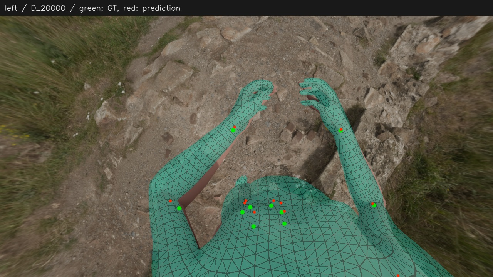

# DownSight

DownSight 探索从头戴下视双目图像恢复人体姿态与体型。

> **当前黄金 D：全二维身体观测损失（`golden-d-2d-v1`）。** 按用户决定，后续研究默认采用这一版本：从模板人体出发，直接使用双目身体关键点的二维重投影损失，保留 Head 位置／朝向软约束及姿态先验和工程约束。旧三维黄金 D 与混合方法保留为历史参考和消融对照。

[当前方法定义](docs/downsight/GOLDEN_D_2D_zh.md) · [当前基线配置清单](configs/golden_d.current.json) · [全二维实验](runs/2026-11-17_newdetector_d10/report.md) · [三种损失对照](runs/2026-11-17_d_loss_compare/report.md) · [本次基线切换记录](runs/2026-11-17_golden-d-2d/report.md)

## 当前黄金 D：双目二维重投影拟合

两张同步图像中的 Sapiens 身体关键点共同约束一套 SMPL-X 人体参数。将模型关节分别投影到左右相机，与各自的二维观测比较，优化身体姿态和根位姿。身体观测不转换为三角化三维目标参与损失；不要求一个点先通过三维可靠性门限，才保留其有效二维约束。

“全二维”指**身体观测损失**，并不删除 Head 三维位置与朝向软约束、姿态／体型先验、旋转范围或正深度约束。输出仍为三维人体。方法不依赖 EgoSMPLX 网络预测的人体初值；二维检测器与 SMPL-X 模型仍是外部依赖。



### 固定参考与适用边界

当前实现与协议固定到 [newdetector_d10](runs/2026-11-17_newdetector_d10/)，配置清单记录源码和协议摘要。参考检测器为 Sapiens2-1B 全骨干微调第 1 轮；优化预算、权重、选点规则和观测策略均沿用该实验。本次确立默认基线，不产生新的拟合结果。

当前参考的体型基底秩为零，实际固定均值体型；没有 WiLoR 手部观测损失，手指局部姿态固定。未来体型或手部扩展应单独命名并与此基线对照，不能沿用旧合成实验的体型和手部结果作为新版本证据。

参考实验仍依赖标注 Head 位置、标注派生外参和画内掩码，包含低置信度检测，并非独立盲测或完全自动部署验证。现有收敛限制见实验报告。此处的“默认”是研究基线；[原 EgoSMPLX 部署入口](README_LEGACY.md)是另一条流程，未因此更换实现。

### 与旧黄金 D 的区别

| 版本 | 身体观测损失 | 后续用途 |
|---|---|---|
| 当前黄金 D / `golden-d-2d-v1` | 双目二维重投影；无三角化身体三维残差 | 默认研究基线 |
| 旧黄金 D / 三维合成归档 | 三角化目标的协方差加权三维残差 | 历史参考与消融 |
| 混合对照 | 通过门限的关节用三维，其余有效观测回退二维 | 对照方案 |

旧版本的完整流程与可观测体型方法见[历史方法说明](experiments/synthetic_template_head_stereo_20261109/METHOD.md)。以下归档、数值和投影图均属于旧三维版本。

## 历史黄金 D：三维损失合成样本

| 固定项 | 身份 |
|---|---|
| 样本 | [DownSightSmplxdata](https://github.com/cdh290718-oss/DownSightSmplxdata) 的 `000001`，同一姿态的 cam3 / cam4 |
| 组别 | 初始化消融中的 `D`：标准体型、模板姿态；与早期 ABCD 实验中的 D 不同 |
| 固定归档 | [`d26b9ee`](https://github.com/cdh290718-oss/DownSight/tree/d26b9ee292204506492fb9e1d221d683531465ea/experiments/synthetic_template_head_stereo_20261109)；拟合代码发布于 [`485fc71`](https://github.com/cdh290718-oss/DownSight/tree/485fc71ca37d3c68a74bf99338fe247c197bf6eb/runs/2026-11-09_initialization-ablation) |
| 选择规则 | 20000 步预算内，按训练目标选择最小可行检查点；选中第 19960 步 |
| 资源与结果 | [固定清单](experiments/synthetic_template_head_stereo_20261109/golden_d.json) · [资源和 SHA-256](experiments/synthetic_template_head_stereo_20261109/manifest.json) · [精确数值](experiments/synthetic_template_head_stereo_20261109/evidence/results.json) |

```bash
python3 tools/check_golden_d.py
```

此检查核对固定身份、仓库文件摘要及其与固定归档提交的字节一致性；**不运行拟合、不检查外部模型资源，也不证明数值复现或精度**。外部资产的获取与授权要求见[复现条件](experiments/synthetic_template_head_stereo_20261109/REPRODUCE.md)。未来方法或样本需要变化时，应建立新版本并保留本参考的固定身份。

### 合成样本投影

绿点为真值，红点为预测，网格为预测。显示结果不能单独证明身体轮廓、扭转、手指或自碰撞正确。

| cam3 / left | cam4 / right |
|---|---|
|  |  |

该合成样本的真值体型恰好是模型均值；归档结果未通过全部预设稳定性门槛。不能据此认定 D 已经在真实设备、多姿态或非均值体型上验证。详见[使用边界](experiments/synthetic_template_head_stereo_20261109/BOUNDARIES.md)。

## 后续研究与原流程

- [真实样本 D 适配探索](runs/2026-11-15_real-d-stereo/report.md)：估计 Head 锚点及鱼眼适配的局限。
- [UnrealEgo-RW 官方二维点实验](runs/2026-11-15_unrealego-gt2d/report.md)：官方二维身体点、标注 Head 位置与拟合后的三维评测。
- [Sapiens 与官方二维点诊断](runs/2026-11-15_gt2d-vs-sapiens/report.md)：自动点、双目筛选及相同可用点的拟合对照。
- [原首页与默认 EgoSmplx 流程](README_LEGACY.md)：逐视角处理、部署及使用说明；它与 D 实验是不同流程。
- [开发与协作流程](docs/downsight/WORKFLOW_zh.md) · [黄金回归候选与容差](docs/downsight/GOLDEN_REGRESSION_zh.md)：后者仍是待测量的回归方案。
