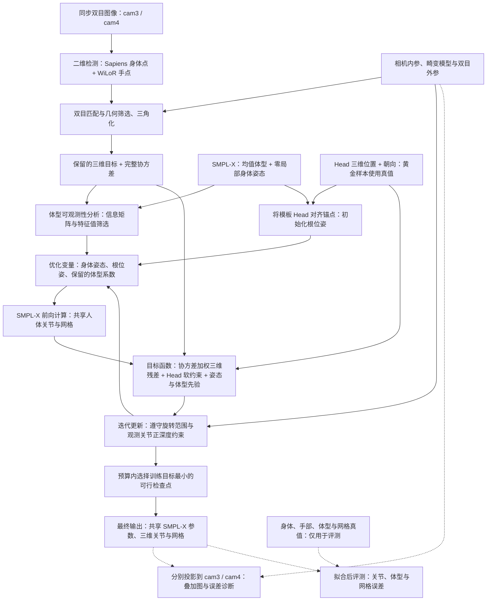
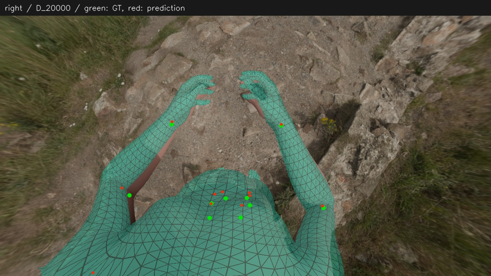

# DownSight

DownSight 探索从头戴下视双目图像恢复人体姿态与体型。当前首页以 **D 方法**为研究入口：从标准体型和模板姿态出发，结合双目身体／手部观测与头部锚点，拟合两目共享的 SMPL-X 人体。

> **黄金样本 D：固定的合成实验参考。** 它依赖真值 Head 位置和朝向、生成相机及单个合成姿态；这是用于追溯和比较的研究基线，尚未成为默认部署流程，也尚未建立经重复运行验证的黄金回归容差。

[黄金样本 D 归档](experiments/synthetic_template_head_stereo_20261109/README.md) · [方法](experiments/synthetic_template_head_stereo_20261109/METHOD.md) · [结果与对照](experiments/synthetic_template_head_stereo_20261109/RESULTS.md) · [边界](experiments/synthetic_template_head_stereo_20261109/BOUNDARIES.md) · [复现条件](experiments/synthetic_template_head_stereo_20261109/REPRODUCE.md)

## D 方法：用双目观测和头部锚点拟合同一个人体

D 是一种基于几何和人体模型的优化拟合方法。它要解决的问题是：**给定两张同步的下视图像、相机标定和头部位姿，如何从模板人体恢复姿态，并估计观测能够支持的体型变化？**

方法从 SMPL-X 均值体型与零局部身体姿态开始。Sapiens 和 WiLoR 提供两目中的身体／手部二维点，双目几何将它们变成带不确定度的三维目标；Head 位置与朝向提供人体的空间锚点。随后优化一套两目共享的 SMPL-X 参数，使人体关节接近这些目标，同时满足头部软约束和姿态／体型先验。这里不使用 EgoSmplx 网络预测的人体姿态、体型或根位姿作为初值，二维检测器仍是必要输入来源。

### 模块关系与数据流

下面是**固定黄金 D** 的流程。实线表示拟合数据流及参数更新，虚线表示最终投影或事后评测。



### 各模块负责什么

| 模块 | 输入 → 输出 | 作用与边界 |
|---|---|---|
| 二维观测 | 双目图像 → 身体与手部二维点 | WiLoR 在此提供二维腕／掌指关节点；不直接采用其三维预测。自动点的偏差会传递到后续拟合。 |
| 双目几何 | 二维点、标定 → 三维目标与协方差 | 匹配并筛选观测，再三角化。协方差描述不同方向的不确定度；检测置信度高不等于三维位置准确。 |
| Head 锚点 | Head 位置和朝向 → 根位姿初值、优化时的软约束 | 先将模板放到对应位置，再约束拟合中的头部。Head 朝向是模型头部坐标系的朝向，不直接等于相机朝向；用头显位姿替代需要相机与头部之间的安装变换。 |
| 可观测体型 | 均值模型的骨段长度敏感度、观测及协方差 → 保留的体型方向 | 对体型信息矩阵做特征分解，只优化超过阈值的方向，其他方向固定在均值，避免弱观测下任意改变体型。 |
| 联合优化 | 三维目标、Head 锚点、体型子空间 → 共享人体参数 | 两目约束同一个人体；用协方差白化残差和 Huber 损失降低不可靠观测的影响，并加入先验及工程约束。 |
| 输出与评测 | 最终人体、相机 → 双目投影；人体与真值 → 误差 | 投影用于检查拟合效果；身体真值不参与黄金 D 的拟合或检查点选择。 |

### 体型怎样参与优化

体型写成 `beta = B · alpha`：`B` 是根据观测计算并固定的可观测方向，`alpha` 是优化变量，初值为零。因此，**从均值体型开始不代表体型始终固定在均值**。黄金 D 保留了一个体型方向；如果另一个样本没有方向通过阈值，才会保持均值体型。保留方向也不等于完整体型已被准确恢复，效果仍受关节定义、观测覆盖和噪声假设影响。依据见[体型初始化实现](runs/2026-11-09_initialization-ablation/initialization.py)和[黄金样本证据](experiments/synthetic_template_head_stereo_20261109/evidence/results.json)。

### 拟合范围与当前验证边界

优化身体姿态、根旋转／平移以及保留的体型系数；手指、面部和足部局部姿态按归档设置固定，踝旋转仍参与优化。三角化目标在损失中各计一次，**不再额外叠加二维重投影损失**。正深度约束针对参与观测的关节；本方法没有“头部入画惩罚”，也没有轮廓、自碰撞或完整解剖关节约束。

黄金 D 使用合成数据的生成相机和真值 Head 位置、朝向，身体／手部目标来自自动二维检测。真实设备需要另外获得可靠的相机标定与 Head 锚点。这个固定样本验证的是上述输入条件下的拟合表现，不能据此认定自动检测、真实头部位姿或任意体型已经得到解决。

完整损失、筛选规则及参数见[方法说明](experiments/synthetic_template_head_stereo_20261109/METHOD.md)、[精确设置](experiments/synthetic_template_head_stereo_20261109/settings.json)和[拟合实现](runs/2026-11-09_initialization-ablation/fit.py)。

## 黄金样本 D

| 固定项 | 身份 |
|---|---|
| 样本 | [DownSightSmplxdata](https://github.com/cdh290718-oss/DownSightSmplxdata) 的 `000001`，同一姿态的 cam3 / cam4 |
| 组别 | 初始化消融中的 `D`：标准体型、模板姿态；与早期 ABCD 实验中的 D 不同 |
| 固定归档 | [`d26b9ee`](https://github.com/cdh290718-oss/DownSight/tree/d26b9ee292204506492fb9e1d221d683531465ea/experiments/synthetic_template_head_stereo_20261109)；拟合代码发布于 [`485fc71`](https://github.com/cdh290718-oss/DownSight/tree/485fc71ca37d3c68a74bf99338fe247c197bf6eb/runs/2026-11-09_initialization-ablation) |
| 选择规则 | 20000 步预算内，按训练目标选择最小可行检查点；选中第 19960 步 |
| 资源与结果 | [固定清单](experiments/synthetic_template_head_stereo_20261109/golden_d.json) · [资源和 SHA-256](experiments/synthetic_template_head_stereo_20261109/manifest.json) · [精确数值](experiments/synthetic_template_head_stereo_20261109/evidence/results.json) |

```bash
python3 tools/check_golden_d.py
```

此检查核对固定身份、仓库文件摘要及其与固定归档提交的字节一致性；**不运行拟合、不检查外部模型资源，也不证明数值复现或精度**。外部资产的获取与授权要求见[复现条件](experiments/synthetic_template_head_stereo_20261109/REPRODUCE.md)。未来方法或样本需要变化时，应建立新版本并保留本参考的固定身份。

### 合成样本投影

绿点为真值，红点为预测，网格为预测。显示结果不能单独证明身体轮廓、扭转、手指或自碰撞正确。

| cam3 / left | cam4 / right |
|---|---|
|  |  |

该合成样本的真值体型恰好是模型均值；归档结果未通过全部预设稳定性门槛。不能据此认定 D 已经在真实设备、多姿态或非均值体型上验证。详见[使用边界](experiments/synthetic_template_head_stereo_20261109/BOUNDARIES.md)。

## 后续研究与原流程

- [真实样本 D 适配探索](runs/2026-11-15_real-d-stereo/report.md)：估计 Head 锚点及鱼眼适配的局限。
- [UnrealEgo-RW 官方二维点实验](runs/2026-11-15_unrealego-gt2d/report.md)：官方二维身体点、标注 Head 位置与拟合后的三维评测。
- [Sapiens 与官方二维点诊断](runs/2026-11-15_gt2d-vs-sapiens/report.md)：自动点、双目筛选及相同可用点的拟合对照。
- [原首页与默认 EgoSmplx 流程](README_LEGACY.md)：逐视角处理、部署及使用说明；它与 D 实验是不同流程。
- [开发与协作流程](docs/downsight/WORKFLOW_zh.md) · [黄金回归候选与容差](docs/downsight/GOLDEN_REGRESSION_zh.md)：后者仍是待测量的回归方案。
