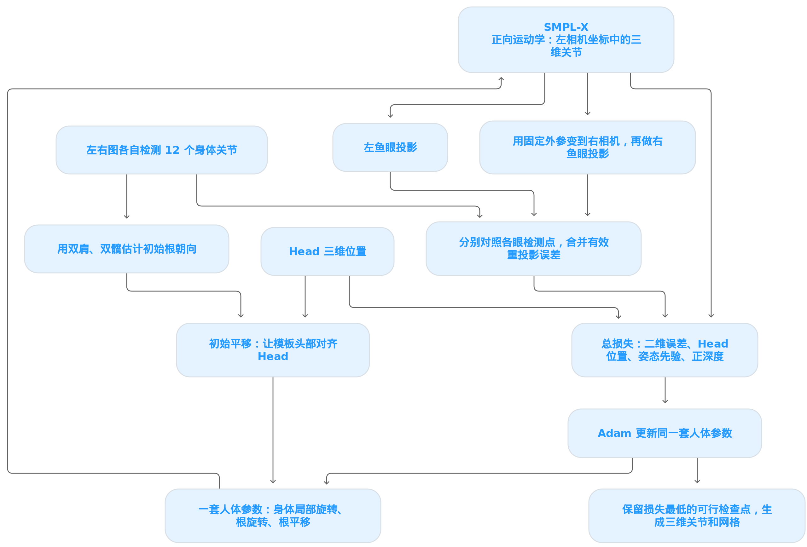

# 黄金 D v2 的双目联合优化

> 当前研究基线为[黄金 D v5](../golden-d-v5/README.md)。本页记录 v2 的连续拟合阶段。

给定一帧同步双目图像，黄金 D v2 只拟合**一具** SMPL-X 人体。人体在左相机坐标系里有一套身体姿态、根旋转和根平移。同一个三维关节分别投影到左右鱼眼图上，两眼的像素误差沿着同一条人体运动链反向传播。这就是“双目联合”的具体含义。每一对图像独立求解。[版本清单](../../../configs/golden_d.2d-v2.json) · [拟合入口](../../../runs/2026-11-19_rw_frozen200_free12/run_fit.py#L22-L68)

## 从同步图像到一具人体

| 图中的量 | v2 在一帧中如何使用 |
|---|---|
| 二维身体点 | RW20000 版 Sapiens2 给左右眼分别提供肩、肘、腕、髋、膝、踝，每眼最多 12 个点。按标注辅助的画内掩码选择有效观测，无置信度门槛。 |
| 相机 | 固定每眼鱼眼标定及逐会话双目外参。左眼作为人体坐标系，外参把同一关节变换到右眼。 |
| Head | 归档实验用官方三维 Head 位置初始化平移，并在拟合中持续约束头部位置。朝向权重为零，颈和头的局部旋转锁定，头随上胸转动。 |
| 人体参数 | Adam 调整身体局部关节旋转、根旋转和平移。体型基底秩为零，β 固定在均值。手指姿态固定，WiLoR 手点未参与。脚踝可动，双脚只受通用姿态先验和角度范围约束。 |

表中条件对应冻结集运行器的 `rw20000` 行。归档实验的 Head、会话外参和画内掩码使用了标注辅助，这些输入也影响如何解读结果。[输入准备](../../../runs/2026-11-18_rw_frozen200_golden_d/prepare.py#L76-L97) · [有效设置](../../../runs/2026-11-19_rw_frozen200_free12/evidence/settings.json)

## 优化前，人体摆在哪里？

**根朝向来自双肩和双髋。** 以左肩为例，把它在两幅图中的像素反投影为两条空间射线，用外参将射线表达在同一坐标系。检测误差会使两条射线错开，代码取两条射线上最近点的中点，作为左肩的初始三维估计。对四个肩髋点都做一次，髋中心指向肩中心给出躯干的上轴；两侧肩髋给出横轴，去掉其沿上轴的分量，再通过叉乘补齐第三根轴。这个坐标架给出整个人的初始旋转。[肩髋射线与坐标轴](../../../runs/2026-11-19_rw_position_only/trial.py#L20-L50)

**根平移来自 Head。** 让均值体型的人体处于模板姿态，应用初始根旋转，算出模型头关节，再将整个人平移“观测 Head 减去模型 Head”的距离。若肩髋射线不稳定，备用求解用同四个模板关节做双目重投影拟合，取回根朝向；平移仍按 Head 对齐。归档 RW20000 的 100 对都成功使用了常规肩髋初始化。初始化完成后，身体关节靠二维观测拟合，肩髋三角化结果不进入身体损失。[备用初始化](../../../runs/2026-11-19_rw_three_free12/experiment.py#L18-L36) · [根平移](../../../runs/2026-11-17_newdetector_d10/fit.py#L79-L93) · [冻结集记录](../../../runs/2026-11-19_rw_frozen200_free12/report.md)

## 跟着左腕走一次迭代

1. **从人体参数算三维左腕。** SMPL-X 沿骨架的父子关系累积旋转与位移。躯干、锁骨、肩和肘的姿态共同决定左腕中心的位置。迭代内部只需计算关节正向运动学，选定参数后可生成完整网格。[关节正向运动学](../../../runs/2026-11-17_newdetector_d10/geometry.py#L20-L55) · [网格生成](../../../runs/2026-11-20_rw20000_frozen_mesh12/gallery.py#L82-L90)
2. **同一个点产生两个预测像素。** 设左相机坐标中的腕点为 $J$。左图预测为 $\pi_L(J)$，右图预测为 $\pi_R(R_{RL}J+t_{RL})$。每个投影函数使用对应鱼眼相机的光轴约定、标定多项式、仿射参数和图像中心，检测坐标也转换到相同的像素系。[双目变换](../../../runs/2026-11-17_newdetector_d10/fit.py#L113-L121) · [鱼眼投影](../../../runs/2026-11-17_newdetector_d10/geometry.py#L58-L70)
3. **用两眼误差修正同一个姿态。** 想象当前腕点在左图已经对准，但沿左眼视线偏深。沿这条射线移动，左图像素几乎不动；从右眼看，腕点的投影一般会移动。右眼残差于是能约束左眼单独难以确定的深度。转肩或弯肘可以移动腕中心，同时会牵动其他关节，因此每次更新都会重新计算整具人体的投影和损失。[目标函数](../../../runs/2026-11-17_newdetector_d10/fit.py#L113-L138)

腕中心的位置和手掌朝向是两个不同的观测问题。绕腕中心转动手掌时，腕中心保持原位。v2 只观测到腕，手指点未参与，所以腕点投影贴合时，手掌朝向仍可缺少约束。踝中心和脚掌朝向也有类似区别。[骨架计算](../../../runs/2026-11-17_newdetector_d10/geometry.py#L35-L55) · [手脚设置](../../../configs/golden_d.2d-v2.json)

## 两眼和十二个关节怎样分配权重？

对每只有效眼、每个关节，先算预测像素和检测像素之间的二维欧氏距离。记横、纵方向的像素差为 Δx 和 Δy。

> **归一化距离**　d = √(Δx² + Δy²) / (8 × √2)
>
> **单眼代价**　Huber(d)，阈值 δ = 2.5。

Huber 在小误差区按平方增长，在大误差区按线性增长，限制离群点的影响。式中的 8 px 属于**拟合像素坐标**：原图为 872 × 872，先缩到 720 × 720，再水平填充到 1280 × 720。评测用的二维 RMSE 会换回原图像素。对每个关节，双眼有效就平均两眼代价；单眼有效就取该眼；双眼都无效就跳过该关节的二维项。[损失代码](../../../runs/2026-11-17_newdetector_d10/fit.py#L113-L129) · [坐标适配](../../../runs/2026-11-18_rw_frozen200_golden_d/prepare.py#L46-L59) · [换回原图评分](../../../runs/2026-11-19_rw_frozen200_free12/measure.py#L23-L42)

随后在每组内对有效关节取均值，乘以组权重，三组相加后统一乘以 0.01。

| 组 | 关节 | 组均值乘数 | 12 点全有效时，每个点在全局 0.01 之前的系数 |
|---|---|---:|---:|
| 身体 | 双肘、双髋、双膝、双踝 | 1 | 1/8 = 0.125 |
| 肩 | 双肩 | 0.25 | 0.25/2 = 0.125 |
| 腕 | 双腕 | 1 | 1/2 = 0.5 |

因此，在观测齐全的一帧里，**一只肩与一只膝的系数相同，一只腕的系数是单膝的四倍**。例如一只腕双眼都缺失，该腕从二维项剔除，腕组按剩下一只有效腕求均值。冻结集的 pair073 就是右腕双眼均缺失的实例。[逐帧权重与缺失点核验](../../../runs/2026-11-20_rw20000_equal12/report.md)

总目标还包括以下三项。[目标函数](../../../runs/2026-11-17_newdetector_d10/fit.py#L130-L138) · [角度裁剪](../../../runs/2026-11-17_newdetector_d10/fit.py#L213-L220) · [目标系数与关节角上限](../../../runs/2026-11-19_rw_frozen200_free12/evidence/settings.json)

- **Head 位置软约束**取模型头关节与观测 Head 的三维距离，以 0.015 m 归一化，平方后乘 0.01。初始化时头部对齐，迭代中则允许它为兼顾双眼观测而有小幅偏移。
- **姿态先验**按各关节的允许角度归一化局部旋转，对归一化分量的平方取均值并乘 0.0008。每次 Adam 更新后，超过上限的关节旋转向量会被裁回允许范围。
- **正深度约束**惩罚有效关节在任一相机中深度过小的解。要成为候选检查点，每个至少被一眼观测到的关节，在两眼的深度都必须达到 0.0001 m。

## 如何选出最后的人体？

每帧运行 Adam，预算为 **20,000 步**，每 **20 步**检查一次，保留总目标最低的可行检查点。归档的 RW20000 样本 pair010 最终取第 **80 步**。冻结集 100 对均找到可行解，其中 2 对通过严格收敛诊断（末 1,000 步目标相对变化低于 0.001，且最大关节位移低于 0.1 mm）。身体三维评测真值在选解后用于评分。[检查点逻辑](../../../runs/2026-11-17_newdetector_d10/fit.py#L164-L206) · [逐对诊断与评分](../../../runs/2026-11-19_rw_frozen200_free12/report.md)

在相同的 S1、S9、S11 冻结样本上，有一组实验只改了二维关节的相对权重。下表中二维误差与官方二维标注比较；非 PA 是左相机坐标中的平均三维关节距离；PA 则在每帧先做旋转、平移和统一尺度对齐再评分。[同输入消融及逐对统计](../../../runs/2026-11-20_rw20000_equal12/report.md)

| 同一批 100 对 | 对官方二维点 RMSE（原图 px） | 三维非 PA MPJPE（mm） | 三维 PA MPJPE（mm） |
|---|---:|---:|---:|
| 黄金 D v2 分组权重 | 18.69 | 61.23 | 44.58 |
| 有效关节等权 | 17.94 | 66.91 | 49.17 |

这次等权拟合使平均二维投影更贴近官方像素，同时三维平均关节误差增大。回到左腕的例子，同样大小的像素偏差可以对应不同方向、不同幅度的三维位移。判断这套拟合是否改善，需要同时看投影贴合度和三维关节误差。[归档比较数据](../../../runs/2026-11-20_rw20000_equal12/evidence/summary.json) · [查看这一版输出的十二个网格](../../../runs/2026-11-20_rw20000_frozen_mesh12/report.md)
