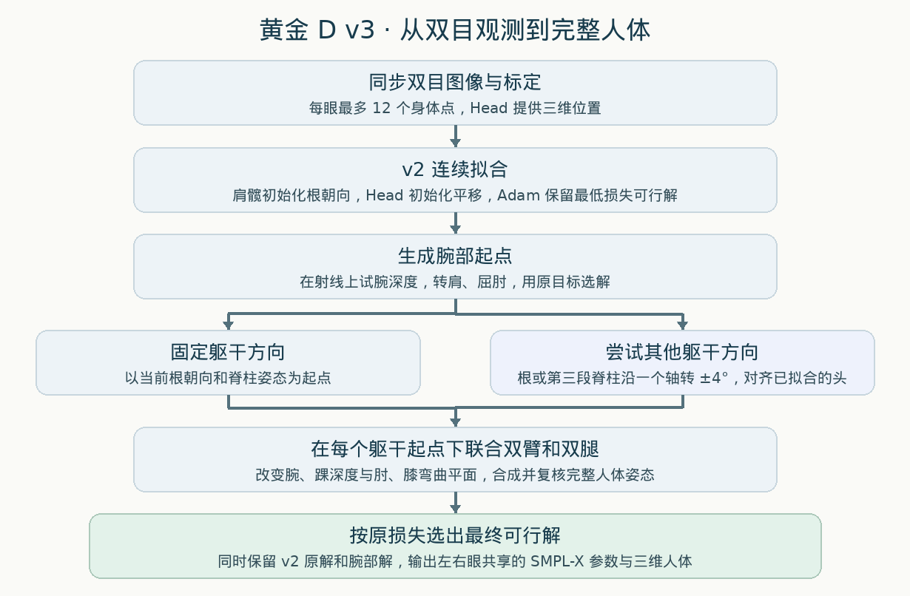

# 黄金 D v3 · 双目四肢与躯干联合拟合

黄金 D v3 是[黄金 D v4](../golden-d-v4/README.md) 的单帧拟合起点。给定一对同步鱼眼图像，左右眼共享一具 SMPL-X 人体。先用黄金 D v2 的 Adam 拟合得到起始姿态，再同时尝试双臂、双腿的弯曲方式，并允许根或上段脊柱小幅转动。最终用两眼共同的原拟合损失选出一套身体姿态、根旋转和平移，可据此生成三维关节和网格。[v3 归档清单](../../../configs/golden_d.2d-v3.json) · [500 对实现入口](../../../runs/2026-11-23_test500_joint/body.py) · [v2 方法原文](../golden-d-v2/README.md)

## 一帧怎样得到初始姿态？

RW20000 版 Sapiens2 在每只眼中检测左右肩、肘、腕、髋、膝、踝，最多 12 个身体点。左右相机各自使用固定鱼眼标定，逐会话外参把左相机坐标中的人体变换到右相机坐标。归档实验使用官方 Head 三维位置和画内掩码，并用样本外的标注帧恢复会话外参。体型固定为均值，手指姿态固定，颈和头部的局部旋转锁定，头随上胸运动。[输入准备与参考条件](../../../runs/2026-11-23_test500_joint/body.py) · [标定来源](../../../runs/2026-11-18_rw_frozen200_golden_d/prepare.py)

双肩和双髋的双目观测给出初始根朝向；射线不稳定时，用同四点的双目重投影恢复朝向。随后平移模板，让模型头关节对齐 Head。Adam 在每帧的 20,000 步预算内更新身体局部旋转、根旋转和平移，每 20 步检查一次可行性，保存总损失最低的可行检查点。这一套参数就是后续搜索可以保留的 v2 原解。[肩髋初始化](../../../runs/2026-11-19_rw_position_only/trial.py) · [Adam 与检查点](../../../runs/2026-11-17_newdetector_d10/fit.py)

## 哪些点能一起动？

| 搜索阶段 | 具体尝试 | 对一具人体的影响 |
|---|---|---|
| 腕部起点 | 沿当前腕点射线和左眼腕部检测射线试多个深度。通过转肩、屈肘得到可达的腕位置，双臂各按原损失选解。 | 为全身搜索提供起点；腕点的远近可以改变，而上下臂的骨长保持固定。 |
| 根或躯干 | 从腕部解出发，保留原躯干方向，再分别沿三个轴试 ±4°。一次转根，或转第三段脊柱；根用相机轴，脊柱用局部轴。平移补偿使模型头关节保持在起点已拟合的位置。 | 最多 13 种躯干起点，逐个检查角度和深度。根转动可以带动肩、髋；上段脊柱转动可以带动肩，四肢随后重新求解。 |
| 四肢联合 | 每个躯干起点下同时考虑左臂、右臂、左腿、右腿。给腕或踝试多个远近位置，再绕肩–腕或髋–踝连线改变肘或膝的弯曲平面。 | 同一帧可以同时改多条链；每条链也可以保留原姿态。骨长、局部角度上限和有效观测限制了可用解。 |

举例来说，左腕在左图已对准，实际深度仍可能有偏差。沿左眼射线改腕深度时，右眼的预测像素通常会移动；再改变肘的弯曲平面，两眼的肘点也会变化。在同一个躯干起点下，还可以同时调整右腿，让膝和踝更贴近两幅图上的检测。四肢阶段沿原端点射线和左眼检测射线试 **−240、−120、−60、−20、0、20、60、120、240 mm**，并试 **−90°、−30°、0°、30°、90°、180°** 的弯曲平面旋转。只有中间点和末端点在两眼均有效的链才生成新方案。[腕部候选](../../../runs/2026-11-23_stereo_wrist_candidates/candidates.py) · [躯干、逆运动学与四链组合](../../../runs/2026-11-23_fullbody_joint_candidates/search.py)

## 用什么标准选出最后的人体？

对每个三维关节 J，左眼预测像素为 πL(J)，右眼为 πR(RJ + t)。在每只有效眼中，取预测像素与检测像素的欧氏距离，除以 **8√2**，再用阈值 **2.5** 的 Huber 损失打分。这里的 8 px 属于拟合像素坐标。对每个关节先平均有效眼，再在身体、肩、腕三组内分别取均值；三组权重依次为 1、0.25、1，整体乘 0.01。总损失还含 Head 位置软约束、姿态先验和正深度惩罚。每个被观测的关节在两只相机中的深度均须达到 0.0001 m。[损失代码](../../../runs/2026-11-17_newdetector_d10/fit.py) · [权重与角度上限](../../../runs/2026-11-19_rw_frozen200_free12/evidence/settings.json)

躯干一旦固定，四条链对原目标的贡献可分别计算。程序先给各链可行方案打分，再把它们合成**一个完整姿态**，重新投影到左右眼，复核整个人的损失与可行性。最后在 v2 原解、腕部解、固定躯干四肢解和其余可行躯干的四肢解中选择总损失最低者。仓库评分表中 **`joint` 对应 v3**，`fixed` 对应固定躯干对照。选定躯干转角可以是零。[完整姿态选解](../../../runs/2026-11-23_test500_joint/body.py) · [结果字段与评分](../../../runs/2026-11-23_test500_joint/score.py)

**Huber、Adam 和 PA 分别用于三处。** Huber 给二维观测误差打分；Adam 在起始拟合中更新参数；候选阶段沿用同一总损失做离散选择。PA 只在最后评分时用官方三维关节对齐人体。默认目标使用腕点和踝点，手掌方向、表面接触和自穿插仍可能有误差，关节均值也无法衡量这些问题。[网格自交实例与适用范围](../../../runs/2026-11-23_floor24_intersections/report.md)

## v3 在多少样本上改善了？

| 同帧比较（mm，越低越好） | v2 非 PA | v3 非 PA | v2 PA | v3 PA |
|---|---:|---:|---:|---:|
| 官方测试新抽 500 对 | 63.98 | **61.01** | 46.96 | **43.52** |
| 此前冻结的 100 对 | 61.23 | **58.73** | 44.58 | **41.22** |
| 另外四名人物的 200 对验证 | 64.97 | **62.67** | 48.12 | **45.35** |

以上均为左右肩、肘、腕、髋、膝、踝的 **12 点 MPJPE**。非 PA 在左相机坐标中直接计算；PA 在每帧用同一组 12 点求平移、旋转和统一尺度后计算。500 对与旧 100 对没有重复源帧，两批均来自 S1、S9、S11；200 对验证来自 S3、S5、S13、S15。[500 对报告与逐帧数据](../../../runs/2026-11-23_test500_joint/report.md) · [100 对与 200 对报告](../../../runs/2026-11-23_fullbody_joint_candidates/report.md)

500 对上的固定躯干对照为 **PA 43.76 mm、非 PA 61.28 mm**。再允许根或躯干转动，只有 8 帧的两项误差进一步下降，其余 492 帧的变化均在 0.01 mm 以内。旧 100 对上，固定躯干的非 PA 为 58.64 mm，略优于 v3 的 58.73 mm。若比较加上颈点和双脚趾根的**校准 15 点 PA**，v3 在旧 100 对为 43.68 mm，在 200 对验证为 47.80 mm。[100 对 15 点定义与结果](../../../runs/2026-11-23_joint_pa15/report.md) · [200 对 15 点结果](../../../runs/2026-11-23_validation_pa15/report.md)

## 如何复核

打开 500 对实验的逐帧证据，读取 `summary.joint.pa_mm` 和 `summary.joint.nonpa_mm`；同一文件中的 `baseline`、`fixed` 可直接配对比较。复跑完整拟合需要开发机的 SMPL-X、检测器权重、双目 RGB、相机标定和 Head 等外部资源。v3 归档清单记录该版研究基线，部署使用另有独立入口。[500 对复跑记录](../../../runs/2026-11-23_test500_joint/report.md) · [逐帧证据](../../../runs/2026-11-23_test500_joint/evidence/results.json) · [部署说明](../../../README_LEGACY.md)
