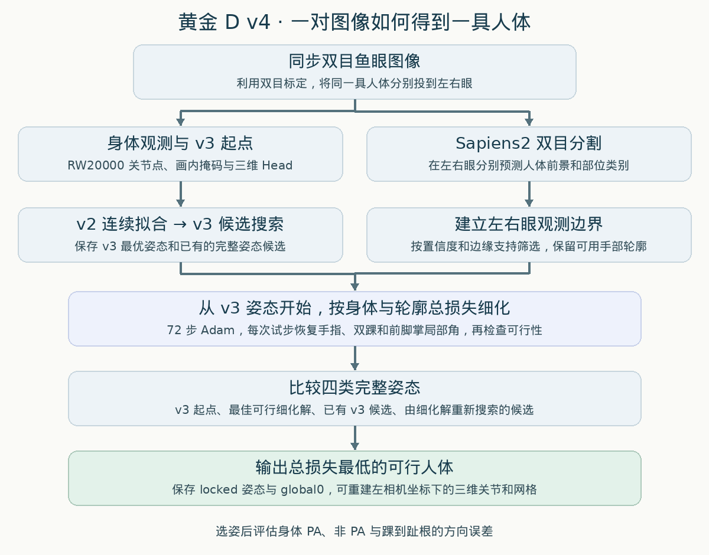

# 黄金 D v4 · 完整双目轮廓与固定手脚局部旋转

`golden-d-2d-v4` 是 DownSight 的默认单帧双目人体研究方法。左右眼共享同一具均值体型的 SMPL-X 人体。原黄金 D v3 提供身体起点，v4 用两眼的完整轮廓重新拟合。正式实验分支为 `locked`。[版本清单](../../../configs/golden_d.current.json) · [参考实现](../../../runs/2026-11-25_floor24_foot_lock/lock.py)

## 一对双目图像提供哪两类观测？

同一时刻的左、右两幅鱼眼图像各走两条路径。**关节点**给出肩、肘、腕、髋、膝、踝在画面上的位置，用来建立人体骨架的起点。**轮廓**给出人体和部分肢段在画面上占据的范围，用来调整这具人体的网格。左右眼观测始终约束同一套人体参数。[v3 身体拟合](../golden-d-v3/README.md) · [v4 分割输入](../../../runs/2026-11-25_validation200_fingers/segment.py)

| 路径 | 每眼提供什么 | 怎样参与拟合 |
|---|---|---|
| RW20000 身体检测 | 双侧肩、肘、腕、髋、膝、踝，最多 12 点 | 结合鱼眼内参、双目外参及有效点掩码，将预测的三维关节点投到各眼，计算重投影误差。参考实验另使用三维 Head 位置软约束。 |
| Sapiens2 部位分割 | 人体前景，以及左右手、前臂、上臂、大腿的可用边界 | 分别与当前网格在同一眼中的可见边界比较。“完整轮廓”保留整手及人体外缘；脚部可通过可见的前景边界参与。 |

双肩和双髋初始化根朝向，Head 初始化平移。v2 先在 20,000 步 Adam 预算内保留最佳可行解；v3 再试腕深度、肘膝弯曲方向和小幅躯干旋转。v4 接收 v3 选中的起始姿态，并保留原来的候选供最后复评。[v3 初始化与候选搜索](../golden-d-v3/README.md) · [v4 读取起点](../../../runs/2026-11-25_floor24_foot_lock/lock.py)

## 网格轮廓怎样变成损失？

**先提取图像边界。** 参考实现按原图每 4 个像素采一个样点。每眼独立筛选各通道，置信度至少为 0.55，可信区域至少有 12 个采样点，边界至少有 6 个采样点，才将该通道纳入比较。前景置信度取 1 减背景概率。这个筛选作用于轮廓，身体 12 点沿用各自的画内掩码。[观测筛选规则](../../../runs/2026-11-25_frozen100_outline/compare.py)

**再提取网格边界。** 把同一具 SMPL-X 网格变换到每只眼的相机坐标，用标定后的鱼眼射线找最先命中的三角面，由此得到该眼可见的前景和部位。对每个有效通道，分别计算“每个模型边界点到最近观测边界点”和“每个观测边界点到最近模型边界点”的距离。比如模型的手轮廓只盖住图里半只手，第二个方向仍能让遗漏的手缘产生代价。[可见面与双向距离](../../../runs/2026-11-24_two_stereo_contact/outline.py)

**两眼共同给姿态打分。** 每个最近邻距离在 64 个原图像素处截断。两个方向分别取平均后再等权平均，除以 12 像素得到归一化距离；先平均每眼的有效通道，再平均有效眼。某个通道有观测边界而模型在该眼看不到该部位时，该通道取截断上限。两项相加得到 v4 总损失。

$$
L_{v4}=L_{\mathrm{body}}+0.008\,L_{\mathrm{contour}}.
$$

身体项沿用 v3 的双目关节 Huber 重投影误差、Head 位置、姿态先验和正深度项。在手指固定为参考零局部角时，代码中的手指先验贡献为零。计算轮廓梯度时，用命中三角面的重心坐标确定表面点，再通过鱼眼投影将像素残差传回人体参数。[身体目标与优化](../../../runs/2026-11-24_two_stereo_contact/fit_probe.py) · [轮廓梯度](../../../runs/2026-11-24_two_stereo_contact/outline.py)

## 手脚固定后，哪些部位还能动？

v4 从 v3 姿态开始再做 **72 步 Adam**。每次尝试更新时，先对身体旋转施加角度限制，再把锁定关节的局部角恢复到该帧 v3 起点，随后检查可行性。程序保存这段轨迹中总损失最低的可行姿态，供最后选姿。[Adam 更新与可行性检查](../../../runs/2026-11-24_two_stereo_contact/fit_probe.py) · [手指锁定](../../../runs/2026-11-25_frozen100_fingers/fit.py) · [足部锁定](../../../runs/2026-11-25_floor24_foot_lock/lock.py)

| 参数 | v4 的处理 | 在渲染中意味着什么 |
|---|---|---|
| 双手共 30 个手指关节 | 从第一次轮廓更新起保持参考局部旋转，保留整手轮廓 | 手指屈伸固定，肩、肘、腕仍可带动整只手对准图像。 |
| 双踝、双前脚掌 | 固定相对父关节的旋转。零基 `body_pose` 索引依次为左踝 6、右踝 7、左前脚掌 9、右前脚掌 10 | 屈髋、屈膝仍可抬脚；足底高度和朝向随整条腿改变。 |
| 身体与根位姿 | 在约束内更新身体关节、根旋转修正和平移；颈与头保持原有局部旋转锁定，体型固定为均值 | 两眼看到的是同一具人体。参考输出保存左相机坐标下的位姿。 |

## 最终选的是哪一个姿态？

轮廓细化后，以最佳可行细化解为种子，再跑一次 v3 的四肢与躯干候选搜索。候选生成仍使用原搜索规则；到了最终选择，四类完整姿态统一使用 **v4 身体加轮廓总损失** 评分。

| 候选来源 | 在代码里的名称 |
|---|---|
| 原 v3 起点 | `v3` |
| 72 步轨迹中最佳可行姿态 | `adam` |
| 原 v3 搜索已保存的候选 | `v3_…` |
| 由细化解重新生成的候选 | `new_…` |

程序逐候选检查手脚局部角，保留满足身体可行性条件的姿态，选总分最低者。参考输出中，`locked` 保存 21 个身体局部轴角、根旋转修正、平移和 30 个手指局部轴角，`global0` 保存初始根朝向。用它们可重建三维关节和网格。PA、非 PA 和脚朝向误差在选姿结束后用官方标注计算。[候选与输出](../../../runs/2026-11-25_floor24_foot_lock/lock.py) · [重建与评分](../../../runs/2026-11-25_floor24_foot_lock/assess_feet.py)

## 参考结果

同一批 24 对按帧等权平均。身体 PA 是逐帧相似对齐后的 12 点平均误差，非 PA 直接在左相机坐标中计算。脚朝向单独比较每只脚从踝到趾根的方向，更容易看出身体 12 点止于踝时遗漏的变化。[逐帧证据](../../../runs/2026-11-25_floor24_foot_lock/evidence/results.json)

| 同一批 24 对 | 身体 PA（mm）↓ | 身体非 PA（mm）↓ | 脚朝向误差（°）↓ |
|---|---:|---:|---:|
| 完整轮廓，只固定手指（`current`） | 41.29 | 58.08 | 34.76 |
| 在上一行输出时复位脚部（`reset`） | 41.29 | 58.08 | 18.61 |
| **黄金 D v4，从第一步锁定并重拟合（`locked`）** | **41.30** | **58.08** | **18.32** |

例如 `pair028`，只固定手指时两脚平均方向误差为 81.4°，v4 为 33.4°；正侧视对照中可以看到脚尖下折和前脚掌上翘的变化。此前 100 对和 200 对的完整轮廓实验仅固定手指，500 对结果属于 v3。[pair028 三种设置，右列为 v4](../../../runs/2026-11-25_floor24_foot_lock/assets/pair028.jpg) · [24 对脚部近景](../../../runs/2026-11-25_floor24_foot_lock/report.md)

## 如何复核

开发机复现这 24 对可运行 `bash runs/2026-11-25_golden_d_v4/reproduce.sh`。入口读取当前清单，使用已封存的 v3 候选和 Sapiens2 分割概率，输出到本轮独立目录，再逐帧核对最终参数和选择。依赖资源及代码指纹见[复现核查](../../../runs/2026-11-25_golden_d_v4/report.md)。
