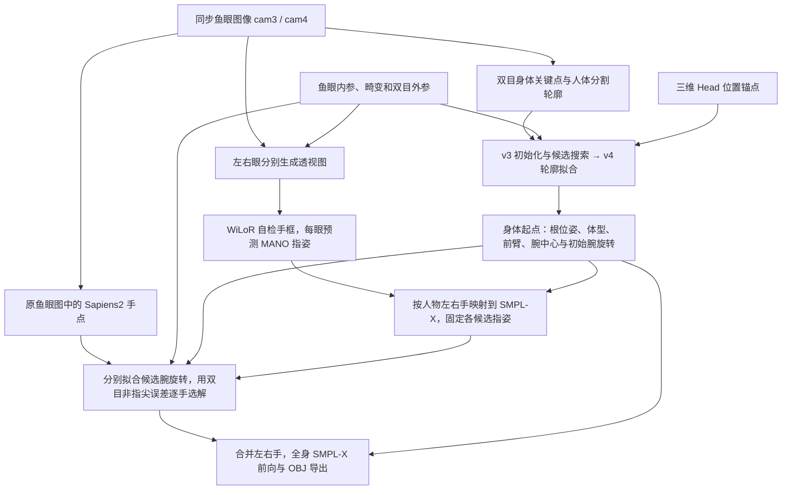

# 黄金 D v5 · 双目全身拟合与 WiLoR 手姿

**`golden-d-2d-v5` 是 DownSight 当前的单帧双目研究基线。** 身体阶段沿用 v4，得到共享的 SMPL-X 身体、前臂姿态和腕中心。手部阶段先将 WiLoR 的指节旋转映射到这具人体，再逐手求腕旋转，使固定手形贴合两眼观测。最终每帧输出一套全身参数，两眼渲染同一个网格。[v5 固定清单](../../../configs/golden_d.2d-v5.json) · [四段真实视频的渲染图集](../../../runs/2026-11-27_perspective_wrist_gallery/report.md)

## 架构



| 阶段 | 数据和决策 |
|---|---|
| 身体 | 左右肩髋初始化身体朝向，身体双目关键点与 Head 位置约束进入拟合，头随上胸。v4 再用完整轮廓细化身体；这一阶段固定手指、踝与前脚掌局部角。四帧回放读取当时实际使用的身体起点，来源见下文。[v4 身体架构](../golden-d-v4/README.md) |
| 单眼手形候选 | 两眼各自转换成标定的 640 × 480 透视图，WiLoR 用自己的检测框预测手姿。对每只手分别处理左右手镜像、中立掌部坐标及 SMPL-X 手姿均值，将每套 MANO 的 15 个局部旋转映射到 SMPL-X。身体体型和腕中心由身体阶段提供。[预测入口](../../../runs/2026-11-27_perspective_wrist_gallery/predict_new.py) · [模型映射与求解](../../../runs/2026-11-27_perspective_wrist_gallery/experiment.py) |
| 双目转腕 | 对每个候选保持指节角固定，只优化腕相对前臂的三维局部旋转。用真实鱼眼标定把关节投回每眼，和 Sapiens2 的非指尖点比较。五指各有三个可用关节，按画内范围和腕到指根尺度筛选；腕点用于筛选，五个指尖留作评估。鲁棒最小二乘的像素尺度为 6 px，腕偏离起始旋转的软约束尺度为 0.65 rad。 |
| 选解、输出 | 每个可用眼先平均其非指尖误差分数，再对可用眼等权平均。人物左、右手独立选择得分最低的候选，两只手可以选不同的相机。若某手缺少有效观测或 WiLoR 候选，沿用该手的输入姿态。最终写入左右腕和指节旋转，用全身 SMPL-X 层生成连续网格，OBJ 以 cam3 为坐标系，单位米。[独立手部入口](../../../runs/2026-11-27_wrist_only_default/wrist_only.py) |

**相对 v4 的变化发生在身体拟合完成之后。** 身体阶段给出起始腕向；最终腕向由每个已映射手形的双目投影决定。完整 B 的腕指联合优化是实验对照，运行 v5 可从已有身体起点直接进入手部步骤。[独立性核验](../../../runs/2026-11-27_wrist_only_default/report.md)

## 参考帧与渲染

001、002 使用归档的 v4 掌面细化起点；003、004 使用当时选定的全身平移和肩肘校正后的起点。每对图像内，v5 手部步骤相对该帧起点的身体主关节和腕中心最大位移为 0 mm。两组双目画内自动指尖 RMSE 分别为 17.89 px（40 个观测）和 17.23 px（33 个观测）。这些数字衡量二维贴合程度；真实样本的三维手指精度仍待独立真值验证。[逐手观测与结果](../../../runs/2026-11-27_perspective_wrist_gallery/evidence/results.json)

| 参考帧 | 全身正面与侧面 | 两角度的左右手 | 双目照片上的轮廓 |
|---|---|---|---|
| 001 | [全身](../../../runs/2026-11-27_perspective_wrist_gallery/assets/clip001_body.jpg) | [双手](../../../runs/2026-11-27_perspective_wrist_gallery/assets/clip001_hands.jpg) | [照片](../../../runs/2026-11-27_perspective_wrist_gallery/assets/clip001_photo.jpg) |
| 002 | [全身](../../../runs/2026-11-27_perspective_wrist_gallery/assets/clip002_body.jpg) | [双手](../../../runs/2026-11-27_perspective_wrist_gallery/assets/clip002_hands.jpg) | [照片](../../../runs/2026-11-27_perspective_wrist_gallery/assets/clip002_photo.jpg) |
| 003 | [全身](../../../runs/2026-11-27_perspective_wrist_gallery/assets/clip003_body.jpg) | [双手](../../../runs/2026-11-27_perspective_wrist_gallery/assets/clip003_hands.jpg) | [照片](../../../runs/2026-11-27_perspective_wrist_gallery/assets/clip003_photo.jpg) |
| 004 | [全身](../../../runs/2026-11-27_perspective_wrist_gallery/assets/clip004_body.jpg) | [双手](../../../runs/2026-11-27_perspective_wrist_gallery/assets/clip004_hands.jpg) | [照片](../../../runs/2026-11-27_perspective_wrist_gallery/assets/clip004_photo.jpg) |

图中 **WiLoR + wrist fit** 是 v5；**Full B** 是对照。照片上的绿线对应 v5，黄线对应 B。

## 开发机回放

在具有归档身体起点、检测缓存、标定和 SMPL-X 环境的开发机上，从仓库根目录执行：

```bash
bash runs/2026-11-27_golden_d_v5/replay.sh
```

入口核对身体与手部版本清单，在独立输出目录 `outputs/golden_d_v5_20261127/` 重新求腕、选候选，生成四份全身参数和 `export/` 下的 OBJ，再核对参考参数和网格指纹。新视频需要先准备同步帧及标定，完成身体拟合并取得 Sapiens2 观测和透视 WiLoR 候选。本次定版验证从归档输入到最终网格，原始视频冷启动和时序优化属于不同的验证范围。[回放证据](../../../runs/2026-11-27_golden_d_v5/evidence/verification.json)
