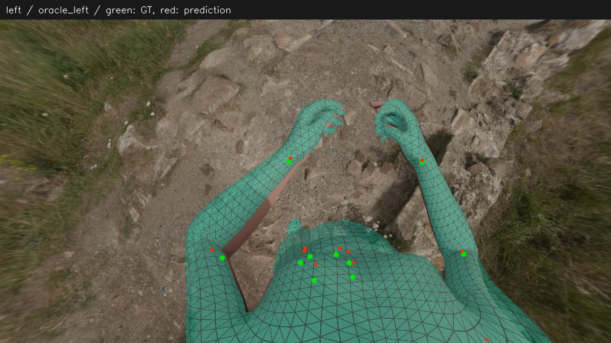
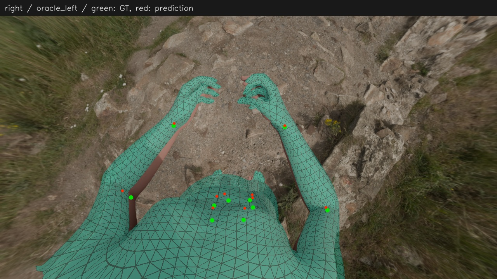

# 真值头部位姿＋双目共享人体＋受限体型优化

**定位：当前这一个合成样本上的身体拟合候选基线。** 本目录归档预先指定的主结果 `oracle_left`，用于方法审核、后续对照和消融。它没有接入默认流程，没有经过真实设备部署验证，也不是完整 MANO 融合后的端到端结果。

[主要改动与依据](METHOD.md) · [结果与对照](RESULTS.md) · [不足与适用边界](BOUNDARIES.md) · [代码、资产和复现说明](REPRODUCE.md) · [全部投影对比](../../runs/2026-11-08_synthetic-head-robustness/projection.md)

## 这一组具体是什么

- 同一合成姿态的 cam3/left、cam4/right，共享一套 SMPL-X 整体位姿、身体姿态和体型。
- 输入自动 Sapiens 身体点、WiLoR 二维手点和已知生成相机标定；将可靠匹配点三角化，按三维不确定度加权。
- 输入合成数据的 **Head 位置和朝向真值**作为软锚点。初始化仍来自网络预测和自动双目身体点，不使用头部真值对齐。
- 身体姿态、整体位姿、允许的体型方向同时优化。按预设局部信息近似，这对图保留一个体型方向，其余方向固定在模型均值。
- 不输入真值身体姿态、体型、身体关节点或轮廓作为拟合目标；它们用于拟合后的评测。模型均值先验与本样本零 beta 真值重合，是解释结果时必须考虑的优势条件。

方法、设置和数据来源固定于源提交 [`c4e2b9d`](https://github.com/cdh290718-oss/DownSight/commit/c4e2b9de76573139fa66cbb953bf973d2af88c77)。[manifest.json](manifest.json) 固定源代码、证据、图片及外部输入/输出的标识和 SHA-256；[settings.json](settings.json) 与实际运行配置逐字节一致。唯一拟合实现保留在[源 run](../../runs/2026-11-08_synthetic-head-robustness/)，本目录提供统一入口，不另存一份可能漂移的拟合器。本次整理没有重新运行实验。

## 主结果

| 指标 | oracle_left |
|---|---:|
| 身体 25 点绝对平均误差 | 35.51 mm |
| 骨盆绝对误差 | 42.14 mm |
| 双腕绝对平均误差 | 6.14 mm |
| 双肘绝对平均误差 | 22.68 mm |
| 手指 40 点绝对平均误差 | 20.97 mm |
| 中性体型网格平均顶点误差 | 5.68 mm |

上述三维关节指标均不做骨盆、旋转或尺度对齐；中性体型指标则统一中性姿态、各自减去骨盆位置，不做尺度匹配。完整精度、逐关节数值与源输出哈希见 [evidence/results.json](evidence/results.json)。

同一初始化、相同头部锚点的旧目标对照，身体误差为 57.99 mm；旧 D（真值体型）参考为 36.93 mm。前者支持整套新方法有收益，后者仅作不同设置下的参考。**不能据此说自动体型超过了真值体型，也不能说所有关节指标都最优。** 例如本组双肘误差仍高于旧 D 的 19.68 mm。

## 主结果投影

绿色为真值关节，红色为预测关节，半透明网格为预测。近相机平面或过大投影三角形会被渲染器略去，图片不能替代数值评测。

### cam3

### cam4

## 使用这个基线时的约定

后续比较应明确是否保留真值头部、相机标定、初始化、原关节增量范围、观测点和体型子空间。仅改变待验证因素；若一次改变多项，结论只属于整套方案。公开报告应保留主初值、另一初值、失败与异常，不按真值挑选更好的结果。现有运行及开发阶段失败记录均保留在源 run；[原 review](../../runs/2026-11-08_synthetic-head-robustness/review.md) 仍待 Claude 审核。
