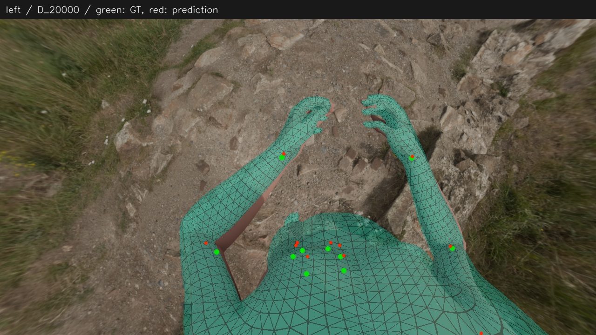
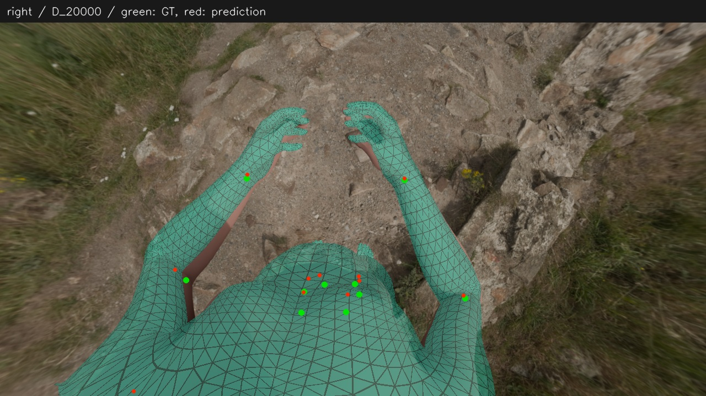

# 标准体型＋模板姿态＋双目三维目标＋真值头部锚点

**定位：不依赖 EgoSmplx 预测初值的身体拟合候选基线。** 本目录整理初始化消融的 **D组**，固定源提交 [`485fc71`](https://github.com/cdh290718-oss/DownSight/commit/485fc71ca37d3c68a74bf99338fe247c197bf6eb)。本组在当前合成样本上达到与同设置网络初值组相近的身体拟合效果；仍使用真值头部位姿和生成相机，不是可部署结果，也没有接入默认流程。

[方法与依据](METHOD.md) · [结果与对照](RESULTS.md) · [不足和边界](BOUNDARIES.md) · [代码与复现条件](REPRODUCE.md) · [全部投影和收敛曲线](../../runs/2026-11-09_initialization-ablation/projection.md)

## 本组身份

- 本目录的D是 `2026-11-09_initialization-ablation` 的标准体型/模板姿态组，**不是早期ABCD实验中使用真值体型的D组**。
- 初始体型为SMPL-X模型均值 `beta=0`，初始身体局部旋转全部为0；不读取EgoSmplx预测的体型、姿态、根位姿、手指或表情初值。
- 同一姿态的cam3/left、cam4/right共享一个人体，输入自动Sapiens身体点和WiLoR手点的双目三角化结果，以及完整真值Head位置和朝向。
- 标准体型只是起点，随后在相同的可观测体型子空间内优化；模板姿态也会优化。头部锚点用于初始对齐及优化中的软约束。
- 归档主结果为20000步预算内训练目标最小的可行检查点，实际选中第19960步。3400步等预算结果一并保留，不按真值误差选优。

[case.json](case.json) 固定D组身份，[settings.json](settings.json) 与实际执行配置逐字节相同，[manifest.json](manifest.json) 固定实现、证据、图片和外部输入/输出的SHA-256。拟合代码保留在[源run](../../runs/2026-11-09_initialization-ablation/)，本目录不复制另一套拟合器；改动本目录的设置不会自动改变源实现。本次归档没有重跑实验。

## A才是本组的直接对照

| 条件 | 初始体型/姿态 | 优化设置 |
|---|---|---|
| 本轮A | 网络体型、网络姿态 | 与D相同的共同目标、绝对旋转范围和固定手型 |
| 本轮D | 标准体型、零局部旋转模板 | 与A相同 |
| 上一轮旧配置 | 网络体型、网络姿态 | 围绕网络初值的先验、较紧的增量限制、固定网络手型；不是A |

因此，检验删除网络初值应比较相同预算下的A与D。旧配置的手指误差20.97 mm变成新配置约25.05 mm，不能解释为D删除网络初值导致手指退步：本轮A与D的手指误差几乎相同。旧配置仅作为另一方法配置的参考。

## 主结果

以下为相同20000步预算，除朝向外单位mm。关节指标为绝对三维误差，不作骨盆或尺度对齐。

| 指标 | A：网络初值 | D：模板初值 |
|---|---:|---:|
| 身体25点平均 | 36.12 | 35.97 |
| 骨盆 | 49.15 | 50.08 |
| 双膝 | 57.14 | 57.20 |
| 双踝 | 57.24 | 57.20 |
| 手指40点平均 | 25.05 | 25.05 |
| 中性体型网格 | 7.73 | 7.35 |
| 全网格绝对误差 | 19.88 | 19.11 |
| 22骨骼相机朝向平均误差（°） | 12.21 | 9.61 |

A和D预测的身体25点之间平均距离为0.91 mm。它们仍共同偏离真值，说明换起点没有消除骨盆、下肢的残差。完整精确数值和指标定义见[结果证据](evidence/results.json)及[结果说明](RESULTS.md)。

## D主结果投影

绿点是真值，红点是预测，网格为预测。部分跨相机平面或过长投影三角形由渲染器略去。关节点接近不代表轮廓、扭转、手指或自碰撞正确。

### cam3 / left

### cam4 / right

## 使用边界

当前只有一个合成姿态，真值体型恰好等于模型均值；D仍依赖真值Head和准确生成标定。D未通过预设的全部严格稳定性门槛，不能称为已证明充分收敛。手指未优化，足部缺少方向观测；保留SMPL-X后端和Sapiens/WiLoR检测器。后续应在更多姿态、非均值体型和扰动头部锚点下验证，再考虑替代网络初值。详见[边界](BOUNDARIES.md)。
