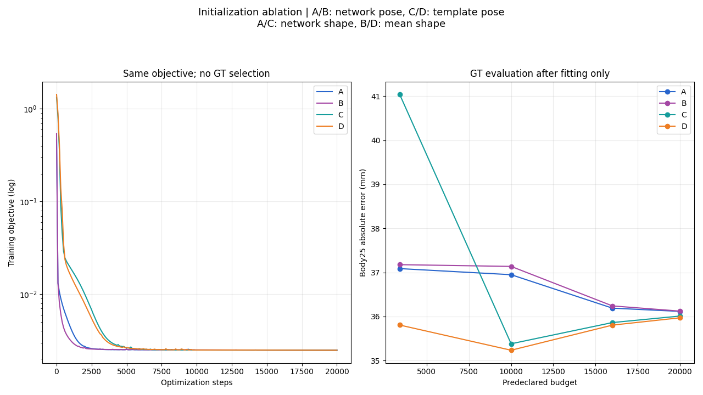
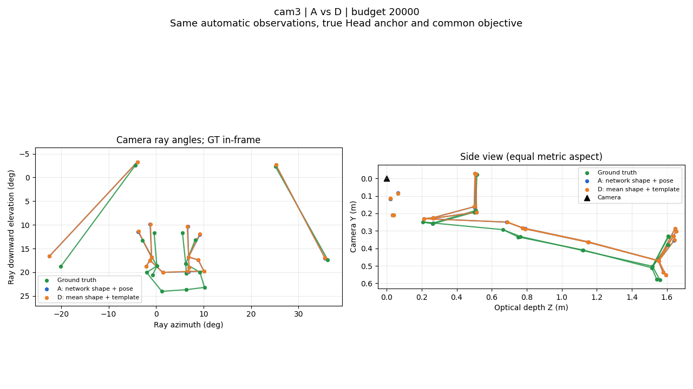

# D组结果与对照

[返回入口](README.md) · [精确证据](evidence/results.json) · [源逐关节结果](../../runs/2026-11-09_initialization-ablation/evidence/metrics.json)

身体25点包含头面和足部标志；身体目标12点单列。三维关节误差不作骨盆、旋转或尺度对齐；中性体型网格统一零姿态后各自减去骨盆。全网格误差按相机坐标系对应顶点直接计算，未作对齐。两目共享同一人体，cam4不是独立重复试验。

## 同设置A与D

| 条件 | 身体25点 mm | 目标12点 mm | 骨盆 mm | 双膝 mm | 双踝 mm | 双腕 mm | 手指40点 mm | 脚部6点 mm | 中性体型网格 mm |
|---|---:|---:|---:|---:|---:|---:|---:|---:|---:|
| A_3400 | 37.09 | 37.76 | 44.75 | 55.94 | 55.13 | 8.88 | 25.10 | 68.95 | 7.91 |
| D_3400 | 35.81 | 37.40 | 42.73 | 62.62 | 62.68 | 8.17 | 23.92 | 63.83 | 13.43 |
| A_20000 | 36.12 | 38.75 | 49.15 | 57.14 | 57.24 | 8.90 | 25.05 | 60.40 | 7.73 |
| D_20000 | 35.97 | 38.76 | 50.08 | 57.20 | 57.20 | 8.90 | 25.05 | 59.97 | 7.35 |

A为相同优化设置的网络初值直接对照。主预算下A/D身体误差相近，手指误差几乎相同；去掉网络初值没有在该样本上造成明显退步，但也没有消除共同的骨盆与下肢偏差。此结果不构成多样本统计等效性或可部署性证明。

## D的预定预算轨迹

| 预算步数 | 训练选中步 | 身体25点 mm | 中性体型网格 mm | 全网格 mm | 22骨骼朝向平均误差 ° |
|---|---:|---:|---:|---:|---:|
| 3400 | 3400 | 35.8073 | 13.4325 | 18.3862 | 11.5338 |
| 10000 | 9920 | 35.2356 | 8.2201 | 18.5430 | 9.7517 |
| 16000 | 16000 | 35.8056 | 7.5404 | 19.0026 | 9.6164 |
| 20000 | 19960 | 35.9713 | 7.3486 | 19.1148 | 9.6108 |

10000步的GT身体误差比20000步更低，但不能按GT选它作部署停止点。主结果保留预先声明的20000步预算内训练目标最小可行检查点。模板体型最初就是该样本的真实体型，后优化却产生形状误差，说明初值正确也不能保证目标和先验最终恢复正确形状。

## 上一轮旧配置：仅作方法参考

| 指标 | 旧配置，3400步 | 本轮D，20000步 |
|---|---:|---:|
| 身体25点 mm | 35.51 | 35.97 |
| 手指40点 mm | 20.97 | 25.05 |
| 中性体型网格 mm | 5.68 | 7.35 |
| 全网格 mm | 17.84 | 19.11 |

**旧配置不是本轮A。** 旧配置使用围绕网络初值的姿态先验、较紧的增量限制和固定网络手型；本轮A/D共用另一套先验、较宽范围和固定模型手型。上述跨配置、跨预算比较不能用于归因删除网络初值的影响。D没有整体超过这份旧配置的质量。

## 稳定性与审核

D最后1000步loss相对变化为 0.000204379，目标关节最大位移 0.110247888 mm，预设稳定性标志为 `False`。具体门槛及解释见[边界](BOUNDARIES.md)。源拟合数值重建、独立损失重算、输入读取隔离等检查通过；它们不替代独立review，也不证明全局最优。

