# 双目网格投影索引

每张图上半是 cam2、下半是 cam3；每一目中左侧为 v0，右侧为二阶段，并各有左右手相同区域的放大图。青色是可见网格、洋红色是可见头部；绿色是 DFM 手臂和 21 点骨架（模型参考，不是真值）；橙色圈是自动 Sapiens 腕点，蓝点是已匹配并通过上轮二维筛选的 WiLoR 手点。WiLoR 点在 v0 图上也显示，便于对照；v0 拟合并未使用它们。

cam3 单目蓝点仅表示自动观测被选中；上一轮手部阶段使用的是 cam2 二维和有效双目三维，只有 cam3 点并不等于该手参与拟合。放大图以 DFM 手部参考为中心；画外或严重偏离的预测可能不在局部裁剪内，应同时看全图。

相机的网格自身遮挡用逐像素射线与三角面交点深度缓冲处理；场景遮挡仅使用部分通过左右一致性检查的双目深度估计（4 cm 保护裕量），并不覆盖所有像素，也可能误判。DFM 骨架与自动点作为参考标记不进行遮挡剔除。

腕为与 DFM 的三维欧氏距离；手部为相对于各自腕部的 21 点三维平均距离；掌面角为与 DFM 的角度差。单位分别为 cm、cm、度。数值来自上一轮的逐帧证据，本轮不重算指标或改变拟合。

| 帧 | 选择理由 | 腕 L / R cm | 手部 v0 L / R → 二阶段 L / R cm | 掌面角 v0 L / R → 二阶段 L / R ° |
|---|---|---:|---:|---:|
| [00270](comparisons/frame_00270.jpg) | 右腕在 cam2 画外（指定帧） | 2.43 / 50.72 | 8.09 / 7.31 → 3.64 / 7.31 | 77.16 / 133.54 → 23.86 / 133.54 |
| [03060](comparisons/frame_03060.jpg) | 双手最近 DFM 参考点距 <5 cm（探索性分组） | 1.46 / 1.76 | 6.77 / 4.36 → 8.03 / 3.43 | 89.79 / 24.33 → 72.77 / 35.43 |
| [04770](comparisons/frame_04770.jpg) | 左手无可用 cam2 二维或双目三维手点；按双腕最大误差取中位 | 2.70 / 2.70 | 6.04 / 2.87 → 6.05 / 4.22 | 94.17 / 36.91 → 94.17 / 41.71 |
| [00540](comparisons/frame_00540.jpg) | 双腕最大误差按升序约 1% 分位（好） | 1.06 / 1.25 | 5.06 / 7.27 → 5.07 / 2.67 | 96.87 / 93.46 → 96.87 / 12.45 |
| [04680](comparisons/frame_04680.jpg) | 双腕最大误差按升序约 3% 分位（好） | 1.32 / 1.44 | 5.58 / 3.17 → 3.59 / 1.62 | 120.97 / 60.98 → 55.06 / 13.58 |
| [05100](comparisons/frame_05100.jpg) | 双腕最大误差按升序约 5% 分位（好） | 1.37 / 1.50 | 5.74 / 5.47 → 3.66 / 1.79 | 114.42 / 35.33 → 20.17 / 14.76 |
| [04710](comparisons/frame_04710.jpg) | 双腕最大误差按升序约 45% 分位（中） | 2.38 / 1.19 | 5.38 / 3.00 → 4.38 / 1.92 | 90.88 / 46.40 → 35.87 / 22.29 |
| [00870](comparisons/frame_00870.jpg) | 双腕最大误差按升序约 50% 分位（中） | 2.33 / 2.52 | 6.06 / 5.36 → 6.65 / 1.82 | 101.55 / 44.03 → 68.99 / 16.93 |
| [04320](comparisons/frame_04320.jpg) | 双腕最大误差按升序约 55% 分位（中） | 2.70 / 1.46 | 5.35 / 4.03 → 5.36 / 2.28 | 92.93 / 43.97 → 92.93 / 15.31 |
| [00300](comparisons/frame_00300.jpg) | 双腕最大误差按升序约 99% 分位（差） | 2.25 / 36.61 | 6.92 / 15.81 → 3.17 / 15.81 | 96.01 / 178.11 → 18.56 / 178.11 |
| [00150](comparisons/frame_00150.jpg) | 双腕最大误差按升序约 97% 分位（差） | 20.07 / 13.57 | 15.03 / 11.24 → 15.03 / 11.24 | 136.80 / 111.91 → 136.80 / 111.91 |
| [00240](comparisons/frame_00240.jpg) | 双腕最大误差按升序约 95% 分位（差） | 7.84 / 1.68 | 7.60 / 5.50 → 2.11 / 2.90 | 90.39 / 28.16 → 8.65 / 25.56 |

## 图像

### 00270：右腕在 cam2 画外（指定帧）

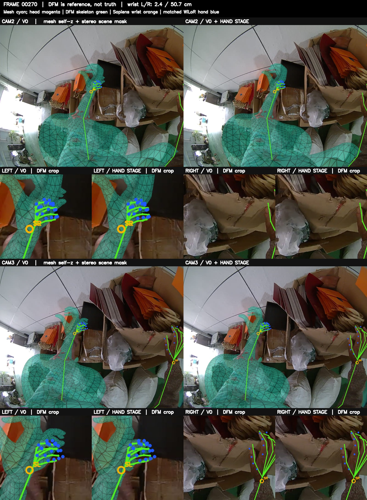

### 03060：双手最近 DFM 参考点距 <5 cm（探索性分组）

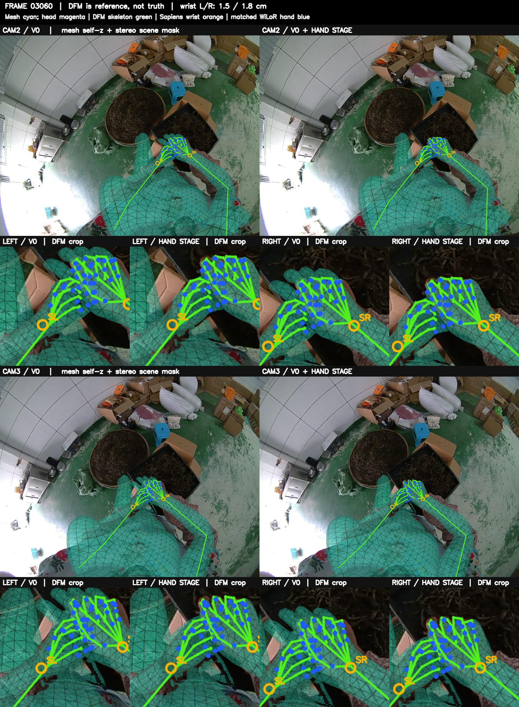

### 04770：左手无可用 cam2 二维或双目三维手点；按双腕最大误差取中位

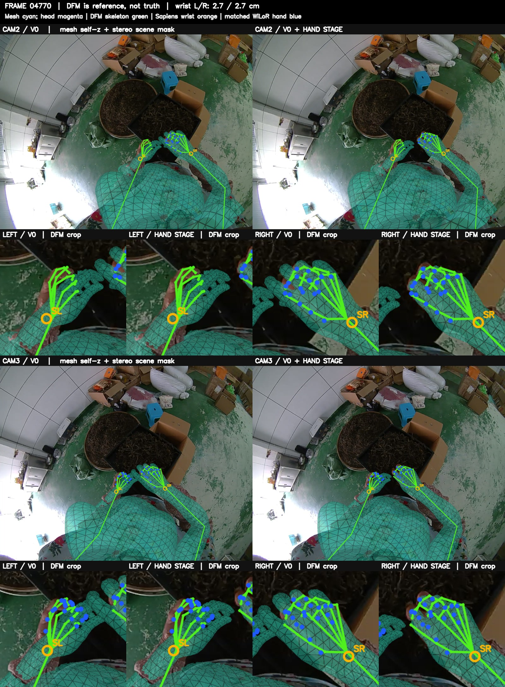

### 00540：双腕最大误差按升序约 1% 分位（好）

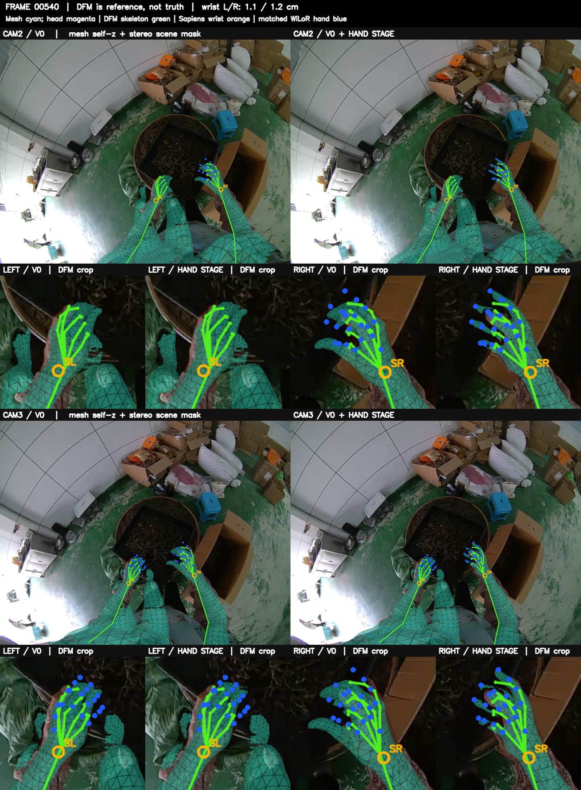

### 04680：双腕最大误差按升序约 3% 分位（好）

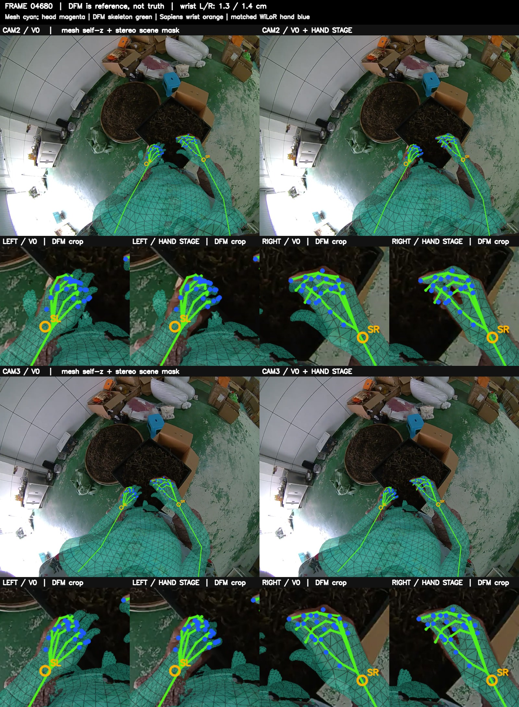

### 05100：双腕最大误差按升序约 5% 分位（好）

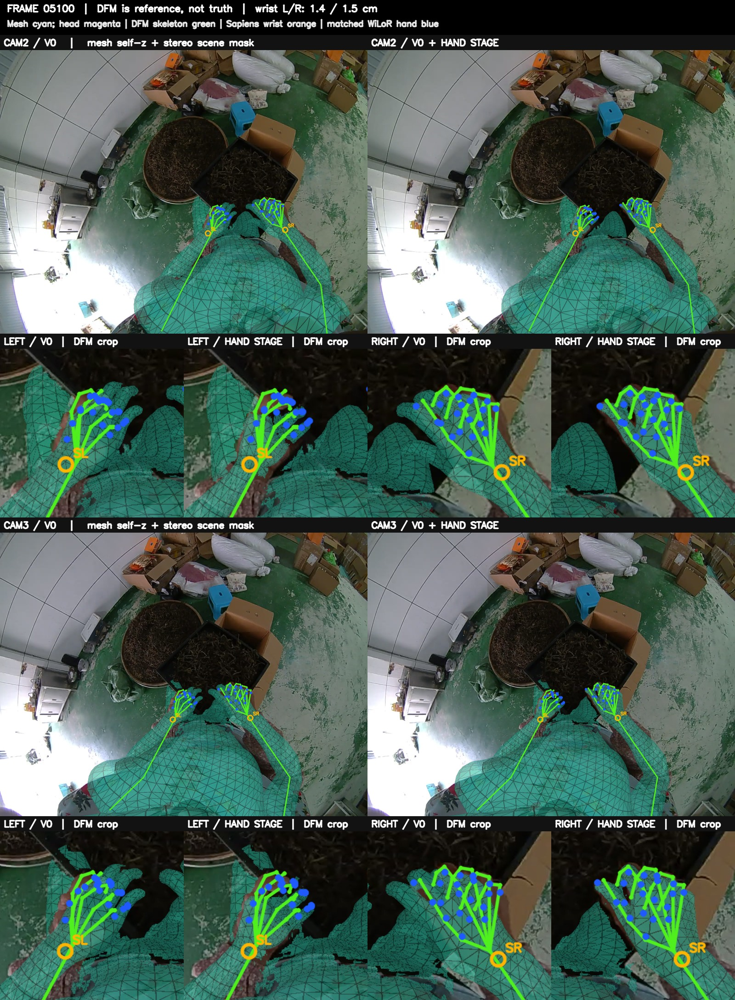

### 04710：双腕最大误差按升序约 45% 分位（中）

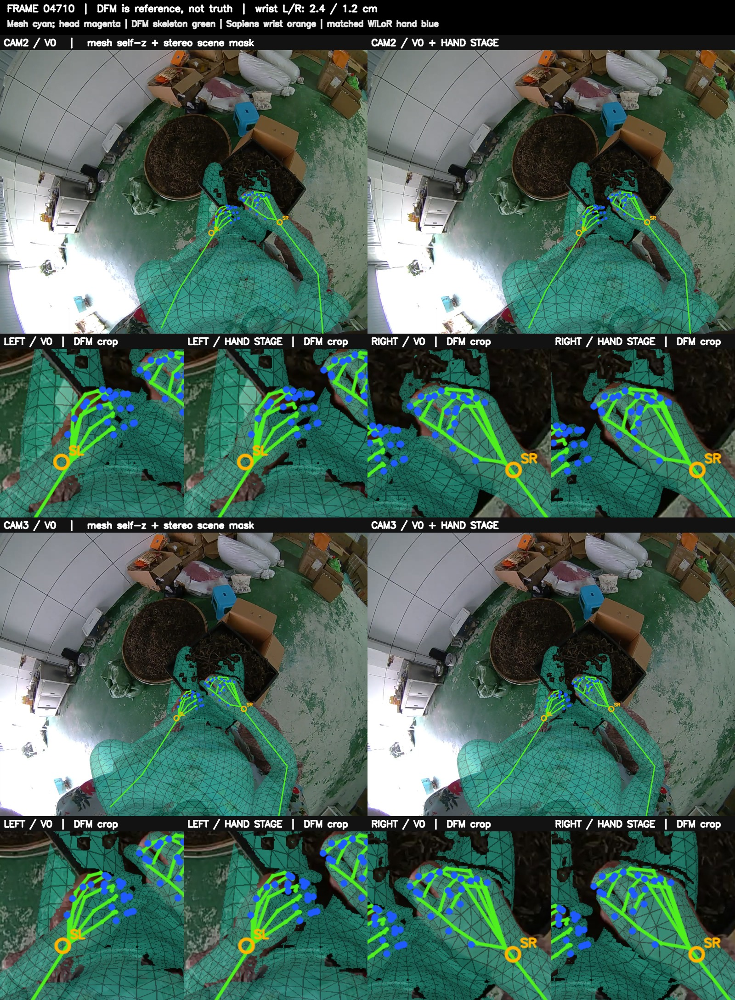

### 00870：双腕最大误差按升序约 50% 分位（中）

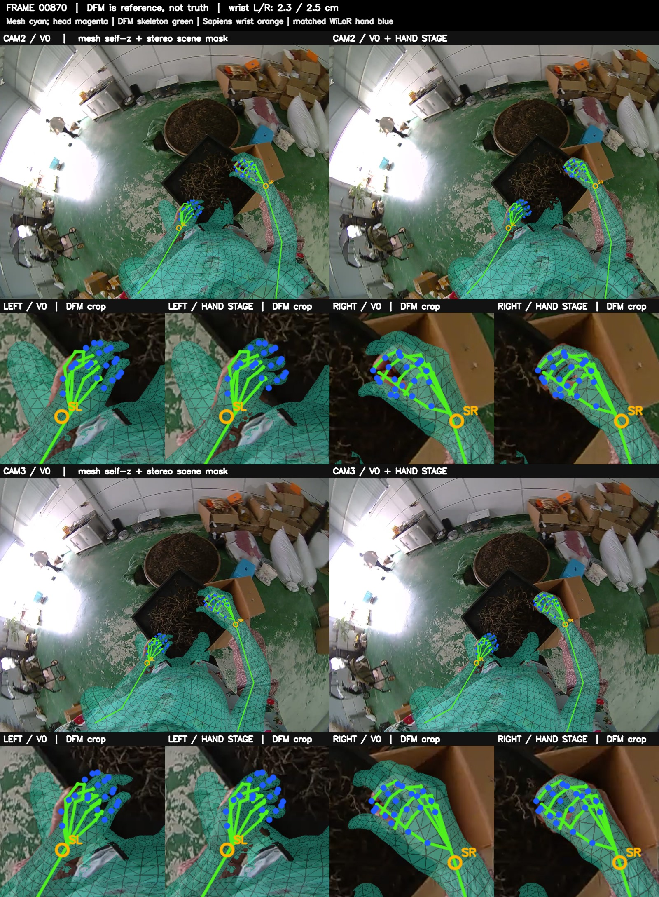

### 04320：双腕最大误差按升序约 55% 分位（中）

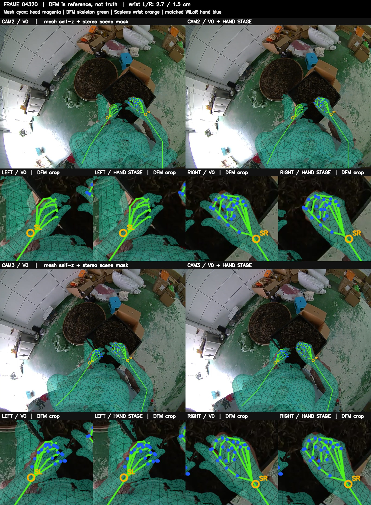

### 00300：双腕最大误差按升序约 99% 分位（差）

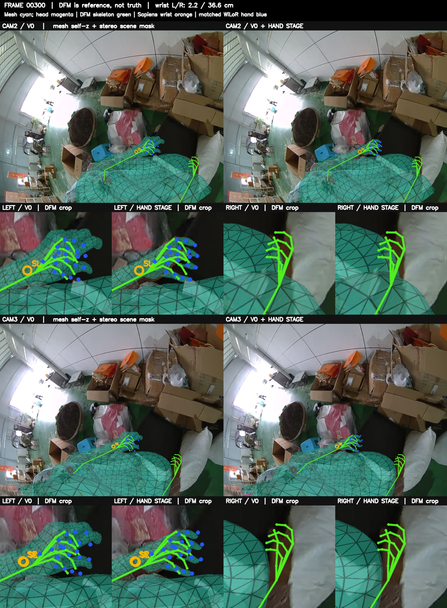

### 00150：双腕最大误差按升序约 97% 分位（差）

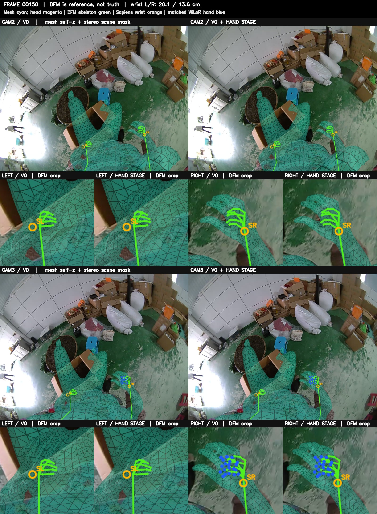

### 00240：双腕最大误差按升序约 95% 分位（差）

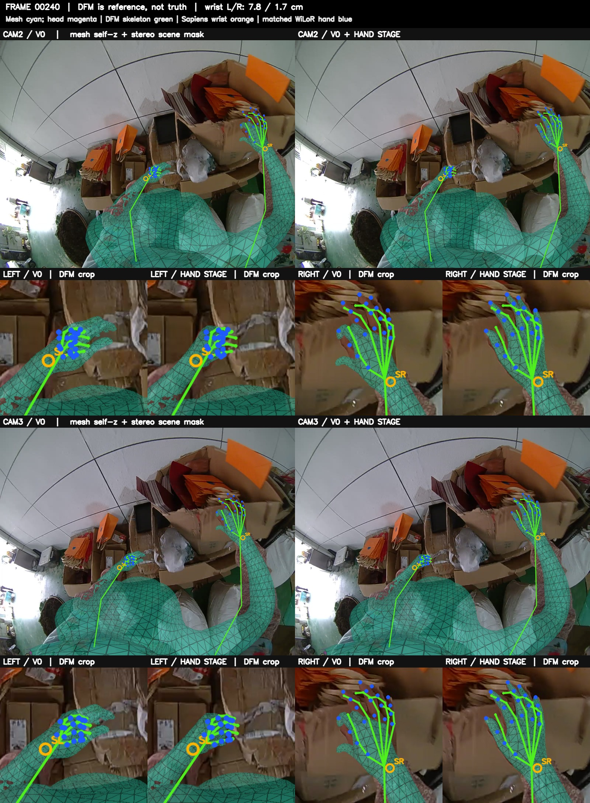
