# 真值头部锚点：投影比较

绿色点为真值关节，红点为预测；青色为身体网格，紫色为头部。新结果是身体阶段的 SMPL-X 网格；原最终图含 MANO 替换。所有图统一采用真值 Brown–Conrady 投影。近面交叉或过长三角形会被省略，不能把显示缺口解释为模型本身有孔洞。

[数值报告](report.md)

## left

| 原身体姿态阶段 | 头部锚点＋交替优化 |
|---|---|
| 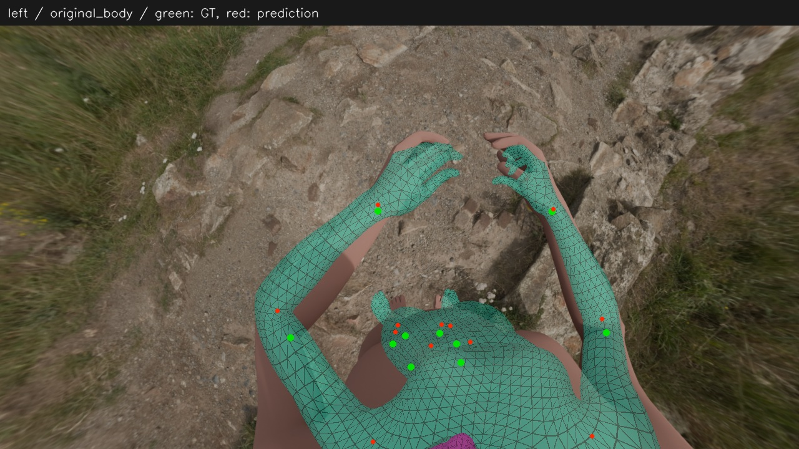 | 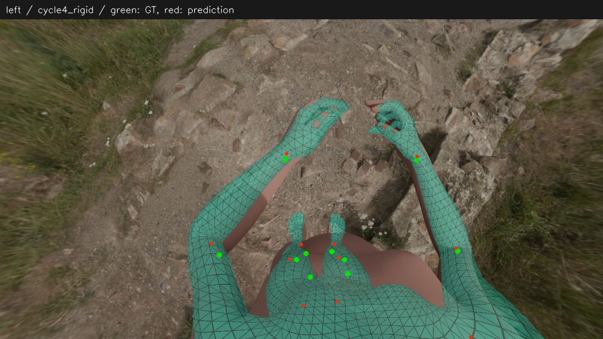 |

真值

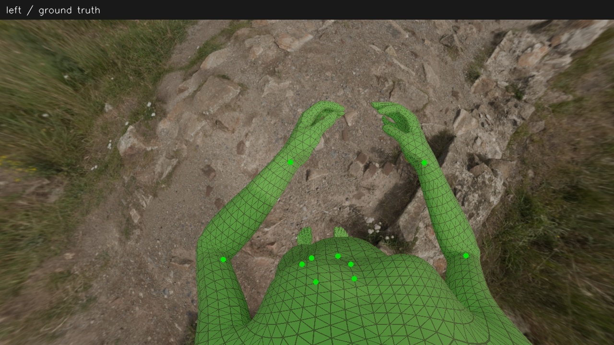

原刚体

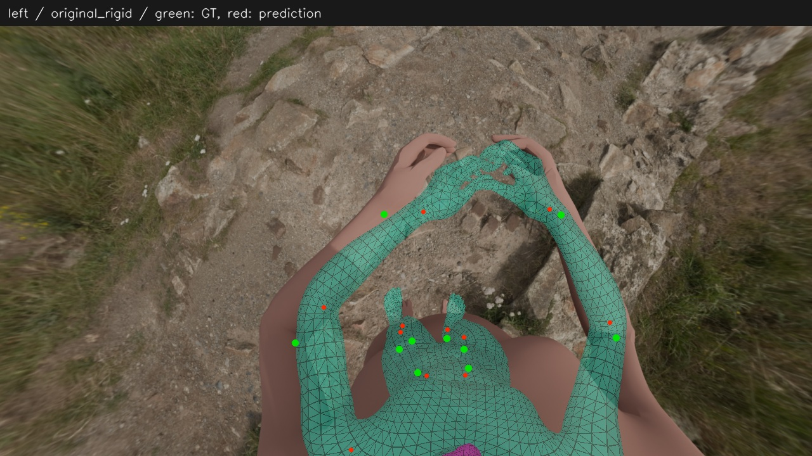

仅加头锚点的刚体

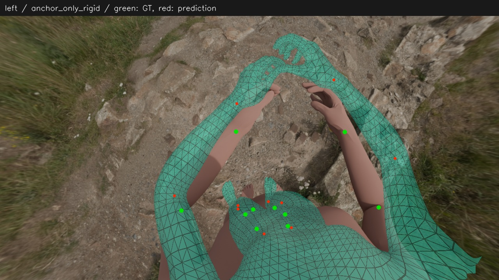

完整修改的刚体

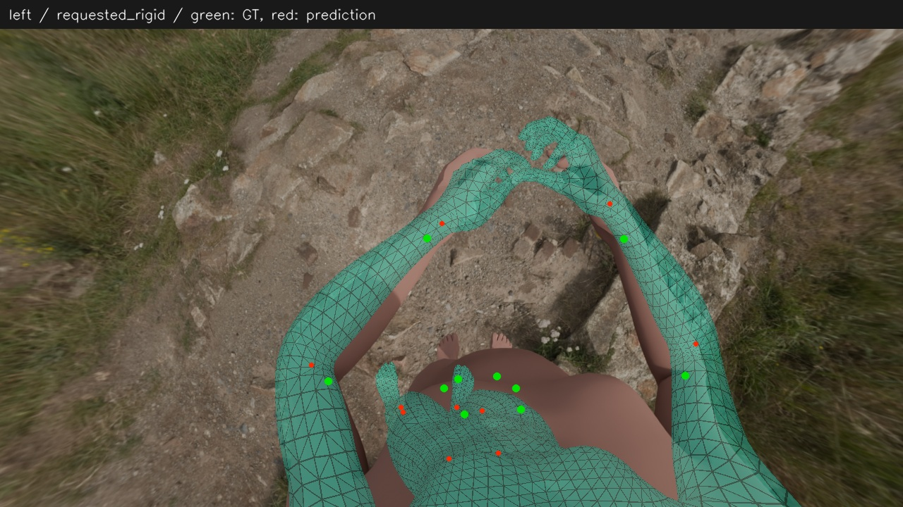

原最终（含 MANO）

## right

| 原身体姿态阶段 | 头部锚点＋交替优化 |
|---|---|
| 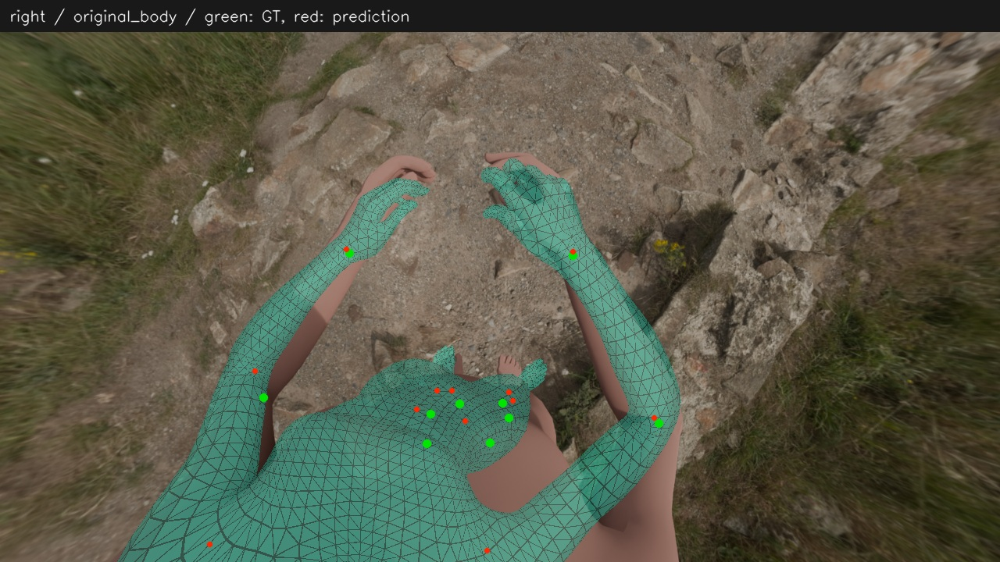 | 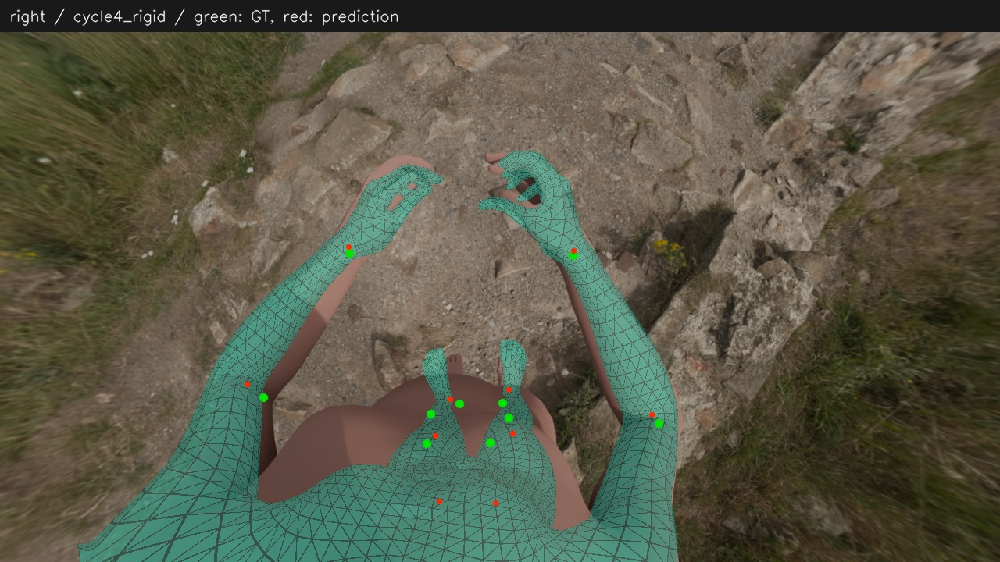 |

真值

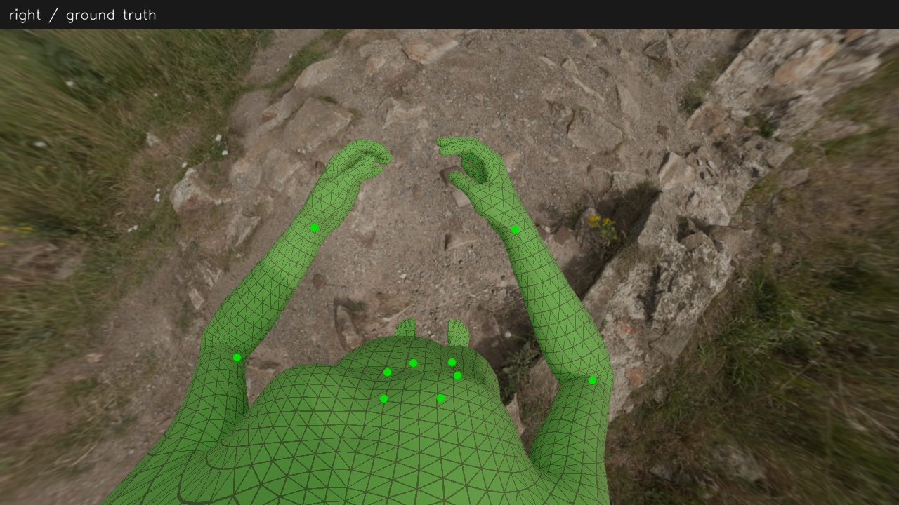

原刚体

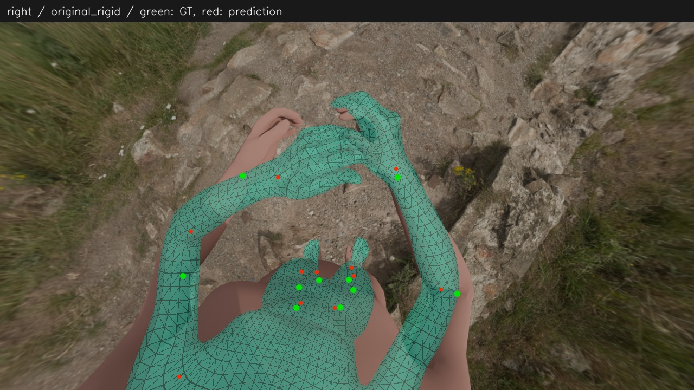

仅加头锚点的刚体

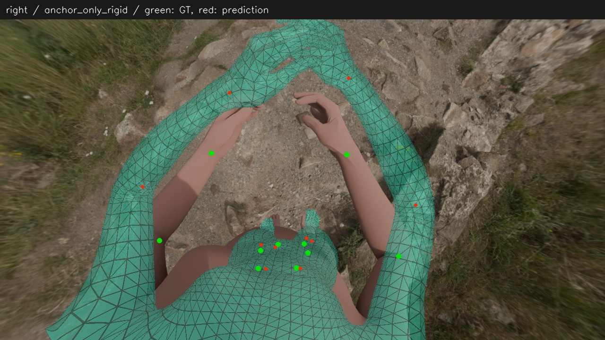

完整修改的刚体

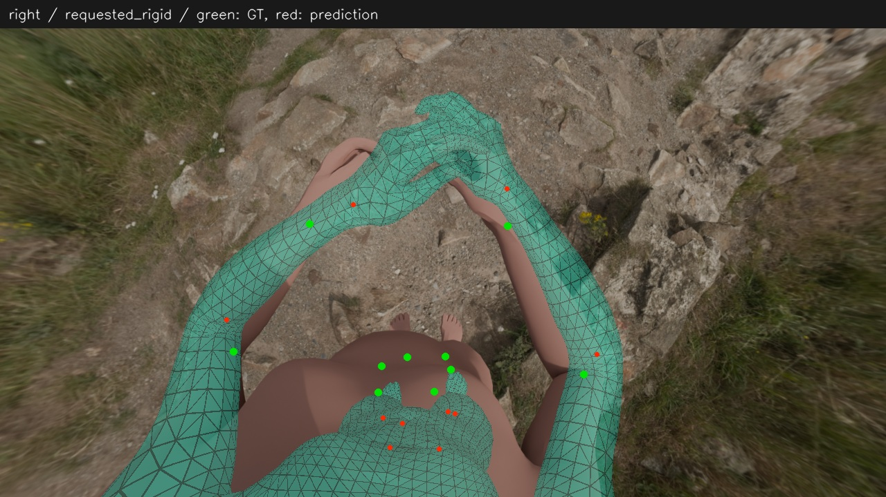

原最终（含 MANO）

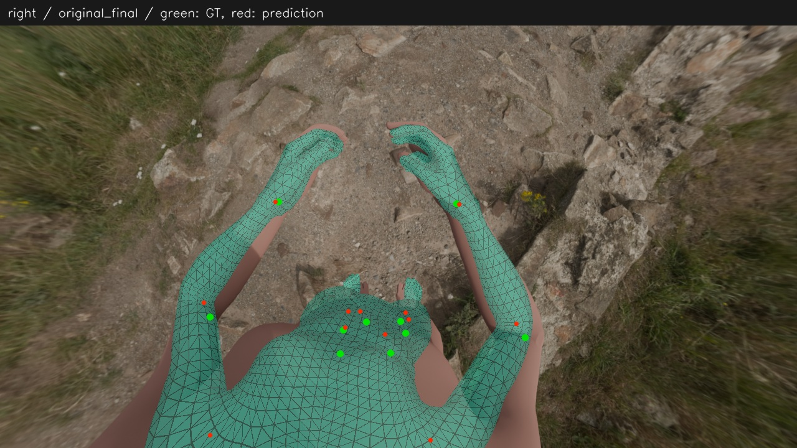
