# 完整头部位姿＋躯干轮廓：投影比较

[数值报告](report.md)

绿色点是真值，红点是预测；青色是身体，紫色是头部。显示统一使用真值 Brown–Conrady 相机，近面交叉或过长的三角形省略。新结果未做 MANO 手替换。

## left

实际 Sapiens 轮廓候选（腿部未启用）

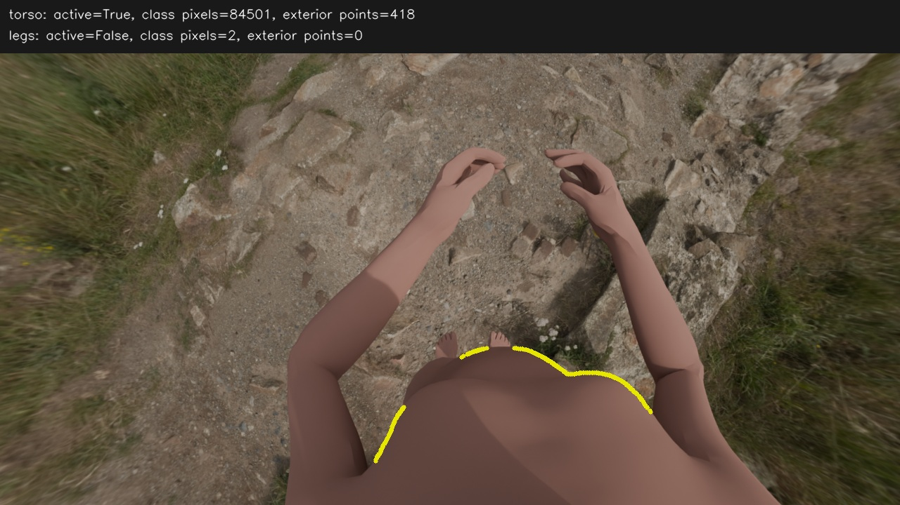

| 上轮位置＋交替 | 本轮完整位姿＋轮廓联合优化 |
|---|---|
| 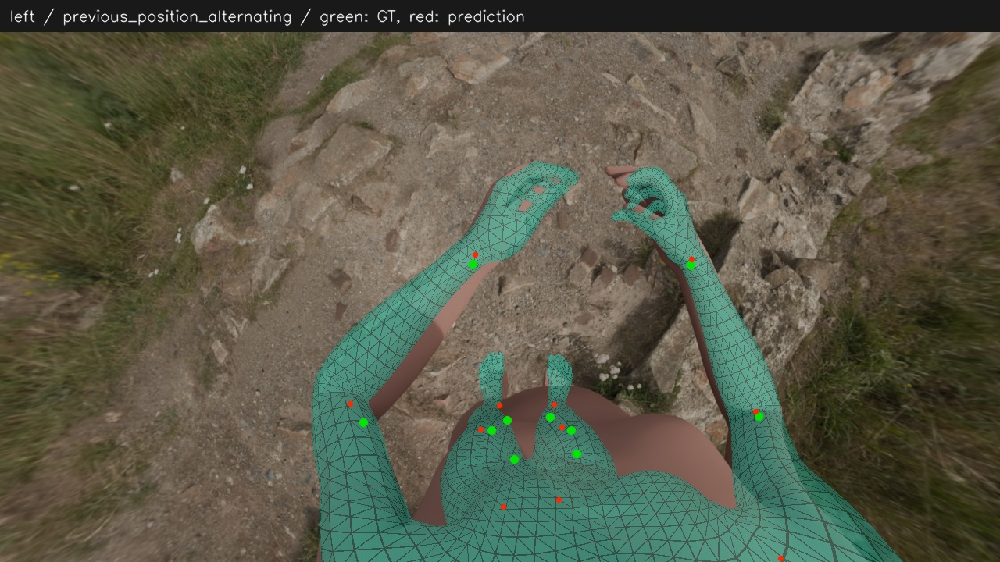 |  |

完整位姿但无轮廓对照

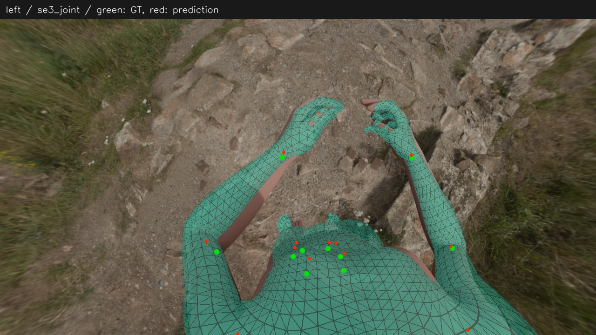

原最终（含 MANO）

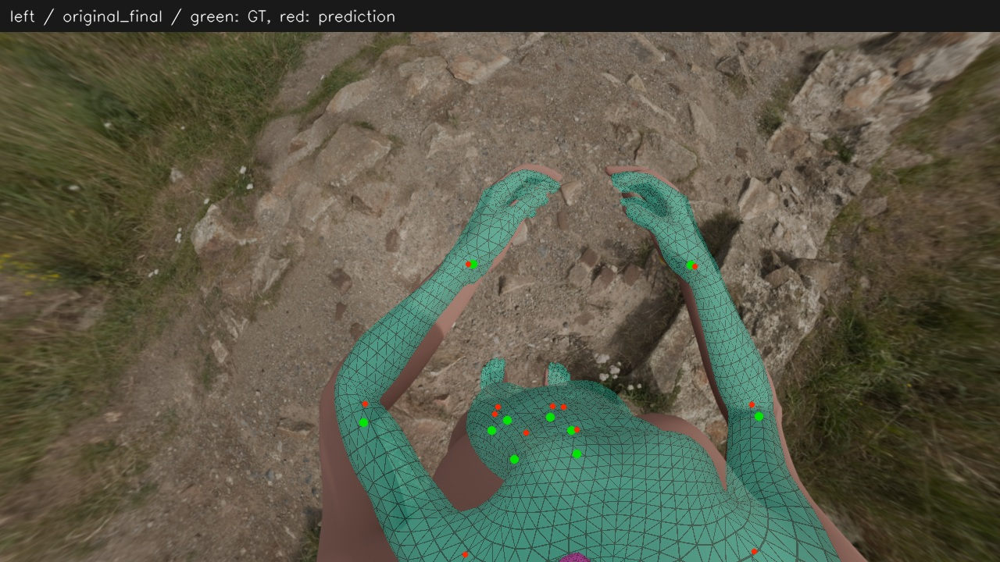

真值

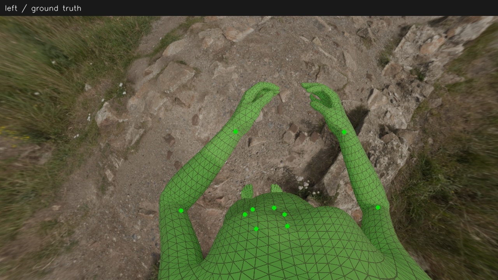

## right

实际 Sapiens 轮廓候选（腿部未启用）

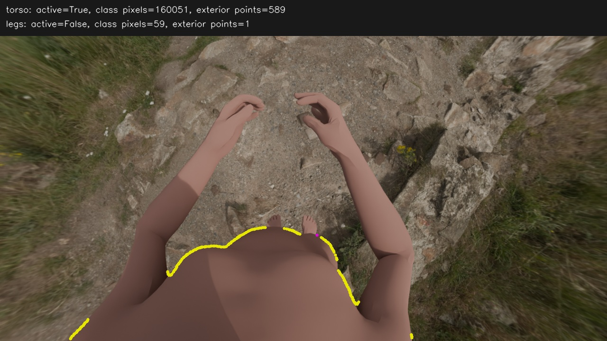

| 上轮位置＋交替 | 本轮完整位姿＋轮廓联合优化 |
|---|---|
| 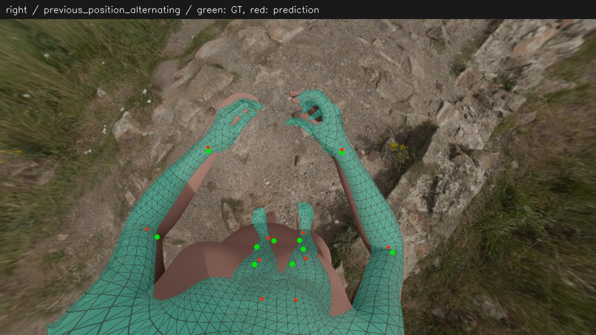 | 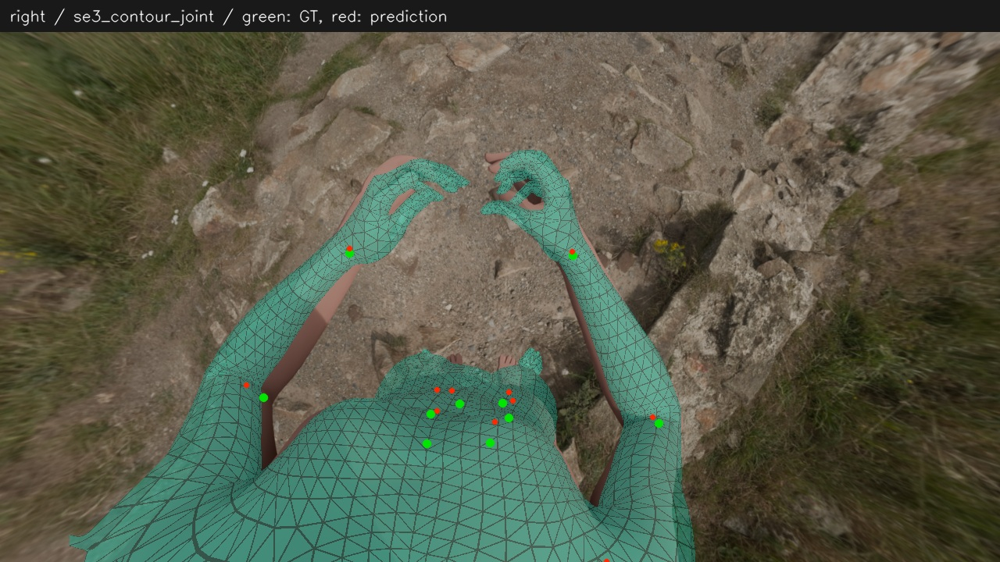 |

完整位姿但无轮廓对照

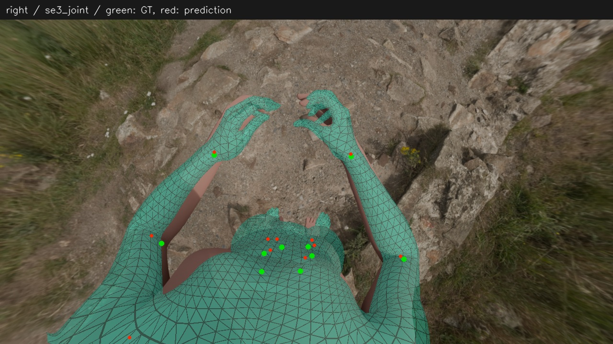

原最终（含 MANO）

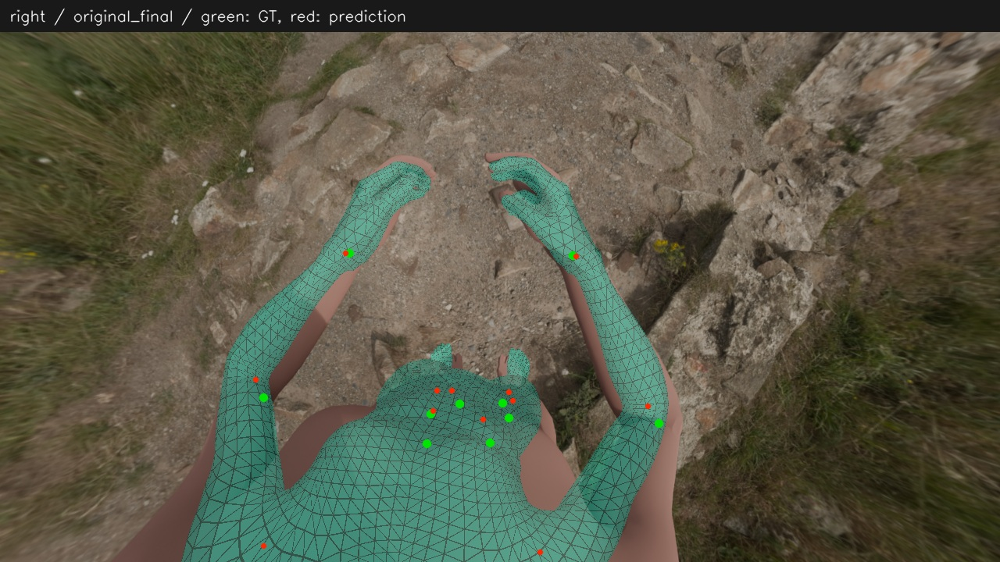

真值

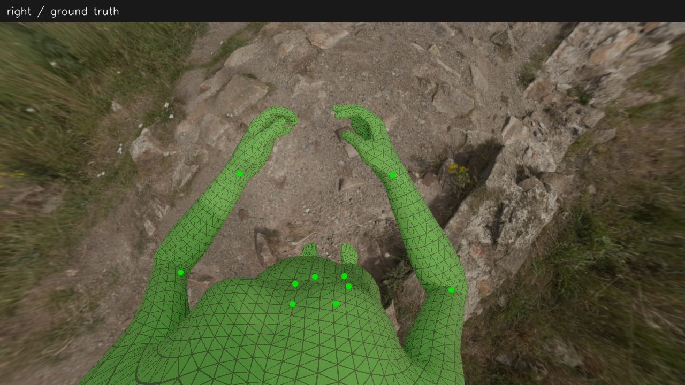
