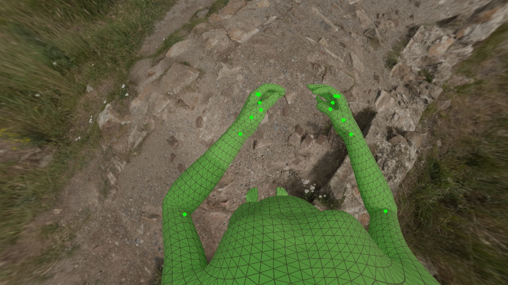
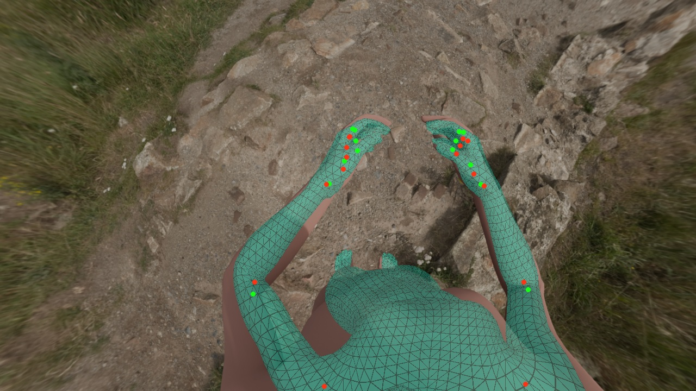
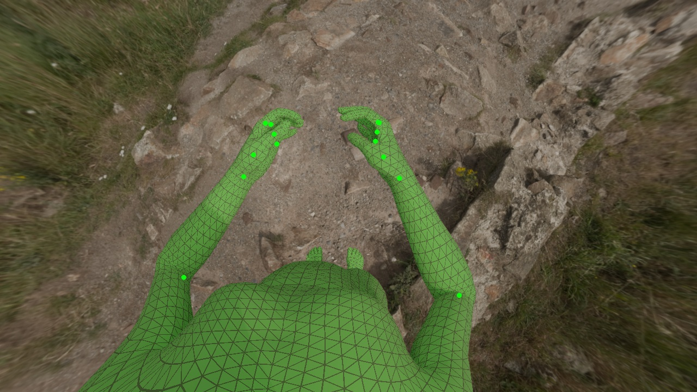
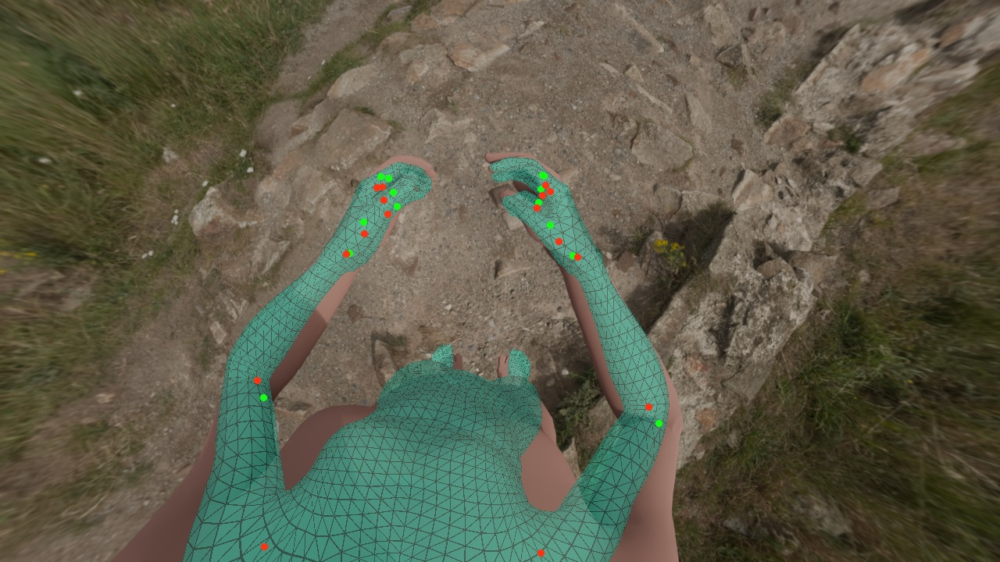

# 合成真值与原流程投影

同一姿态、左右相机。左列为合成真值网格（绿色）；右列为原流程预测网格（青色）。绿色点为真值，红色点为预测；点只显示部分上肢和手指关节。真值投影采用渲染的 Brown–Conrady 模型，预测网格采用原流程多项式模型。网格采用近似逐像素深度测试处理自身遮挡，未模拟环境遮挡；跨镜头或投影过长的三角形被过滤。入画关节点不等于无遮挡。

## cam3 / left

| 合成真值 | 原流程预测 |
|---|---|
|  |  |

## cam4 / right

| 合成真值 | 原流程预测 |
|---|---|
|  |  |

[返回报告](report.md)
