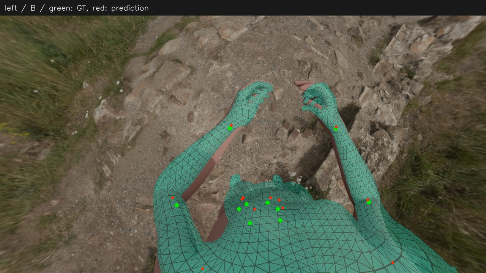
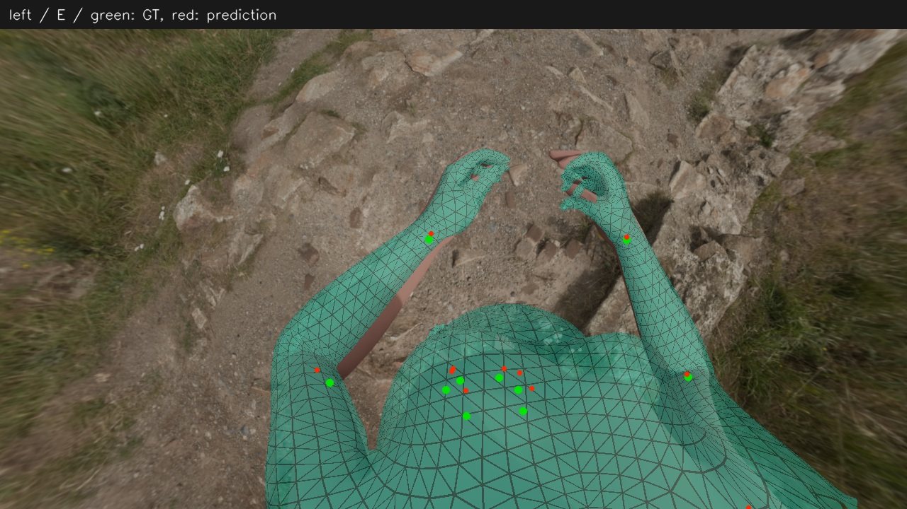
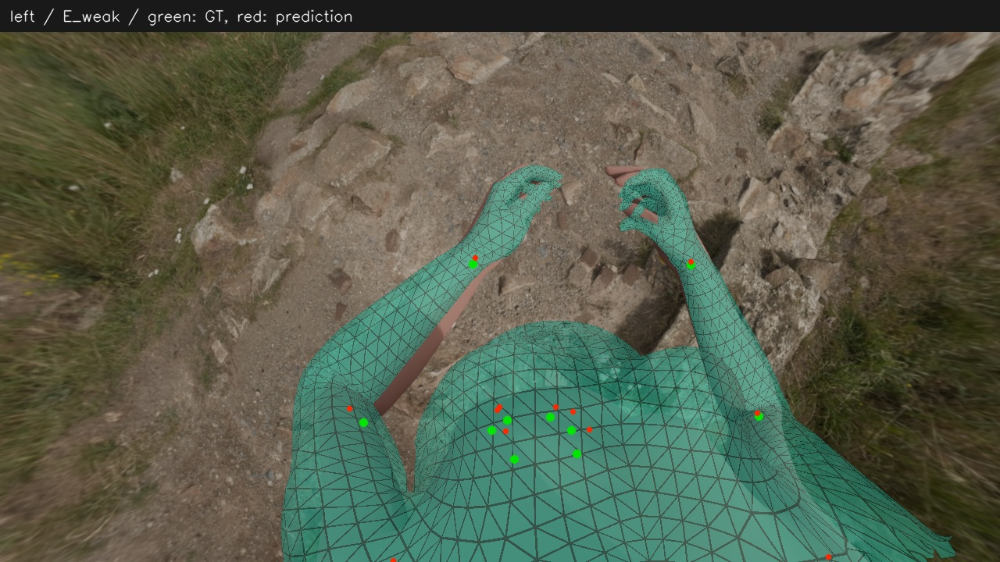
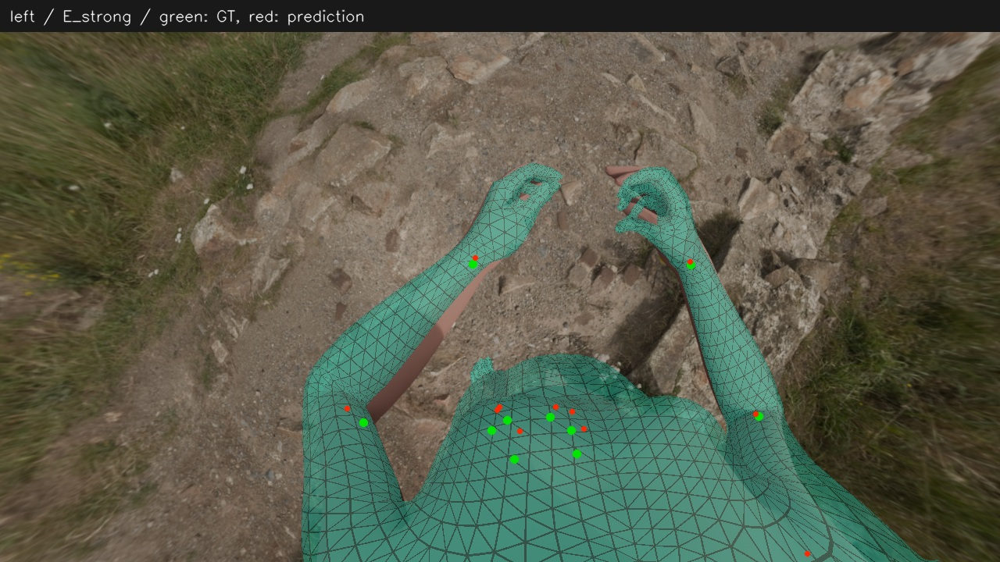
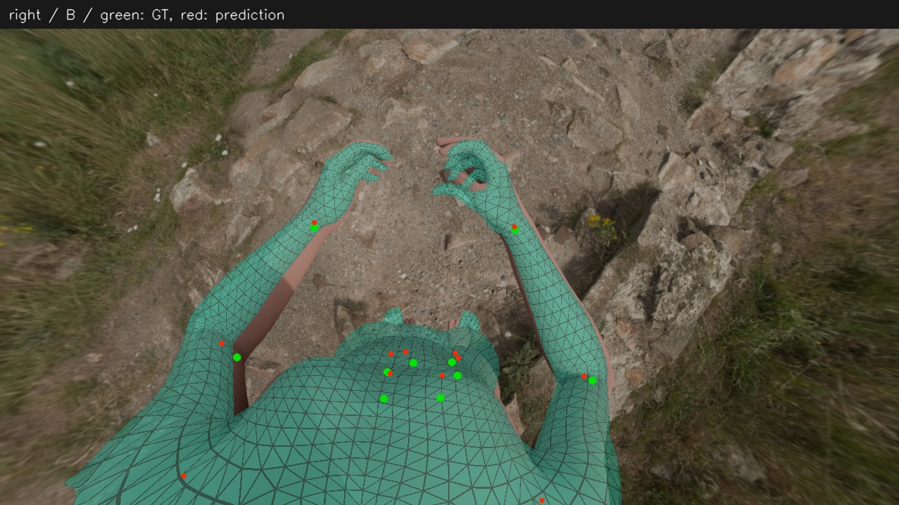
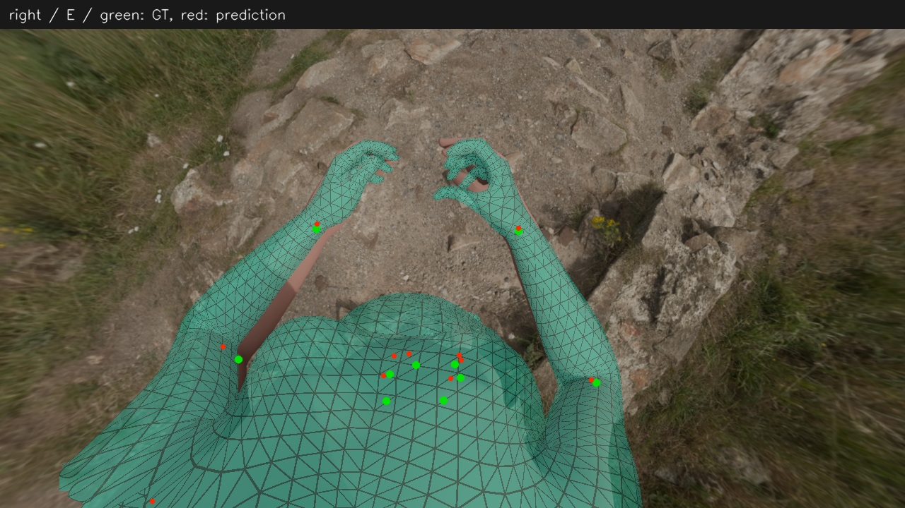
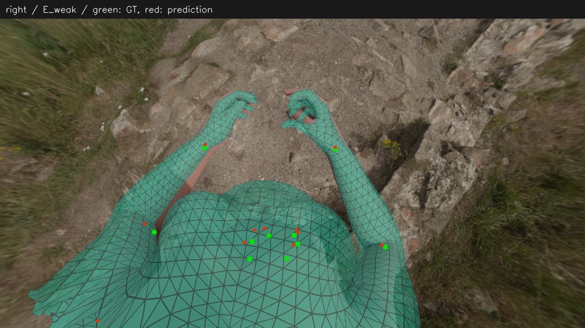
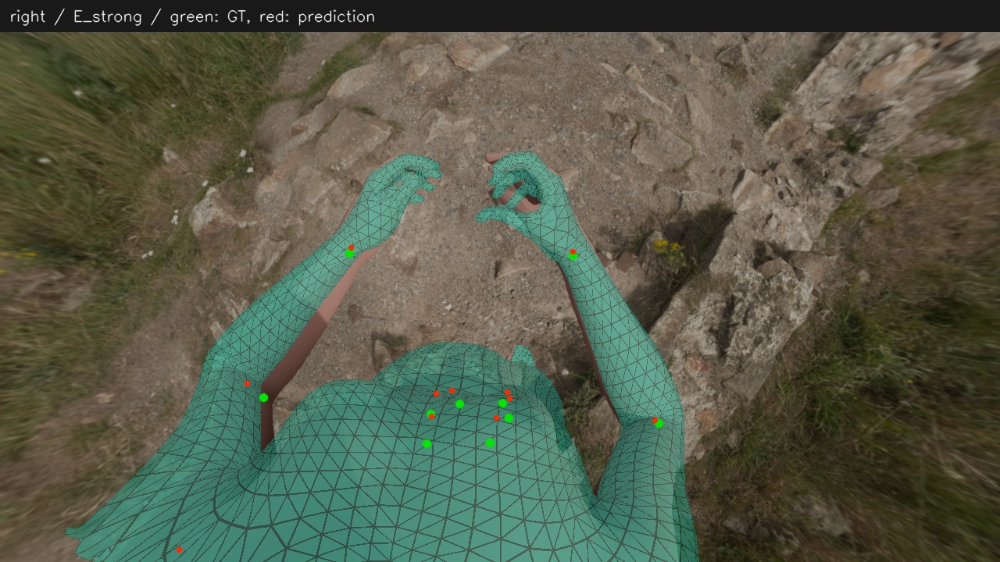
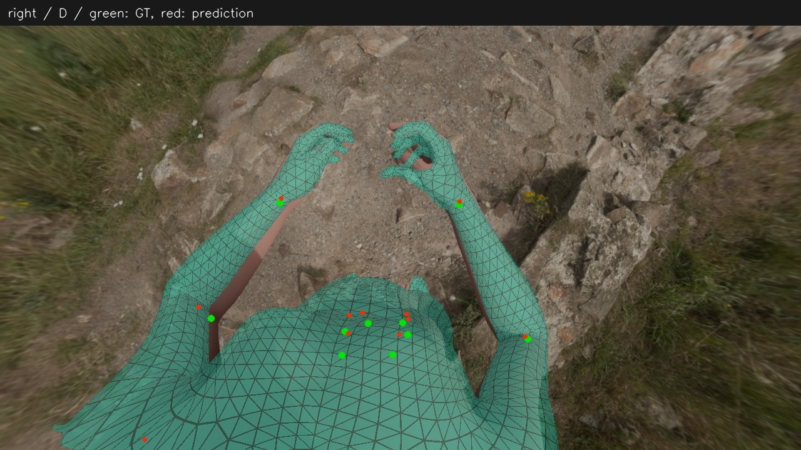

# 双目体型优化投影比较

[数值报告](report.md)

绿色点为真值，红色点为预测；青色为网格。E 是预先固定的主权重，不按真值挑选。两目投影来自同一人体；手部未做 MANO 替换。

## cam3

| B 固定预测体型 | E 带先验优化体型 |
|---|---|
|  |  |

| 弱先验 | 强先验 |
|---|---|
|  |  |

D 真值体型参考

[真值投影](../2026-11-08_synthetic-head-se3-contour/assets/left_truth.jpg)

## cam4

| B 固定预测体型 | E 带先验优化体型 |
|---|---|
|  |  |

| 弱先验 | 强先验 |
|---|---|
|  |  |

D 真值体型参考

[真值投影](../2026-11-08_synthetic-head-se3-contour/assets/right_truth.jpg)
