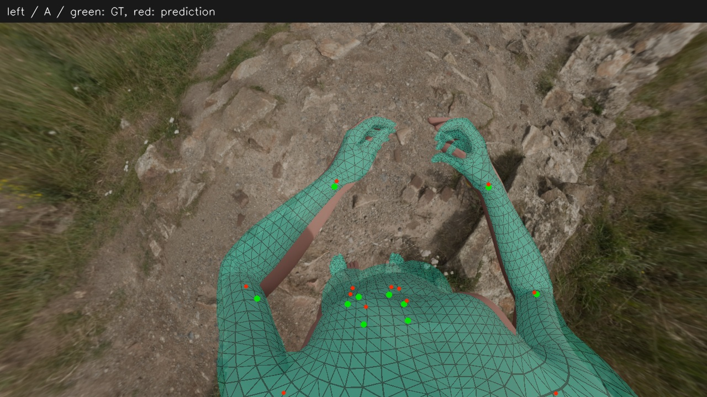
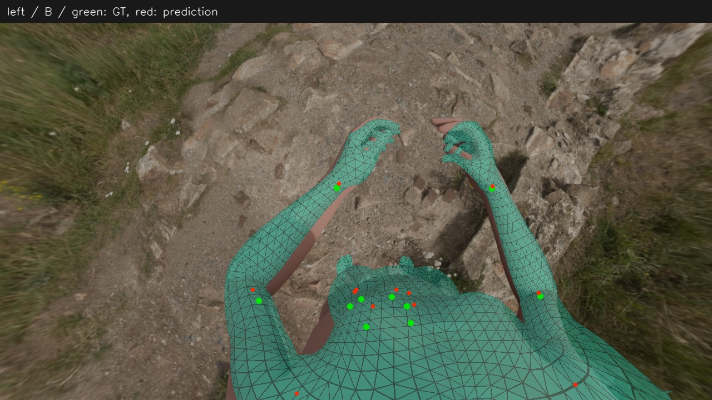
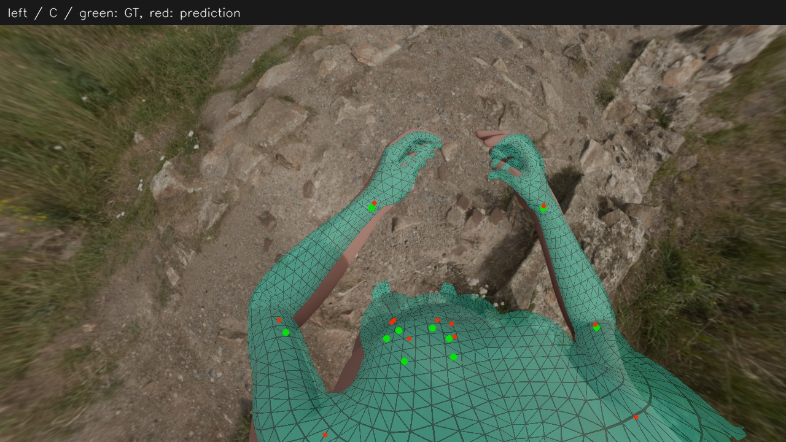
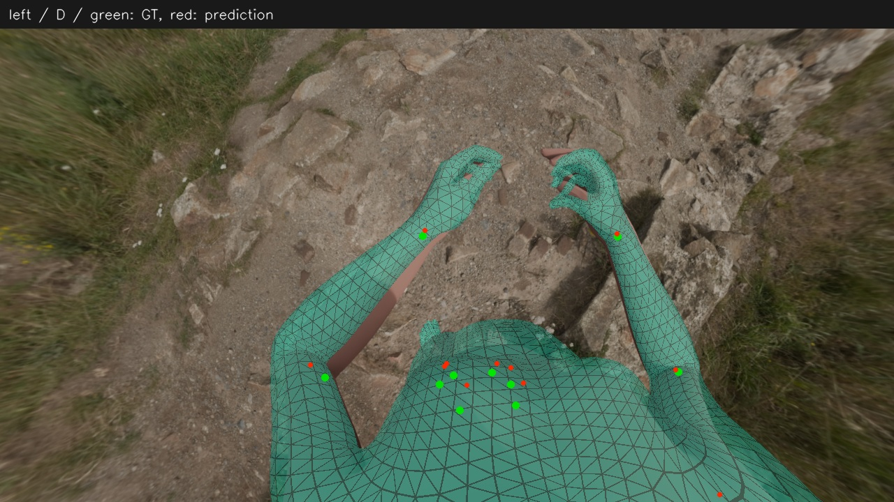
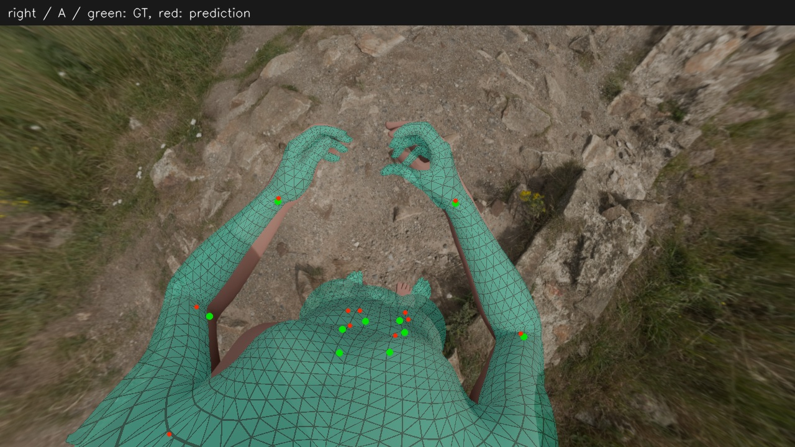
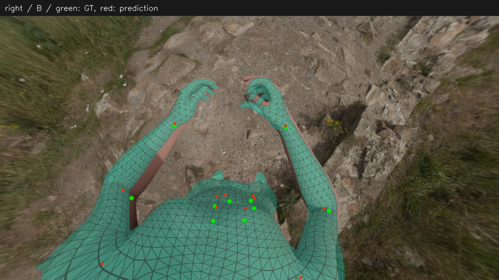
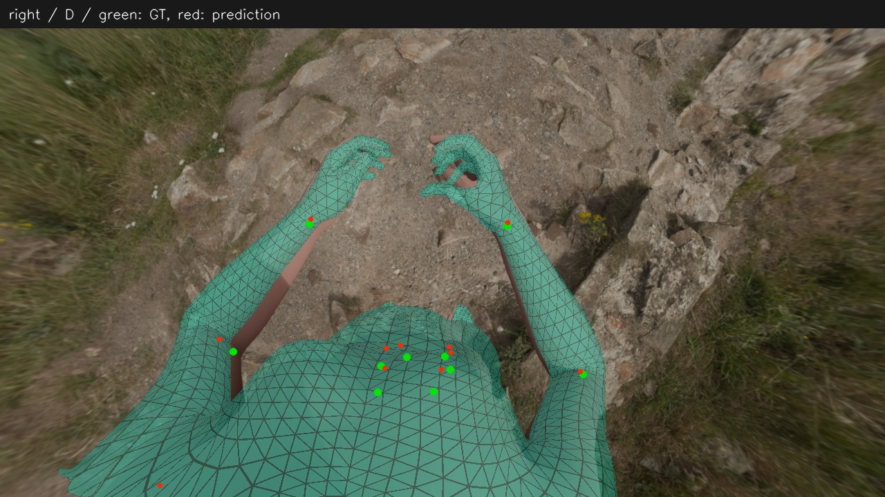

# A–D 投影对比

[数值报告](report.md)

绿色点为真值，红色点为预测；青色为身体网格。所有图使用生成相机。B/C/D 两目显示同一人体的不同投影；手部未做 MANO 替换。

## cam3

| A 单目 | B 共享双目 |
|---|---|
|  |  |

| C 放宽硬范围 | D 真值体型诊断 |
|---|---|
|  |  |

[真值投影](../2026-11-08_synthetic-head-se3-contour/assets/left_truth.jpg)

## cam4

| A 单目 | B 共享双目 |
|---|---|
|  |  |

| C 放宽硬范围 | D 真值体型诊断 |
|---|---|
|  |  |

[真值投影](../2026-11-08_synthetic-head-se3-contour/assets/right_truth.jpg)
