# 网络初值消融：投影与骨架

[返回完整报告](report.md)

A=网络体型/网络姿态；B=标准体型/网络姿态；C=网络体型/模板姿态；D=标准体型/模板姿态。新四组目标和约束相同，全部身体/手部观测为自动值，Head为真值。

## 收敛

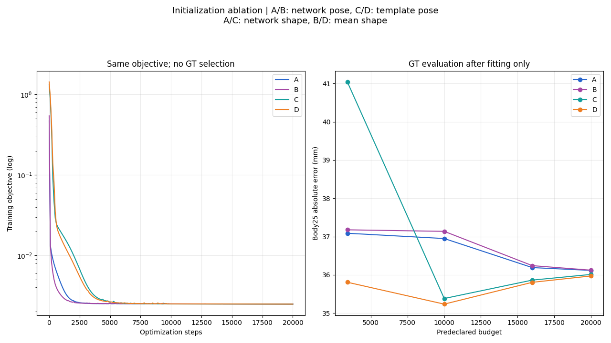

## left / A与D / 3400步

绿：真值；蓝：A；橙：D。同一相机两种预算保持相同轴范围；侧视米制等比例。

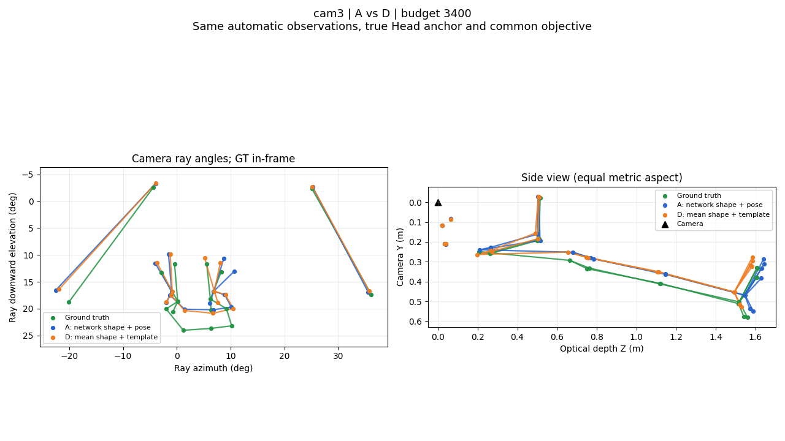

## left / A与D / 20000步

绿：真值；蓝：A；橙：D。同一相机两种预算保持相同轴范围；侧视米制等比例。

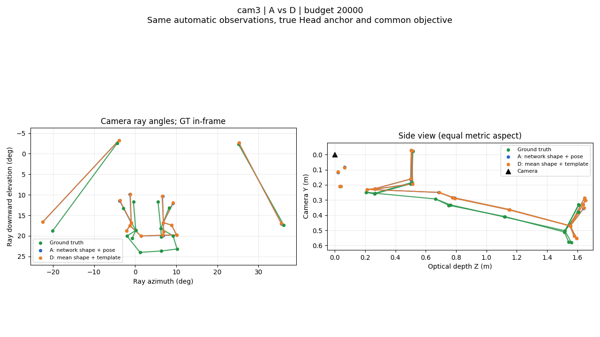

## right / A与D / 3400步

绿：真值；蓝：A；橙：D。同一相机两种预算保持相同轴范围；侧视米制等比例。

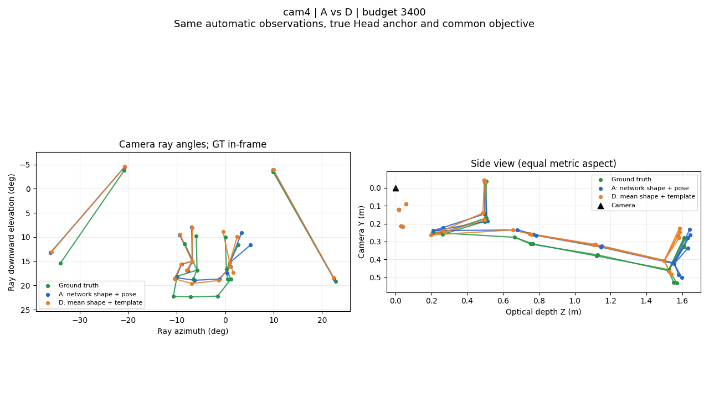

## right / A与D / 20000步

绿：真值；蓝：A；橙：D。同一相机两种预算保持相同轴范围；侧视米制等比例。

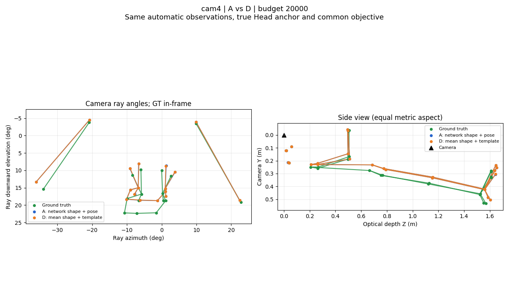

## 原图网格投影

绿点：真值；红点：预测；网格为预测。部分跨相机平面或过长投影三角形由渲染器跳过；关键点接近不代表轮廓、头部可见性或手指形态准确。

### left / 原流程参考

### left / A / 3400步

### left / B / 3400步

### left / C / 3400步

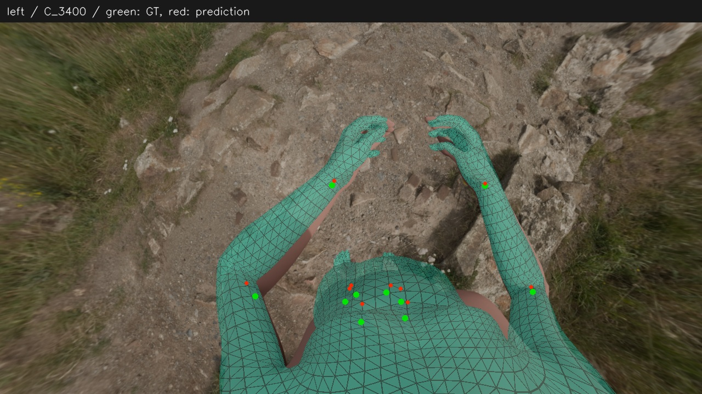

### left / D / 3400步

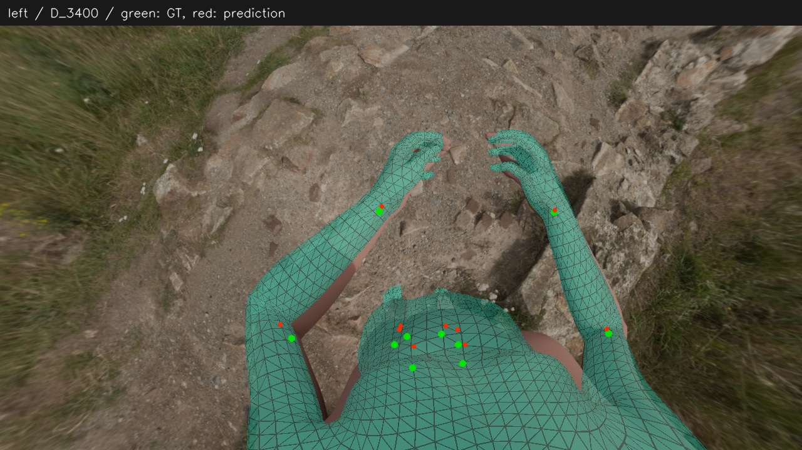

### left / A / 20000步

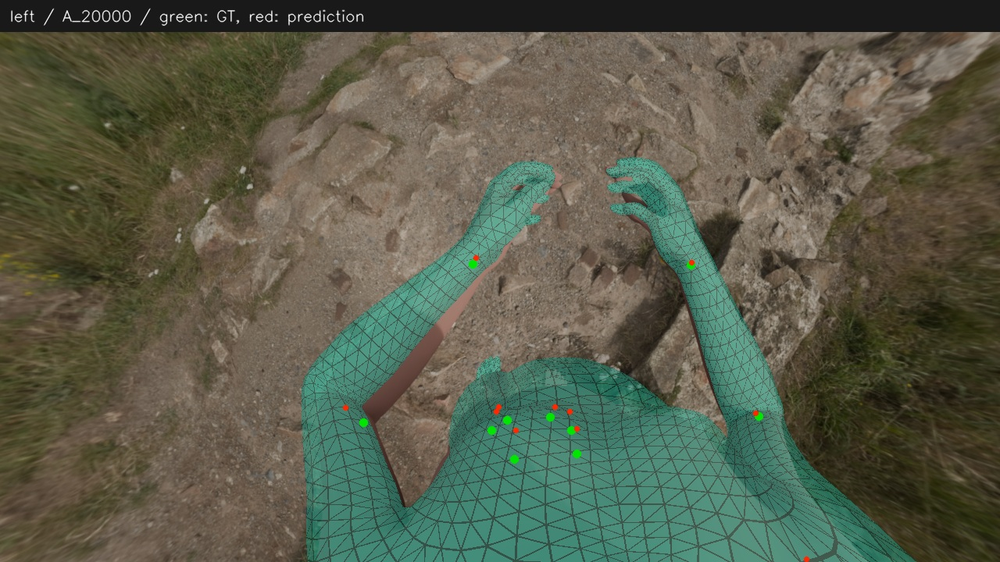

### left / B / 20000步

### left / C / 20000步

### left / D / 20000步

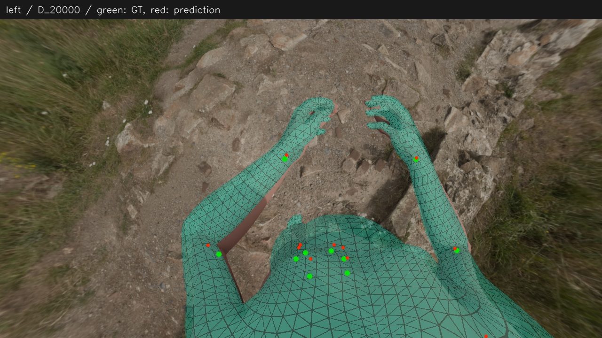

### right / 原流程参考

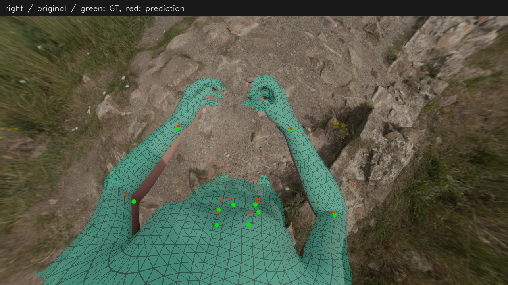

### right / A / 3400步

### right / B / 3400步

### right / C / 3400步

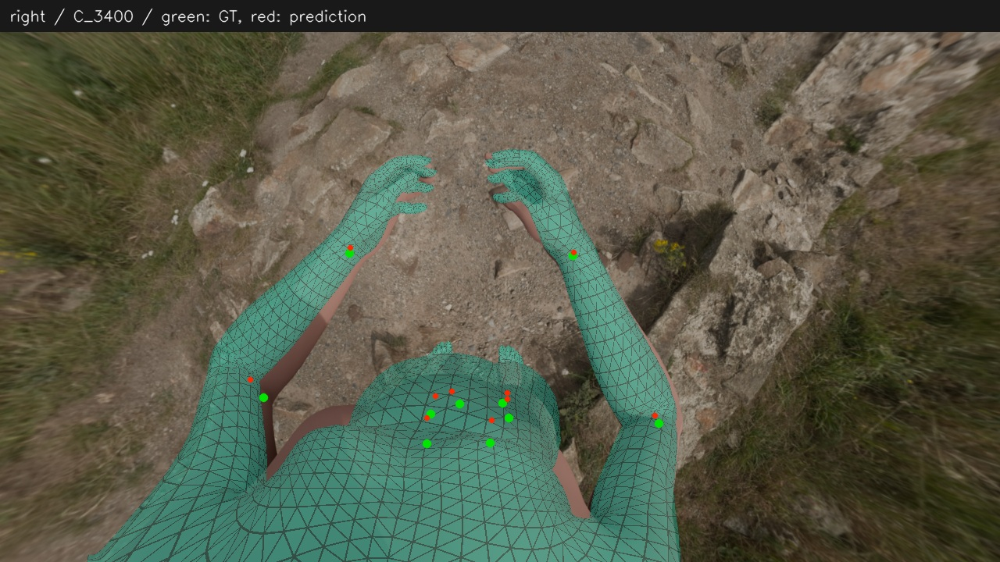

### right / D / 3400步

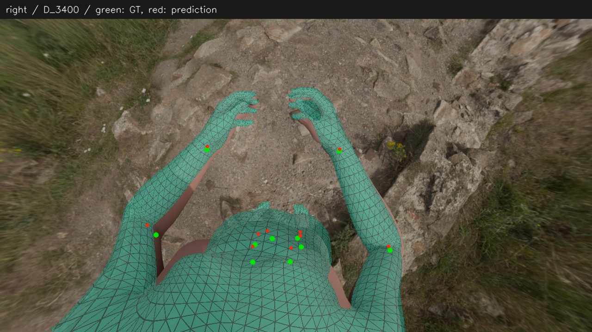

### right / A / 20000步

### right / B / 20000步

### right / C / 20000步

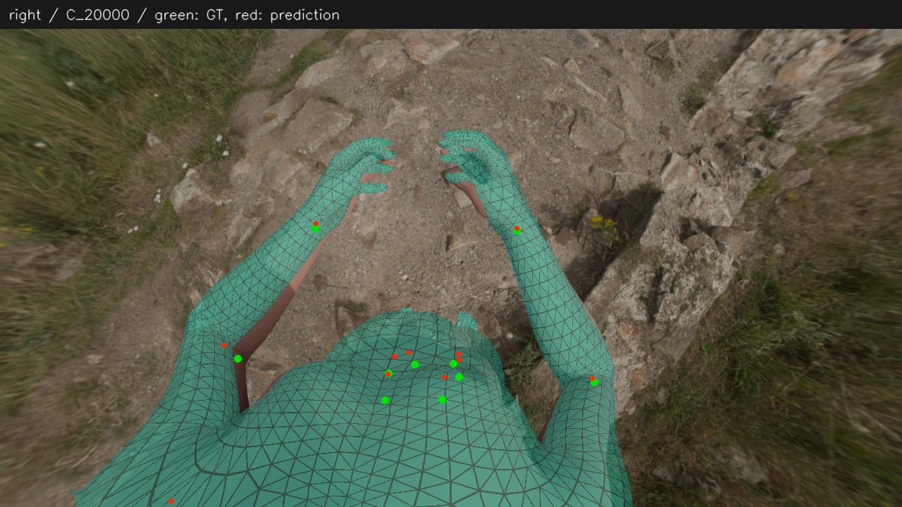

### right / D / 20000步

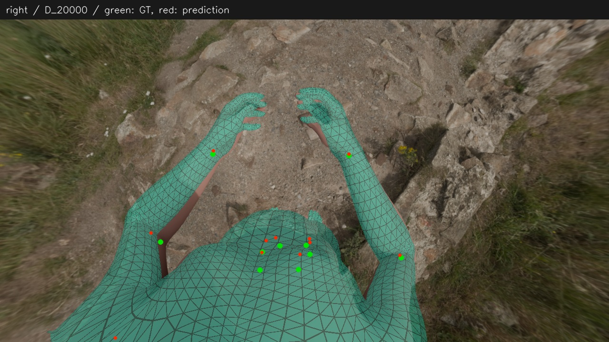
