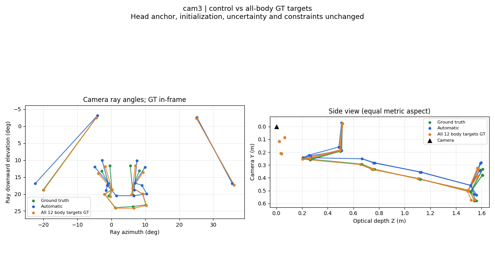
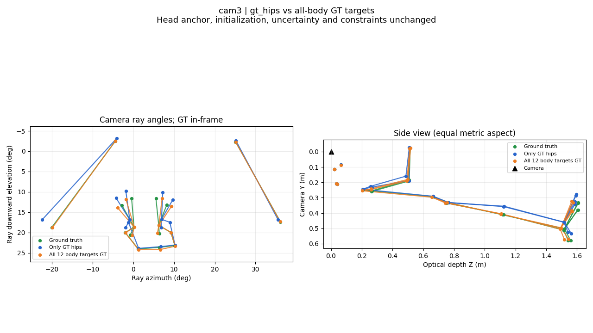
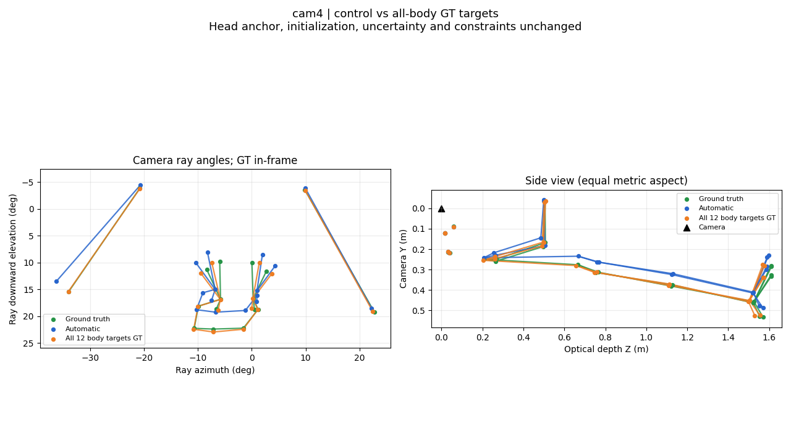
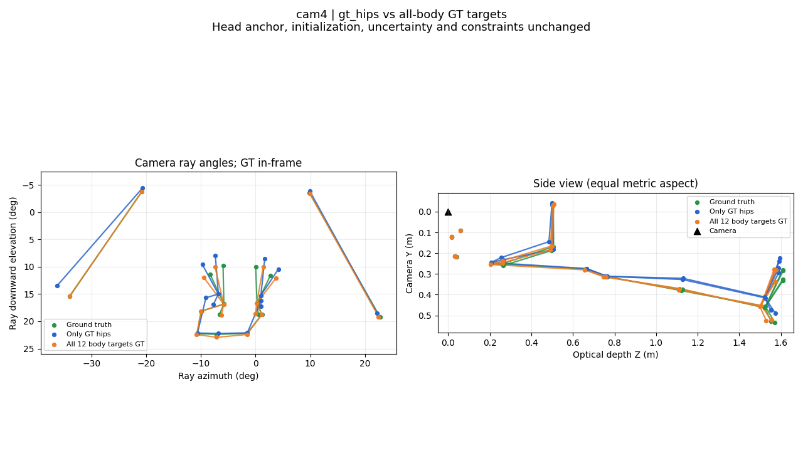
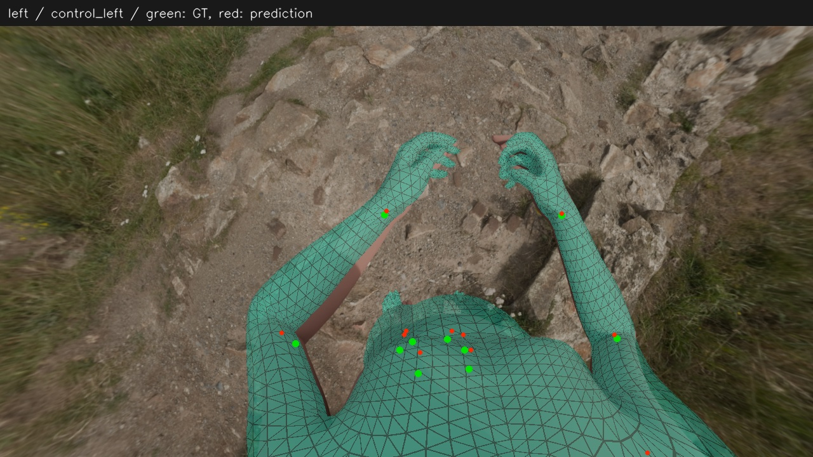
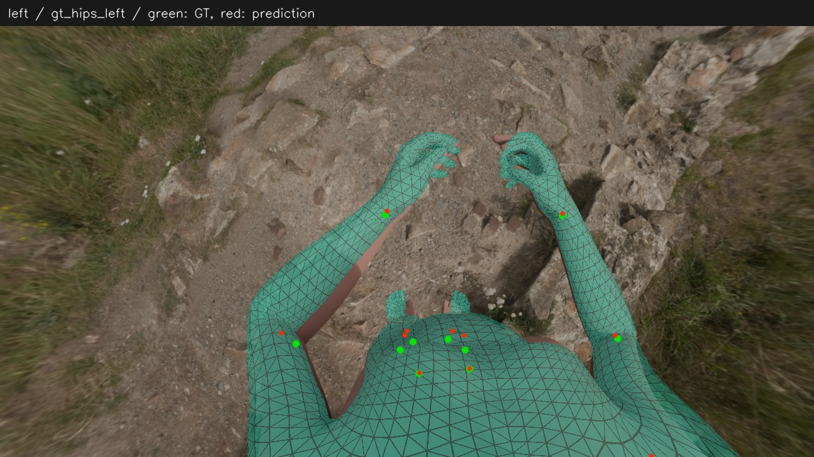
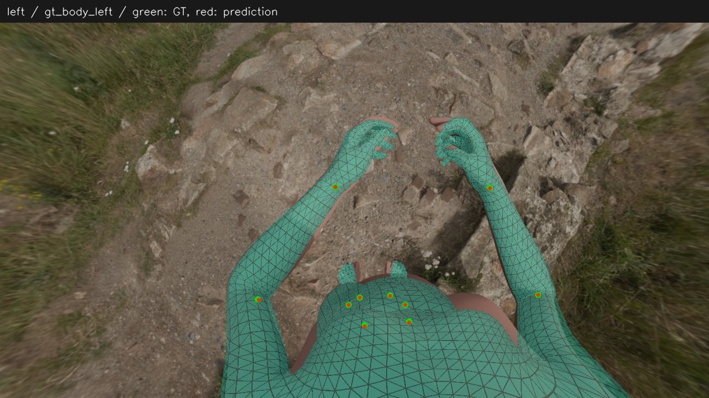
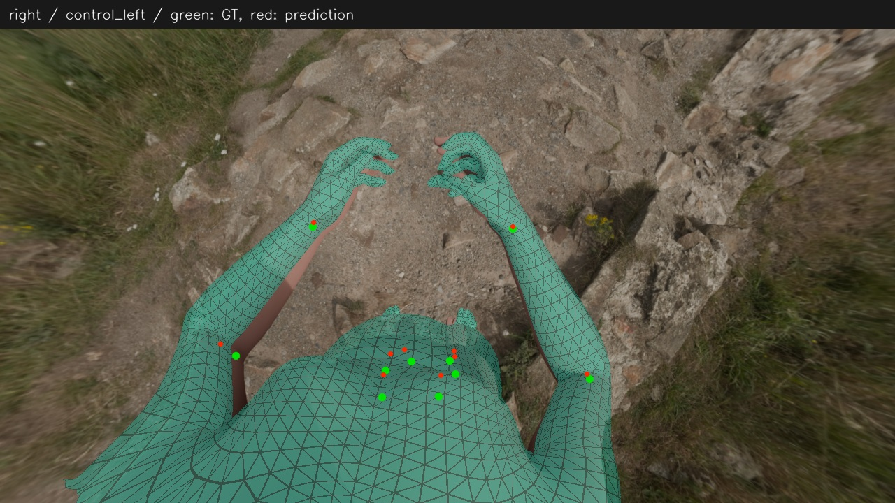
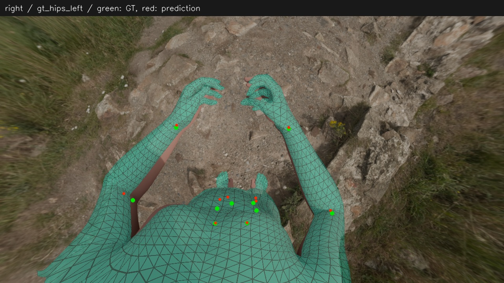
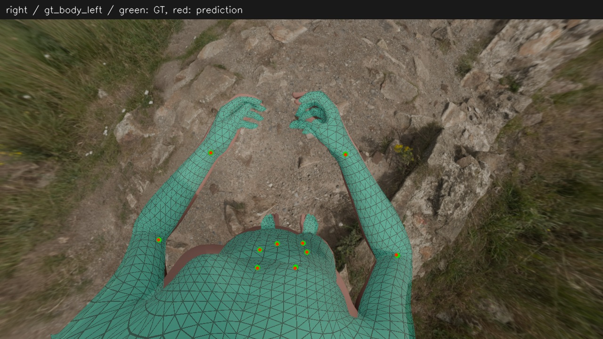

# 全身体目标真值：骨架与投影对比

[返回报告](report.md)

绿：真值；蓝：原条件或仅真值髋；橙：全部12个身体目标真值。每个相机的两幅对比使用相同坐标范围，侧视横纵单位比例一致。手部观测仍为自动值。

## left / control 对比全身体真值

## left / gt_hips 对比全身体真值

## right / control 对比全身体真值

## right / gt_hips 对比全身体真值

## 原图投影

绿点为真值、红点为预测；半透明预测网格。部分跨相机平面或过长投影三角形会被渲染器略去。

### left / control_left

### left / gt_hips_left

### left / gt_body_left

### right / control_left

### right / gt_hips_left

### right / gt_body_left

