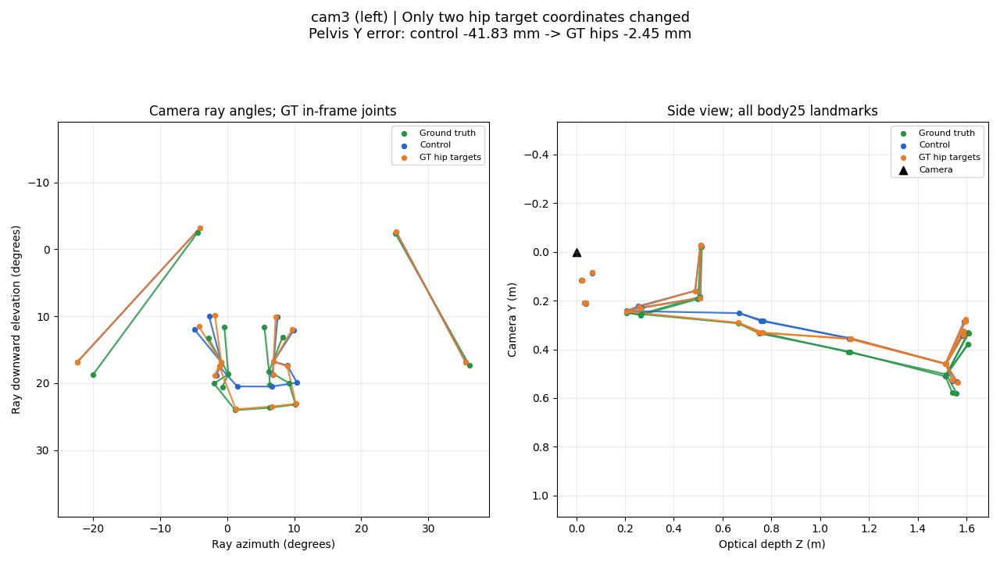
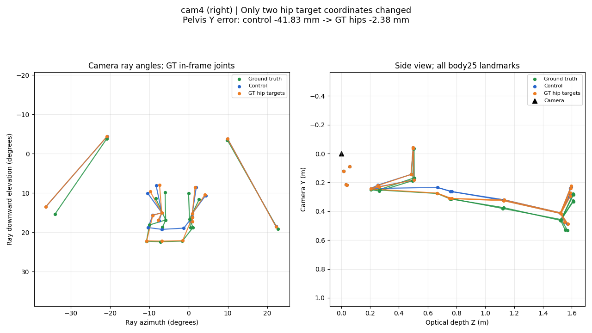
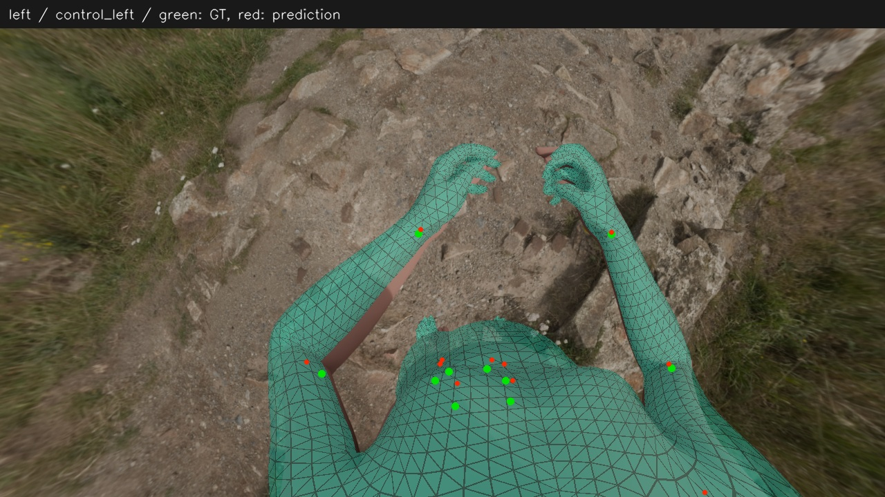
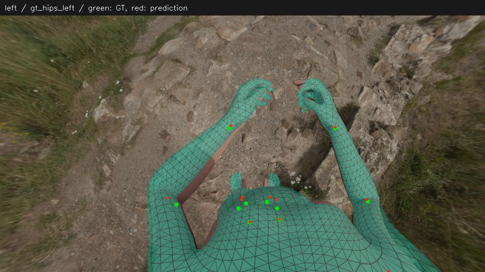
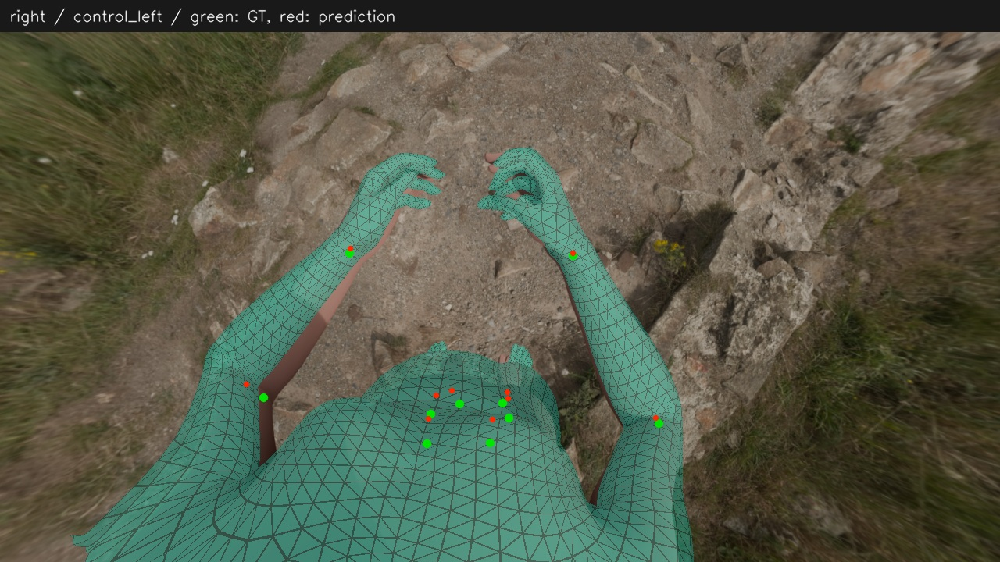
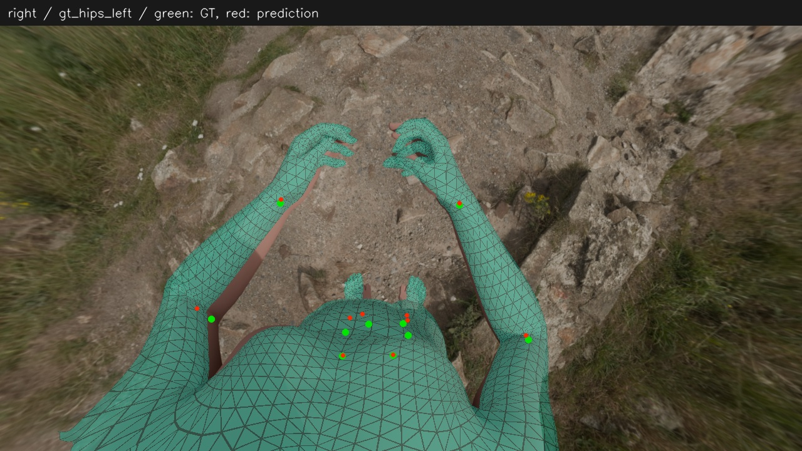

# 只改髋目标：前后对比

[返回报告](report.md)

绿色是真值，蓝色是原条件复跑，橙色是仅替换两髋目标。骨架图同一相机内使用相同坐标轴，侧视坐标为米且横纵单位比例一致；两目不代表独立样本。

## cam3 骨架

## cam4 骨架

## 原图投影

绿色点为真值，红色点为预测，半透明网格为预测；渲染器可能略去相机平面相交或过长投影三角形。

### left / 原条件复跑

### left / 仅替换两髋目标

### right / 原条件复跑

### right / 仅替换两髋目标

