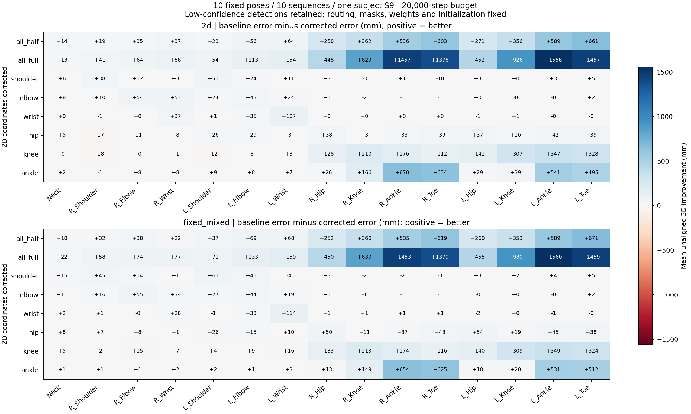

# 二维修正是否使全身三维关节都改善？

全身十二个身体二维关节同时修正到官方参考时，主实验的不对齐三维平均误差由 **688.68 降至 86.61 mm**。全部十五个评测关节中，15 个关节的均值下降，其中 15 个下降超过预先固定的 1 mm 描述门槛，0 个均值上升超过该门槛。

这里的“全身修正”指双肩、肘、腕、髋、膝、踝共十二个身体二维关节；评测另外包含 Neck 和左右脚跟代理点，不含 Head。全身整体修正与只修正局部是不同干预，不能互相替代结论。

这是单人便利样本上的固定预算输出，尚非充分收敛解的理论结论；全关节同时不确定性证据也不足。核心均值现象在延长预算和固定混合对照中保留，详细边界见后文。

## 实验范围与控制

执行基线 `c662eb7eda530e041a4470216a78fbc8148062f3`，拟合使用本轮新增工作树源码；既有无关修改与未跟踪文件保留。输入为固定 body01–body10，来自 S9 的十段不同序列，每段一个姿态。没有跨受试者泛化证据；这些便利样本也不是随机抽样。完整序列、样本标识和输入哈希见 [preparation.json](evidence/preparation.json)。

主对照直接使用二维重投影损失：原预测、全身半修正、全身全修正，以及双肩／双肘／双腕／双髋／双膝／双踝分别修正。局部条件同时替换该部位左右关节的双目坐标，其余点逐位不变；不能把双侧部位干预称为单点干预。

所有条件固定有效观测、置信度字段、工程损失权重与标准化、相机、Head、初始化、体型基底、优化预算和选点规则。每个样本均保留十二个关节的双目观测，包括低置信度原预测；不做分数筛除。这是隔离坐标效应的诊断，不能冒充实际部署的检测筛选策略。像素 sigma 固定为工程值，不等于测得的检测噪声。

辅助的 fixed_mixed 方法固定既有基线通过三维门限的关节及其协方差，只根据修正后的二维坐标重算这些关节的三角化坐标，其他关节用相同的二维观测。不会因修正而增加三维目标或改变路由。它是固定路由的混合对照，不是部署时随输入重新筛选的端到端流程。

每对样本的体型基底只从原预测的既有三角化计算一次，跨方法和干预共享；本次全部保留秩为零，体型实际固定均值。身体姿态从模板出发。Head 位置依赖标注，朝向取历史估计；外参来自另一段 S9 标注配准，关节语义与遮挡没有独立核验。非 Head 身体三维真值只在全部拟合完成后读取用于评测。官方二维与评测三维同源，因此参考点替换也不是独立标注准确度验证。

协议与实际变化门槛在运行前固定：[protocol.json](protocol.json)。输入二维平均参考距离 144.40 px → 半修正 72.20 px → 全修正 0 px；前处理逐点检查了严格的二分缩小关系。

## 主实验：全身修正的逐关节结果

下表为直接二维拟合、20000 步预算，单位 mm；各序列等权。误差为欧氏距离均值，不是 RMSE。改善量 = 原预测条件误差 − 修正条件误差，正数是改善。

| 评测关节 | 原预测 | 全身半修正 | 全身全修正 | 全修正改善量 | 改善／退化样本数 |
|---|---:|---:|---:|---:|---:|
| Neck | 93.41 | 79.56 | 79.93 | +13.48 | 9/1 |
| R_Shoulder | 68.44 | 49.39 | 26.96 | +41.48 | 9/1 |
| R_Elbow | 72.48 | 37.87 | 8.89 | +63.60 | 10/0 |
| R_Wrist | 96.23 | 58.74 | 8.67 | +87.56 | 10/0 |
| L_Shoulder | 100.86 | 77.91 | 47.26 | +53.60 | 10/0 |
| L_Elbow | 144.07 | 87.63 | 31.50 | +112.57 | 10/0 |
| L_Wrist | 196.27 | 132.60 | 42.38 | +153.89 | 9/1 |
| R_Hip | 532.33 | 274.10 | 84.81 | +447.52 | 10/0 |
| R_Knee | 937.50 | 575.01 | 108.19 | +829.32 | 10/0 |
| R_Ankle | 1543.81 | 1007.35 | 86.42 | +1457.39 | 10/0 |
| R_Toe | 1597.43 | 993.97 | 219.43 | +1378.00 | 10/0 |
| L_Hip | 565.99 | 295.04 | 113.65 | +452.34 | 10/0 |
| L_Knee | 1040.84 | 685.33 | 115.03 | +925.81 | 10/0 |
| L_Ankle | 1656.78 | 1067.99 | 99.25 | +1557.53 | 10/0 |
| L_Toe | 1683.79 | 1023.21 | 226.73 | +1457.06 | 10/0 |

事后举例说明逐样本例外：body02 全身全修正后的三维均值从 689.59 降到 92.98 mm，但左腕由 40.61 升到 61.25 mm。即使全部输入二维点同时变准，也不能保证该次拟合每个三维关节都改善。

样本计数按改善量超过 +1 mm／低于 −1 mm 计算，其余为变化小。Toe 字段沿用历史 heel proxy，不是严格脚趾精度。所有逐样本原误差、PA、训练选点和收敛见 [results.json](evidence/results.json)。

本诊断保留了全部低置信度预测，基线的下肢错误非常大；这些误差不是原来带置信度筛选的部署流程精度。全修正也只是参考标签替换的理想化敏感性结果，不能把它的改善幅度直接许诺为微调收益。

## 局部二维修正：收益会传到哪里

矩阵展示全部干预与评测关节。正数为改善，负数为退化；左右输出分别报告。

| 修正的二维部位 | 全身三维均值 mm | 平均改善 mm | 均值改善／退化关节数 | 均值退化关节 |
|---|---:|---:|---:|---|
| 全身半修正 | 429.71 | +258.97 | 15/0 | 无（按 1 mm 门槛） |
| 全身全修正 | 86.61 | +602.08 | 15/0 | 无（按 1 mm 门槛） |
| 双肩 | 678.94 | +9.75 | 11/2 | R_Knee, R_Toe |
| 双肘 | 674.39 | +14.30 | 8/2 | R_Knee, R_Ankle |
| 双腕 | 676.71 | +11.98 | 4/1 | L_Hip |
| 双髋 | 669.75 | +18.94 | 12/3 | R_Shoulder, R_Elbow, L_Wrist |
| 双膝 | 574.36 | +114.32 | 10/3 | R_Shoulder, L_Shoulder, L_Elbow |
| 双踝 | 512.43 | +176.25 | 14/0 | 无（按 1 mm 门槛） |

局部干预的关节均值与逐样本效果不是同一个结论。远处关节可以改善，也可能退化；不能从全身平均下降推出每个关节都不变差。每个矩阵格的完整样本分布、改善比例、最大退化与区间见 [analysis.json](evidence/analysis.json)。

可下载原始精度的派生矩阵：[直接二维标准预算](evidence/effects_2d_20000.csv)、[固定混合标准预算](evidence/effects_fixed_mixed_20000.csv)、[直接二维延长预算](evidence/effects_2d_40000.csv)、[固定混合延长预算](evidence/effects_fixed_mixed_40000.csv)。

## 方法与优化预算敏感性

| 方法 | 预算步数 | 全身全修正前／后不对齐 mm | 前／后 PA mm | 全修正均值改善／退化关节数 | 基线／全修正收敛通过数 |
|---|---:|---:|---:|---:|---:|
| 2d | 20000 | 688.68/86.61 | 271.88/63.35 | 15/0 | 0/0 |
| 2d | 40000 | 688.61/86.61 | 271.88/63.35 | 15/0 | 6/0 |
| fixed_mixed | 20000 | 691.53/84.21 | 271.31/61.92 | 15/0 | 0/0 |
| fixed_mixed | 40000 | 691.43/84.21 | 271.32/61.92 | 15/0 | 4/0 |

每个方法和预算的收敛计数分母为十。总共执行 180 个独立参数配置，每个配置保留两个预算的输出，共 360 条评测记录；不是 360 次独立实验。两预算之间哪些局部干预的关节效果发生符号变化，完整列于 analysis.json 的 budget_sensitivity。延长预算不保证全局最优；未通过稳定性诊断的输出不能宣称已充分收敛。

每个预算按该条件的最低可行训练目标选择检查点，不用评测真值选点。优化轨迹和完整参数只留在本机；公开结果包含所选迭代、最终窗口运动及相对目标变化，所有失败均保留。

## “全身都改善”的统计边界

主实验全修正是否每个样本、每个评测关节都改善超过 1 mm：**否**。在本组序列重采样的同时区间下，是否所有关节均支持超过 1 mm 的均值改善：**否**。

分析按完整序列行成组重采样，同时保留全部关节与干预；每个方法、预算分别构成全部干预 × 全部评测关节的同时区间。点区间和同时区间均保留；同时区间用中心化 bootstrap 最大绝对误差构造，具体设置在 protocol.json 与 analysis.json。便利样本只有单人，区间只表示这组样本的重采样敏感性，不能当成跨人总体推断，也不能把多次干预当成更多独立样本。

因此，要区分“本组样本每个关节的均值下降”“每个样本都下降”“对任意二维修正都成立”。本实验可以支持前两者中实际满足的有限范围陈述，不能建立第三种一般保证。自包含理论反例和条件性期望推导见 [上一轮 theory.md](../2026-11-17_2d-to-3d-joint-effects/theory.md)。

## 实现验证、失败与复现证据

为避免重复计算未进入目标的全身网格，本轮使用与原 SMPL-X 等价的身体关节运动学批处理。已对零姿态和随机姿态核对完整模型的关节位置、Head 旋转、目标值及参数梯度，并核对原逐关节逐视角的损失归约、标定投影、批量与单独拟合，以及保存／恢复中间状态的回归检查。拟合后评测仍调用完整 SMPL-X，包括网格脚跟代理点。数值和梯度证据见 [verification.json](evidence/verification.json)，最终检查点与完整模型的逐批核对见 results.json。

最终 [consistency.json](evidence/consistency.json) 核对了协议、准备输入和外部资源哈希未变；无三维目标的样本在两种方法下输出逐位相同；固定路由使用的重算三角化点均未出现原几何门限失败。

首次批处理在标准预算保存／恢复后，继续反传时触发参数版本错误；原日志和退出状态保留在 [first_attempt_fit_console.txt](evidence/first_attempt_fit_console.txt)、[first_attempt_fit_execution.json](evidence/first_attempt_fit_execution.json) 与 [first_attempt_failure.json](evidence/first_attempt_failure.json)。失败 worker 在异常清理阶段仍占用 CPU，本轮仅终止了自己启动的该 worker，实际子进程退出状态为 SIGTERM。修正为恢复参数后重建计算图，并在全新输出目录从相同初始化重跑，未覆盖失败输出。两次标准预算快照的全部参数、损失及选择迭代逐位相同，见 [retry_equivalence.json](evidence/retry_equivalence.json)。

成功运行命令与退出状态：[fit_execution.json](evidence/fit_execution.json)、[evaluate_execution.json](evidence/evaluate_execution.json)、[analyze_execution.json](evidence/analyze_execution.json)。环境版本见 [environment.json](evidence/environment.json)，模型资源与源码标识见 [input_hashes.json](evidence/input_hashes.json)。未安装依赖、未下载数据、未改外部文件；所有拟合在 CPU 上执行。

本轮完整成功输出位于 `<WORKSPACE>/DownSight/outputs/2d_intervention_20261117_retry1`，失败输出保留在 `<WORKSPACE>/DownSight/outputs/2d_intervention_20261117`。原始二维坐标、模型资产、三维标注、数组、完整日志、完整本地 provenance 与 patch 不公开；公开派生误差与必要的脱敏控制日志。无法取得模型和数据的审核者只能审阅公开证据，不能声称独立复现。

## 发布自检

本轮文件、工作树、暂存内容及待推送提交的增量检查见 [prepush.json](evidence/prepush.json)。其他轮次的工作树变更不纳入提交。所有发布文件均小于单文件限制；不含模型、数据集、视频、NumPy 数组、凭据、开发机绝对路径、完整原始输出或完整 provenance／patch。历史文件未在本轮全面审计。
