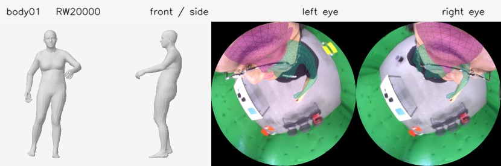

# RW20000 · S9 十对双目的人体网格

[下载 body01–body10 的 10 个 OBJ（ZIP）](https://github.com/cdh290718-oss/DownSight/releases/download/rw20000-s9-mesh10-free12-20261119/RW20000_S9_body01-10_free12_OBJ.zip) · [原三模型数值对照](../2026-11-19_rw_three_free12/report.md)

每个样本对应一份双目共享的 SMPL-X 人体网格。OBJ 单位为米，左相机坐标系的 X 朝右、Y 朝下、Z 朝前。每张预览从左到右为同一网格的正面、侧面、左目原图叠加和右目原图叠加。点击下表可查看单独视图。

| 样本 | 四视图预览 | 正侧面渲染 | 左目匹配图 | 右目匹配图 | 12 点 PA (mm) | 12 点非 PA (mm) |
|---|---|---|---|---|---:|---:|
| body01 | [预览](assets/body01__rw20000.jpg) | [网格](assets/body01/obj.jpg) | [左目](assets/body01/left.jpg) | [右目](assets/body01/right.jpg) | 32.31 | 50.67 |
| body02 | [预览](assets/body02__rw20000.jpg) | [网格](assets/body02/obj.jpg) | [左目](assets/body02/left.jpg) | [右目](assets/body02/right.jpg) | 35.10 | 45.28 |
| body03 | [预览](assets/body03__rw20000.jpg) | [网格](assets/body03/obj.jpg) | [左目](assets/body03/left.jpg) | [右目](assets/body03/right.jpg) | 62.13 | 72.05 |
| body04 | [预览](assets/body04__rw20000.jpg) | [网格](assets/body04/obj.jpg) | [左目](assets/body04/left.jpg) | [右目](assets/body04/right.jpg) | 34.42 | 44.00 |
| body05 | [预览](assets/body05__rw20000.jpg) | [网格](assets/body05/obj.jpg) | [左目](assets/body05/left.jpg) | [右目](assets/body05/right.jpg) | 36.45 | 44.10 |
| body06 | [预览](assets/body06__rw20000.jpg) | [网格](assets/body06/obj.jpg) | [左目](assets/body06/left.jpg) | [右目](assets/body06/right.jpg) | 62.95 | 66.59 |
| body07 | [预览](assets/body07__rw20000.jpg) | [网格](assets/body07/obj.jpg) | [左目](assets/body07/left.jpg) | [右目](assets/body07/right.jpg) | 48.13 | 60.31 |
| body08 | [预览](assets/body08__rw20000.jpg) | [网格](assets/body08/obj.jpg) | [左目](assets/body08/left.jpg) | [右目](assets/body08/right.jpg) | 30.91 | 43.65 |
| body09 | [预览](assets/body09__rw20000.jpg) | [网格](assets/body09/obj.jpg) | [左目](assets/body09/left.jpg) | [右目](assets/body09/right.jpg) | 39.41 | 51.57 |
| body10 | [预览](assets/body10__rw20000.jpg) | [网格](assets/body10/obj.jpg) | [左目](assets/body10/left.jpg) | [右目](assets/body10/right.jpg) | 41.16 | 48.44 |

## 来源与核验

复用 S9 十对报告保存的 RW20000 检查点与双目标定，逐帧用双肩和双髋初始化，头随上胸，12 个自动身体点参与拟合，双脚自由。按左相机的米制位置导出 OBJ；每帧以相同观察方向展示两个相差 90 度的网格视角，居中和缩放只影响预览画布。渲染器读回导出的 OBJ，并逐眼使用原标定、外参及网格自身的深度遮挡。它会过滤越过近裁剪面或投影跨度过大的三角形。彩色叠加显示预测的表面位置，缺少场景深度与实测表面真值。完整左右目保留 1280 × 720 画布，总览裁去两侧留白。[导出与渲染代码](build.py)

执行基线 `8d196f217f4a54b03412ee8918bd0ecf1a6e7561`，工作树含本轮目录及既有无关改动。核对原检查点和输入散列、读回顶点及三角面，并将导出时计算的 12 点 PA、非 PA 逐对与原报告核对至 0.001 mm 以内。逐图记录源 OBJ、原图及渲染图散列；ZIP 经解包逐成员校验。原始数据、参数与完整执行记录保留在开发机。[逐样本证据](evidence/renders_rw20000.json) · [ZIP 清单摘要与 SHA-256](evidence/attachment_audit.json)

推送前检查工作区、暂存、待推提交和远端基线。Git 仅含本轮代码、文档、精简证据及应用户要求发布的无 EXIF 渲染图，OBJ 通过 Release 附件提供。逐文件检查小于 50 MB，排查机器路径、凭据、环境文件、权重、数据集、视频、数组、完整原始输出、provenance 和补丁。本次增量自检见[检查记录](evidence/prepush.json)。
