# RW20000 地面参考正视图与侧视图

原图库 12 对全部完成，每对从同步双目估计地毯法向，用它确定画面的竖直。以下为 24 张原人体网格渲染，左正面、右侧面。9 对通过内部一致性检查。pair001、pair034、pair068 的地面方向仍属暂定，图中整体倾角请谨慎解读。

[下载 24 张独立图片](https://github.com/cdh290718-oss/DownSight/releases/download/rw20000-floor12-views-20261120/RW20000_floor12_front_side.zip?download=1) · [打开汇总大图](assets/overview.jpg)

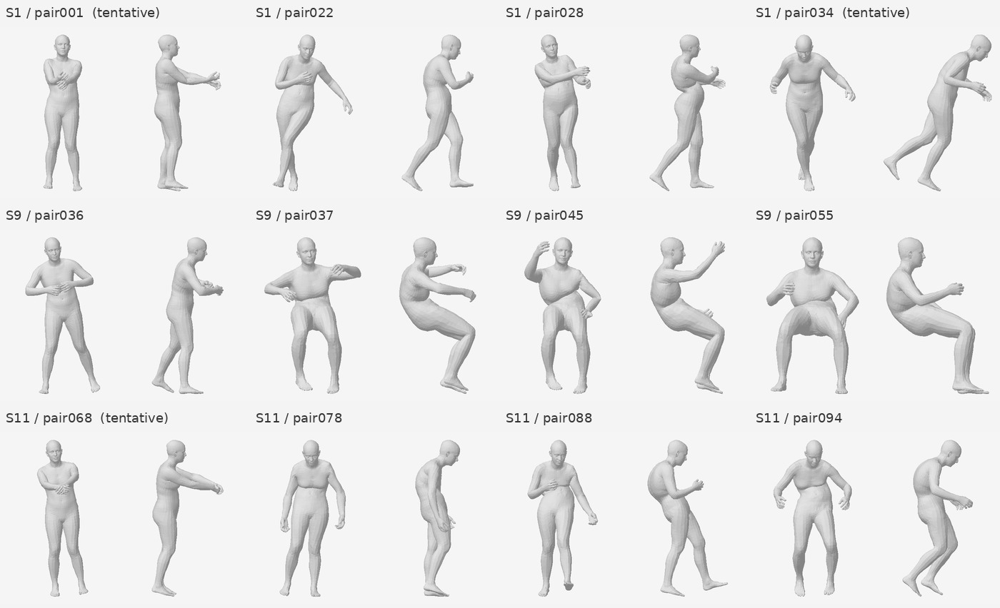

## 逐对查看

| 人物 / 样本 | 正面 | 侧面 | 地面法向 |
|---|---|---|---|
| S1 / pair001 | 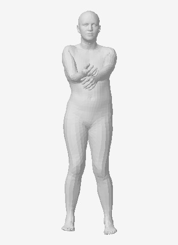 | 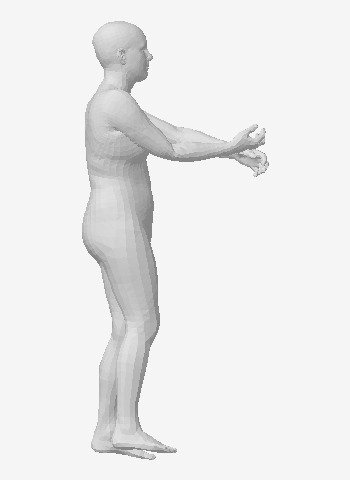 | **暂定** |
| S1 / pair022 | 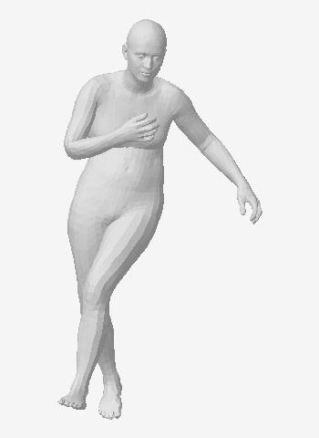 | 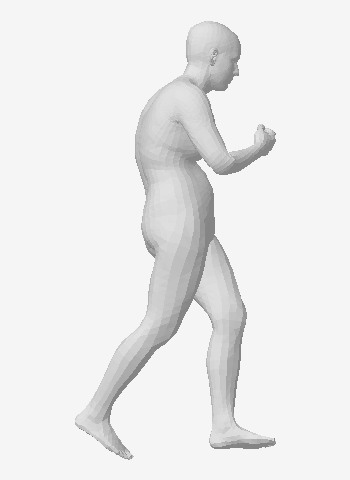 | 通过 |
| S1 / pair028 | 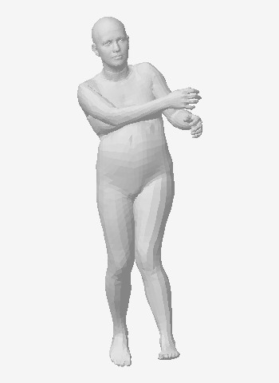 | 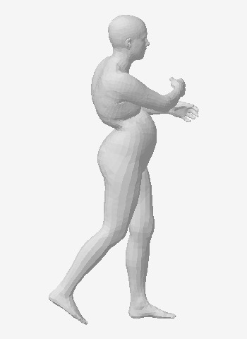 | 通过 |
| S1 / pair034 | 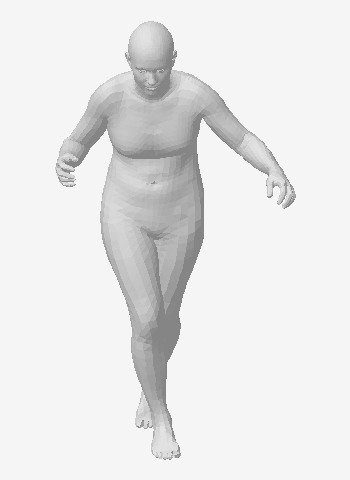 | 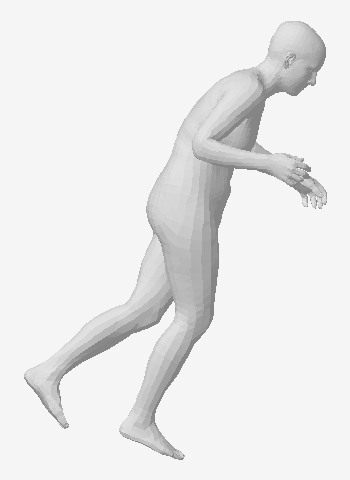 | **暂定** |
| S9 / pair036 | 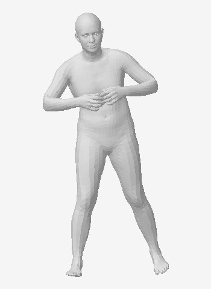 | 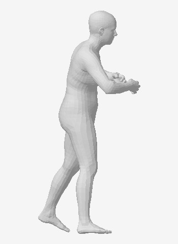 | 通过 |
| S9 / pair037 | 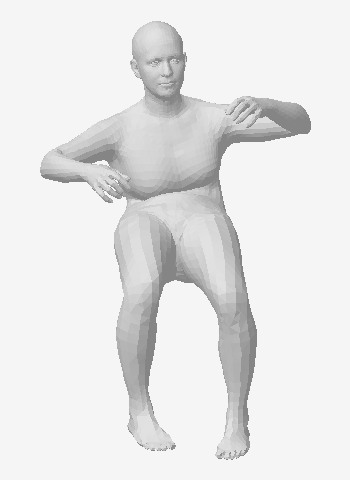 | 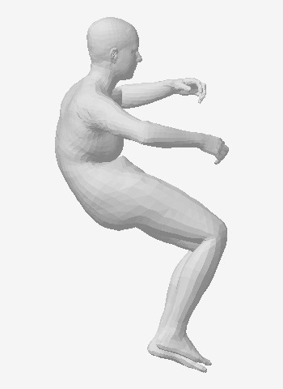 | 通过 |
| S9 / pair045 | 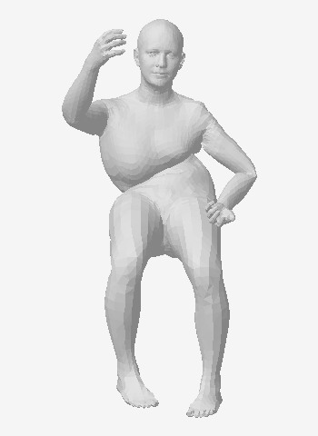 | 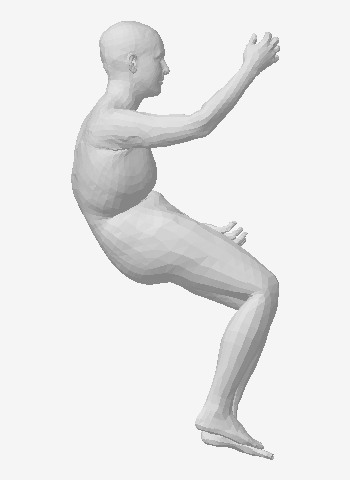 | 通过 |
| S9 / pair055 | 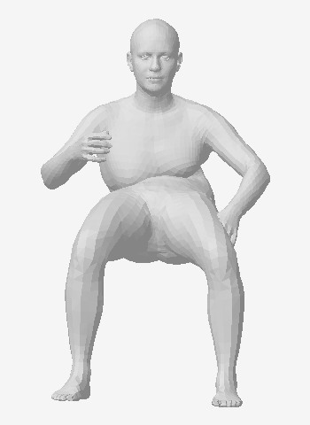 | 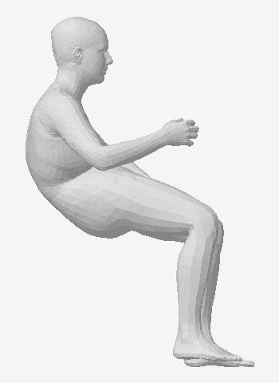 | 通过 |
| S11 / pair068 | 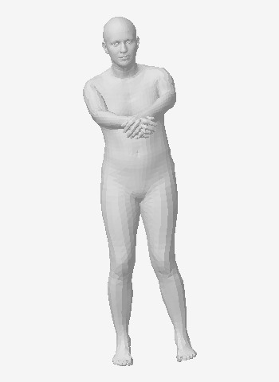 | 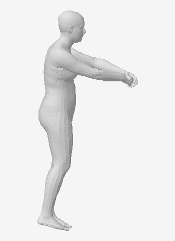 | **暂定** |
| S11 / pair078 | 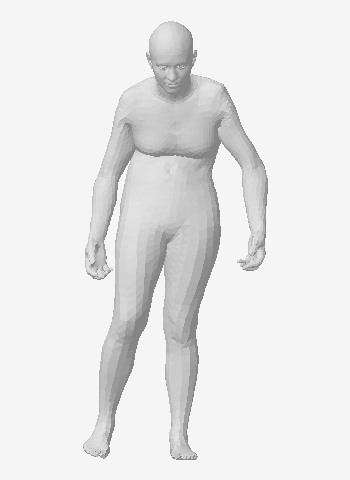 | 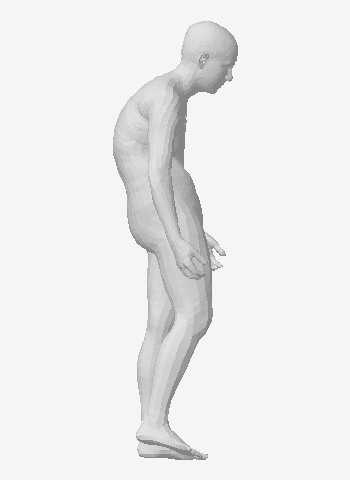 | 通过 |
| S11 / pair088 | 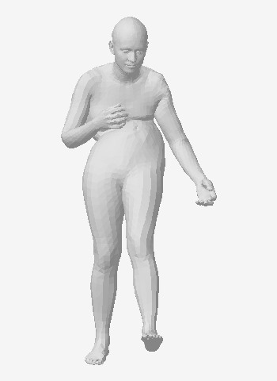 | 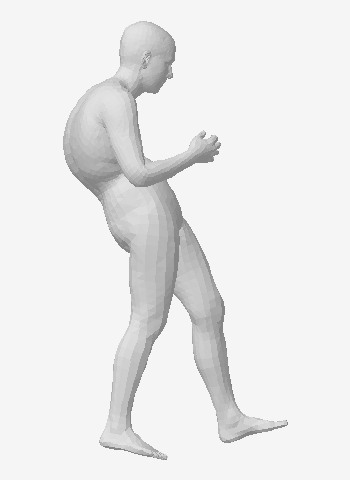 | 通过 |
| S11 / pair094 | 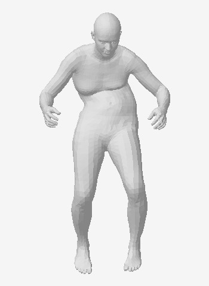 | 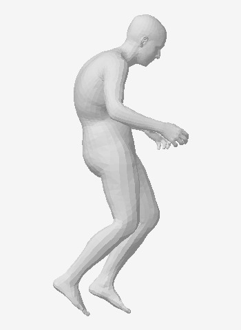 | 通过 |

## 地面估计与取景

用原始左右鱼眼图像和归档会话标定，将人工圈选的可见地毯纹理三角化，稳健拟合平面，再按左右眼纹理一致性细化其法向。假设地毯水平，以该帧估计的法向为上，以原骨盆前向在平面上的投影选取正侧视方位。只改变观察方向，沿用原图库自由脚、头随上胸的 OBJ。正面和侧面等比例、分别居中，无地面特征点、骨架或检测叠加。取景用途是比较身体方向，图像下沿不代表地面或坐面。[场景估计和渲染](render_gallery.py) · [原图库](../2026-11-20_rw20000_frozen_mesh12/report.md)

首轮沿用三帧报告的 SIFT 匹配及检查，有 6 对通过。对其余帧，沿标定后的双目极线搜索多种深度，用局部纹理相关性和双向匹配筛选独立对应点。对弱纹理的 pair001、034、068 复查可见选区，扩大地毯覆盖或排除立体道具。最终保留各次检查结果。三帧原对照 pair045、055、078 也重新运行，逐帧法向和高度差记在 prior_repeat。[首轮](evidence/initial.json) · [第一次补测](evidence/patch_attempt.json) · [匹配代码](patch_match.py)

内部检验沿用稀疏内点、候选高度范围、法向朝向、棋盘分区法向差与高度差、稀疏点到面残差。纹理块补测另要求支持点覆盖至少五个网格、稀疏与稠密法向夹角低于 10°。这是对当前左右图内部一致性的检查，绝对离地高度仍缺外部测量。原报告中足底甚至官方踝点都曾落到估计平面下方。本轮不据此判断是否腾空。[三帧高度诊断](../2026-11-20_rw20000_floor3/report.md) · [完整检查、指纹及运行状态](evidence/renders_floor.json)

| 样本 | 方法 | 匹配 / 内点 | 分区法向差 ° | 分区高度差 mm | 稀疏点到面中位数 mm | 稀疏/稠密法向差 ° |
|---|---|---:|---:|---:|---:|---:|
| pair001 | 极线纹理块 | 53 / 32 | 4.57 | 47.3 | 70.8 | 4.57 |
| pair022 | 极线纹理块 | 31 / 19 | 3.54 | 11.2 | 43.4 | 5.89 |
| pair028 | 极线纹理块 | 50 / 39 | 2.76 | 18.3 | 27.6 | 9.36 |
| pair034 | 极线纹理块 | 12 / 9 | 6.72 | 8.7 | 34.1 | 6.81 |
| pair036 | SIFT | 112 / 60 | 1.04 | 11.7 | 37.4 | 2.71 |
| pair037 | SIFT | 36 / 30 | 1.97 | 27.6 | 24.6 | 4.80 |
| pair045 | SIFT | 78 / 58 | 0.21 | 2.8 | 26.8 | 2.55 |
| pair055 | SIFT | 34 / 23 | 1.45 | 4.9 | 34.7 | 7.22 |
| pair068 | SIFT（修订选区） | 34 / 18 | 4.08 | 99.6 | 63.1 | 12.97 |
| pair078 | SIFT | 142 / 88 | 2.25 | 14.1 | 32.9 | 2.88 |
| pair088 | SIFT | 115 / 67 | 1.51 | 29.6 | 43.1 | 2.40 |
| pair094 | 极线纹理块 | 31 / 20 | 0.77 | 4.8 | 31.7 | 7.17 |

## 执行与发布

运行基线 093e213bd2c632c777f8213748917fec9f0d55a0。工作树含本轮新增脚本和此前无关改动。开发环境使用现有 CPU 身体后端；原图、归档相机、RW20000 检查点、逐对 OBJ 均核对 SHA-256。第一轮、补测及恢复后的最终渲染都以同一组对象计算；重跑可依次执行 render_gallery.py --initial、render_gallery.py 和 package_views.py。报告仅发布相对资源路径、摘要、精简证据与衍生人体图。[输入指纹和数值](evidence/renders_floor.json) · [图片打包与内容校验](evidence/attachment_audit.json)

增量自检覆盖工作树、暂存内容与待推提交，并核查远端基线。逐文件核对体积（小于 50 MB）、JPEG 格式、EXIF、机器路径与凭据。无权重、数据集、视频、数组、原始照片或完整本地 provenance；无关变更未纳入提交。[推送前自检](evidence/prepush.json)
