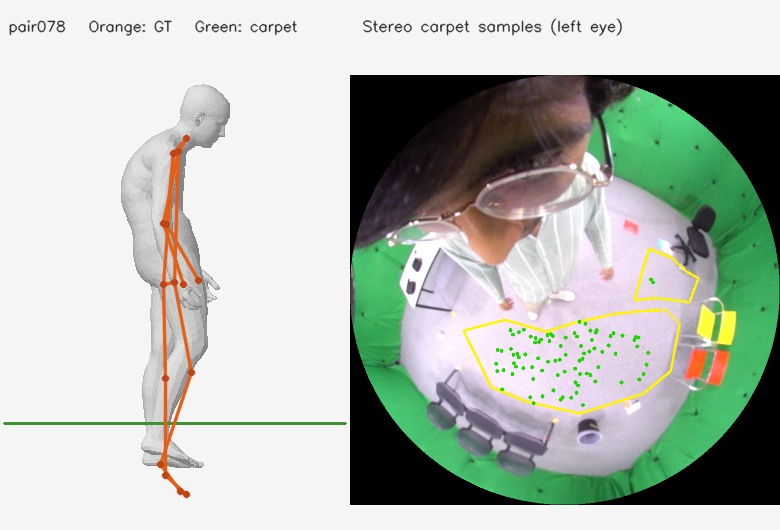
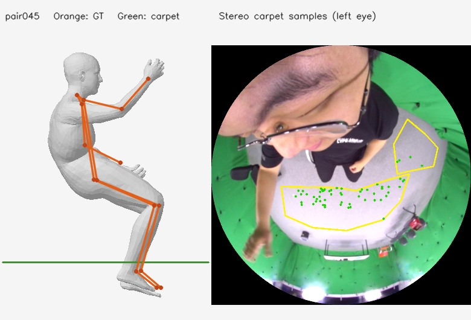
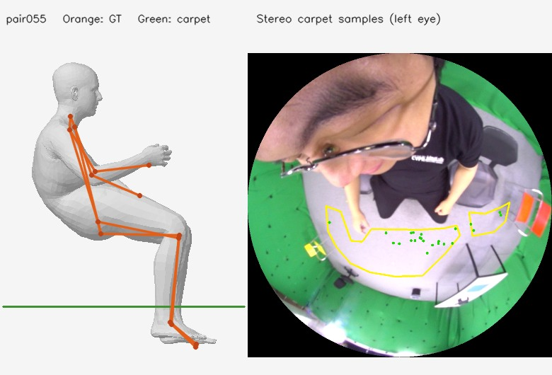

# 三帧地毯参考侧视图

用地毯定竖直后，pair078 的肩髋中轴距竖直仅 2.7°，官方骨架为 4.3°。两帧屈膝姿态中，pair045 和 pair055 的预测躯干比官方骨架倾得更多。三帧的绝对离地高度仍有明显矛盾：预测足底、官方踝点都落到了估计地毯面下方。现有证据支持判断躯干方向，对脚底或臀部的实际悬空距离还缺独立的场景高度核验。[逐帧完整数值](evidence/planes.json)

| 样本 | 预测 / 官方躯干距估计竖直 | 预测与官方躯干三维夹角 | 预测足部最低点，左 / 右 (cm) | 官方踝点，左 / 右 (cm) |
|---|---:|---:|---:|---:|
| pair078 | 2.7° / 4.3° | 1.8° | −18.7 / −18.2 | −22.3 / −17.3 |
| pair045 | 18.3° / 9.2° | 9.9° | −20.3 / −16.9 | −5.4 / −5.2 |
| pair055 | 27.3° / 15.5° | 12.4° | −16.8 / −14.8 | −7.1 / −8.2 |

肩髋中轴从双髋中点指向双肩中点。各自偏离竖直的角度只衡量倾斜大小，三维夹角还保留倾斜方向的差异。负高度表示在估计平面下方。足部按 SMPL-X 蒙皮主导关节划分并取最低顶点；官方只有稀疏骨架，没有脚底表面。双方踝点可在证据中同部位比较。以 pair078 为例，预测左踝相对官方左踝高约 11.3 cm，即使躯干方向很接近，踝的位置仍有误差。[同部位核对](evidence/planes.json)

## 逐帧图

左侧灰色为原 OBJ，橙色为同一左相机坐标中的官方骨架，绿线为估计地毯面。右侧黄色多边形为人工圈选的地毯区域，绿点为稀疏拟合内点。图在每帧内保持人体、参考骨架和地面之间的相对位置，三帧各自取景。原图中缺少可可靠确定座面位置和支撑关系的证据，本轮没有估计座面。

**pair078 · S11**

**pair045 · S9**

**pair055 · S9**

## 地面估计及局限

1. 对三帧分别在左目原图选裸露的灰地毯。在左右目匹配 SIFT 纹理点，通过双向匹配、局部纹理相似度及双目重投影筛查。用已归档的鱼眼内参和该会话的双目外参把射线三角化为米制三维点。地面估计不读取当前帧的人体点；沿用的会话外参原由其他帧的身体标注恢复。[相机与外参来源](../2026-11-18_rw_frozen200_golden_d/report.md)
2. 用 RANSAC 在三维点中找平面，再把左目地毯纹理经这个平面投到右目，按双目亮度纹理一致性细化。假设地毯水平，取指向相机一侧的单位法向为“上”。在左相机坐标内平面写为 n·X + d = 0，d 是左相机原点到地面的垂距。对地面采用场景重建值；未找到这三帧可直接核验的世界系地板方程，没有将标定板坐标轴当作重力。
3. 将地毯像素按空间棋盘格分两半，在同一稀疏初值上分别细化。下表为两半的差异，衡量对选取区域的敏感性。共同的相机标定误差、地面与人体坐标的系统偏差不会体现在该差异里。pair055 首次分区高度差为 6.8 cm，收紧纹理筛查并剔除靠近地毯边缘、设施的选区后，降到 0.5 cm。该帧稀疏初值与细化结果的法向仍相差 7.2°，解释需保留这一点。[初次失败与复查](evidence/attempts.json) · [最终分区核验](evidence/planes.json)
4. 保留原检查点、原 OBJ、原自由脚。渲染以地面法向为图像竖直，以骨盆前向在地面上的投影确定侧视方位；对网格和官方骨架使用同一组变换。没有使用 PA，也没有把脚、髋或官方骨架平移到绿线上。[计算与渲染代码](assess.py) · [原始网格图库](../2026-11-20_rw20000_frozen_mesh12/report.md)

| 样本 | 相机至平面 (m) | 稀疏内点 / 匹配点 | 棋盘两半法向差 | 棋盘两半距离差 (mm) | 稀疏点到最终平面绝对距离中位数 (mm) |
|---|---:|---:|---:|---:|---:|
| pair078 | 1.308 | 88 / 142 | 2.25° | 14.1 | 32.9 |
| pair045 | 1.179 | 58 / 78 | 0.21° | 2.8 | 26.8 |
| pair055 | 1.065 | 23 / 34 | 1.45° | 4.9 | 34.7 |

## 执行与增量发布

实际基线为 `0c8780119a54874daf7cdff7c6a862b130050c3b`，工作树含既有无关修改与本轮目录。输入为冻结集选定三帧的标定、同步原图、归档 OBJ 与评测参考。逐眼校验图像哈希，逐个 OBJ 对上轮哈希，并验证重建顶点与 OBJ 一致。退出状态、参数和派生数值见证据。推送前检查工作树、暂存、待推送提交和远端，增量仅含报告、代码、脱敏证据及三张派生图。逐文件检查小于 50 MB，排查权重、数据集、视频、数组、凭据、.env、机器绝对路径、完整原始输出、provenance 及 patch。[增量检查](evidence/prepush.json)
