# RW20000 · 冻结集 12 个 OBJ 与双目网格匹配图

[下载全部 12 个 OBJ，各人物单独文件夹](https://github.com/cdh290718-oss/DownSight/releases/download/rw20000-frozen200-mesh12-20261120/RW20000_frozen200_S1_S9_S11_12_OBJ.zip) · [冻结集原始四模型结果](../2026-11-19_rw_frozen200_free12/report.md)

仅使用 RW20000 在冻结 200 张（100 对）实验中已选定的拟合结果。S1、S9、S11 每人选四个不同序列，每个序列取一对同步帧。抽样按人物分组，使用固定字符串、人物和 pair ID 的 SHA-256 排序，依次取序列首次出现的样本，选择时没有读取误差。每个样本提供正面、侧面、左目和右目四张独立大图。

## S1

**pair001 · seq_1-0-2 · 第 0 帧**　12 点 PA 38.94 mm，非 PA 48.10 mm。

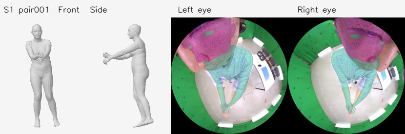

[查看正面](assets/pair001/front.jpg) · [查看侧面](assets/pair001/side.jpg) · [查看左目原图叠加](assets/pair001/left.jpg) · [查看右目原图叠加](assets/pair001/right.jpg)

**pair022 · seq_3-0-58 · 第 0 帧**　12 点 PA 53.59 mm，非 PA 58.98 mm。

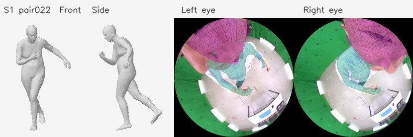

[查看正面](assets/pair022/front.jpg) · [查看侧面](assets/pair022/side.jpg) · [查看左目原图叠加](assets/pair022/left.jpg) · [查看右目原图叠加](assets/pair022/right.jpg)

**pair028 · seq_3-1-36 · 第 0 帧**　12 点 PA 32.58 mm，非 PA 64.84 mm。

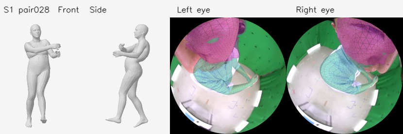

[查看正面](assets/pair028/front.jpg) · [查看侧面](assets/pair028/side.jpg) · [查看左目原图叠加](assets/pair028/left.jpg) · [查看右目原图叠加](assets/pair028/right.jpg)

**pair034 · seq_3-1-78 · 第 0 帧**　12 点 PA 48.13 mm，非 PA 60.77 mm。

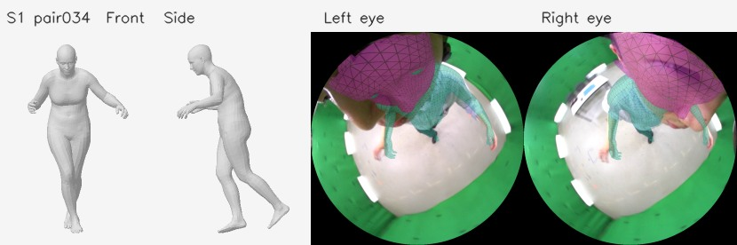

[查看正面](assets/pair034/front.jpg) · [查看侧面](assets/pair034/side.jpg) · [查看左目原图叠加](assets/pair034/left.jpg) · [查看右目原图叠加](assets/pair034/right.jpg)

## S9

**pair045 · seq_1-0-8 · 第 20 帧**　12 点 PA 41.80 mm，非 PA 46.08 mm。

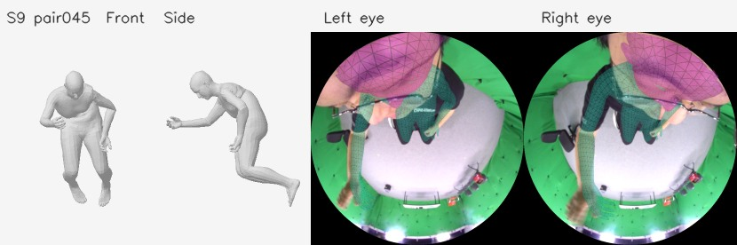

[查看正面](assets/pair045/front.jpg) · [查看侧面](assets/pair045/side.jpg) · [查看左目原图叠加](assets/pair045/left.jpg) · [查看右目原图叠加](assets/pair045/right.jpg)

**pair055 · seq_1-1-17 · 第 20 帧**　12 点 PA 41.62 mm，非 PA 46.06 mm。

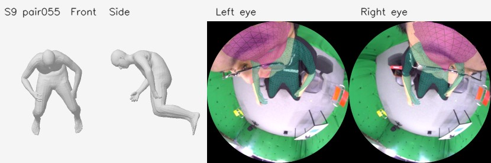

[查看正面](assets/pair055/front.jpg) · [查看侧面](assets/pair055/side.jpg) · [查看左目原图叠加](assets/pair055/left.jpg) · [查看右目原图叠加](assets/pair055/right.jpg)

**pair036 · seq_1-0-1 · 第 760 帧**　12 点 PA 32.04 mm，非 PA 50.03 mm。

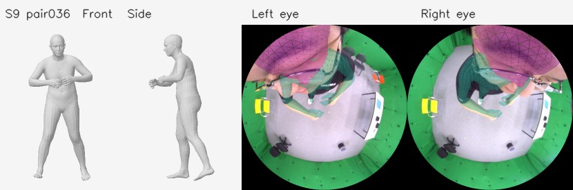

[查看正面](assets/pair036/front.jpg) · [查看侧面](assets/pair036/side.jpg) · [查看左目原图叠加](assets/pair036/left.jpg) · [查看右目原图叠加](assets/pair036/right.jpg)

**pair037 · seq_1-0-11 · 第 0 帧**　12 点 PA 43.42 mm，非 PA 48.69 mm。

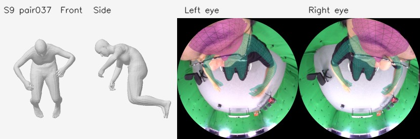

[查看正面](assets/pair037/front.jpg) · [查看侧面](assets/pair037/side.jpg) · [查看左目原图叠加](assets/pair037/left.jpg) · [查看右目原图叠加](assets/pair037/right.jpg)

## S11

**pair078 · seq_1-0-30 · 第 0 帧**　12 点 PA 33.02 mm，非 PA 73.67 mm。

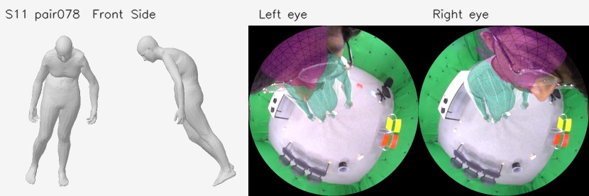

[查看正面](assets/pair078/front.jpg) · [查看侧面](assets/pair078/side.jpg) · [查看左目原图叠加](assets/pair078/left.jpg) · [查看右目原图叠加](assets/pair078/right.jpg)

**pair068 · seq_1-0-0 · 第 0 帧**　12 点 PA 32.64 mm，非 PA 44.97 mm。

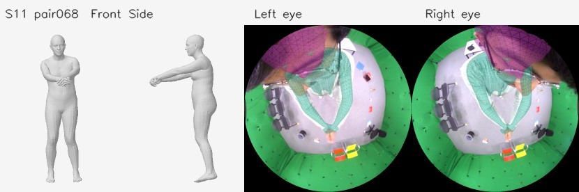

[查看正面](assets/pair068/front.jpg) · [查看侧面](assets/pair068/side.jpg) · [查看左目原图叠加](assets/pair068/left.jpg) · [查看右目原图叠加](assets/pair068/right.jpg)

**pair094 · seq_1-1-18 · 第 0 帧**　12 点 PA 37.81 mm，非 PA 60.75 mm。

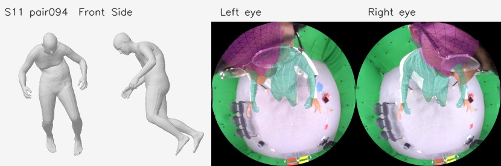

[查看正面](assets/pair094/front.jpg) · [查看侧面](assets/pair094/side.jpg) · [查看左目原图叠加](assets/pair094/left.jpg) · [查看右目原图叠加](assets/pair094/right.jpg)

**pair088 · seq_1-1-13 · 第 110 帧**　12 点 PA 86.08 mm，非 PA 106.05 mm。

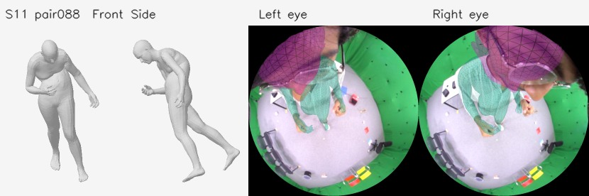

[查看正面](assets/pair088/front.jpg) · [查看侧面](assets/pair088/side.jpg) · [查看左目原图叠加](assets/pair088/left.jpg) · [查看右目原图叠加](assets/pair088/right.jpg)

## 来源与核查

每个 OBJ 为两眼共享的 SMPL-X 网格，单位为米，坐标系以左相机为原点，X 向右、Y 向下、Z 向前。拟合时使用双目 12 点、逐帧肩髋初始化、头随上胸、自由脚。网格读回后按拟合的骨盆方向渲染正面和相差 90° 的侧面。左右目分别使用该帧保存的外参和鱼眼标定，并将像素变换还原到 872 × 872 的原始图。叠加按网格自身深度处理可见面，颜色与轮廓用于查看预测表面，未测量场景遮挡。[导出与投影代码](gallery.py)

核对原报告检查点、双目图片文件、相机标定及评测输入散列，逐对复算非 PA、PA 和左右目对真值重投影 RMSE，与原报告的差均小于 0.001（分别为 mm、px）。ZIP 已逐成员解包并核验散列。实际基线为 `97bd8ceee9c09083fb6db6ab2a22b1a551e47f45`，工作树含既有无关改动与本轮文件。[每个样本的图像及网格校验记录](evidence/renders_rw20000.json) · [附件大小与 SHA-256](evidence/attachment_audit.json)

推送前检查工作区、暂存、待推提交与远端基线。本轮 Git 增量仅含代码、文档、精简证据及用户指定的无 EXIF 渲染图，OBJ 打包作为 Release 附件。单文件低于 50 MB，排查权重、数据集、视频、数组、完整预测、原始输入、机器路径、凭据、.env、完整 provenance 和补丁。[增量检查](evidence/prepush.json)
