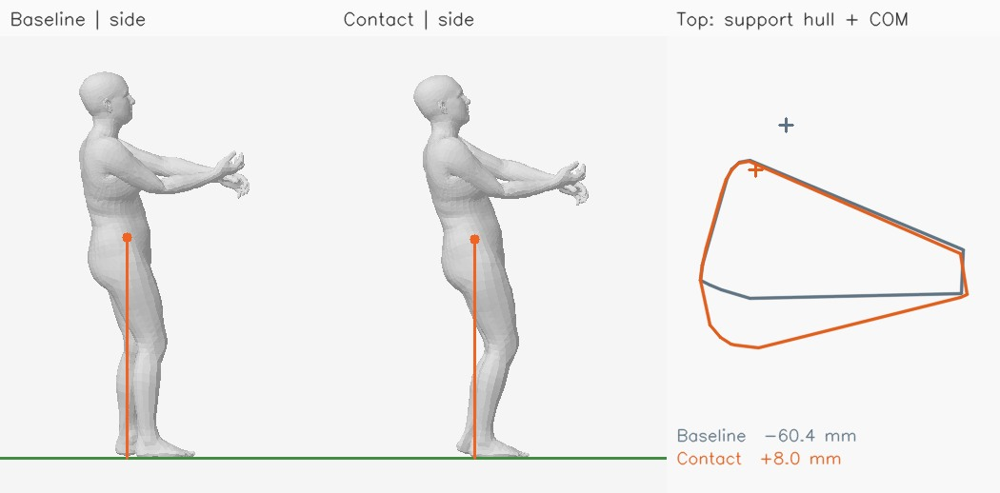
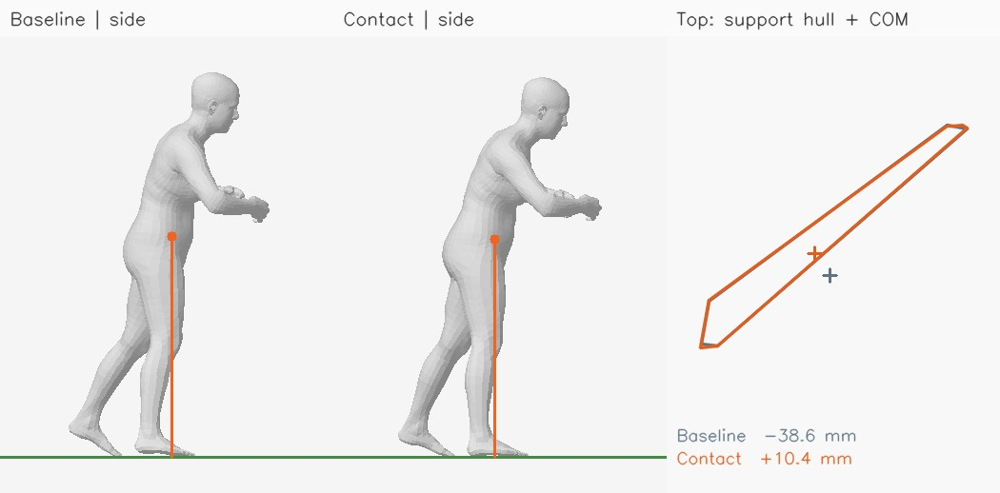
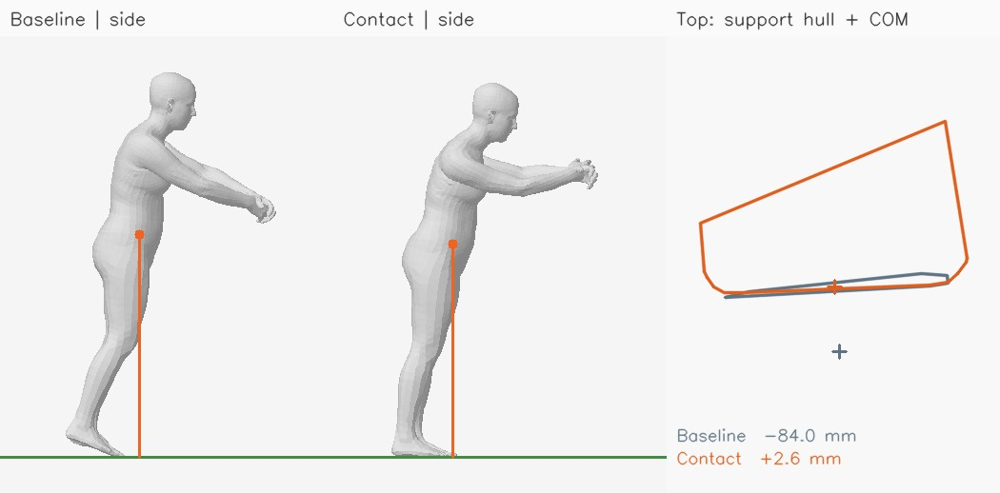
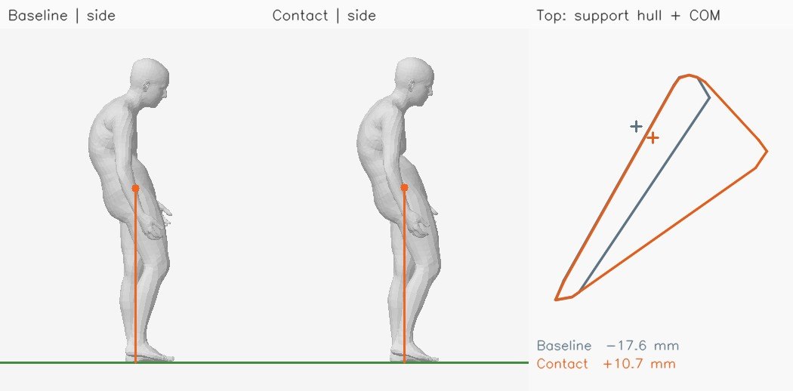

# RW20000 单对双目站姿平衡

按原图判断，原图库里有四对比较像双脚站立。在假设的水平面上，保持足底接触并施加强平衡约束，让四对的重心投影都进入了支撑区。不过，原始双目观测和官方身体真值均更支持自由脚基线。建议把当前方法用于检查站姿，保留原人体拟合作为默认输出。[汇总](evidence/summary.json) · [原图库](../2026-11-20_rw20000_frozen_mesh12/report.md)

| 四对站姿 | 重心在支撑区内 | 平均支撑余量 mm ↑ | 12 点 PA mm ↓ | 12 点非 PA mm ↓ | 投影对官方点 RMSE px ↓ | 投影对检测点 RMSE px ↓ |
|---|---:|---:|---:|---:|---:|---:|
| 原自由脚拟合 | 0/4 | -50.2 | 34.16 | 54.19 | 16.09 | 11.90 |
| 弱约束 | 0/4 | -32.5 | 35.94 | 59.72 | 17.83 | 13.64 |
| 强约束 | 2/4 | -0.5 | 48.39 | 86.60 | 26.72 | 24.29 |
| 强约束并保持接触 | 4/4 | +7.9 | 47.66 | 85.99 | 26.82 | 24.45 |

支撑余量取投影质心到最不利支撑边的有符号垂距。正值在区内，负值表示越过至少一条边。每种方案评分时均从最终网格重新提取接触区。PA 在每对的 12 点上单独做相似变换，非 PA 在左相机系评分。二维径向 RMSE 在原图上按左右目所有有效点汇总。[逐帧三维与逐目二维证据](evidence/renders_all.json)

## 四个站姿的实际网格

左、中的侧视图共用视角、尺度和候选地面，橙线从人体质心沿假设重力向下。右侧俯视图中，十字为质心投影，轮廓为支撑区，灰色为原拟合，橙色为优化后。网格叠加使用左相机几何和归档双目标定。

| 样本 | 支撑余量，原 → 最终 mm | PA，原 → 最终 mm | 非 PA，原 → 最终 mm | 对官方二维 RMSE，原 → 最终 px | 最终图 |
|---|---:|---:|---:|---:|---|
| pair001 | -60.4 → +8.0 | 38.94 → 50.19 | 48.10 → 74.84 | 15.69 → 26.60 | [侧视与俯视](assets/pair001/contact_comparison.jpg) · [左目](assets/pair001/contact_left.jpg) · [右目](assets/pair001/contact_right.jpg) |
| pair036 | -38.6 → +10.4 | 32.04 → 39.40 | 50.03 → 70.18 | 18.00 → 26.93 | [侧视与俯视](assets/pair036/contact_comparison.jpg) · [左目](assets/pair036/contact_left.jpg) · [右目](assets/pair036/contact_right.jpg) |
| pair068 | -84.0 → +2.6 | 32.64 → 66.17 | 44.97 → 120.12 | 17.53 → 34.80 | [侧视与俯视](assets/pair068/contact_comparison.jpg) · [左目](assets/pair068/contact_left.jpg) · [右目](assets/pair068/contact_right.jpg) |
| pair078 | -17.6 → +10.7 | 33.02 → 34.89 | 73.67 → 78.83 | 12.58 → 15.29 | [侧视与俯视](assets/pair078/contact_comparison.jpg) · [左目](assets/pair078/contact_left.jpg) · [右目](assets/pair078/contact_right.jpg) |

**pair001**

**pair036**

**pair068**

**pair078**

## 竖直方向与实际可用性

四对在候选竖直下都通过。保持人体和接触区不变，将载荷方向分别沿平面两个轴向正、负各偏 5°，四个方向仍全部通过的有 0/4。用独立估计的地毯面做事后检验，pair078 的候选竖直与地毯法向相差 6.42°。该帧原拟合躯干相对地毯竖直已经只有 2.70°。地毯证据只在拟合完成后读取，无法验证其他三帧或绝对地面高度。[载荷敏感性](evidence/balance_contact.json) · [地毯对照](../2026-11-20_rw20000_floor3/report.md)

## 实验设置

1. 按双目原图区分样本。主组为上表四对。pair022、028、034、088 看起来直立，可能在迈步或换重心，单列弱约束诊断。pair037、045、055、094 为明显屈膝、坐姿候选，跳过静态拟合。单帧图像无法确认真实受力或加速度。[样本及指纹](evidence/inputs.json)

2. 每对从其归档 RW20000 自由脚 SMPL-X 结果独立起步，保留原体型、随上胸转动的头和原实验的官方头部位置输入。把俯视左相机的光轴反向作为“上”的先验。从当前网格的足底候选支撑面中找与该先验最接近、可支撑双脚且不穿过原网格的面，搜索范围 45°。面高取沿该法向的最低点。距面 5 mm 内的足底顶点定义接触区。该面在后续优化中保持固定。这个假设会把原拟合中的足底位置误差带进来，无法独立测出绝对悬空高度。无 IMU、地面像素或相邻帧输入。[平面与拟合代码](balance.py)

3. 按人体分段质量估算全身质心，重力线穿过质心。躯干、大腿等以 SMPL-X 关节近似节段端点，头颈质心用头关节代理。静态投影条件只依赖相对质量，统一改变人体总质量不会移动质心。只检验足底支撑几何，未估计实际压力分布、摩擦或关节力矩。[分段参考表](https://holmeslab.ca/csb-scb/Archives/dempster.pdf) · [质量系数实现](balance.py)

4. 二次优化可调整身体姿态及根位姿，保留旧拟合的有效 12 点双目投影、头部位置和接触角点的软约束。旧拟合已经使用 RW20000 检测点。本轮投影保持项以旧拟合投影为目标，另行报告对实际检测点和官方二维点的误差。弱约束只惩罚重心越界。强约束加大权重并以进入原支撑区 12 mm 为目标。首次强约束有两帧在原多边形内、重算接触区后却落在区外。第三组增加原接触边界顶点保持在接触带内的软约束，全程未强制脚底放平。[弱约束](evidence/balance.json) · [强约束](evidence/balance_strong.json) · [强约束并保持接触](evidence/balance_contact.json)

## 承重不明样本及其他对照

承重不明的四帧仅做弱约束，优化后 0/4 进入支撑区，整体 PA 从 55.09 变为 68.48 mm。此组不计入主表。单帧走路可能自然地不满足静态平衡。[独立汇总](evidence/summary.json)

| 样本 | 弱约束结果 | 首次强约束结果 |
|---|---|---|
| pair001 | [侧视与俯视](assets/pair001/soft_comparison.jpg) · [左目](assets/pair001/soft_left.jpg) · [右目](assets/pair001/soft_right.jpg) | [侧视与俯视](assets/pair001/strong_comparison.jpg) · [左目](assets/pair001/strong_left.jpg) · [右目](assets/pair001/strong_right.jpg) |
| pair036 | [侧视与俯视](assets/pair036/soft_comparison.jpg) · [左目](assets/pair036/soft_left.jpg) · [右目](assets/pair036/soft_right.jpg) | [侧视与俯视](assets/pair036/strong_comparison.jpg) · [左目](assets/pair036/strong_left.jpg) · [右目](assets/pair036/strong_right.jpg) |
| pair068 | [侧视与俯视](assets/pair068/soft_comparison.jpg) · [左目](assets/pair068/soft_left.jpg) · [右目](assets/pair068/soft_right.jpg) | [侧视与俯视](assets/pair068/strong_comparison.jpg) · [左目](assets/pair068/strong_left.jpg) · [右目](assets/pair068/strong_right.jpg) |
| pair078 | [侧视与俯视](assets/pair078/soft_comparison.jpg) · [左目](assets/pair078/soft_left.jpg) · [右目](assets/pair078/soft_right.jpg) | [侧视与俯视](assets/pair078/strong_comparison.jpg) · [左目](assets/pair078/strong_left.jpg) · [右目](assets/pair078/strong_right.jpg) |
| pair022 | [侧视与俯视](assets/pair022/soft_comparison.jpg) · [左目](assets/pair022/soft_left.jpg) · [右目](assets/pair022/soft_right.jpg) | — |
| pair028 | [侧视与俯视](assets/pair028/soft_comparison.jpg) · [左目](assets/pair028/soft_left.jpg) · [右目](assets/pair028/soft_right.jpg) | — |
| pair034 | [侧视与俯视](assets/pair034/soft_comparison.jpg) · [左目](assets/pair034/soft_left.jpg) · [右目](assets/pair034/soft_right.jpg) | — |
| pair088 | [侧视与俯视](assets/pair088/soft_comparison.jpg) · [左目](assets/pair088/soft_left.jpg) · [右目](assets/pair088/soft_right.jpg) | — |

## OBJ 与复核

压缩包按样本和方案区分，包含同一几何的 left_camera.obj 与 support_Y_up.obj。前者为原左相机坐标，后者以候选法向为 Y 轴，以相机原点在面上的投影为原点，以原骨盆前向在平面上的投影确定水平方位。单位均为米。可从 standing/contact/pair078/ 看起。[下载 OBJ](https://github.com/cdh290718-oss/DownSight/releases/download/rw20000-single-pair-stance-balance-20261120/RW20000_stance_balance_OBJ.zip) · [附件文件名与 SHA-256](evidence/attachment_audit.json)

运行基线为 fe573bb52cf18541932160ae7418cc01e7d34d0e，使用当时工作树新增的本轮脚本。工作树另有此前产生的无关改动。本轮复核了原始 OBJ、归档输入和相机指纹，并用模型输出重算旧模型的 PA、非 PA、拟合对检测和官方点的二维 RMSE，与归档值在 0.001 以内。使用既有身体环境的 CPU，依次运行 balance.py（默认、--strong、--contact）和 inspect_fit.py。[输入指纹](evidence/inputs.json) · [测量与渲染代码](inspect_fit.py)

发布增量仅包含本轮文档、脚本、脱敏摘要和网格可视化 JPEG。核查工作区、暂存内容、远端基线与待推提交，排除其他改动。Git 增量逐文件核验大小、图片格式、摘要、机器路径和凭据，没有权重、原图数据集或完整原始输出。OBJ 以单独的 Release 附件提供，逐项校验压缩包成员和内容哈希。[增量自检](evidence/prepush.json) · [附件自检](evidence/attachment_audit.json)
