# 用双目相机方向展示 12 个 RW20000 人体

仅把原图库的每个 OBJ 整体旋转到由两台相机定义的 Y-up 坐标。没有重新拟合身体、摆脚、拉直躯干、对齐地面或施加额外俯仰角。适合按同一规则查看不同动作，尤其是坐姿。相机随头部俯仰，仍会影响这种视图里的整体倾角。[下载 12 个 OBJ](https://github.com/cdh290718-oss/DownSight/releases/download/rw20000-stereo-axes-20261120/RW20000_stereo_axes_12_OBJ.zip?download=1) · [文件校验值](evidence/attachment_audit.json)

## 三帧有独立地面参考的结果

支撑未参与导出。用此前从双目地毯重建的法向作事后参照，计算竖直与躯干的三维夹角。躯干轴从双髋中点指向双肩中点。[地毯方法及不确定性](../2026-11-20_rw20000_floor3/report.md) · [逐帧数值](evidence/renders_stereo.json)

| 样本 | 双目“上”与地毯“上”的夹角 | 躯干相对双目“上” | 同一躯干相对地毯“上” |
|---|---:|---:|---:|
| pair045 | 18.95° | 8.07° | 18.31° |
| pair055 | 24.58° | 17.21° | 27.26° |
| pair078 | 16.14° | 15.25° | 2.70° |

pair078 用新视图看，原图库中的明显前趴变为略后仰。这一帧的躯干按地毯参考已接近竖直。两种参照之间的差异也会让坐姿显得更直，如 pair045。地毯方向在新坐标系的前后分量，在 pair045、055 与 pair078 之间符号相反。本轮没有依据为全部样本再统一加一个俯仰修正。

## 新旧视图与左右目叠图

每张图依次为原视图正面、新正面、原视图侧面、新侧面。原视图沿用旧图库的骨盆旋转选取观察方向。新视图按双目支架固定选方向，以导出 OBJ 的 −Z 一侧作为正面观察位置。每对四栏的尺度一致、按同一骨盆取景。OBJ 坐标原点保留在左相机，Y=0 对应相机高度。左右目链接使用原归档叠图，投影回检见下文。

**S11 · pair078**　[左目](../2026-11-20_rw20000_frozen_mesh12/assets/pair078/left.jpg) · [右目](../2026-11-20_rw20000_frozen_mesh12/assets/pair078/right.jpg)

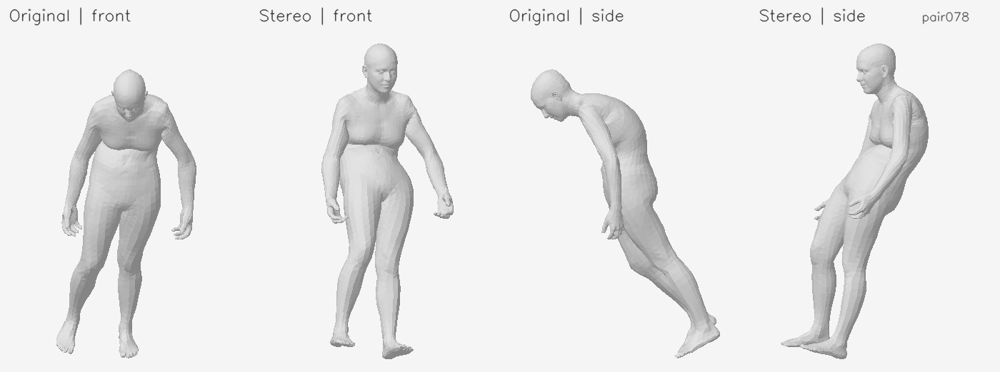

**S9 · pair045**　[左目](../2026-11-20_rw20000_frozen_mesh12/assets/pair045/left.jpg) · [右目](../2026-11-20_rw20000_frozen_mesh12/assets/pair045/right.jpg)

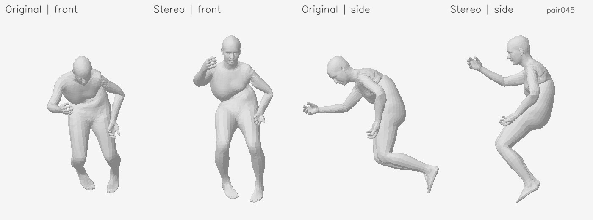

**S9 · pair055**　[左目](../2026-11-20_rw20000_frozen_mesh12/assets/pair055/left.jpg) · [右目](../2026-11-20_rw20000_frozen_mesh12/assets/pair055/right.jpg)

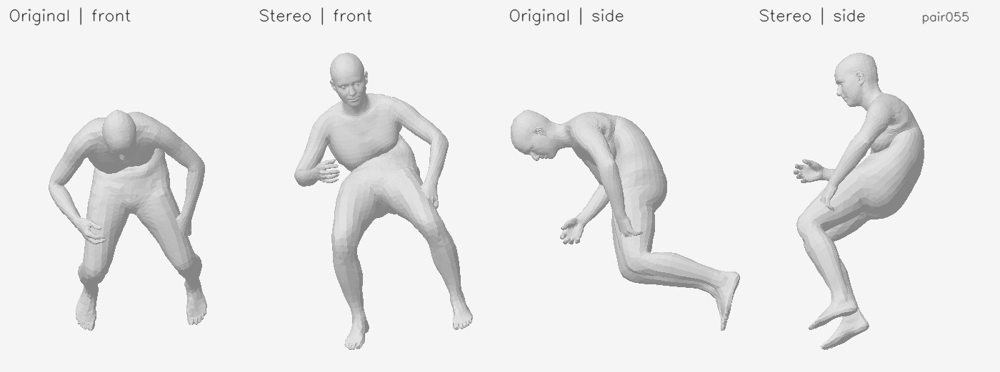

**S1 · pair001**　[左目](../2026-11-20_rw20000_frozen_mesh12/assets/pair001/left.jpg) · [右目](../2026-11-20_rw20000_frozen_mesh12/assets/pair001/right.jpg)

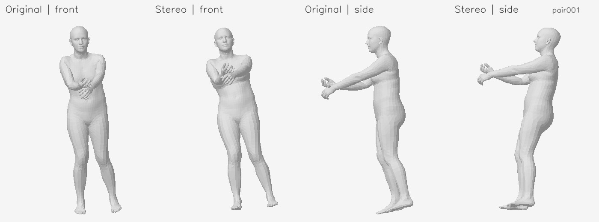

**S1 · pair022**　[左目](../2026-11-20_rw20000_frozen_mesh12/assets/pair022/left.jpg) · [右目](../2026-11-20_rw20000_frozen_mesh12/assets/pair022/right.jpg)

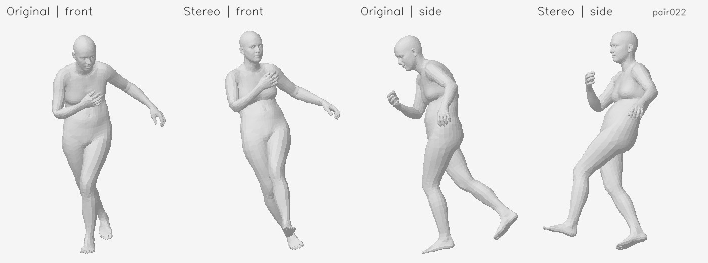

**S1 · pair028**　[左目](../2026-11-20_rw20000_frozen_mesh12/assets/pair028/left.jpg) · [右目](../2026-11-20_rw20000_frozen_mesh12/assets/pair028/right.jpg)

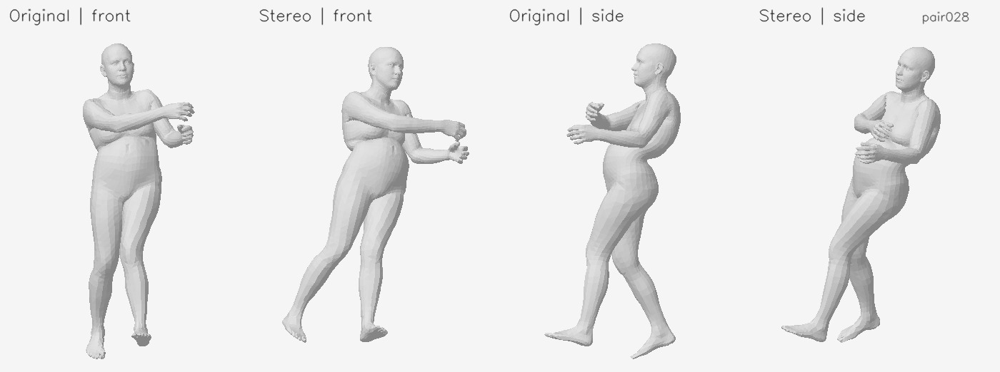

**S1 · pair034**　[左目](../2026-11-20_rw20000_frozen_mesh12/assets/pair034/left.jpg) · [右目](../2026-11-20_rw20000_frozen_mesh12/assets/pair034/right.jpg)

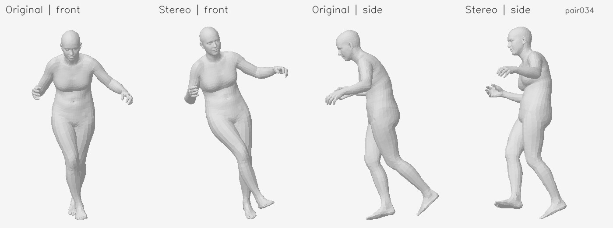

**S9 · pair036**　[左目](../2026-11-20_rw20000_frozen_mesh12/assets/pair036/left.jpg) · [右目](../2026-11-20_rw20000_frozen_mesh12/assets/pair036/right.jpg)

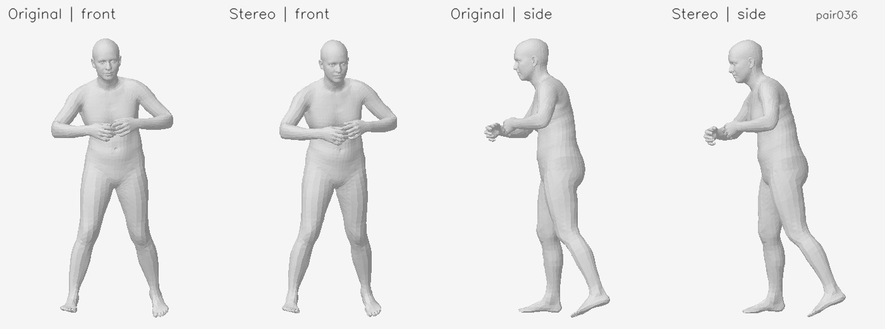

**S9 · pair037**　[左目](../2026-11-20_rw20000_frozen_mesh12/assets/pair037/left.jpg) · [右目](../2026-11-20_rw20000_frozen_mesh12/assets/pair037/right.jpg)

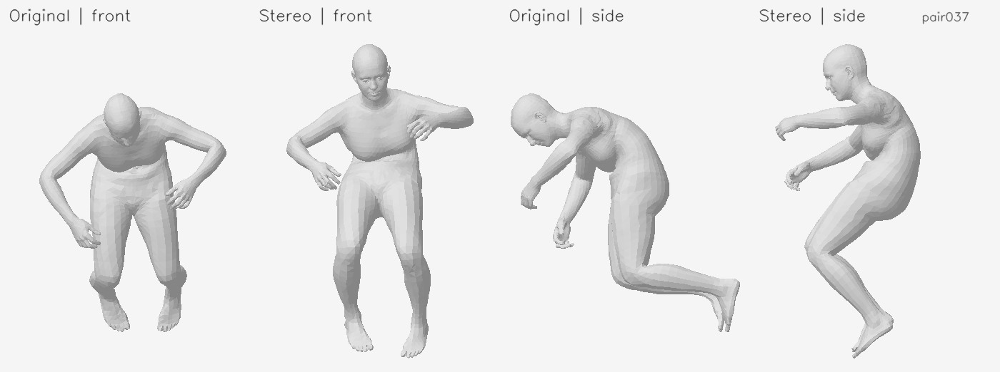

**S11 · pair068**　[左目](../2026-11-20_rw20000_frozen_mesh12/assets/pair068/left.jpg) · [右目](../2026-11-20_rw20000_frozen_mesh12/assets/pair068/right.jpg)

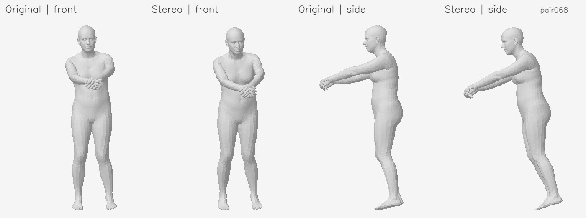

**S11 · pair088**　[左目](../2026-11-20_rw20000_frozen_mesh12/assets/pair088/left.jpg) · [右目](../2026-11-20_rw20000_frozen_mesh12/assets/pair088/right.jpg)

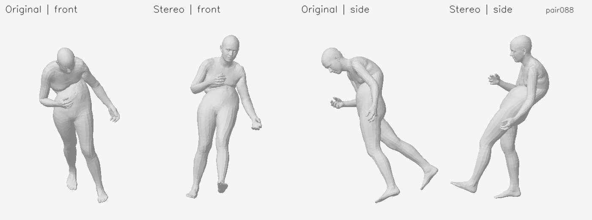

**S11 · pair094**　[左目](../2026-11-20_rw20000_frozen_mesh12/assets/pair094/left.jpg) · [右目](../2026-11-20_rw20000_frozen_mesh12/assets/pair094/right.jpg)

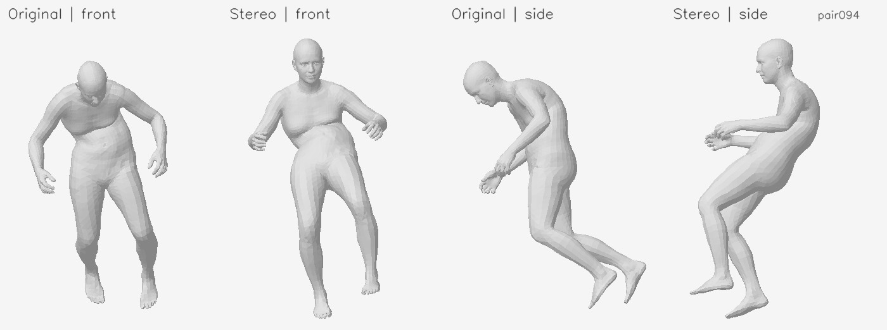

## 旋转与验证

以左到右的相机中心连线为 X。若外参将左相机点映射到右相机，右相机中心在左系为 −Rᵀt。将两个镜头的光轴都换到左系后取平均，去掉沿 X 的分量，归一化并反向得到 Y，即假设的“上”。Z 为 X 与 Y 的叉积。三轴构成右手正交基，只用拍摄会话的双目外参。外参沿用冻结集由其他帧标注辅助恢复的版本。当前帧的头、躯干、脚和地毯均未参与选轴。[代码](export_rig.py) · [归档标定来源](../2026-11-18_rw_frozen200_golden_d/report.md)

导出前逐个核对源 OBJ 的 SHA-256，重新读取写盘的 OBJ，检查三角面顶点顺序和每个顶点。逆变换回左相机后，最大顶点误差为 8.63e-10 m；分别投影到左、右原图，所有顶点的最大像素差为 4.58e-06、4.19e-06 px。在预测与真值处于同一坐标系时，12 对上 12 点平均 PA 为 43.47 mm、非 PA 为 59.08 mm，旋转前后数值相同。[逐对象几何和投影回检](evidence/renders_stereo.json)

运行基线为 3e473cf67f6b39f20e5a19f8f211bfb27a070931，在有既存无关改动的工作树中运行本轮新增的 export_rig.py。输入为原图库 S1、S9、S11 的 RW20000 自由脚拟合、归档相机和检查点。未使用上轮平衡修正后的网格。逐帧数据含坐标变换与输入指纹。所需检查点、原始数据及现有身体后端保留在开发环境。此结果限于孤立双目对，无法据此判断视频世界系稳定性或绝对离地高度。[原网格来源](../2026-11-20_rw20000_frozen_mesh12/report.md)

推送前检查了工作树、暂存文件、远端基线及待推提交。本轮 Git 增量仅有本轮代码、文档、证据和比较图，各文件小于 50 MB；无权重、视频、原始数据、机器绝对路径、凭据或完整本地输出。附件独立核对清单、压缩包完整性及 OBJ 摘要。命令中的环境路径已替换为占位符。[推送前自检](evidence/prepush.json) · [附件自检](evidence/attachment_audit.json)
