# 固定躯干、四肢联合候选 · 双目原图与地面视角

每行是同一帧，依次为左目、右目、OBJ 地面正视图、OBJ 地面侧视图。点击图片可单独查看。左右目保留完整画幅，无检测点或网格叠加；在线提供缩小的 JPEG 预览。开发机离线包附逐字节一致的双目原始 PNG 和各帧 OBJ。

[旧图库的 12 对](#旧图库的-12-对) · [验证集新抽的 12 对](#验证集新抽的-12-对) · [原地面图库](../2026-11-20_rw20000_floor12/report.md) · [候选方法](../2026-11-23_fullbody_joint_candidates/report.md)

## 旧图库的 12 对

逐帧沿用原报告的地面法向与骨盆前向。地面方向通过内部检查 9/12；暂定帧为 pair001、pair034、pair068。相对原版黄金 D v2，固定躯干候选选出了新姿态的样本为 pair088。

| 样本 · 地面方向 | 左目原图 | 右目原图 | OBJ 正面 | OBJ 侧面 |
|---|---|---|---|---|
| S1 / pair001 · 暂定 | [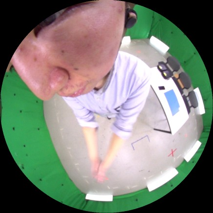](assets/pair001/left.jpg) | [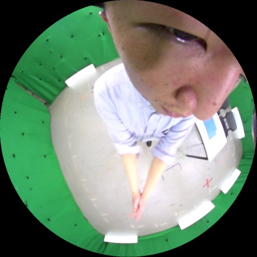](assets/pair001/right.jpg) | [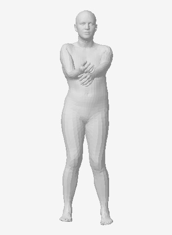](assets/pair001/front.jpg) | [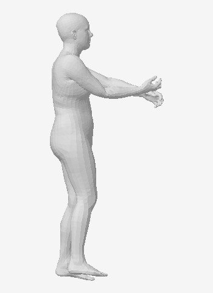](assets/pair001/side.jpg) |
| S1 / pair022 · 通过 | [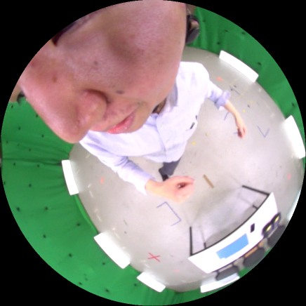](assets/pair022/left.jpg) | [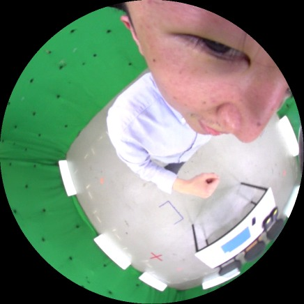](assets/pair022/right.jpg) | [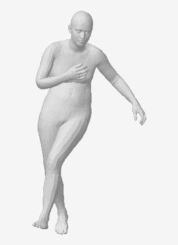](assets/pair022/front.jpg) | [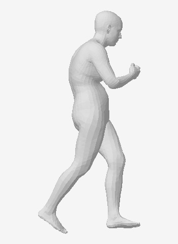](assets/pair022/side.jpg) |
| S1 / pair028 · 通过 | [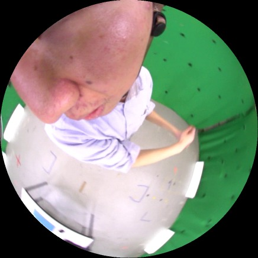](assets/pair028/left.jpg) | [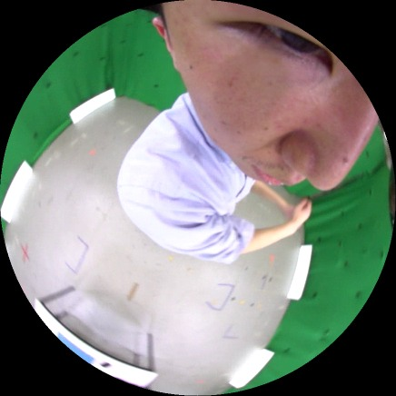](assets/pair028/right.jpg) | [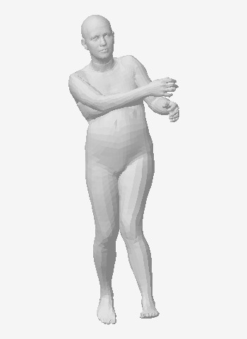](assets/pair028/front.jpg) | [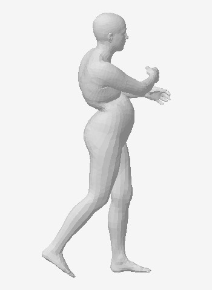](assets/pair028/side.jpg) |
| S1 / pair034 · 暂定 | [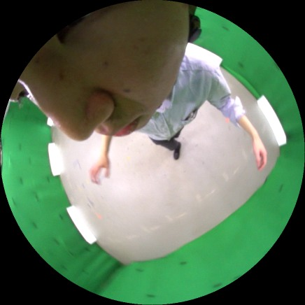](assets/pair034/left.jpg) | [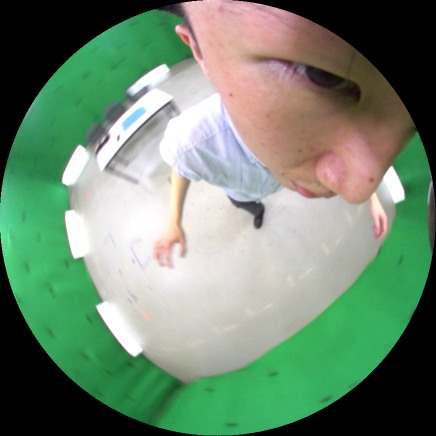](assets/pair034/right.jpg) | [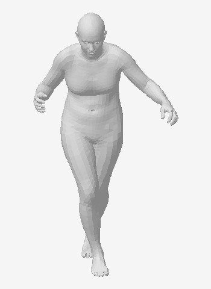](assets/pair034/front.jpg) | [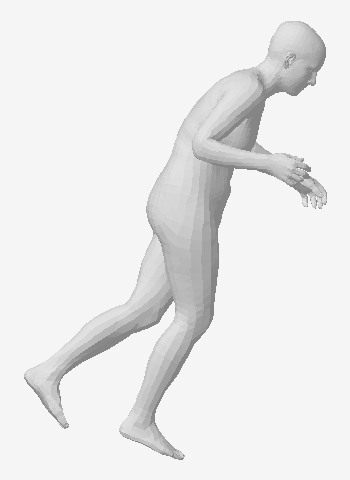](assets/pair034/side.jpg) |
| S9 / pair036 · 通过 | [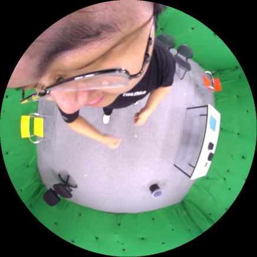](assets/pair036/left.jpg) | [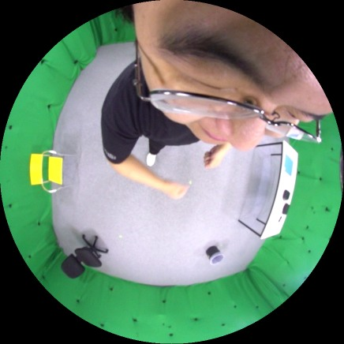](assets/pair036/right.jpg) | [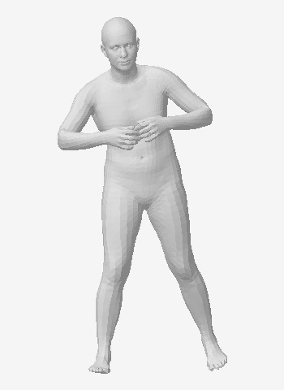](assets/pair036/front.jpg) | [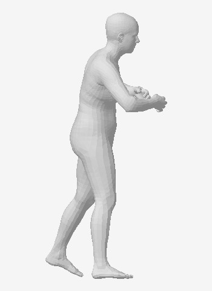](assets/pair036/side.jpg) |
| S9 / pair037 · 通过 | [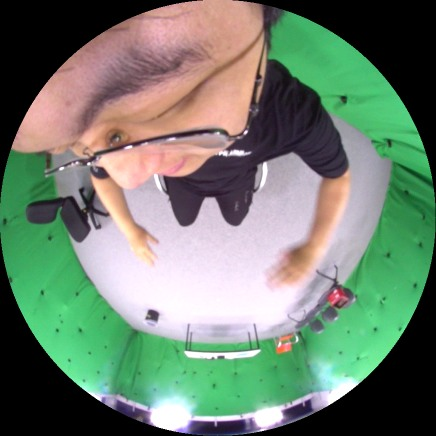](assets/pair037/left.jpg) | [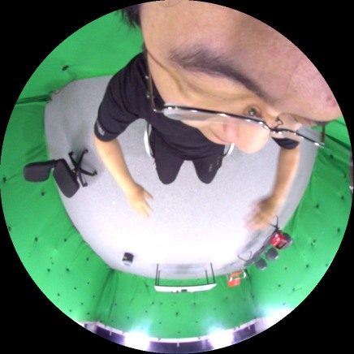](assets/pair037/right.jpg) | [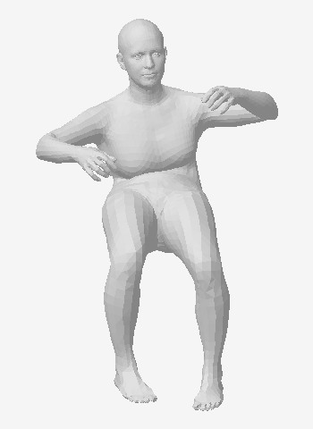](assets/pair037/front.jpg) | [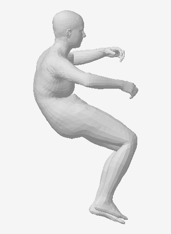](assets/pair037/side.jpg) |
| S9 / pair045 · 通过 | [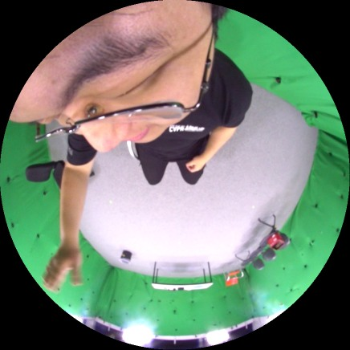](assets/pair045/left.jpg) | [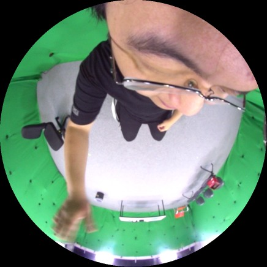](assets/pair045/right.jpg) | [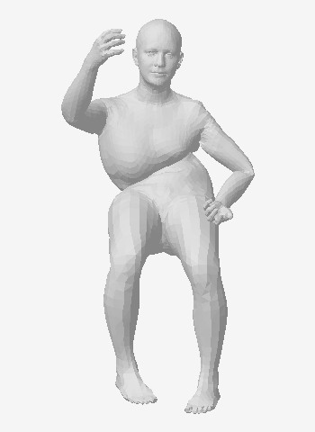](assets/pair045/front.jpg) | [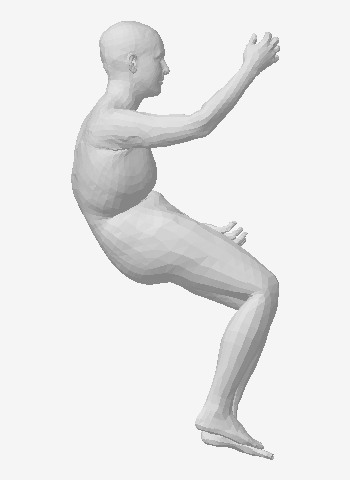](assets/pair045/side.jpg) |
| S9 / pair055 · 通过 | [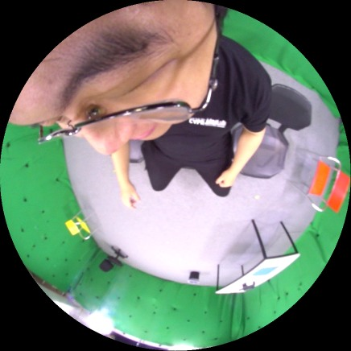](assets/pair055/left.jpg) | [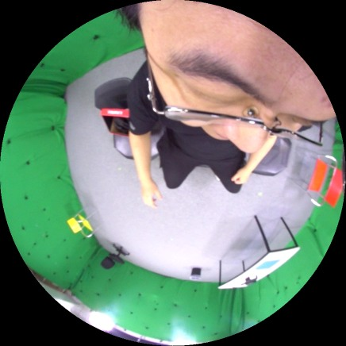](assets/pair055/right.jpg) | [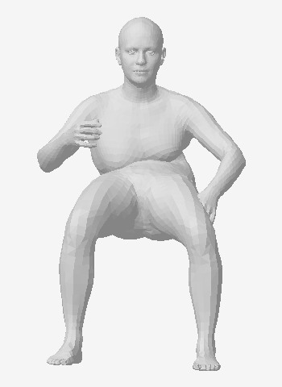](assets/pair055/front.jpg) | [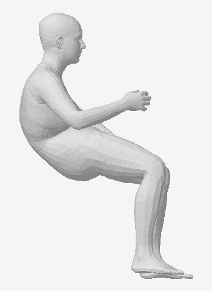](assets/pair055/side.jpg) |
| S11 / pair068 · 暂定 | [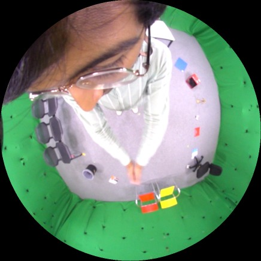](assets/pair068/left.jpg) | [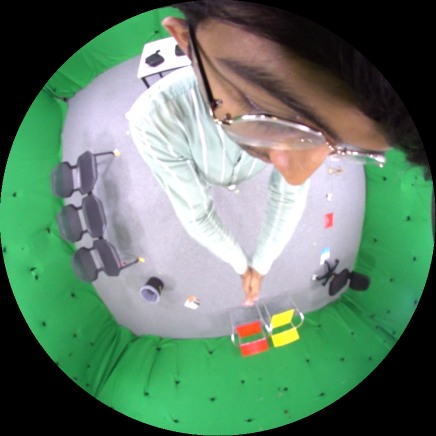](assets/pair068/right.jpg) | [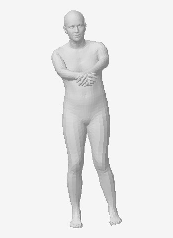](assets/pair068/front.jpg) | [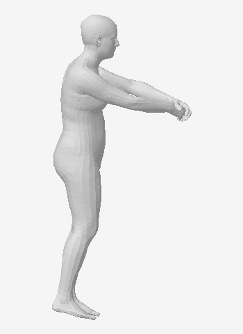](assets/pair068/side.jpg) |
| S11 / pair078 · 通过 | [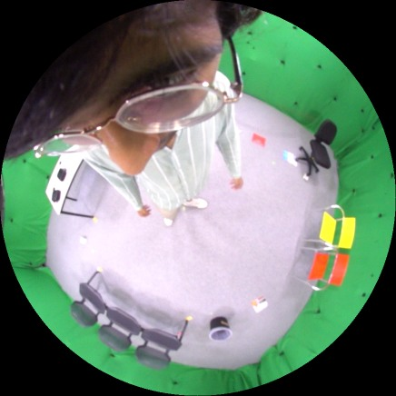](assets/pair078/left.jpg) | [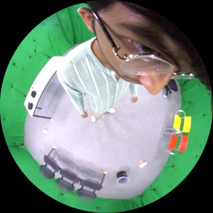](assets/pair078/right.jpg) | [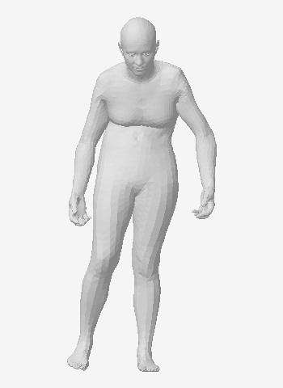](assets/pair078/front.jpg) | [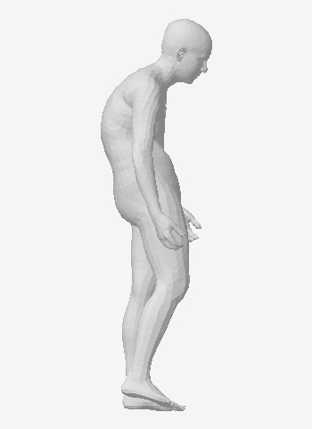](assets/pair078/side.jpg) |
| S11 / pair088 · 通过 | [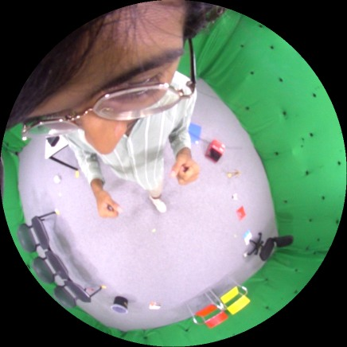](assets/pair088/left.jpg) | [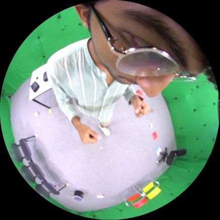](assets/pair088/right.jpg) | [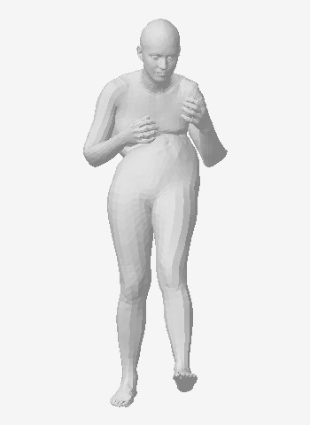](assets/pair088/front.jpg) | [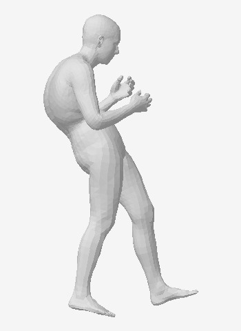](assets/pair088/side.jpg) |
| S11 / pair094 · 通过 | [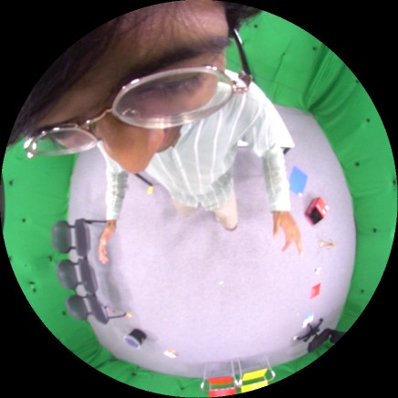](assets/pair094/left.jpg) | [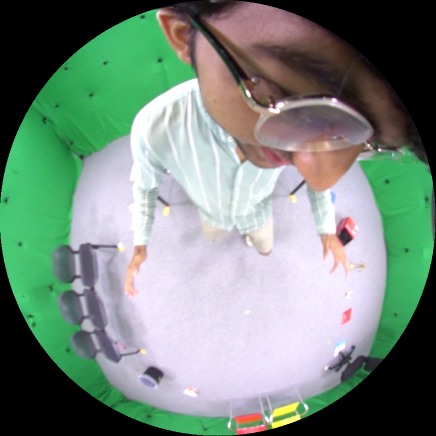](assets/pair094/right.jpg) | [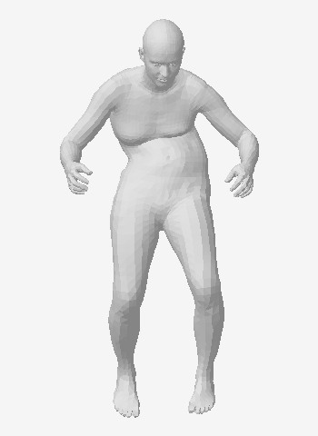](assets/pair094/front.jpg) | [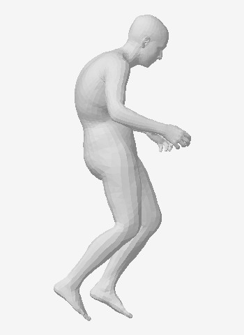](assets/pair094/side.jpg) |

## 验证集新抽的 12 对

从 200 对中按源样本标识的固定哈希顺序抽取。S3、S5、S13、S15 各三对，每人来自三个不同序列；抽样不使用姿态误差、是否改姿或地面质量。地面方向通过内部检查 8/12；暂定帧为 val017、val042、val073、val100。相对原版黄金 D v2，固定躯干候选选出了新姿态的样本为 val017、val178、val181。

| 样本 · 地面方向 | 左目原图 | 右目原图 | OBJ 正面 | OBJ 侧面 |
|---|---|---|---|---|
| S3 / val017 · 暂定 | [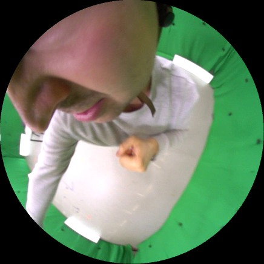](assets/val017/left.jpg) | [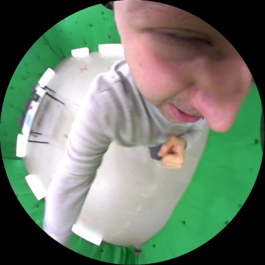](assets/val017/right.jpg) |  |  |
| S3 / val031 · 通过 |  |  |  |  |
| S3 / val042 · 暂定 |  |  |  |  |
| S5 / val055 · 通过 |  |  |  |  |
| S5 / val073 · 暂定 |  |  |  |  |
| S5 / val100 · 暂定 |  |  |  |  |
| S13 / val102 · 通过 |  |  |  |  |
| S13 / val122 · 通过 |  |  |  |  |
| S13 / val134 · 通过 |  |  |  |  |
| S15 / val168 · 通过 |  |  |  |  |
| S15 / val178 · 通过 |  |  |  |  |
| S15 / val181 · 通过 |  |  |  |  |

## 如何读图

旧组固定该帧地面法向和正侧视方位后重新渲染，保留原姿态的样本已逐张与旧正、侧图核对文件哈希。新组单独在左目圈选可见地面区域，结合右目和会话双目标定，由地面纹理匹配与三角化估计法向；稀疏支持不足时补做极线纹理匹配。两者都无法提供足够对应点时，用双眼纹理做平面扫描并标记暂定。地面方向仅用于取景；两视图同尺度、分别居中，画面底边不表示足底接地点。暂定帧的整体倾角有不确定性。[每帧地面拟合与诊断](evidence/gallery.json)

每帧复用上轮按黄金 D v2 原损失选出的固定躯干解。核对参数库与选择表指纹，检查根位姿、体型及躯干参数；从完整 SMPL-X 生成网格，将 OBJ 写入左相机米制坐标，再读回文件绘图。以官方关节点核对上轮对应帧的全身 MPJPE，容差 0.001 mm。去重同时检查源序列与帧号、双目图像哈希。[样本清单](evidence/sample.json) · [生成脚本](build_views.py)

## 文件与复现

开发机的离线图库为 `outputs/fixed_floor24_20261123/fixed_trunk_floor24.zip`。解压打开 `index.html` 即可按样本浏览原始 PNG、两张地面视图和 OBJ。文件摘要见[打包核验](evidence/gallery.json)。复跑需获准访问原图、已冻结的姿态参数、会话标定以及原 SMPL-X 环境，在仓库根目录依次运行本轮 sample.py、run.sh test、run.sh validation、package.py。

启动时的执行基线为 `c0c225eef7d39c344a7a61fd1e87566e3fd8a47e`。工作期间另一轮独立提交将共享工作树和远端更新至 `0a1c771`；核对差异仅涉及另一轮 runs 目录，本轮依赖与输入指纹一致。在这一新基线上完成发布自检。工作树包含本轮新增文件及既有无关改动。输入直接取自已冻结的两组结果。首轮 val017 的稀疏和极线方法均因对应点不足而退出，重试纳入稠密纹理估计并保留暂定标记。公开证据将机器路径改成仓库相对资源标识。[运行记录](evidence/execution.json)

推送前自检覆盖工作区、暂存文件、待推提交及远端基线。仅发布本轮源码、脱敏报告、数值摘要及四栏浏览图；检查了文件类型、体积、图像元数据、机器路径和凭据。原始 PNG、OBJ、离线 ZIP、完整输出和既有无关文件留在开发机。
