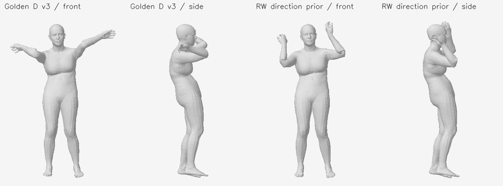
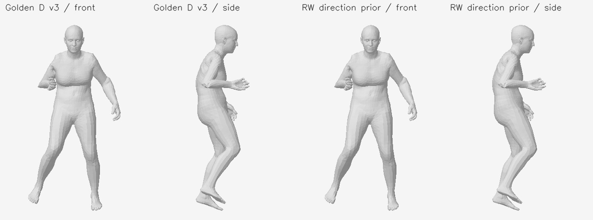

# 黄金 D v3 加四肢条件方向先验

在同一批输入和相同肢体方向、深度及躯干探测范围内比较 v3 原目标与附加 RW 条件方向项。执行基线 `b1e7d687f8a2409070c39dc405c6a0ef0cc76f32`，工作树有既有无关修改。RW20000、标定、Head 三维位置、观测掩码、体型与手部设置沿用黄金 D v3。候选选择时禁止打开身体三维真值与官方评测标注，事后才做评分。两组使用相同的肩髋初值与 v2/腕部起点。对照逐帧核对已归档的 v3 MPJPE。[原搜索](../2026-11-23_fullbody_joint_candidates/search.py) · [新选择器](select_pose.py)

论文官方代码及模型的下载入口在本次访问时转到登录页。本轮是 RW 上对论文“子骨段方向随父骨段变化”思想的适配。论文采用 17 点骨架、分箱及条件区域，本轮只用双臂双腿的 12 个点，使用 RW 动捕与近邻软边界。头部方向、手掌、穿插均未加入本轮。[官方入口](https://poseprior.is.tue.mpg.de/download.php) · [原论文](https://files.is.tue.mpg.de/black/papers/PosePriorCVPR2015.pdf)

## 整体效果

| 数据 | 方法 | 非 PA MPJPE mm | PA-MPJPE mm | 三维 RMSE mm | 双腕 RMSE mm | 对官方二维 RMSE px |
|---|---|---:|---:|---:|---:|---:|
| 验证 200 对 | v3 | 62.67 | 45.35 | 79.69 | 82.65 | 18.21 |
| 验证 200 对 | 加条件方向 | 62.53 | 45.26 | 79.40 | 80.62 | 18.27 |
| 冻结测试 100 对 | v3 | 58.73 | 41.22 | 71.41 | 83.31 | 17.91 |
| 冻结测试 100 对 | 加条件方向 | 58.68 | 41.08 | 71.20 | 81.54 | 18.05 |

逐帧按全身非 PA MPJPE 比较，0.01 mm 以内视为持平。 验证改善 / 变差 / 持平为 8 / 4 / 188。 测试改善 / 变差 / 持平为 2 / 2 / 96。[验证逐帧](evidence/validation_scores.json) · [测试逐帧](evidence/test_scores.json)

## 两个预先指定的验证帧

方向角是相机坐标中预测肘→腕与官方肘→腕的夹角，越低越好。正面、侧面使用原图库的地面法向与观看方向，同一帧两种解共用中心和比例。

| 帧 | 方法 | 左前臂方向误差 ° | 右前臂方向误差 ° | 全身非 PA mm | 全身 PA mm |
|---|---|---:|---:|---:|---:|
| val031 | v3 | 91.59 | 75.02 | 109.40 | 94.76 |
| val031 | 加条件方向 | 16.76 | 27.40 | 82.24 | 63.49 |
| val055 | v3 | 37.14 | 12.86 | 58.55 | 38.98 |
| val055 | 加条件方向 | 37.14 | 12.86 | 58.55 | 38.98 |

val031 的两侧前臂方向误差都显著下降，val055 原解的先验惩罚为零，选出的姿态相同。去掉 val031 后，另外 199 对验证帧非 PA MPJPE 为 62.434 → 62.427 mm，PA 为 45.101 → 45.170 mm。验证整体改善集中在该异常帧；两批整体官方二维误差略有上升。建议继续作可选纠错实验，暂时保留 v3。[执行与敏感性核对](evidence/execution.json)

### S3 / val031

### S5 / val055

## 先验和复跑

用官方训练清单去重后每个时间点取同一眼的三维标注，共 79,705 帧、9 人。左右肩和左右髋确定躯干坐标系。对每侧手臂/腿把上段和下段的三维单位方向拼成六维向量；某条链只有在训练姿态中能同时匹配父、子段方向，才会得到较小的最近邻距离。每条链用训练人物留一距离分布的第 95 百分位作阈值 τ。标准化的超界量 max(距离/τ−1,0) 求平方，四条链取平均后乘 0.01，与 v3 原目标相加。重新评分分链探测并重组完整姿态，同时保留原已组合候选。角度边界、损失系数预先固定，验证和测试没有参与拟合先验或调参。训练数据只描述其观察到的姿态范围；实际人体的全部活动范围可能更宽。[训练证据](evidence/training.json) · [方向定义](prior.py) · [预设方案](brief.md)

同一已有 CPU 身体环境（仓库根目录在 PYTHONPATH）运行 prior.py，再用 select_pose.py 分别选择 validation 和 test，之后对两个分割运行 evaluate.py，最后运行 show_cases.py。原始数据及训练库、候选参数留在受控存储，公开逐帧派生指标。未改黄金 D 默认配置。[验证输入与选择](evidence/validation_selection.json) · [测试输入与选择](evidence/test_selection.json) · [评分代码](evaluate.py) · [图像摘要](evidence/views.json)

推送前逐项检查工作区、暂存区、提交增量和远端基线。仅发布文本、精简派生证据及两张无 EXIF 的模型渲染图；单文件低于 50 MB，排除机器路径、凭据、模型、数据集、完整输出、环境文件及本地补丁。[增量自检](evidence/prepush.json)
