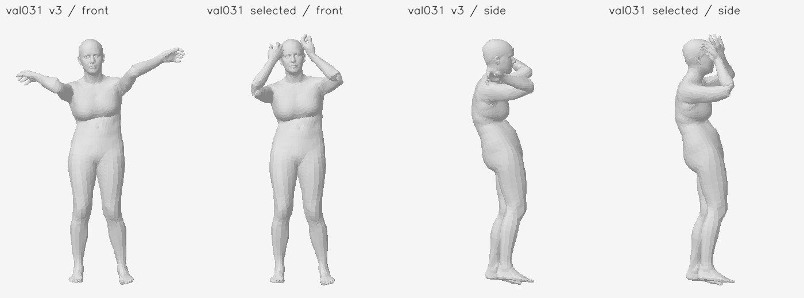
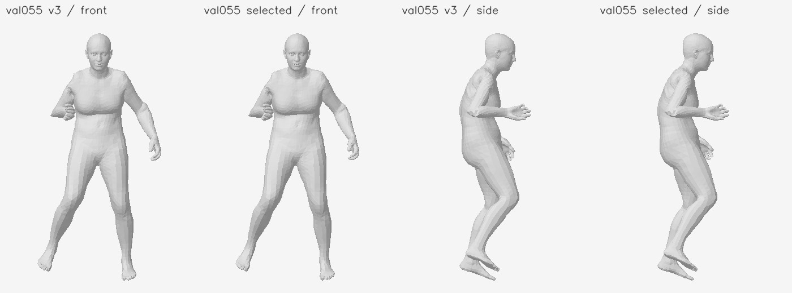

# 双目肘腕方向作为起点，能否找回黄金 D v3 漏掉的姿态？

在指定失败帧 **val031** 上，原方法保存的 15 个候选都没能还原左前臂，左侧最好的也偏了 **89.89°**。右侧倒是有一个候选达到 **27.53°**，原损失选出的姿态偏了 **75.02°**。增加双目肘腕方向起点后，原损失自动选中了双臂新起点，左右前臂分别只偏 **7.61°、7.18°**。这说明左侧主要漏在候选生成，右侧同时存在局部姿态更好、整身损失却排得靠后的现象。[旧候选逐个复核及新姿态评估](evidence/evaluation.json)

## 两帧配对结果

“原起点续跑”与其他起点使用相同的 1,000 步 Adam 预算。原损失越低越好。非 PA 是相机坐标系下 12 个关节的平均欧氏距离，PA 是对这 12 点逐帧做相似对齐后的平均距离。前臂角度是从肘指向腕的三维向量与官方骨架对应向量的夹角。[精确损失与选择](evidence/selection.json) · [逐侧误差](evidence/evaluation.json)

| 帧 | 选项 | 原损失 | 左前臂 ° | 右前臂 ° | 12 点非 PA mm | 12 点 PA mm |
|---|---|---:|---:|---:|---:|---:|
| val031 | 原 v3 | 0.03304389 | 91.59 | 75.02 | 109.40 | 94.76 |
| | 原起点续跑 | 0.03302526 | 91.59 | 75.05 | 110.60 | 95.15 |
| | 左臂新起点 | 0.03029270 | 7.58 | 77.20 | 85.78 | 67.27 |
| | 右臂新起点 | 0.01220577 | 91.66 | 7.03 | 89.11 | 75.83 |
| | **双臂新起点，自动选中** | **0.00949164** | **7.61** | **7.18** | **63.80** | **41.35** |
| val055 | 原 v3 | 0.00656630 | 37.14 | 12.86 | 58.55 | 38.98 |
| | 原起点续跑 | 0.00656019 | 37.15 | 12.86 | 59.11 | 39.03 |
| | **左臂新起点，自动选中** | **0.00655950** | **37.14** | **12.86** | **59.16** | **39.03** |
| | 右臂新起点 | 0.00656222 | 37.15 | 12.86 | 58.92 | 39.02 |
| | 双臂新起点 | 0.00656004 | 37.15 | 12.86 | 59.11 | 39.03 |

**val031。** 即使用真值事后从原 v3 保存的候选里挑，最低非 PA 也只有 105.37 mm。双臂新起点在第零步的原损失为 0.14463，若立刻与旧解竞争就会被淘汰；允许各自拟合后才降到 0.00949。只改一侧的起点，改善也主要在那一侧。双臂胜出后的左、右腕误差从 292.71、248.73 mm 降到 52.44、39.41 mm。之前报告的 109.36 mm 属于另加肘部限位的诊断条件，本表从原 v3 出发。[选择记录](evidence/selection.json) · [姿态指标](evidence/evaluation.json) · [上轮分项](../2026-11-24_gt_projection_elbows/evidence/scores.json)

**val055。** 直接三角化的左前臂方向偏 26.38°，右侧偏 13.09°。拟合后，各个起点落在相近的方向。胜出的左臂分支仅比原起点续跑少约 0.00000069 的损失。相对原 v3，非 PA 增加 0.61 mm，左腕误差从 160.19 到 160.22 mm。原解参加竞争能保住原损失，却不能保证三维误差也下降。[逐帧证据](evidence/evaluation.json) · [损失记录](evidence/selection.json)

## 候选如何生成、拟合与选择

1. 从冻结的 v3 候选库读取每帧按原损失选出的可行人体。保留此姿态作为可直接返回的候选。
2. 对每侧同时在两眼有效的肘和腕，先求双鱼眼射线最近点的中点，再用原相机做双目像素重投影细化。排除退化、无效或负深度解。三角化位置只用于初始化。
3. 保留当前肩位置，把模型上臂转向三角化的肘，把前臂转向三角化的肘→腕方向。只改肩、肘局部旋转，骨长由 SMPL-X 保持，超过原关节旋转上限时回投影。val031 右肘起点触及该上限。原起点、只改左臂、只改右臂、同时改双臂共四路。
4. 每路重启 Adam，在相同的 v3 完整损失下更新可动身体姿态、根旋转和根平移。沿用原协议起始学习率，在本轮 1,000 步内恒定；形状仍为零，手部设置、Head 位置、相机、掩码保持原配置。二维项沿用 Huber，未加入三角化方向损失，也未加入上轮的额外肘部约束。每步保存损失更低的可行解，最后和原始解一起比。四路总计算量高于只从原起点续跑一路。
5. 拟合进程屏蔽已知身体真值与上轮诊断文件。写入选择和参数包哈希，独立评估进程核对哈希后才读官方骨架。渲染沿用每帧先前估计的地面方向，同帧原解和新解共用视角、缩放与取景。[拟合与评估代码](forearm_seed.py) · [渲染代码](compare_views.py)

两帧均为预先指定的已知问题帧。实验只比较固定追加预算，两帧获选分支都在第 1,000 步达到本轮保存的最低损失。更长预算、网格穿插和独立样本上的总体收益仍待检验。当前默认黄金 D v3 保持原版本。

## 复核与发布

运行基线为 `fca81c0b5af5ee116a76b2c7251f62114a5b61b1` 加本目录新增脚本。运行时工作树另有与本轮无关的改动及未跟踪文件。仓库根目录执行 `bash runs/2026-11-24_stereo_forearm_seed/run.sh`。需要开发机已配置的身体后端、受限 SMPL-X 模型、既有 v3 参数库、检测结果和地面估计。资源指纹、命令及状态见[选择记录](evidence/selection.json)、[评估记录](evidence/evaluation.json)和[执行记录](evidence/execution.json)。

发布检查覆盖工作区、暂存增量、待推送提交及远端基线。本轮发布代码、数值摘要、报告及两张预测网格渲染。仅列资源标识和哈希，去除机器路径；权重、数据集、数组、网格文件、完整日志和本地 provenance 留在开发机。所有发布文件小于 50 MB，路径与敏感内容扫描见[自检记录](evidence/prepush.json)。
