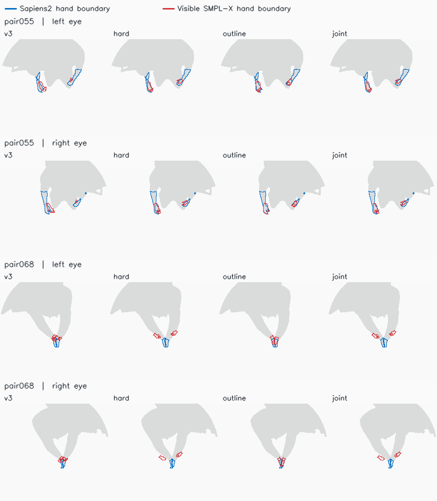

# 两个单帧的双目语义轮廓与硬防穿插

直接要求完整 SMPL-X 的原始三角网格零穿面，两帧均无合格输出，PA 与非 PA 均不适用。均值模板在未摆姿态时已有 320 对无共顶点三角面严格相交，其中头部 298 对、双脚各 11 对。原始计数、区域豁免后的计数与目标手部计数分别给出。结论适用于搜索过的姿态。不能据此证明任意姿态永远无解。[模板与初筛](evidence/pair055_selection.json) · [第二帧初筛](evidence/pair068_selection.json) · [最终独立复算](evidence/evaluation.json)

## 配对结果

四项主对照始终使用标准体型。下表的硬约束只豁免模板已有交叉的局部邻域；普通接触允许。目标部位为 pair055 左手–左大腿、pair068 左手–右手。两侧肩肘腕髋膝踝的 PA 是逐帧相似对齐误差，非 PA 是左相机坐标中直接计算的 MPJPE。双目边界距离是参与损失的可见轮廓双向距离，越小越贴合预测分割。已相交时将间隙记为零；分离时取原表面顶点和三角面面心到另一侧表面的最小采样距离，尚无真实接触传感器数据。[评分与未截断间隙](assess.py) · [逐帧数值](evidence/evaluation.json)

| 帧 | 设置 | PA（mm） | 非 PA（mm） | 双目边界距离（px） | 目标相交面数 | 原始整网格 / 豁免区外相交面数 | 目标采样间隙（mm） |
|---|---|---:|---:|---:|---:|---:|---:|
| pair055 | 原 v3 | 41.62 | 46.06 | 19.22 | 121 | 513 / 193 | 0.00 |
| pair055 | 硬防穿插 | 46.86 | 51.98 | 17.13 | 0 | 331 / 0 | 2.20 |
| pair055 | 只加轮廓 | 40.96 | 46.43 | 14.81 | 24 | 546 / 203 | 0.00 |
| pair055 | 硬防穿插＋轮廓 | 46.86 | 51.98 | 17.13 | 0 | 331 / 0 | 2.20 |
| pair055 | 联合＋接近筛选（补充） | 46.86 | 51.98 | 17.13 | 0 | 331 / 0 | 2.20 |
| pair068 | 原 v3 | 32.64 | 44.97 | 21.80 | 337 | 782 / 470 | 0.00 |
| pair068 | 硬防穿插 | 73.32 | 81.96 | 43.63 | 0 | 310 / 0 | 184.41 |
| pair068 | 只加轮廓 | 32.95 | 44.52 | 10.17 | 362 | 933 / 592 | 0.00 |
| pair068 | 硬防穿插＋轮廓 | 73.32 | 81.96 | 43.63 | 0 | 310 / 0 | 184.41 |
| pair068 | 联合＋接近筛选（补充） | 无可行候选 | — | — | — | — | — |

在两帧上，硬约束单独使用和与轮廓联合都选中了同一姿态。pair055 的左手–大腿严格相交从 121 对降到 0，采样间隙 2.20 mm，但 PA/非 PA 各升高约 5–6 mm。pair068 的双手分离 184.41 mm，原图中的双手相靠动作丢失，PA/非 PA 都明显恶化。只用轮廓时，其边界距离由 21.80 降到 10.17 px，双手相交面数由 337 变为 362，采样最大穿入却由 19.96 降到 8.47 mm。相交面数受相交区域的形状和网格密度影响，不能当作穿入深度。额外尝试 600 个双臂候选，均未通过豁免区外零穿面的检查。[逐帧评分](evidence/evaluation.json) · [双臂搜索](evidence/reach.json)

补充行在同一个候选池上再要求原本接近的目标部位采样间隙不大于 8 mm；该行只用于检查分离是否被当成“修好”。本轮候选中没有双手相距 8 mm 以内且通过硬门槛的姿态。第一视角分割支持也不同。pair055 左眼检测到了部分左臂，pair068 两眼的前臂类均没有预测像素。它们都能提供可见手的边界。两者均未得到足够可靠的大腿语义边界参与损失。[四眼概率与部位支持](evidence/evaluation.json) · [两帧轮廓通道](evidence/pair068_selection.json)



图中浅灰底为分割的人体前景，蓝线为 Sapiens2 可见手边界，红线为按双目鱼眼相机渲染的 SMPL-X 可见手边界。轮廓图不能证明三维无穿插。对所有输出都用历史三角面程序重新遍历了整具网格，并与优化时使用的快速检查逐部位核对。[诊断图生成](preview.py) · [独立相交检查](assess.py)

## 输入与约束

- 用已有 Sapiens2 的 1B 分割权重，校验原图及权重哈希，对四张原始图独立运行 29 类分割。沿用 v3 单帧双目检测、相机标定、官方 Head 位置、画内关节掩码和十维全零 betas。轮廓、手掌和手指均来自本帧的推理或拟合。身体三维真值仅在封存姿态后读入。实际分割图、概率、完整网格与参数留在本机。[分割入口](segment.py) · [权重/输入摘要](evidence/evaluation.json)
- 两目分别按自身鱼眼标定从原图每隔 4 像素采一条射线，取正深度可见三角面。比较整体前景以及左右手、前臂、上臂、大腿有足够支持的可见边界。剔除画幅边线，分割置信度至少 0.55，每组至少 12 个有效网格像素和 6 个边界样本。各组内取双向最近边界距离，截断在 64 原图像素、除以 12，再按可用组与双眼平均。权重 0.008。衣物纳入整体前景，裤子不直接当作裸大腿标签。可见轮廓不表示人体内部的深度顺序或皮肤真实边界。[轮廓实现](outline.py)
- 三维硬门槛检查原网格中不共享顶点的两面是否有边严格穿过另一面内部，按历史协议排除共面贴合和数值边界；未做连续时间扫掠或体积包含证明。局部豁免由未摆姿态模板上的交叉决定，只对同一头部或同一脚内、双方均位于初始交叉面向外扩张两圈的区域生效。跨部位和其他区域全部检查，手/臂/躯干/腿不在豁免内。[表面检查](surface.py) · [豁免定义](fit_probe.py)
- 每帧同时考察从中性姿态开始与从 v3 修复后开始。初始修复先试原姿态、中性姿态和分链衰减。可行分支使用 72 次 Adam 提议；每个实际接受的更新都复查几何和正深度，整步不可行时缩步或分组试动。允许手指和腕部活动。补充局部修复提案允许搜索过程中暂时穿插，仅合格姿态可进入硬约束候选集。用可见手区域与原本接近的部位引导提案，不读身体真值。对于 pair068，额外用仅轮廓拟合所得双腕目标，在可行躯干上以两条双骨臂链同时改变肘弯曲平面，专门检查双手接近的可达性。[约束更新](fit_probe.py) · [局部修复](repair_local.py) · [双臂补查](evidence/reach.json)
- 原 v3 对照沿用归档获胜姿态。其余三种选法共用完整候选池，含 Adam 输出、原 v3 候选、从新姿态重新合成的根/躯干与四肢候选、修复提案。只加轮廓以原拟合代价加轮廓代价选，硬约束按原代价选，联合方法在可行解中按两种代价之和选。手指有相同的小幅旋转正则。补充近接筛选沿用前次 8 mm 判据。共享提案中含由图像和碰撞产生的候选，表中比较的是实际最终评分/可行性条件，不构成从提案到评分完全独立的因子消融。这是两已知故障帧的有限预算探查，原 v3 的 20,000 步拟合已归档复用。[候选与最终选择](postselect.py) · [pair055](evidence/pair055_final.json) · [pair068](evidence/pair068_final.json)

## 复跑与发布

在开发机的 DownSight 仓库内执行。启动时 HEAD 为 af9d1f55f085ebfc13c01f55a9784147d45984e2，工作树含本轮新增脚本及此前无关改动。执行过程中有另一个独立的肘部实验提交 ad4aff7c23d1347da99df113fddbbe29282b9cef，已核对其增量仅在该实验目录，未修改本轮依赖。分割使用单 GPU，拟合、求交和评分使用 CPU。需要外部 SMPL-X、Sapiens2 仓库及分割权重，以及开发机上归档的候选、相机、原图和评测标注。[摘要、脚本和输入哈希、命令及退出状态](evidence/execution.json)

```sh
r=runs/2026-11-24_two_stereo_contact
python -B "$r/segment.py"
for p in pair055 pair068; do
    bash "$r/run.sh" fit_probe "$p"
    bash "$r/run.sh" repair_local "$p"
done
bash "$r/run.sh" reach
for p in pair055 pair068; do
    bash "$r/run.sh" postselect "$p"
done
bash "$r/run.sh" assess
bash "$r/run.sh" preview
```

推送前检查工作树、暂存区、待推送提交和远端状态；本轮清单只含代码、报告、脱敏指标与一张派生轮廓图。单文件小于 50 MB。无权重、数据集、源图、视频、数组、完整参数/网格、完整 provenance 或 patch、机器绝对路径、环境文件和凭据。既有无关改动未纳入。[增量自检](evidence/prepush.json)
