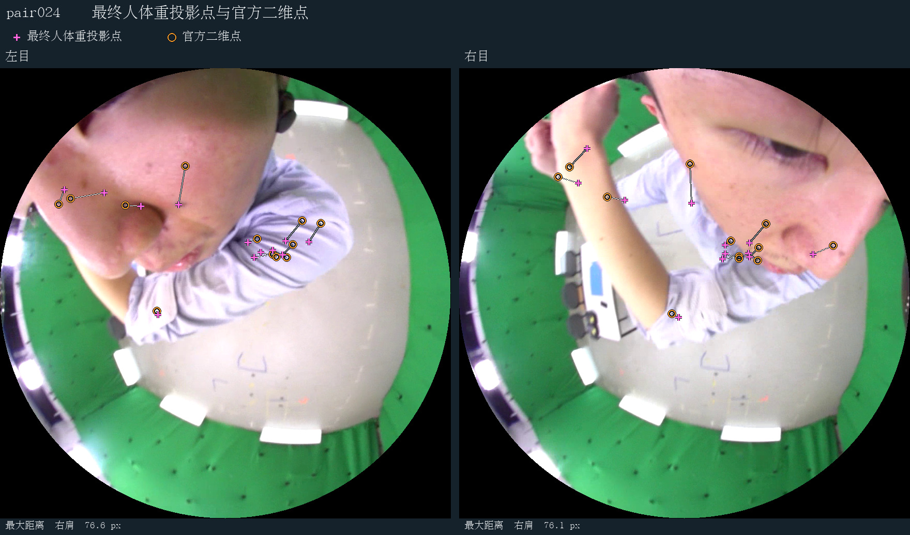
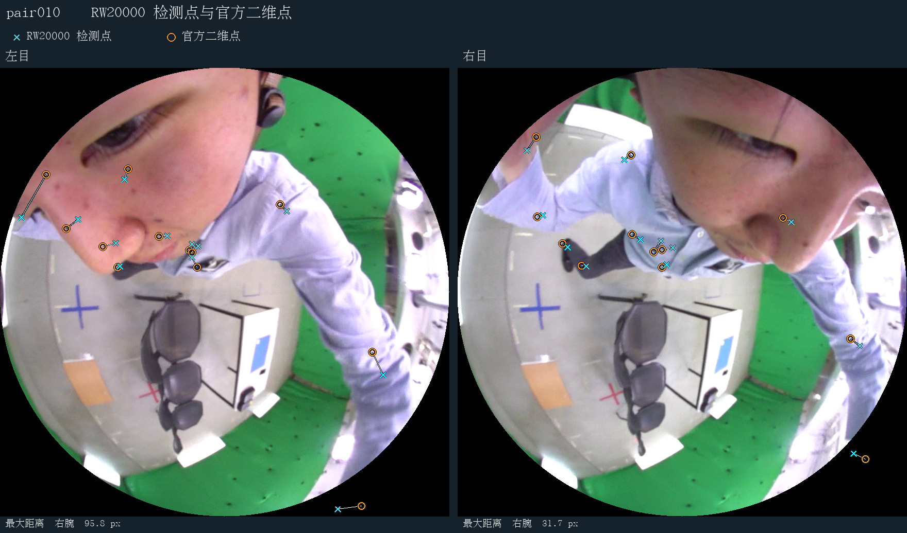
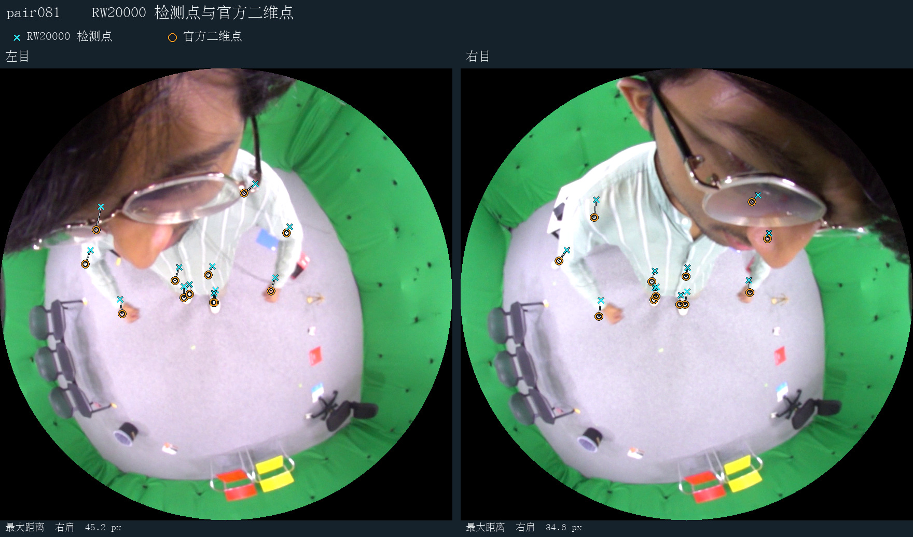
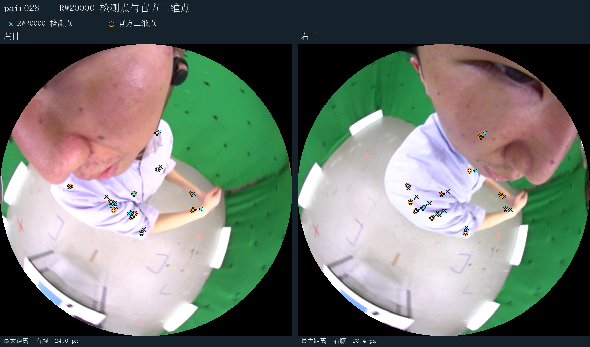
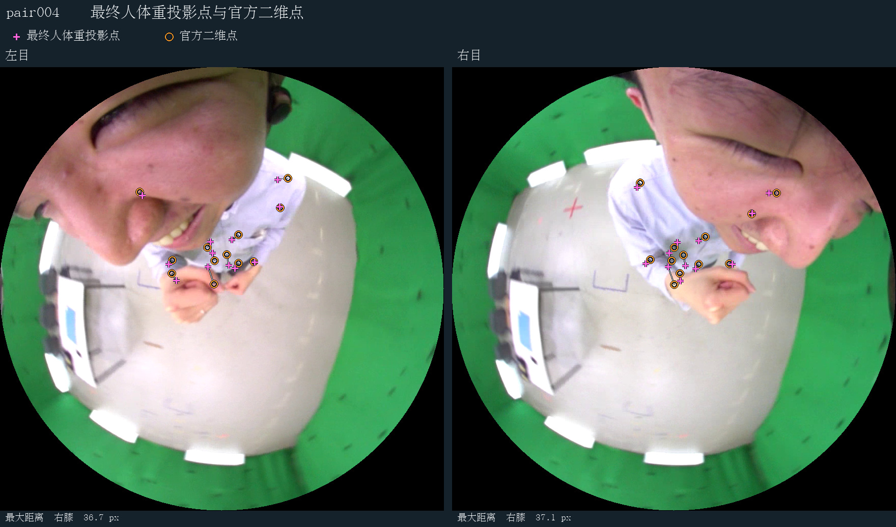

# 五对冻结测试帧的双目原图点位对照

每张左边为左目，右边为右目，每眼原生 872 × 872 像素完整保留，标题、图例与最大距离放在原图范围以外。橙色空心圆为官方二维标注。青色叉号为 RW20000 输入，粉色加号为上轮最终选中的 SMPL-X 人体重投影，细线连接同一关节的两个位置。每眼绘制双肩、双肘、双腕、双髋、双膝及双踝共 12 点。

| 帧 | RW20000 检测与官方点 | 最终模型重投影与官方点 |
|---|---|---|
| pair024 | [完整双目图](assets/pair024_detector.jpg) | [完整双目图](assets/pair024_fit.jpg) |
| pair010 | [完整双目图](assets/pair010_detector.jpg) | [完整双目图](assets/pair010_fit.jpg) |
| pair081 | [完整双目图](assets/pair081_detector.jpg) | [完整双目图](assets/pair081_fit.jpg) |
| pair028 | [完整双目图](assets/pair028_detector.jpg) | [完整双目图](assets/pair028_fit.jpg) |
| pair004 | [完整双目图](assets/pair004_detector.jpg) | [完整双目图](assets/pair004_fit.jpg) |

## pair024

## pair010

## pair081

## pair028

## pair004

## 复核

执行基线 f2a5e19f3293888e4ef76ad940299ad21395fc9f，工作树含无关既有改动，本轮仅新增图集目录。按归档配对、左右目、原图哈希、有效点掩码及标定读取数据。由上轮获选参数生成关节，经两眼鱼眼相机模型投影，再逆变换至原图坐标。逐点复核检测距离，逐帧复核最终人体的三维非 PA 与前次归档。十个视图的有效点均在完整画幅内。未裁切或重采样，派生图使用 JPEG 保存。[逐眼误差、源图与成品哈希、命令和状态](evidence/gallery.json) · [绘图代码](gallery.py)

发布前审核工作区、暂存、当前增量与远端。提交只含代码、文档、派生证据和标注后的 JPEG，无 EXIF、原始数据文件、权重、机器路径或凭据，单文件低于 50 MB。[推送前检查](evidence/prepush.json)
