# 手指固定、完整双目轮廓 · 24 对渲染与关节误差

沿用指定图库的 24 对及原排列。每行显示同一时刻的双目图、最新方法拟合的 SMPL-X 网格正侧面，以及该姿态的关节误差。点图可放大。

| 样本 | 对数 | PA-MPJPE（mm） | 非 PA MPJPE（mm） |
|---|---:|---:|---:|
| **全部** | 24 | 41.29 | 58.08 |
| 测试图库子集 | 12 | 39.02 | 56.16 |
| 验证图库子集 | 12 | 43.55 | 60.00 |

两项均评估双侧肩、肘、腕、髋、膝、踝的 12 个关节。非 PA 在左相机坐标下直接与官方三维标注比较，PA 先逐帧对齐平移、旋转和统一尺度。先求每帧 12 点的平均距离，再对样本等权平均。[逐帧 CSV](evidence/metrics.csv) · [完整精度与渲染核查](evidence/results.json)

## 测试图库的 12 对

| 人物 / 样本 | 左目 | 右目 | 最新正面 | 最新侧面 | PA（mm） | 非 PA（mm） |
|---|---|---|---|---|---:|---:|
| S1 / pair001（地面暂定） | [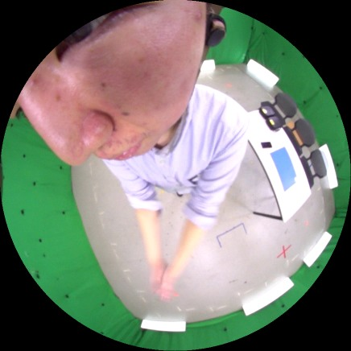](../2026-11-23_fixed_floor24/assets/pair001/left.jpg) | [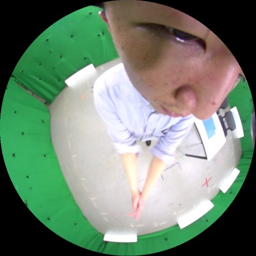](../2026-11-23_fixed_floor24/assets/pair001/right.jpg) | [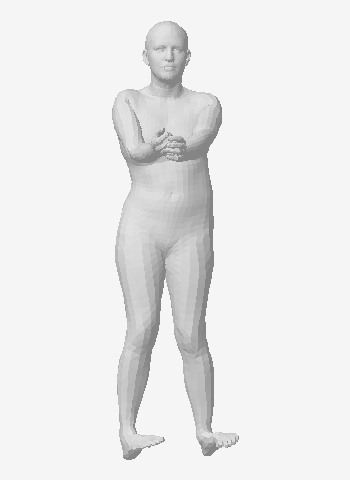](assets/pair001/front.jpg) | [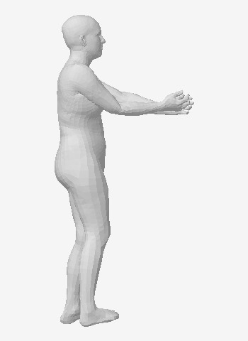](assets/pair001/side.jpg) | 38.99 | 47.98 |
| S1 / pair022 | [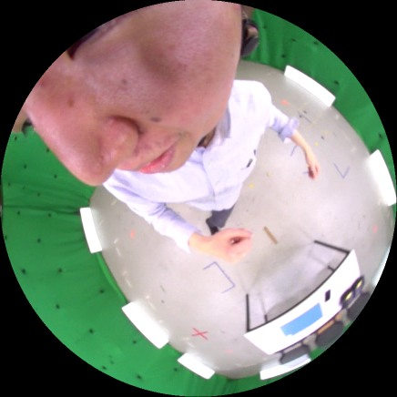](../2026-11-23_fixed_floor24/assets/pair022/left.jpg) | [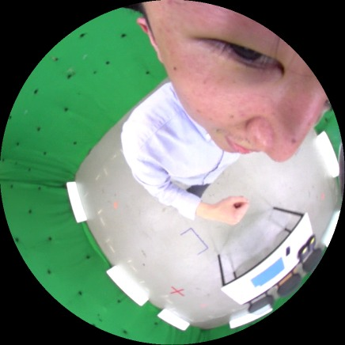](../2026-11-23_fixed_floor24/assets/pair022/right.jpg) | [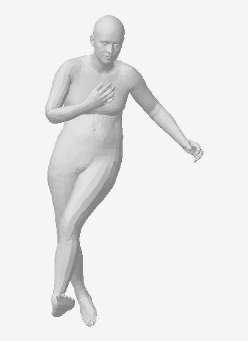](assets/pair022/front.jpg) | [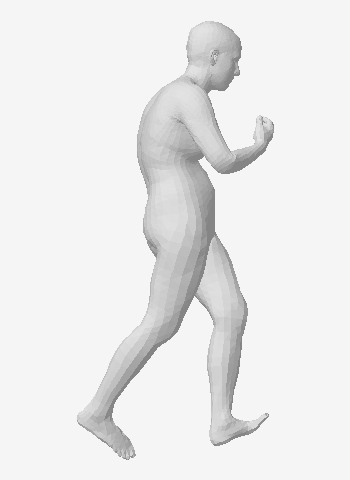](assets/pair022/side.jpg) | 53.88 | 59.04 |
| S1 / pair028 | [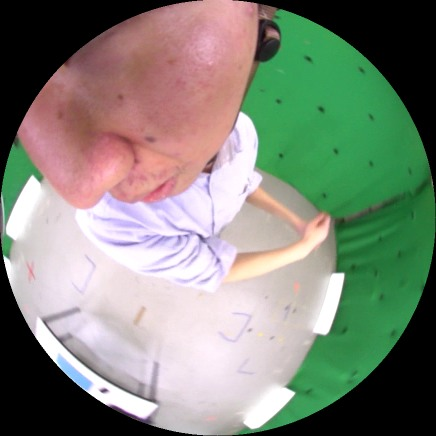](../2026-11-23_fixed_floor24/assets/pair028/left.jpg) | [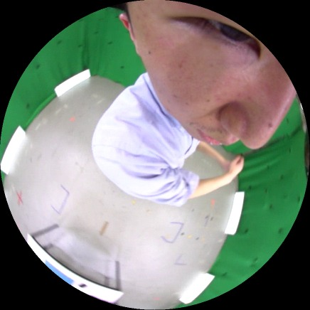](../2026-11-23_fixed_floor24/assets/pair028/right.jpg) | [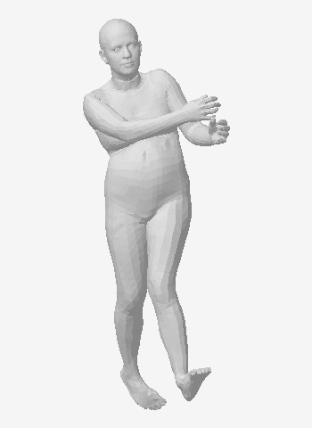](assets/pair028/front.jpg) | [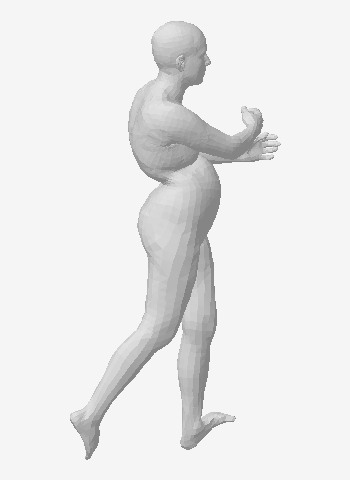](assets/pair028/side.jpg) | 33.33 | 65.48 |
| S1 / pair034（地面暂定） | [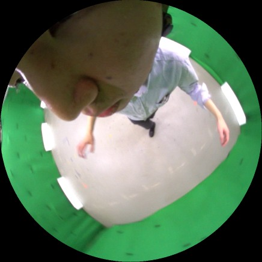](../2026-11-23_fixed_floor24/assets/pair034/left.jpg) | [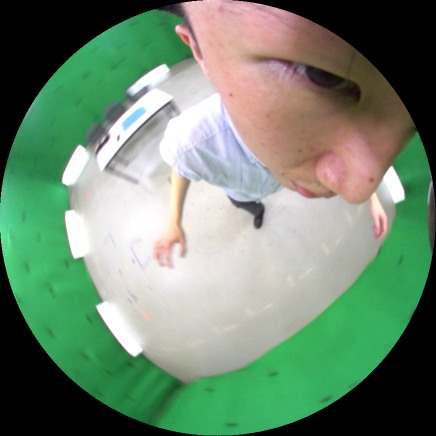](../2026-11-23_fixed_floor24/assets/pair034/right.jpg) | [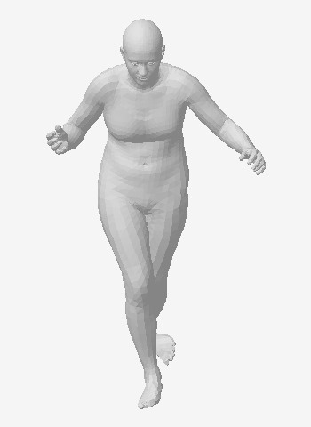](assets/pair034/front.jpg) | [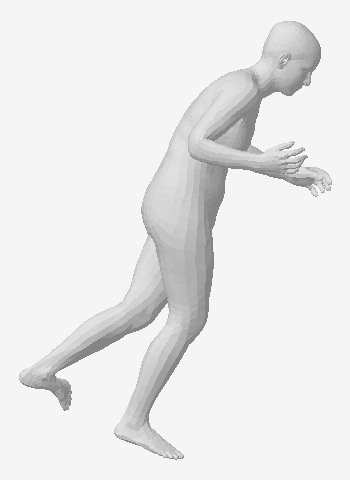](assets/pair034/side.jpg) | 47.65 | 60.25 |
| S9 / pair036 | [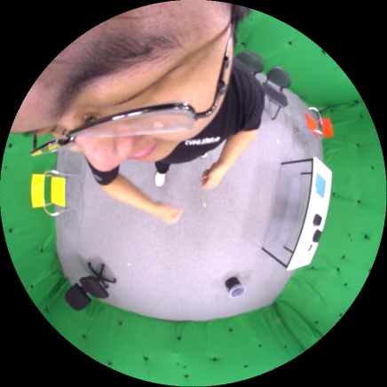](../2026-11-23_fixed_floor24/assets/pair036/left.jpg) | [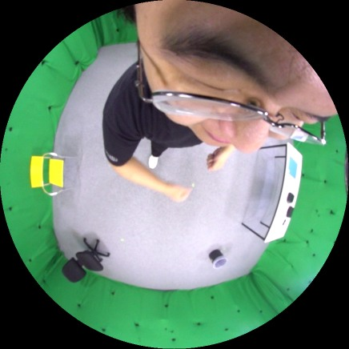](../2026-11-23_fixed_floor24/assets/pair036/right.jpg) | [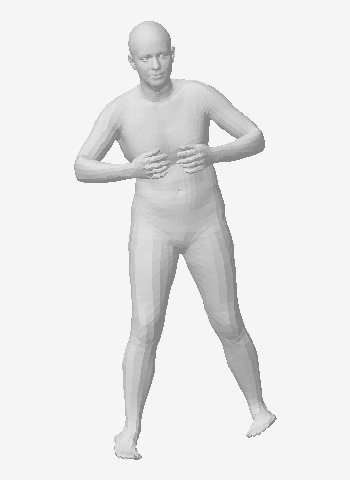](assets/pair036/front.jpg) | [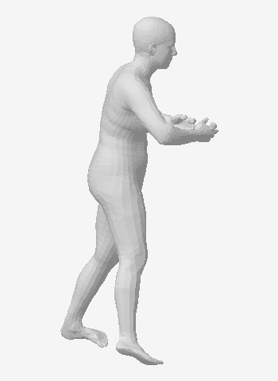](assets/pair036/side.jpg) | 29.18 | 47.51 |
| S9 / pair037 | [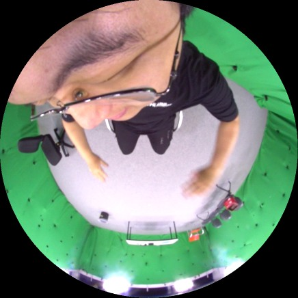](../2026-11-23_fixed_floor24/assets/pair037/left.jpg) | [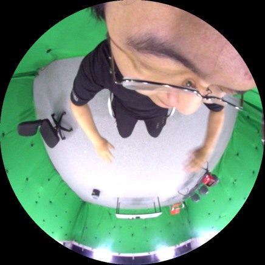](../2026-11-23_fixed_floor24/assets/pair037/right.jpg) | [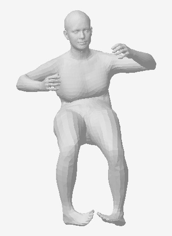](assets/pair037/front.jpg) | [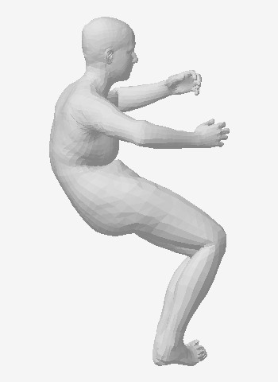](assets/pair037/side.jpg) | 43.70 | 47.96 |
| S9 / pair045 | [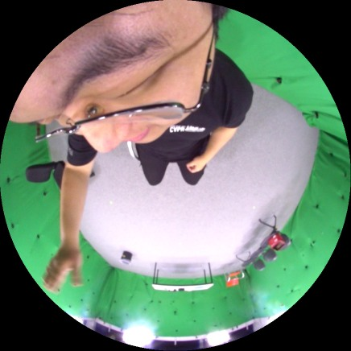](../2026-11-23_fixed_floor24/assets/pair045/left.jpg) | [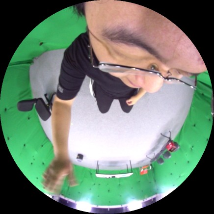](../2026-11-23_fixed_floor24/assets/pair045/right.jpg) | [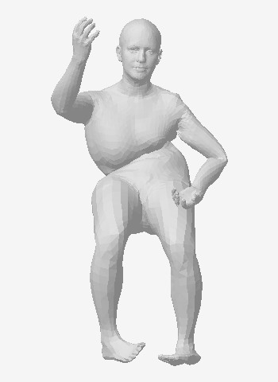](assets/pair045/front.jpg) | [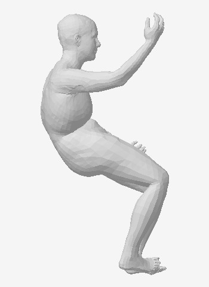](assets/pair045/side.jpg) | 42.34 | 46.06 |
| S9 / pair055 | [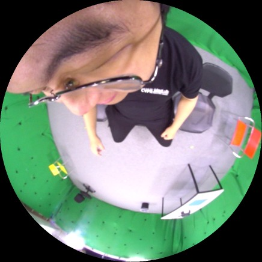](../2026-11-23_fixed_floor24/assets/pair055/left.jpg) | [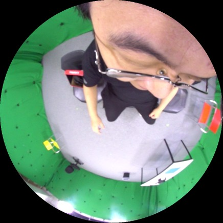](../2026-11-23_fixed_floor24/assets/pair055/right.jpg) | [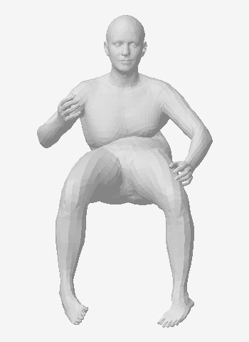](assets/pair055/front.jpg) | [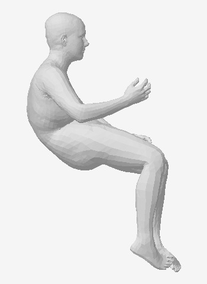](assets/pair055/side.jpg) | 41.07 | 46.72 |
| S11 / pair068（地面暂定） | [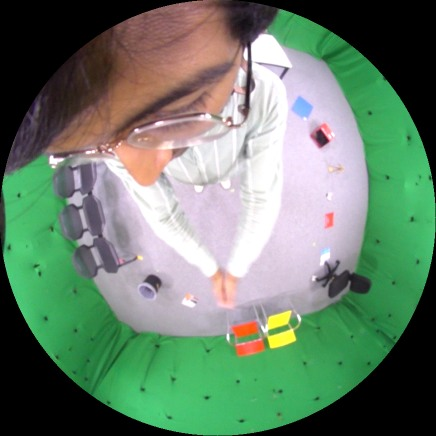](../2026-11-23_fixed_floor24/assets/pair068/left.jpg) | [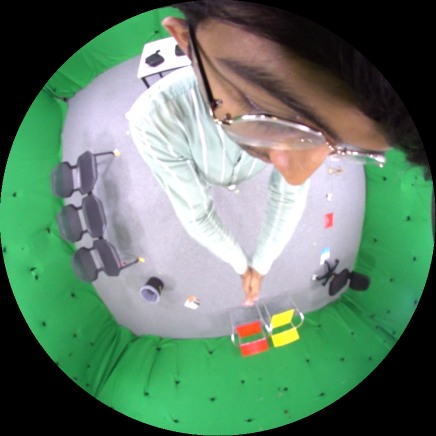](../2026-11-23_fixed_floor24/assets/pair068/right.jpg) | [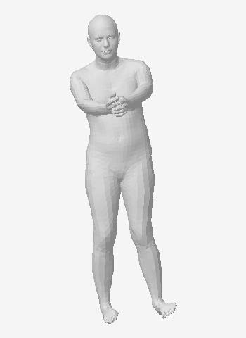](assets/pair068/front.jpg) | [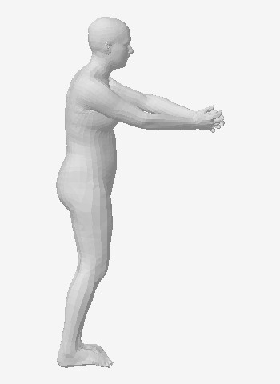](assets/pair068/side.jpg) | 32.60 | 44.40 |
| S11 / pair078 | [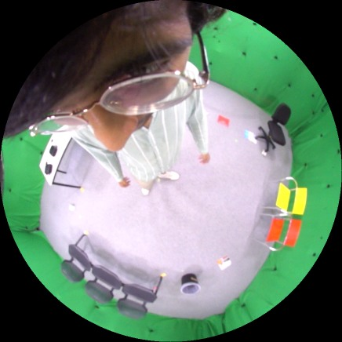](../2026-11-23_fixed_floor24/assets/pair078/left.jpg) | [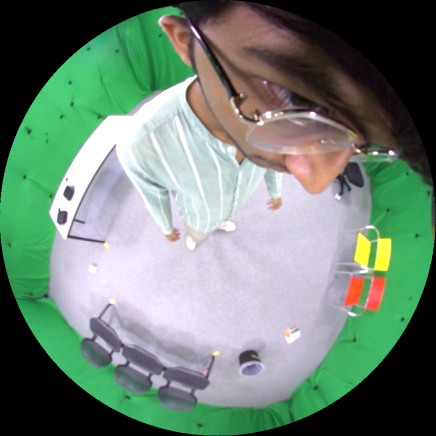](../2026-11-23_fixed_floor24/assets/pair078/right.jpg) | [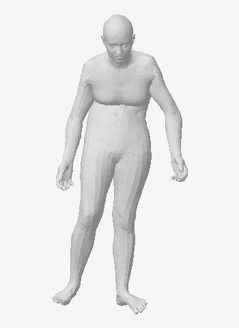](assets/pair078/front.jpg) | [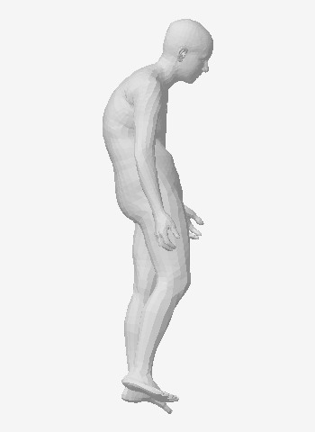](assets/pair078/side.jpg) | 32.66 | 73.10 |
| S11 / pair088 | [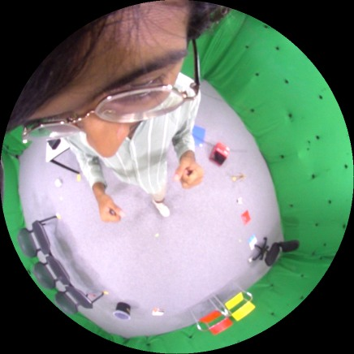](../2026-11-23_fixed_floor24/assets/pair088/left.jpg) | [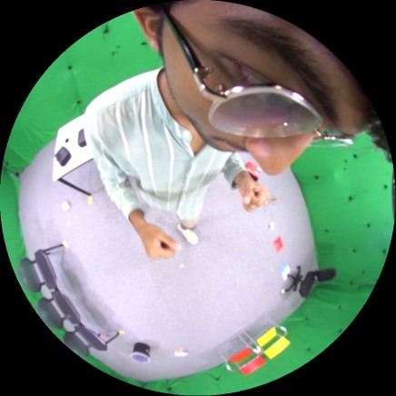](../2026-11-23_fixed_floor24/assets/pair088/right.jpg) | [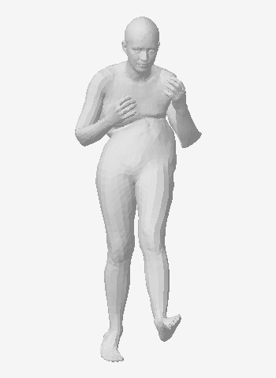](assets/pair088/front.jpg) | [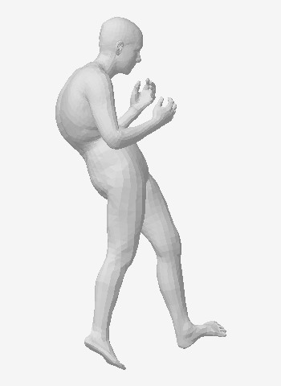](assets/pair088/side.jpg) | 38.75 | 75.43 |
| S11 / pair094 | [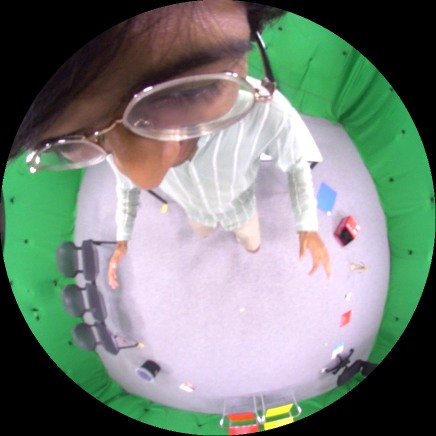](../2026-11-23_fixed_floor24/assets/pair094/left.jpg) | [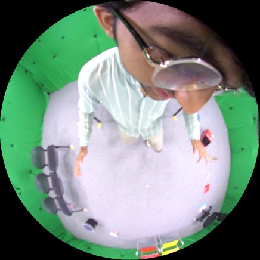](../2026-11-23_fixed_floor24/assets/pair094/right.jpg) | [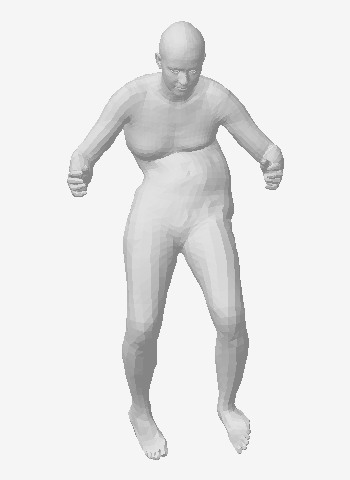](assets/pair094/front.jpg) | [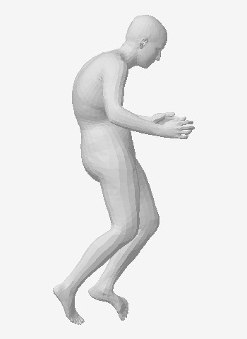](assets/pair094/side.jpg) | 34.08 | 60.00 |

## 验证图库的 12 对

| 人物 / 样本 | 左目 | 右目 | 最新正面 | 最新侧面 | PA（mm） | 非 PA（mm） |
|---|---|---|---|---|---:|---:|
| S3 / val017（地面暂定） | [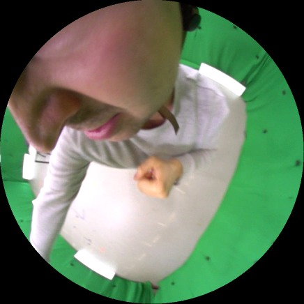](../2026-11-23_fixed_floor24/assets/val017/left.jpg) | [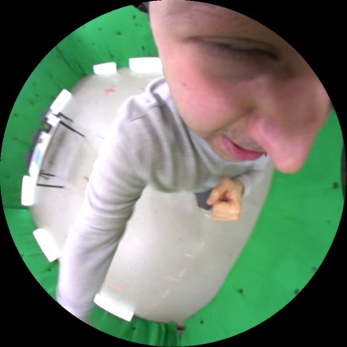](../2026-11-23_fixed_floor24/assets/val017/right.jpg) |  |  | 65.90 | 74.75 |
| S3 / val031 |  |  |  |  | 86.21 | 100.78 |
| S3 / val042（地面暂定） |  |  |  |  | 34.69 | 51.46 |
| S5 / val055 |  |  |  |  | 37.71 | 57.91 |
| S5 / val073（地面暂定） |  |  |  |  | 44.14 | 58.37 |
| S5 / val100（地面暂定） |  |  |  |  | 35.76 | 50.56 |
| S13 / val102 |  |  |  |  | 41.26 | 59.27 |
| S13 / val122 |  |  |  |  | 55.99 | 81.01 |
| S13 / val134 |  |  |  |  | 33.66 | 54.48 |
| S15 / val168 |  |  |  |  | 25.39 | 52.51 |
| S15 / val178 |  |  |  |  | 31.23 | 43.24 |
| S15 / val181 |  |  |  |  | 30.71 | 35.69 |

## 评分与取景

每帧按 SHA-256 核对已封存的最终姿态文件，读取 fixed_full 分支，使用标准体型和固定手指参数重新生成网格、关节点及两张渲染图。所有逐帧重算误差与原评分的差异均小于 0.001 mm。两张原图引用同一帧已公开的预览。正侧视图沿用原图库该帧的地面法向和观看方向，同尺度分别居中。地面暂定只影响看图时对身体倾斜的判断。[样本与取景来源](../2026-11-23_fixed_floor24/report.md) · [测试拟合](../2026-11-25_frozen100_fingers/report.md) · [验证拟合](../2026-11-25_validation200_fingers/report.md)

执行基线为 `58387c62eeea1800489ef09b8efd4ee48e4b95f4`。工作树含本轮文件及此前已有的无关修改。此轮复用已拟合参数，在 CPU 上重建与渲染。开发机复现命令为 `bash runs/2026-11-25_fixed_full_floor24/run.sh`。
推送前核对工作树、暂存区、待推提交与远端，仅发布本轮代码、文档、数值证据和渲染预览。检查单文件低于 50 MB、图像元数据、凭据、环境文件、机器绝对路径和禁发资产。公开路径为仓库相对路径或占位符。[发布自检](evidence/prepush.json)
