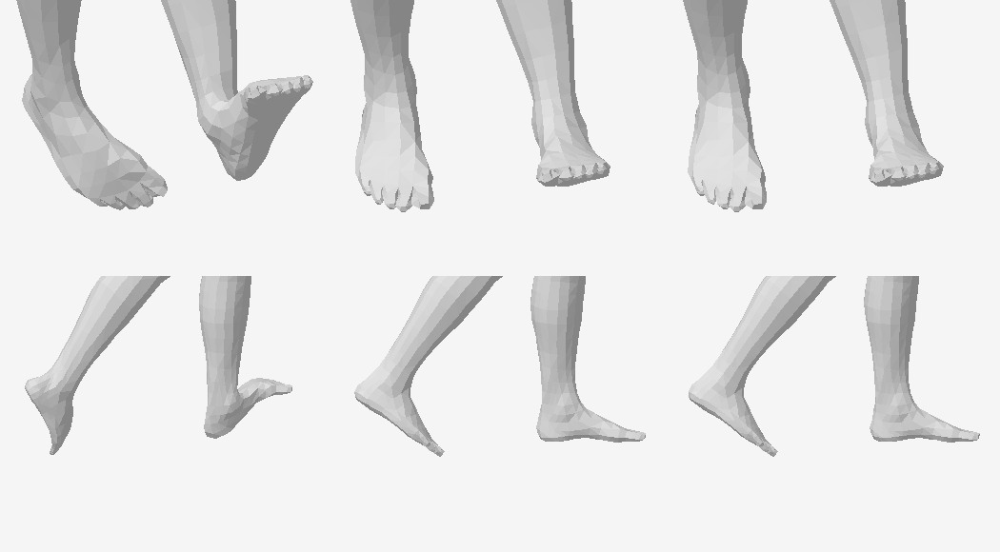

# 双踝与前脚掌固定 · 24 对同帧对照

固定手指、加完整轮廓的上一版允许两侧踝和前脚掌自由转动。固定这四个关节后，24 对里有 20 对的双脚平均朝向更接近 RW 官方标注。原 v3 在这些帧里的四个局部轴角都是零。锁定后足部继续随小腿运动，脚跟高度、是否接触地面仍取决于人体姿态。

| 同一批 24 对 | 身体 12 点 PA（mm） | 身体 12 点非 PA（mm） | 脚朝向误差（°） | 趾根位置误差（mm） |
|---|---:|---:|---:|---:|
| 上一版完整轮廓、仅固定手指 | 41.29 | 58.08 | 34.76 | 137.19 |
| 输出时复位双踝及前脚掌 | 41.29 | 58.08 | 18.61 | 98.52 |
| 从第一步固定双踝及前脚掌并重新拟合 | 41.30 | 58.08 | 18.32 | 98.74 |

方向在左相机坐标中用每只脚从踝到趾根的向量与官方向量的夹角计算。位置采用既有协议中的 SMPL-X 踝至前脚关节线段和标定比例，映射到 RW 趾根。每帧两只脚等权，再对 24 帧等权。方向与位置都在拟合封存后评分，未参与新解选择。趾根可检验脚的朝向，对逐趾弯曲和足底接触仍缺少直接标注。身体 12 点评分止于踝，单独替换这四个局部角保持这 12 点的位置。[逐帧评分和局部角](evidence/results.json) · [标定方法](../2026-11-19_rw_landmarks_head_views/report.md)

## 脚部渲染

每张图三列依次为上一版、输出时复位、从第一步锁定重拟合；上排正面，下排侧面。每一行共用相同的取景方向、中心和比例，均按原图库的地面方向显示。表中角度为每帧两脚的平均方向误差。[原双目照片和全身姿态](../2026-11-25_fixed_full_floor24/report.md)

在 pair028，上一版侧面可见一只脚尖下折、另一只前脚掌上翘。锁定后局部折弯消失，这帧仍有约 33° 的脚朝向误差。



| 样本 · 点开看脚部近景 | 原方向误差（°） | 输出复位（°） | 从头锁定（°） |
|---|---:|---:|---:|
| [pair001](assets/pair001.jpg) | 39.74 | 10.33 | 9.54 |
| [pair022](assets/pair022.jpg) | 35.43 | 11.35 | 11.32 |
| [pair028](assets/pair028.jpg) | 81.42 | 33.52 | 33.36 |
| [pair034](assets/pair034.jpg) | 18.61 | 21.48 | 20.30 |
| [pair036](assets/pair036.jpg) | 19.13 | 9.95 | 9.67 |
| [pair037](assets/pair037.jpg) | 44.01 | 8.13 | 8.25 |
| [pair045](assets/pair045.jpg) | 33.51 | 10.44 | 10.28 |
| [pair055](assets/pair055.jpg) | 18.20 | 21.93 | 21.94 |
| [pair068](assets/pair068.jpg) | 29.98 | 5.62 | 8.16 |
| [pair078](assets/pair078.jpg) | 13.05 | 12.13 | 7.86 |
| [pair088](assets/pair088.jpg) | 30.64 | 13.16 | 12.67 |
| [pair094](assets/pair094.jpg) | 50.06 | 24.32 | 24.32 |
| [val017](assets/val017.jpg) | 26.02 | 25.99 | 25.99 |
| [val031](assets/val031.jpg) | 37.33 | 20.81 | 20.29 |
| [val042](assets/val042.jpg) | 40.33 | 8.76 | 9.50 |
| [val055](assets/val055.jpg) | 29.16 | 23.02 | 22.52 |
| [val073](assets/val073.jpg) | 30.72 | 25.32 | 24.86 |
| [val100](assets/val100.jpg) | 29.91 | 15.80 | 15.69 |
| [val102](assets/val102.jpg) | 20.44 | 21.73 | 21.39 |
| [val122](assets/val122.jpg) | 50.52 | 21.70 | 21.71 |
| [val134](assets/val134.jpg) | 50.47 | 24.17 | 24.35 |
| [val168](assets/val168.jpg) | 63.67 | 31.32 | 31.39 |
| [val178](assets/val178.jpg) | 15.65 | 23.25 | 23.33 |
| [val181](assets/val181.jpg) | 26.23 | 22.40 | 21.00 |

## 拟合与核查

上一版 Adam 更新完整身体姿态，手指在每次更新后恢复原值。双踝只受角度上限约束，两个前脚掌关节也能随轮廓梯度改变。轮廓包含人体前景，没有单独的足底方向项。这 24 对的上一版踝和前脚掌局部转角最大值分别为 59.41°、63.50°。新实验在每次更新后都把双踝和双前脚掌恢复到原 v3 的局部旋转，并对所有最终候选检查。保持原有单帧标准体型、完整双目轮廓、冻结手指、候选选择及 72 步优化预算。单独复位分支使用已拟合结果，只替换这四项。[原更新实现](../2026-11-24_two_stereo_contact/fit_probe.py) · [锁定实现](lock.py)

执行基线 `13bbff9a4fcae8ea394de454e3853ab76410c814`，工作树含本轮新增文件和已有无关改动。输入为已封存两批拟合、概率图及参考标注。拟合与评分均用 CPU，代码中的路径为相对资源标识；完整参数、原图和工作日志保留在开发机。首次并发运行保存了全部 24 份结果，外层会话记录状态 143；逐份核对哈希，另行重跑全部 24 帧并逐元素比较，核查状态见执行记录。[运行与发布核查](evidence/checks.json)

```sh
r=runs/2026-11-25_floor24_foot_lock
bash "$r/workers.sh" 8 lock
bash "$r/run.sh" assess_feet
bash "$r/workers.sh" 8 replay
```

推送前检查工作区、暂存文件、待推提交及远端。允许清单仅含本轮代码、报告、汇总、逐帧派生指标和脚部渲染。每个文件小于 50 MB，排除原始数据、权重、视频、数组、环境文件、凭据、机器绝对路径及完整本地 provenance/patch。
