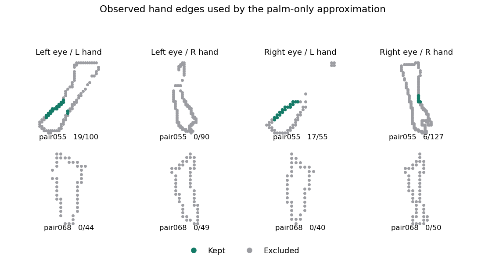

# 冻结 100 对上剔除手指轮廓和锁定手指的对照

在同一批 100 对、标准 SMPL-X 体型上，手指可动且使用完整轮廓时，81 帧出现同一只手内部的网格自交。只在轮廓中剔除估计的手指边缘，剩 1 帧。锁定手指后，使用完整轮廓为 0 帧，剔除估计手指边缘为 0 帧。各分支分别拟合，使用相同 v3 起点、步数、相机与损失权重。手腕和其余身体关节可以调整。[逐帧数据](evidence/results.json) · [与原方法的配对差异](evidence/execution.json)

| 设置 | PA（mm）↓ | 非 PA（mm）↓ | 完整轮廓距离（px）↓ | 同手内部自交帧 | 手–手或手–腿穿插帧 |
|---|---:|---:|---:|---:|---:|
| 原 v3 | 41.22 | 58.73 | 15.48 | 0 | 16 |
| 续跑，无轮廓 | 40.78 | 58.17 | 15.37 | 0 | 16 |
| 手指可动，完整轮廓 | 40.39 | 57.54 | 11.05 | 81 | 11 |
| 手指可动，剔除估计手指边缘 | 40.67 | 57.64 | 14.19 | 1 | 18 |
| 手指固定，完整轮廓 | 40.39 | 57.52 | 11.38 | 0 | 13 |
| 手指固定，剔除估计手指边缘 | 40.68 | 57.69 | 14.07 | 0 | 21 |
| 手指固定，整手轮廓关闭 | 41.17 | 58.03 | 15.39 | 0 | 23 |

PA 为单帧 12 点相似变换对齐后的 MPJPE，非 PA 为同一组肩肘腕髋膝踝在左相机坐标中的 MPJPE。两种误差均以官方三维关节为参照。轮廓列对所有方法均使用相同的完整双目边界评分，便于横向比较。手内自交计数以左手或右手任一内部发生严格穿面为准。跨部位计数只检查双手之间、任一手与任一大腿的五种组合。两列可能重叠。五个样本另用历史三角面程序交叉核查双手内部的计数。[评分程序](score.py) · [原 100 对对照](../2026-11-25_frozen100_outline/report.md)

本次 100 对中，锁定手指并保留完整轮廓保住了此前的关节精度。与可动手指完整轮廓相比，双手之间或手与大腿穿插从 11 帧增至 13 帧；与原 v3 的 16 帧相比仍较少。只剔除估计的手指边缘且继续允许手指活动时，唯一残留的手内自交出现在 pair053 右手，共 31 对相交面。剔除后只保留约 19% 的原手通道采样点，对手的位置和朝向提供的图像约束也发生了变化。各帧默认手指姿态并非该帧真实手势，固定方案适用目标是身体关节拟合和减少手内自交。[逐帧与边缘支持数据](evidence/results.json)

## 实际去掉了哪些轮廓

Sapiens2 的部位分割提供左手和右手区域，未单列掌缘或逐指。手指区域由标准 SMPL-X 蒙皮权重估计：在手的三角面上，30 个手指关节的总权重大于两腕权重的面归为手指区。把原 v3 网格投到各眼，相机光线首次命中的面决定可见部位。图像中只有接近同侧投影手掌、并远离投影手指的手缘能作为掌缘观测。初始投影有偏差时可能丢失真实掌缘或误留手指边缘；没有逐指像素真值检查分类准确率。[筛选实现](hand_edges.py)

- **剔除估计手指边缘。** 在每四个原图像素一个采样点的网格上，只保留到投影掌区两格以内、离投影指区两格以外的观察手缘。原 v3 决定观察侧的筛选，固定后再做拟合。渲染侧每次更新均剔除当前可见手指面及周围一格。筛选同时作用于人体外轮廓和部位轮廓，以免手指继续通过前景误差影响拟合。先提真正边界、再屏蔽采样点，屏蔽区边缘不会生成新轮廓。各通道继续按可用组归一化。
- **关闭整手轮廓。** 删除两个手语义通道，同时屏蔽观测和渲染中可见整手及邻近一格的边界。其他身体轮廓和原二维腕关节继续参与拟合。
- **固定手指。** 每次 Adam 更新以及最终所有候选均保持与对应帧原 v3 相同的 30 个手指关节局部旋转参数。手仍随腕和手臂做整体运动。所有冻结分支对每帧输出检查参数最大差值等于零。
- 200 个视图中，原本 196 个至少有一只手的可用边缘；筛选后 166 个仍至少有一只手的可用掌缘。两个手通道的有效边缘采样点合计由 23086 个减至 4325 个。每个通道至少需要 6 个有效边缘采样点。[通道支持与逐帧核查](evidence/results.json) · [候选与筛选数量](evidence/selections.json)



## 两个历史诊断帧

| 帧 | 设置 | PA / 非 PA（mm） | 对应部位相交面数 |
|---|---|---:|---:|
| pair055 | 手指可动，完整轮廓 | 40.96 / 46.43 | 24 |
| pair055 | 手指可动，剔除估计手指边缘 | 41.14 / 45.71 | 76 |
| pair055 | 手指固定，完整轮廓 | 41.07 / 46.72 | 53 |
| pair055 | 手指固定，剔除估计手指边缘 | 42.60 / 47.49 | 87 |
| pair055 | 手指固定，整手轮廓关闭 | 45.08 / 50.61 | 111 |
| pair068 | 手指可动，完整轮廓 | 32.95 / 44.52 | 362 |
| pair068 | 手指可动，剔除估计手指边缘 | 32.19 / 43.53 | 0 |
| pair068 | 手指固定，完整轮廓 | 32.60 / 44.40 | 201 |
| pair068 | 手指固定，剔除估计手指边缘 | 32.17 / 43.50 | 0 |
| pair068 | 手指固定，整手轮廓关闭 | 32.13 / 43.50 | 0 |

pair055 计左手–左大腿，pair068 计左手–右手。相交面数不代表穿入毫米数，计数为零也不能证明首尾部位仍贴在一起。[逐帧全部几何结果](evidence/results.json)

## 复现与发布

执行基线 b8b5dde72b716e0d6f14ae12ae16b3bb89f20234；工作树包含本轮新增文件及已存在的无关修改。使用历史已校验的 100 帧 v3 结果、200 份 Sapiens2 双目采样概率、RW20000 检测与画内掩码、官方 Head、相机标定和标准体型。各分支重新做 72 次 Adam 更新，生成四肢、躯干候选并按本分支的目标选解。数值优化和三角面核查均用 CPU，没有碰撞罚项或接触筛选。旧 v3、等步数无轮廓和可动手指完整轮廓沿用相同 100 帧的封存评分。四组新姿态封存后才读取身体关节真值。固定分支启动后入口扩展以同时支持单独的手指可动分支；用最终入口在 pair001 重跑全部三个固定分支，参数逐元素一致。[回放证据](evidence/replay.json) · [输入、源码、命令与退出状态](evidence/execution.json)

```sh
r=runs/2026-11-25_frozen100_fingers
bash "$r/workers.sh" 16 fixed
bash "$r/workers.sh" 10 free
bash "$r/run.sh" replay
bash "$r/run.sh" diagram
bash "$r/run.sh" score
bash "$r/run.sh" verify
```

公开增量仅含代码、报告、逐帧脱敏指标、哈希与一张派生手缘示意。输入图像、概率、网格、参数和完整日志留在开发机。推送前核对工作树、暂存区、本次提交和远端状态；清单内文件均小于 50 MB，排除权重、数据集、视频、数组、原始输出、凭据、环境文件、绝对机器路径及完整 provenance/patch。[发布自检](evidence/prepush.json)
