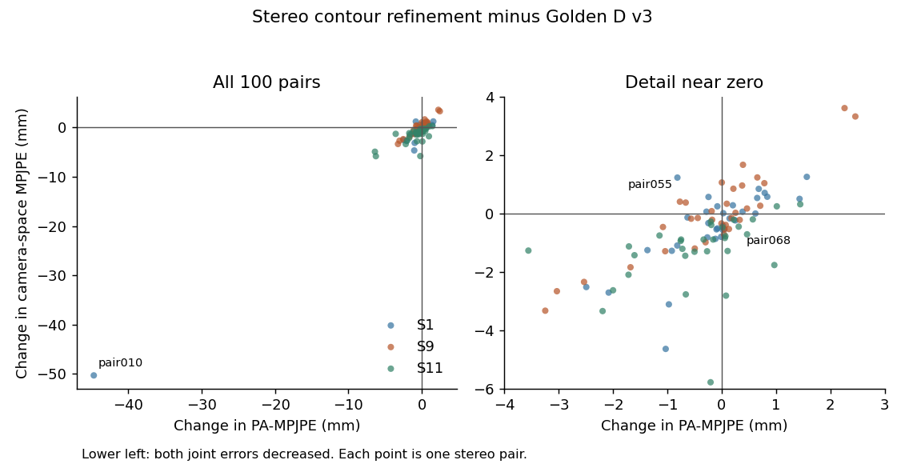

# 冻结 100 对：黄金 D v3 与单帧双目轮廓复跑

在相同的 100 对、三个测试人物和标准体型上，加入轮廓后，相对原 v3 的平均 PA 变化 -0.83 mm，非 PA 变化 -1.19 mm，轮廓距离变化 -4.42 px。下表均为同帧配对计算。复跑的每个 v3 获胜参数与原归档最大绝对差为 0。[精度、穿插与逐帧明细](evidence/results.json) · [原参数核验](evidence/execution.json)

## 与原 v3、等步数对照和先前碰撞实验比较

| 同一批冻结测试 | PA（mm）↓ | 非 PA（mm）↓ | 轮廓距离（px）↓ | 对官方二维 RMSE（px）↓ | 手–手或手–腿穿插帧 | 采样穿入 >2 mm 帧 |
|---|---:|---:|---:|---:|---:|---:|
| 黄金 D v3 复跑 | 41.22 | 58.73 | 15.48 | 17.91 | 16 | 16 |
| v3 继续优化，无轮廓 | 40.78 | 58.17 | 15.37 | 17.27 | 16 | 16 |
| v3 继续优化，加双目轮廓 | 40.39 | 57.54 | 11.05 | 17.22 | 11 | 11 |
| 上一轮仅加碰撞代价和局部候选 | 41.85 | 59.31 | — | 18.00 | 10 | 7 |

PA 在每帧对左右肩、肘、腕、髋、膝、踝做旋转、平移及统一缩放对齐后计算 MPJPE；非 PA 在左相机坐标中直接计算同一组关节。轮廓距离是模型可见边界与 Sapiens2 预测边界的截断双向距离，属于拟合目标。二维关节 RMSE 和两种三维关节误差用官方标注独立评分。穿插计数检查左右手之间和任一手与任一大腿的五组表面，取至少一次严格穿面的帧数。采样深度使用另一种度量。旧碰撞实验的轮廓距离未归档。[本轮评分](evaluate.py) · [原 v3 报告](../2026-11-23_fullbody_joint_candidates/report.md) · [前次碰撞实验](../2026-11-24_v3_contact/report.md)

按每帧误差变化的 ±0.01 mm 作持平区间，相对原 v3，PA 改善 54 帧、变差 44 帧、持平 2 帧；非 PA 改善 69 帧、变差 29 帧、持平 2 帧。PA 和非 PA 的配对变化中位数分别为 -0.11 和 -0.49 mm。相对等步数无轮廓对照，平均变化分别为 -0.39 和 -0.63 mm。五组表面中有 7 帧原有相交消失，2 帧新增，9 帧前后均存在。面数和采样深度各自独立，无法用面数换算穿入深度。[逐帧配对](evidence/results.json)

全身几何核查给出了不同的结论。排除标准模板头部、脚部既有交叉局部后，严格相交面数平均从每帧 190.53 对变为 314.97 对。其中至少一只手内部出现自交的帧从 0 变为 81，对照组仍为 0。左手内部出现于 53 帧，右手内部出现于 67 帧，两侧有重叠。本文对“手部内部”的定位只精确到同一只手，未将接触面逐一细分到具体手指。另取七帧，用历史独立三角面程序复核双手内部相交面数。分割只标手区域，对手指如何排布的约束有限。[逐部位几何核验](evidence/regions.json)

单帧 pair010 的 PA 比原 v3 改善 44.69 mm，非 PA 改善 50.30 mm。这一帧在等步数对照也大幅改善。去掉它后，另外 99 帧相对原 v3 的平均 PA 下降 0.39 mm，非 PA 下降 0.69 mm。相对原 v3 的均值混合了继续搜索和轮廓观测的影响。[配对统计](evidence/results.json) · [去除该帧的统计](evidence/regions.json)



| 人物 | 帧数 | PA 原 v3 → 加轮廓（mm） | 非 PA 原 v3 → 加轮廓（mm） | 目标穿插帧 原 v3 → 加轮廓 |
|---|---:|---:|---:|---:|
| S1 | 34 | 42.47 → 41.01 | 55.48 → 53.54 | 2 → 1 |
| S11 | 33 | 38.90 → 38.09 | 70.23 → 68.70 | 6 → 2 |
| S9 | 33 | 42.26 → 42.05 | 50.57 → 50.51 | 8 → 8 |

## 此前关注的两帧

- **pair055**。加轮廓后 PA 40.96、非 PA 46.43 mm，上次只加轮廓为 40.96、46.43 mm。L_hand/L_thigh 相交面数从 121 到 24，采样最大穿入从 71.50 到 11.27 mm。
- **pair068**。加轮廓后 PA 32.95、非 PA 44.52 mm，上次只加轮廓为 32.95、44.52 mm。L_hand/R_hand 相交面数从 337 到 362，采样最大穿入从 19.96 到 8.47 mm。

两帧同时检查了四眼原图采样分割概率相对归档的最大差异。它们是已知诊断样本；其他帧可用来检查此前两帧的表现是否代表整个冻结集。[两帧复核字段 examples](evidence/results.json) · [前次四种设置](../2026-11-24_two_stereo_contact/report.md)

## 实验设置与复现

- 基线提交 ef1400e241216602251fdf81cb7a346342c86157，运行时工作树含本轮新增文件及此前无关改动。固定人员 S1、S9、S11 和既有冻结集；每次拟合只用当前同步双目。沿用已校验的 RW20000 关键点检测、官方 Head、画内掩码、相机参数，十维 betas 全零。Sapiens2 分割在 200 张原图上重新运行。沿用 BF16 网络推理、32 位插值与 softmax，只保存先前轮廓项实际使用的每四像素一个的 FP16 概率。不使用身体真值选解。[分割输入证据](evidence/segmentation.json)
- 使用历史优化器，从相同初值重跑 20,000 步。为保留相同浮点运算顺序，沿用原来四种检测条件组成的 400 行批次，本轮评分只取其中 RW20000 的 100 行。重新运行腕候选、躯干与四肢组合搜索及可行性评分。运行中将耗时阶段并行，用归档 20,000 步检查点先行开始候选搜索，再逐字段对照本次冷启动的结果；目标 100 行在所有保存字段均逐元素相等。关键点检测本身使用归档，不属于此次冷启动复跑范围。[复跑程序](refit.py) · [逐帧参数与选择](evidence/selections.json) · [哈希与复现检查](evidence/execution.json)
- 两个继续优化分支均从同一个重建 v3 出发，分别做 72 次 Adam 更新、允许腕与手指活动，按各自下降后的位置重新生成根/躯干和四肢候选。两者同时保留输入姿态及原 v3 候选，只按本分支目标选可行解，均无碰撞项、硬门槛、接触或交叉修复提案。轮廓分支沿用上次的总体前景、可用左右手臂、手和大腿边界；两眼各独立光线投射，仅比较可见面。阈值 0.55、最少 12 个有效采样像素和 6 个边缘点，距离上限 64 px、尺度 12 px、权重 0.008 均固定。等步数对照保留相同的额外优化、正则、搜索规则，候选随各自解变化。前次两帧还在共享池中考虑过硬约束提案，此次只复跑纯轮廓分支。[拟合代码](compare.py) · [前次轮廓代价](../2026-11-24_two_stereo_contact/outline.py)
- 原图、概率、参数、完整本地日志留在开发机，公开的是脱敏哈希、统计、命令及退出状态。分割只用一块 GPU，拟合与评分用 CPU。首次冷启动定位输入目录失败，首次评分导入了同名历史模块；修正后分别重新执行。推送前自检覆盖本次工作区、暂存增量、待推送提交和远端基线；无模型、数据集、视频、源图、数组、完整输出、机器绝对路径或凭据，单文件小于 50 MB。[执行记录](evidence/execution.json) · [发布检查](evidence/prepush.json)

从仓库根目录依次执行下列命令。需要开发机已有的标定、模型、图像、冻结检测和 RW 官方评分数据。

```sh
r=runs/2026-11-25_frozen100_outline
bash "$r/run.sh" segment
bash "$r/run.sh" refit
bash "$r/workers.sh" 12
bash "$r/run.sh" evaluate
bash "$r/run.sh" chart
bash "$r/run.sh" regions
bash "$r/run.sh" verify
```
