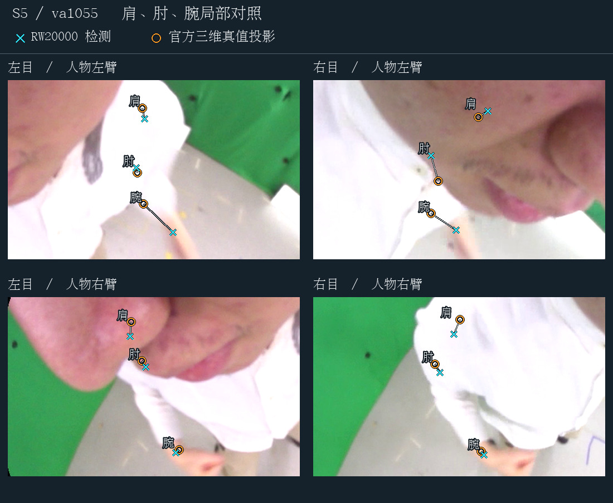
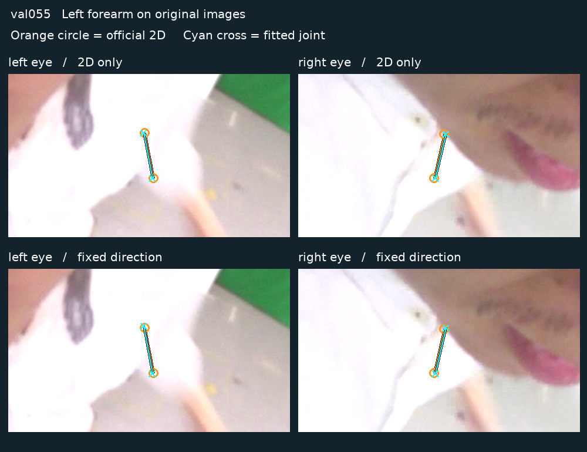

# val055 左腕点位与官方二维双目方向对照

val055 的左右目左腕检测均落在官方投影的右下方；右目左肘偏向上方。左前臂在两眼的官方投影长度仅 39.47 / 38.37 px，检测点之间却为 92.51 / 90.32 px。图中白袖、皮肤、面部邻近，左前臂在成像平面上明显缩短；图像能定位偏差位置，无法判定网络内部误判原因，也无法用肉眼独立认证官方关节中心。[臂部双目图](assets/arms.jpg) · [全身 12 点](assets/stereo.jpg) · [视图几何](evidence/val055_geometry.json)

青叉为 RW20000，橙圈为官方三维关节投影，行按人物左臂、右臂分，列按左目、右目分。原图坐标的检测减官方偏移如下，正值为向右、向下。

| 人物左侧 | 左目 dx / dy px | 左目距离 px | 右目 dx / dy px | 右目距离 px |
|---|---:|---:|---:|---:|
| 肘 | −1.73 / −6.30 | 6.53 | −8.26 / −29.17 | 30.32 |
| 腕 | +36.64 / +35.36 | 50.93 | +28.81 / +18.99 | 34.51 |

两眼的二维前臂方向分别相差 18.93°、31.10°。单独双目三角化并事后比较，检测肘与腕都取用时三维方向偏 26.38°；只换官方双腕中的左腕，保留检测左肘，仍偏 25.69°；只换左肘，保留检测左腕，偏 16.10°。此处比较同一左臂的两个端点，不经过全身拟合。左腕对官方位置偏差更大，但仅纠正腕仍不能纠正这帧的前臂方向。[三角化替换对照](evidence/val055_geometry.json) · [原图距离](evidence/render.json)

## 三组相同预算的拟合

执行基线 7c18a6216417f5b4257c1b8fd989c1f886adc03e。两帧均从先前用数据集现成官方 12 点二维标注拟合并生成的 v3 最优姿态续跑；锁定输入文件、协议、候选与参数哈希。各组使用相同 Head、掩码、平均体型、肩髋初始来源与相机，每组再执行 1,000 步 Adam，按相同 v3 目标选可行检查点。纯二维组从归档姿态启动；初始化组从同一姿态出发，使用两侧官方二维肘腕分别三角化后重摆肩与肘；硬约束组采用同一个双臂起点，此后在每次更新时把两侧肘的局部旋转重新调整，使模型的肘→腕方向在左相机坐标下与指定方向一致。保留模型骨长与原关节上限，不锁腕点位置。逐步核验双侧方向，整个硬约束轨迹最大偏离低于 0.00005°。独立评分进程才读取官方身体三维真值。[拟合代码](compare.py) · [输入与选解记录](evidence/fit.json)

| 帧 | 官方二维点上的方法 | 左 / 右前臂误差 ° | 左 / 右腕距离 mm | 12 点非 PA mm | 12 点 PA mm | 二维 RMSE px |
|---|---|---:|---:|---:|---:|---:|
| val055 | 直接全身拟合 | 0.827 / 0.113 | 27.56 / 18.74 | 57.41 | 27.83 | 6.86 |
| val055 | 三角化方向作起点 | 0.826 / 0.115 | 27.53 / 18.75 | 57.15 | 27.70 | 6.87 |
| val055 | 全程固定三角化方向 | <0.001 / <0.001 | 27.92 / 19.86 | 58.00 | 28.36 | 6.88 |
| val031 | 直接全身拟合 | 2.338 / 0.747 | 13.35 / 1.48 | 27.10 | 18.81 | 14.83 |
| val031 | 三角化方向作起点 | 2.341 / 0.750 | 13.36 / 1.49 | 27.12 | 18.82 | 14.83 |
| val031 | 全程固定三角化方向 | <0.001 / <0.001 | 1.92 / 4.64 | 28.39 | 20.11 | 14.91 |

误差角比较相机系肘→腕方向。非 PA 为关节三维平均欧氏距离，PA 为每帧经相似变换后的平均距离；二维 RMSE 为对原图官方有效点的双目汇总。两帧的官方二维点均与官方身体三维投影数值一致，三角化方向与三维真值的误差也都低于 0.00005°，所以指定方向后得到近零角误差是几何上的预期。方向相同仍允许端点整体移动，且全身其余关节仍有误差。固定预算下，两帧整体 PA 和非 PA 均未因硬锁而下降。只测两个已知问题帧，默认方法保持原配置。[完整指标](evidence/scores.json) · [先前官方二维输入一致性检查](../2026-11-24_gt_projection_elbows/report.md)

橙圈为官方二维肘腕，青叉为最终 SMPL-X 肘腕。上排只用二维拟合，下排全程指定双臂方向，两组均从同一官方二维 v3 来源得到。这张图中标记的像素位置和第一张的检测点含义不同。[绘图代码](fit_overlay.py)

## 执行与发布

工作树有既有无关改动，仅提交本 run。运行脚本、精简退出状态与资源校验见记录。开发机保存完整参数、原始图与日志，公开内容只含派生标记图、数值、文档和代码。推送前核对工作区、暂存、待推提交及远端，检查增量文件大小、凭据、受限数组、机器路径及图像元数据。[执行记录](evidence/execution.json) · [发布检查](evidence/prepush.json)
