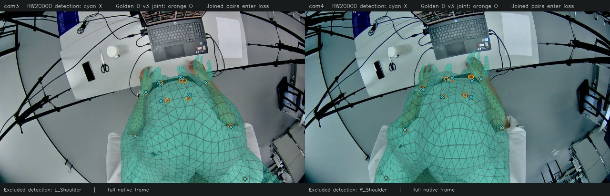
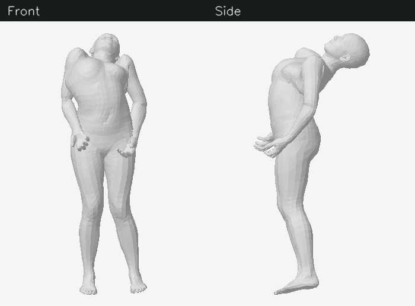

# real001 真实双目 · 黄金 D v3

同一套 SMPL-X 拟合结果投影到 cam3 和 cam4。青色叉是 RW20000 自动检测点，橙色圆是最终 SMPL-X 关节的投影，白线连接进入拟合的对应点。两目都保留 1280 × 720 原始视野，图例在画面外。

| 原图大小查看 | 网格投影 | 自动点与拟合点 | 网格与两组点 |
|---|---|---|---|
| cam3 左目 | [打开](assets/cam3_mesh.jpg) | [打开](assets/cam3_points.jpg) | [打开](assets/cam3_mesh_points.jpg) |
| cam4 右目 | [打开](assets/cam4_mesh.jpg) | [打开](assets/cam4_points.jpg) | [打开](assets/cam4_mesh_points.jpg) |

OBJ 回读后，以人体根部为参考从正面和侧面渲染。侧面能看到头和上胸明显后仰。模型的头随上胸，图像中缺少独立的头朝向观测。人体自身有深度遮挡测试，叠加渲染没有场景深度，对桌面、衣物以及手指接触的遮挡关系无法作出判断。

## 二维点贴合程度

| 对检测点的距离 | cam3 | cam4 |
|---|---:|---:|
| 有效观测 | 11 | 11 |
| 二维重投影 RMSE | 11.44 px | 10.74 px |
| 最大偏差 | 左髋 26.32 px | 右髋 26.85 px |

两目合并 RMSE 为 11.10 px，按有效关节的二维欧氏距离取平方平均再开方。两侧肘、腕在两目均小于 4 px。这一对缺少独立人体真值，以上数值只衡量最终关节与输入检测的一致程度。每关节距离、图像尺寸和输出哈希见[数值证据](evidence/results.json)。

## 执行与溯源

- 基线提交 `87525b94a23ca4bfac09d2aefbfb802f190e96b0`。工作树含本轮新增脚本和既有无关改动，后者未纳入提交。使用[仓库现行黄金 D v3](../../configs/golden_d.current.json) 锁定实现，复用[旧报告](../2026-11-18_real001_golden_d_four_models/report.md)同一帧对的 RW20000 自动检测、标定、掩码及历史估计 Head 位置。左右图像、标定和方法实现均核验哈希。[输入证据](evidence/inputs.json)
- 双肩各缺一目有效观测，本帧用双肩、双髋的有效二维点做重投影初始化。人体使用固定均值体型，头颈随上胸，手型固定，脚自由。完整运行 20000 步并搜索 3645 个候选探测，最终保留初始拟合阶段的第 20000 步解。解满足可行性条件，末段最大关节位移为 2.28 mm，严格收敛诊断未通过。[拟合记录](evidence/results.json)
- OBJ 采用 cam3 相机坐标、单位米，已回读检查三角面索引与顶点。原始 OBJ 与参数保存在开发机本轮输出目录。证据只公开哈希、结果数值和相对资源名。[执行记录](evidence/execution.json)
- 已检查工作区、暂存区、增量提交和远端基线。公开二进制文件限本轮渲染 JPEG，已核对大小、哈希和元数据。权重、原始图像、参数数组、完整原始输出、凭据及开发机绝对路径均未纳入。自检仅覆盖本次增量。[推送前记录](evidence/prepush.json)
