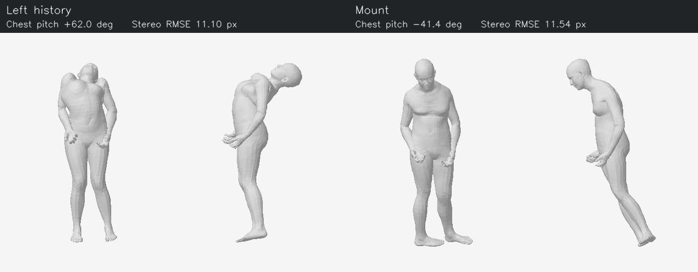

# real001 · 按相机佩戴位置估计 Head

同一对真实相机，同一组 RW20000 二维检测，同一黄金 D v3。仅更换左相机坐标系中的三维 Head 目标；各组用同一个肩髋旋转初始化，初始平移由各自的头目标确定。历史左目复用已核验的上轮完整输出，其余五组重新拟合。左右目历史估计先经标定外参变换到 cam3 再比较或平均。[上轮结果](../2026-11-25_real001_golden_d_v3/report.md)

## 从相机支架定位眉心

以两镜头光心中点为原点，以左光心到右光心的方向为佩戴者右侧。两光轴的平均方向去掉沿基线的分量后取反，作为近似向上，向后取朝佩戴者脑后的方向。这个佩戴坐标约定使用“镜头大致正对地面”，没有独立的重力测量。

按佩戴者描述，**眉心在中点上方 5 cm、后方 5 cm**。将中性 SMPL-X 的双眉内端中点作为眉心代理，模板原生 Head 关节相对该点约向左 1.11 cm、向下 6.27 cm、向后 9.03 cm。按头部中立朝前换算，Head 位于支架中点约左 1.11 cm、下 1.27 cm、后 14.03 cm。此偏移取自本轮模型，对个人解剖和实际佩戴角度只有近似意义。额外两组把假定的上下、前后轴绕光心基线各旋转 ±10°，两段偏移一并旋转。该角度假设只用于计算三维目标，所有组仍让头随上胸。左右光心间距 15.45 cm；旧左右目 Head 估计相距 3.93 cm；旧左目与佩戴法居中假设相距 41.28 cm。[坐标、模板偏移与输入哈希](evidence/inputs.json)

## 同帧结果

| Head 来源 | 上胸相对骨盆 | 两目合并二维 RMSE | 拟合后眉心至名义眉心 |
|---|---:|---:|---:|
| 历史左目 | 后仰 61.97° | 11.10 px | 50.18 cm |
| 历史右目 | 后仰 58.57° | 11.12 px | 51.65 cm |
| 左右估计取均值 | 后仰 60.14° | 11.11 px | 50.87 cm |
| 佩戴几何 | 前倾 41.44° | 11.54 px | 1.42 cm |
| 佩戴几何 −10° | 前倾 44.56° | 11.96 px | 1.56 cm |
| 佩戴几何 +10° | 前倾 36.98° | 11.24 px | 3.32 cm |

二维 RMSE 按 22 个有效身体观测和各自自动点的欧氏像素距离计算。胸廓角取骨盆局部坐标中上胸向上轴在人体矢状面内的倾角。最后一列统一对照佩戴者给出的名义眉心位置，即使上下方向假设有变化也沿用同一参考。六组都满足 v3 可行性，均未通过既定末段收敛诊断。[逐组数值、检查点与诊断](evidence/results.json)

[六组正侧面同尺度对照](assets/all_front_side.jpg) · [佩戴法 cam3 网格与关节](assets/mount_cam3.jpg) · [佩戴法 cam4 网格与关节](assets/mount_cam4.jpg)。正侧面以各自的骨盆为参考；原图上青叉为检测点、橙圈为最终关节。

旧左目和佩戴法的二维贴点残差只差 0.45 px，上胸相对骨盆却从后仰变为前倾。两目历史估计取均值仍然后仰。按佩戴关系换算 Head 后，重建的网格眉心与描述的名义位置相距 1.42 cm。这里既有头部模板和佩戴方向的假设，也有估计误差；真实三维姿态与佩戴偏移均未独立实测。这些数据支持本帧姿态强烈依赖绝对 Head 锚点，无法确定真人前倾角。

## 复现与发布

运行基线 `5b5eaf4c14fc7a0490137e922cfc26908b45eb8e`，工作树含未提交的本轮脚本及无关历史改动。读上轮 review，沿用原协议、相机内外参、头随上胸、均值体型、自由脚和官方当前 v3 实现。没有重新检测。五组各运行 20000 步及原版候选选择。相关的历史参数、图像、后端和模型需有读取权限。公开记录只保留相对路径、哈希、渲染及判断所需的数值。[执行记录](evidence/execution.json)

推送前检查工作区、暂存文件、待推增量和远端。公开二进制文件限本轮生成的 JPEG，各自验证哈希、格式、尺寸和元数据。单个文件小于 50 MB，公开增量未含权重、原图、原始输出、参数数组、环境凭据或主机路径。[自检记录](evidence/prepush.json)
