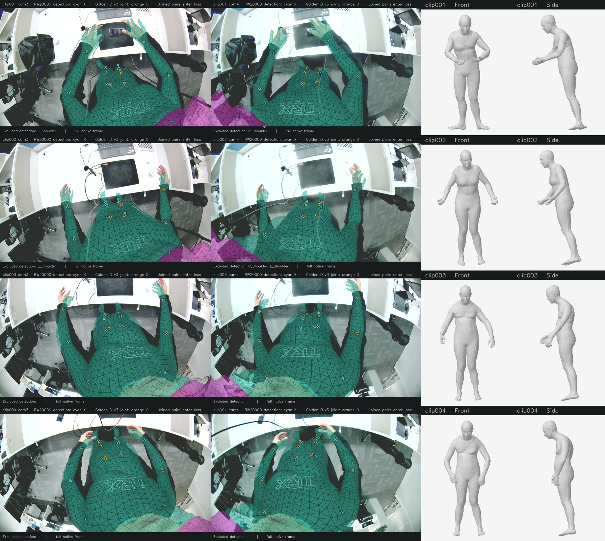

# 四段真实视频中间帧 · 黄金 D v3

每行依次为左目、右目和导出 OBJ 的正面、侧面。青叉是 RW20000 自动点，橙圈是最终 SMPL-X 关节投影，白线连接参与拟合的对应点。各目完整保留 1280 × 720，带图例的版本向外加边。

| 片段 | 仅网格（左 / 右） | 仅两组点（左 / 右） | 网格和点（左 / 右） | OBJ 正侧视 |
|---|---|---|---|---|
| 001 | [左](assets/clip001_cam3_mesh.jpg) / [右](assets/clip001_cam4_mesh.jpg) | [左](assets/clip001_cam3_points.jpg) / [右](assets/clip001_cam4_points.jpg) | [左](assets/clip001_cam3_both.jpg) / [右](assets/clip001_cam4_both.jpg) | [正面＋侧面](assets/clip001_obj.jpg) |
| 002 | [左](assets/clip002_cam3_mesh.jpg) / [右](assets/clip002_cam4_mesh.jpg) | [左](assets/clip002_cam3_points.jpg) / [右](assets/clip002_cam4_points.jpg) | [左](assets/clip002_cam3_both.jpg) / [右](assets/clip002_cam4_both.jpg) | [正面＋侧面](assets/clip002_obj.jpg) |
| 003 | [左](assets/clip003_cam3_mesh.jpg) / [右](assets/clip003_cam4_mesh.jpg) | [左](assets/clip003_cam3_points.jpg) / [右](assets/clip003_cam4_points.jpg) | [左](assets/clip003_cam3_both.jpg) / [右](assets/clip003_cam4_both.jpg) | [正面＋侧面](assets/clip003_obj.jpg) |
| 004 | [左](assets/clip004_cam3_mesh.jpg) / [右](assets/clip004_cam4_mesh.jpg) | [左](assets/clip004_cam3_points.jpg) / [右](assets/clip004_cam4_points.jpg) | [左](assets/clip004_cam3_both.jpg) / [右](assets/clip004_cam4_both.jpg) | [正面＋侧面](assets/clip004_obj.jpg) |

## 输入与投影

- 按左右目系统时钟重叠区间的中点选择最近左帧，再选时间最近的右帧。MP4 包数比时间戳行数多 1–2；抽帧前交叉检查中点附近 CSV 与媒体显示时间的变化，再用逐帧解码选择对应帧号。序号从 1 开始，时差基于采集系统记录。[逐段帧号、时差、视频与图像哈希](evidence/frames.json)
- 使用 2026-11-08 重新标定的 MATLAB Scaramuzza 双鱼眼。列向量外参由毫米换算为米，基线 152.02 mm；标定尺度沿用棋盘格长 15 mm 的假设。转换到原生零起始像素后，在真实标定板第 30、69、73 对重检角点，右图局部极线距离均值分别为 0.18、0.93、0.82 px。实际拟合后端的像素→射线→像素抽检最大误差小于 0.001 px，这项衡量转换的数值一致性。[标定证据](evidence/calibration.json) · [后端核对](evidence/inputs.json)
- 按佩戴关系，眉心在光心中点的上、后各 5 cm，向上取支架平均向下光轴的反向并与基线正交。延用上一轮中性模板眉心至原生 Head 的偏移，新标定下 Head 在 cam3 坐标约为 (6.86, 13.88, 0.89) cm。四帧使用同一 Head 位置软锚点，头颈随上胸。[佩戴换算依据](../2026-11-25_real001_head_mount/report.md)
- 对八张中间帧独立运行 RW20000，沿用黄金 D v3 的 12 个身体关节和原候选搜索。二维点有效条件为有限且在画内；被衣物或桌面遮挡的点仍可能被检测器估计出来。黄金 D v3 固定均值体型和局部手型，脚自由，未加入 WiLoR、地面和时序损失。[检测指纹](evidence/detection.json) · [方法配置](../../configs/golden_d.current.json)

## 每段拟合结果

| 片段 | 左 / 右帧号 | 时差 ms | 有效关节观测 | 左 / 右 RMSE px | 合并 RMSE px |
|---|---:|---:|---:|---:|---:|
| 001 | 1363 / 1375 | 2.06 | 22 | 13.07 / 14.31 | 13.70 |
| 002 | 1212 / 1212 | 1.95 | 21 | 13.53 / 15.05 | 14.27 |
| 003 | 397 / 407 | 1.38 | 24 | 6.77 / 8.05 | 7.43 |
| 004 | 702 / 705 | 0.31 | 24 | 9.20 / 9.74 | 9.47 |

RMSE 为所有有效关节的二维欧氏距离取平方均值后开根，对照对象为该帧的 RW20000 自动检测。四段均得到可行解，均完成 20000 步并运行 v3 候选选择，均保留基础优化解；四段的严格末段收敛检查均未通过。001 和 002 因肩部某些视图出界而使用原版肩髋重投影初始化。四段右目中残差最大的关节均为右髋。手掌、手指在多段的叠加图上仍能看到偏差，当前 12 点没有独立手指和脚掌方向观测。该真实录制缺少三维人体真值。[每眼每关节、收敛与网格证据](evidence/results.json)

## 复现与增量检查

执行基线 `326a47ac9d316f4f1ee8f4242ef5681f029471ac`，工作树含本轮新增文件及既有无关改动。新原始采集目录仅在开发机读取。按执行记录先运行 frames、calibrate、detect，再运行 solve 的 prepare、fit、candidates，最后运行 gallery。仅检测使用单张 GPU，拟合使用 CPU。四份 OBJ 为左相机坐标系、单位米；已逐一回读并核对顶点与三角面，再按人体根部观看方向渲染。本地原始 OBJ 位于仓库输出目录 `outputs/realvideo4_dv3_20261125/`。[执行及恢复记录](evidence/execution.json)

已核对工作区、暂存区、待推提交和远端。增量只公开实验脚本、报告、精简数值、输入哈希及所请求的派生 JPEG。图片逐份核对尺寸、哈希及 EXIF；所有单文件小于 50 MB。原始视频、照片、设备标识、权重、拟合参数、OBJ 及原始日志留在开发机。公开文本无开发机绝对路径、环境凭据或令牌。[推送前自检](evidence/prepush.json)
