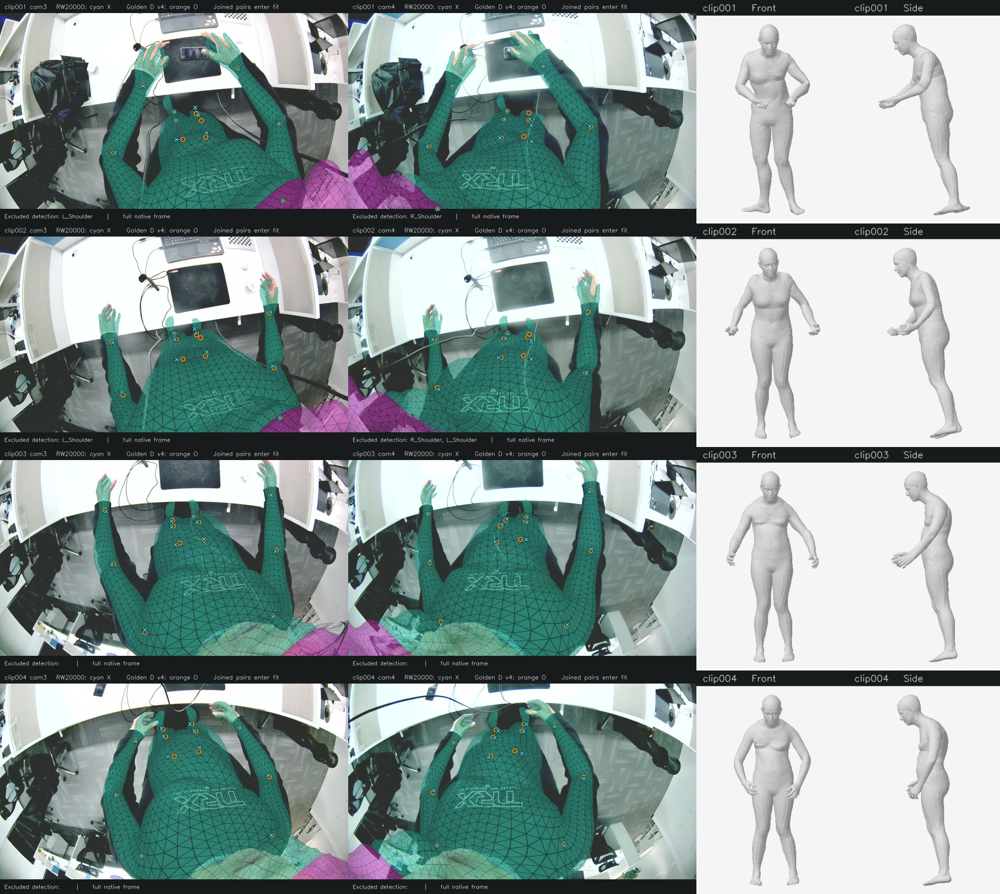

# 四段真实双目视频 · 黄金 D v4

[下载全部四份 OBJ（ZIP）](https://github.com/cdh290718-oss/DownSight/releases/download/realvideo4-dv4-obj-20261125/realvideo4_Dv4_OBJ_cam3_m.zip) · [附件 SHA-256](evidence/attachment_audit.json)

使用与上轮相同的四对中间帧、新双鱼眼标定和佩戴 Head。每行依次显示左目、右目，以及同一个 OBJ 的正面和侧面。青叉表示 RW20000 自动点，橙圈表示最终 SMPL-X 关节投影。

| 片段 | 原图网格 | 原图两组点 | 网格和点 | OBJ 正侧视 | 单独下载 OBJ |
|---|---|---|---|---|---|
| 001 | [左](assets/clip001_cam3_mesh.jpg) / [右](assets/clip001_cam4_mesh.jpg) | [左](assets/clip001_cam3_points.jpg) / [右](assets/clip001_cam4_points.jpg) | [左](assets/clip001_cam3_both.jpg) / [右](assets/clip001_cam4_both.jpg) | [查看](assets/clip001_obj.jpg) | [下载](https://github.com/cdh290718-oss/DownSight/releases/download/realvideo4-dv4-obj-20261125/clip001_dv4_cam3_m.obj) |
| 002 | [左](assets/clip002_cam3_mesh.jpg) / [右](assets/clip002_cam4_mesh.jpg) | [左](assets/clip002_cam3_points.jpg) / [右](assets/clip002_cam4_points.jpg) | [左](assets/clip002_cam3_both.jpg) / [右](assets/clip002_cam4_both.jpg) | [查看](assets/clip002_obj.jpg) | [下载](https://github.com/cdh290718-oss/DownSight/releases/download/realvideo4-dv4-obj-20261125/clip002_dv4_cam3_m.obj) |
| 003 | [左](assets/clip003_cam3_mesh.jpg) / [右](assets/clip003_cam4_mesh.jpg) | [左](assets/clip003_cam3_points.jpg) / [右](assets/clip003_cam4_points.jpg) | [左](assets/clip003_cam3_both.jpg) / [右](assets/clip003_cam4_both.jpg) | [查看](assets/clip003_obj.jpg) | [下载](https://github.com/cdh290718-oss/DownSight/releases/download/realvideo4-dv4-obj-20261125/clip003_dv4_cam3_m.obj) |
| 004 | [左](assets/clip004_cam3_mesh.jpg) / [右](assets/clip004_cam4_mesh.jpg) | [左](assets/clip004_cam3_points.jpg) / [右](assets/clip004_cam4_points.jpg) | [左](assets/clip004_cam3_both.jpg) / [右](assets/clip004_cam4_both.jpg) | [查看](assets/clip004_obj.jpg) | [下载](https://github.com/cdh290718-oss/DownSight/releases/download/realvideo4-dv4-obj-20261125/clip004_dv4_cam3_m.obj) |

## 同帧结果

| 片段 | 左 / 右帧号 | 时差 ms | 有效观测 | 双目关节点 RMSE，v3 → v4（px） | 双目轮廓距离，v3 → v4（px） |
|---|---:|---:|---:|---:|---:|
| 001 | 1363 / 1375 | 2.06 | 22 | 13.70 → 13.70 | 13.50 → 12.04 |
| 002 | 1212 / 1212 | 1.95 | 21 | 14.27 → 14.31 | 13.80 → 10.84 |
| 003 | 397 / 407 | 1.38 | 24 | 7.43 → 7.50 | 20.13 → 9.74 |
| 004 | 702 / 705 | 0.31 | 24 | 9.47 → 9.52 | 17.19 → 10.38 |

四段都选中了 72 步细化过程中保留的可行姿态。轮廓距离指网格可见边缘与 Sapiens2 分割边缘的双向距离，每个像素距离截断到 64 px，再按有支持的部位、左右目平均；表中按协议将归一化的轮廓项乘 12 还原为像素。关节点 RMSE 衡量对输入身体点的贴合，四段均略增，增量最多 0.07 px。003 的轮廓改善最大。无人体三维真值，未计算 PA 或非 PA 三维误差。[每眼每关节与选姿记录](evidence/results.json) · [v3 原图与指标](../2026-11-25_realvideo4_dv3/report.md)

## 输入、约束与复现

逐一校验上一轮的八张原图、标定、优化协议、准备数据与 v3 参数。沿用眉心在光心中点上、后各 5 cm，再换算到 SMPL-X Head 的设定。对八张完整 1280 × 720 原图重新运行 Sapiens2 人体分割。v4 使用前景和达到支持阈值的部位边缘，手指、双踝和双前脚掌的局部旋转从细化首步起保持在 v3 初值。手腕和上游关节仍可转动。四帧分别拟合，无地面接触或时序信息。起点的严格末段稳定性检查沿用上轮结果；v4 完成规定步数并按原始复合目标选姿。[v4 定义](../../configs/golden_d.current.json) · [分割指纹](evidence/segmentation.json) · [抽帧证据](../2026-11-25_realvideo4_dv3/evidence/frames.json)

执行起点为 `bb6c9d0aa0cef70dc151fa8f26100abfc77f6bfe`，发布前 main 已推进至 `f9ed07edf7443cad2f57cf732d24b91a498b0247`，其增量仅含说明与架构图。工作树含本轮新增脚本和既有无关修改。使用锁定实现核验重建的 v3 候选，通过同一轮廓目标比较 v3 起点、细化解与两批候选。各帧的支持区域、原始损失、选姿和哈希均已记录。

OBJ 为逐帧共享人体，采用左相机 cam3 的 OpenCV 坐标，单位米。用于正侧视渲染的展示旋转只应用于视图，导出文件保留相机坐标。四份网格回读核对顶点与面，再打包为 ZIP，逐项验证 SHA-256。[运行步骤](evidence/execution.json)

已核对工作区、暂存内容、待推增量及远端。Git 增量仅含代码、报告、精简数值及衍生 JPEG，核对了图片尺寸、元数据和哈希。所有文件小于 50 MB，未包含原始视频、模型权重、完整拟合参数、主机绝对路径或凭据。四个 OBJ 和 ZIP 单独作为本轮授权的 Release 附件。[增量自检](evidence/prepush.json)
