# 脚部复位后的 24 对全身渲染

左为正面，右为侧面。

### S1 / pair001

[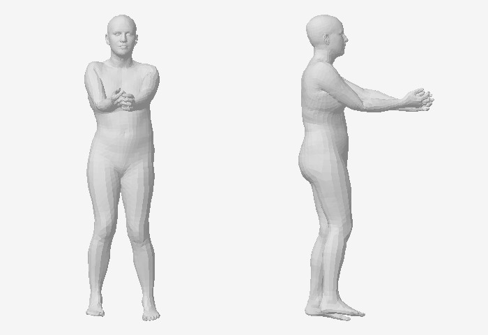](assets/pair001.jpg)

### S1 / pair022

[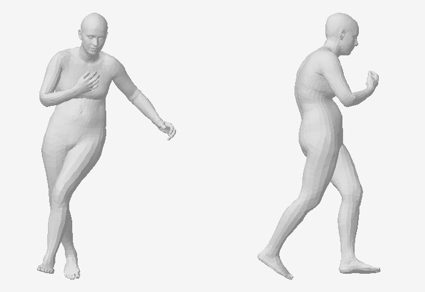](assets/pair022.jpg)

### S1 / pair028

[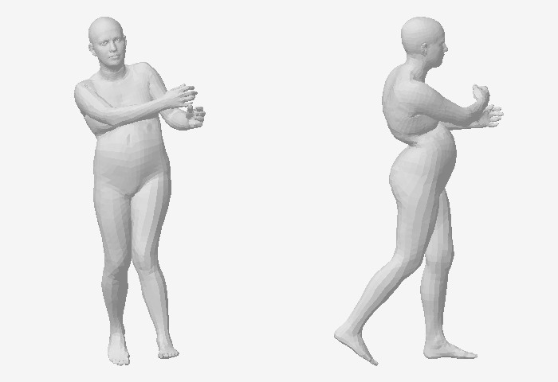](assets/pair028.jpg)

### S1 / pair034

[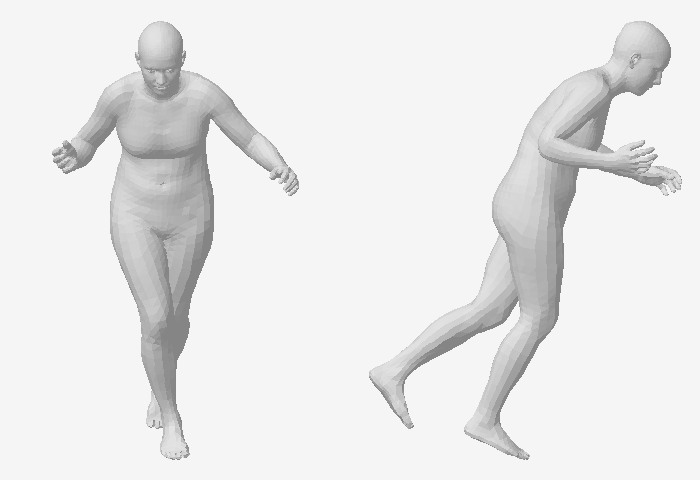](assets/pair034.jpg)

### S9 / pair036

[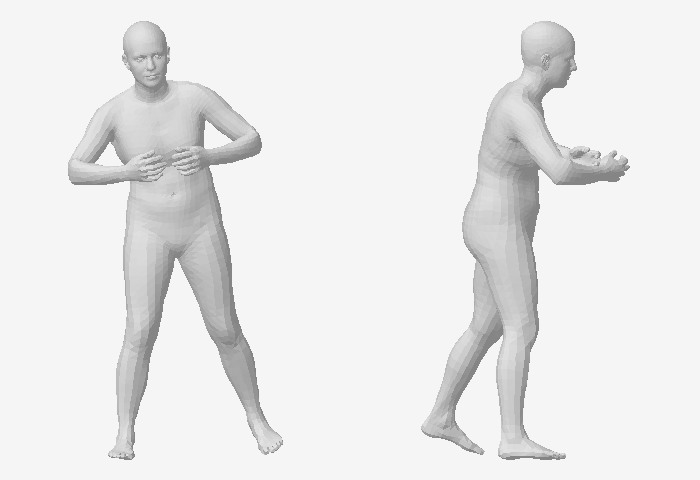](assets/pair036.jpg)

### S9 / pair037

[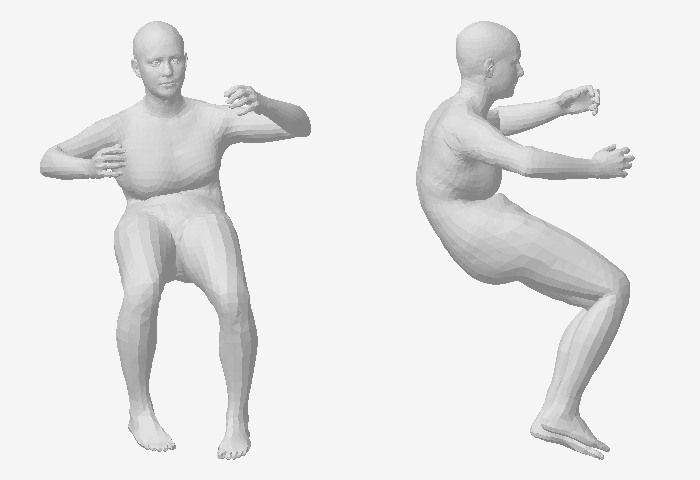](assets/pair037.jpg)

### S9 / pair045

[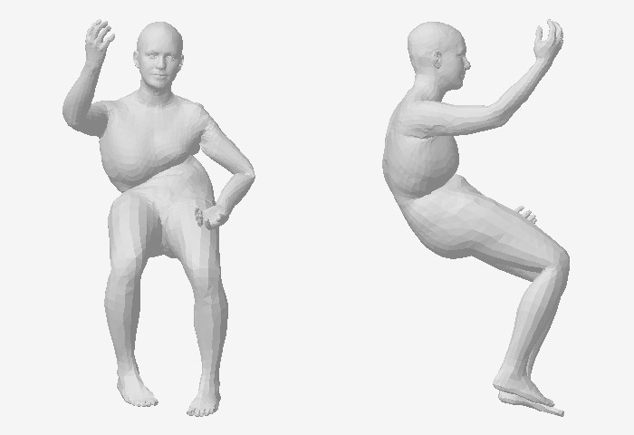](assets/pair045.jpg)

### S9 / pair055

[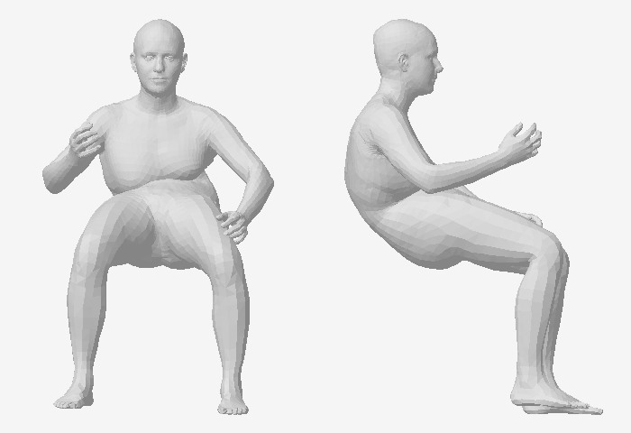](assets/pair055.jpg)

### S11 / pair068

[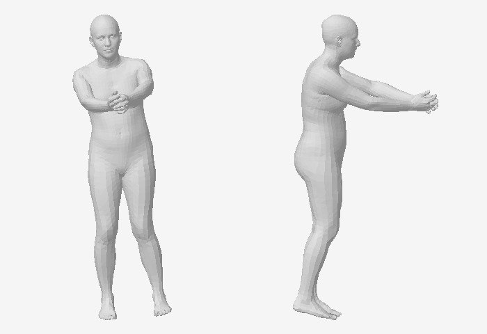](assets/pair068.jpg)

### S11 / pair078

[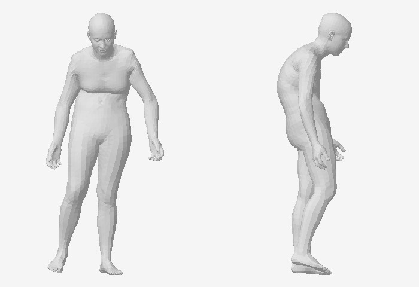](assets/pair078.jpg)

### S11 / pair088

[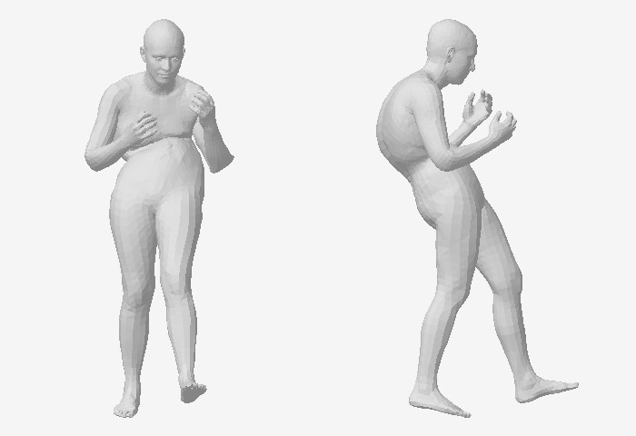](assets/pair088.jpg)

### S11 / pair094

[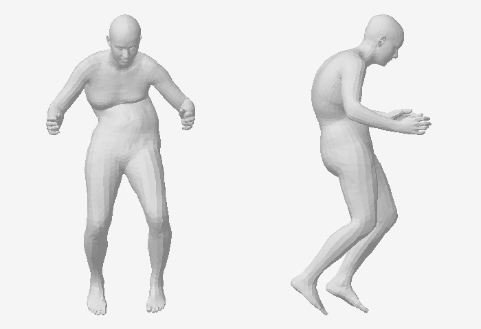](assets/pair094.jpg)

### S3 / val017

[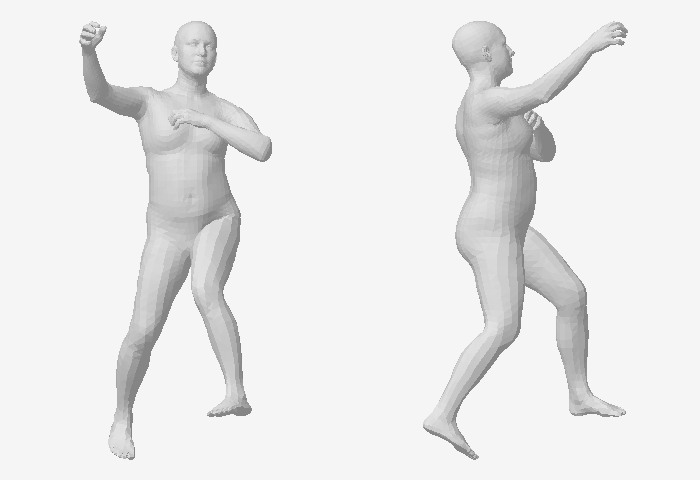](assets/val017.jpg)

### S3 / val031

[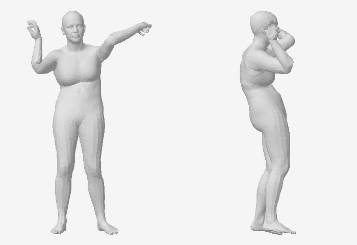](assets/val031.jpg)

### S3 / val042

[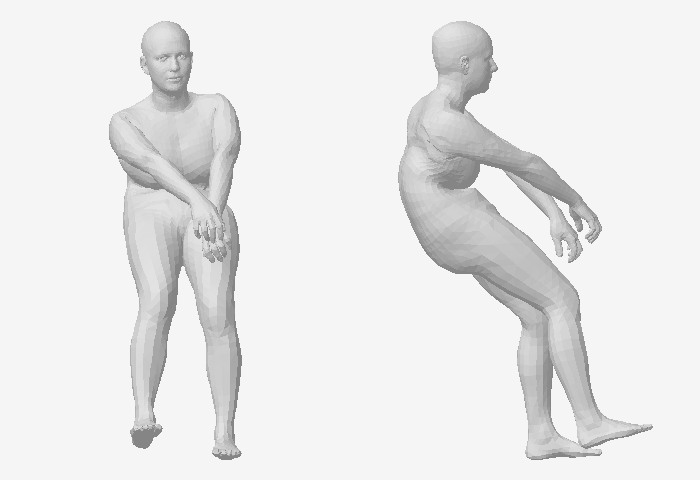](assets/val042.jpg)

### S5 / val055

[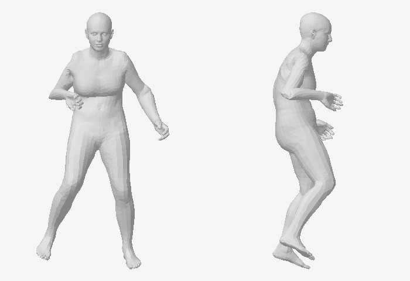](assets/val055.jpg)

### S5 / val073

[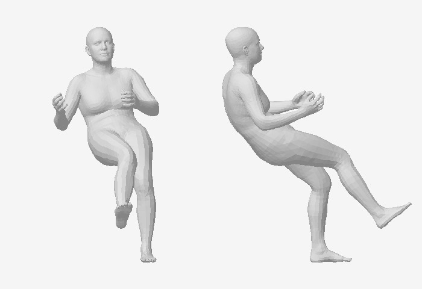](assets/val073.jpg)

### S5 / val100

[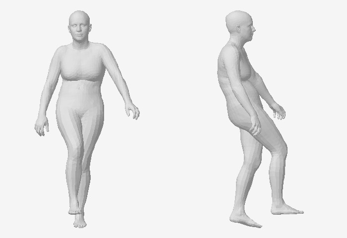](assets/val100.jpg)

### S13 / val102

[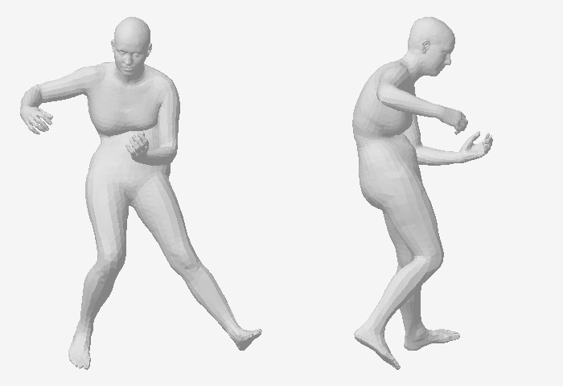](assets/val102.jpg)

### S13 / val122

[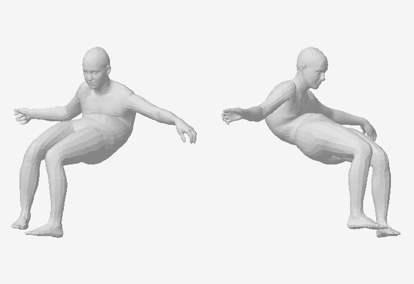](assets/val122.jpg)

### S13 / val134

[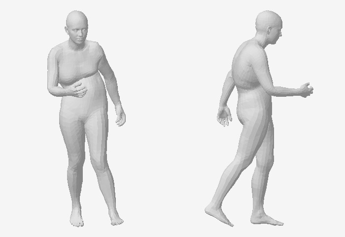](assets/val134.jpg)

### S15 / val168

[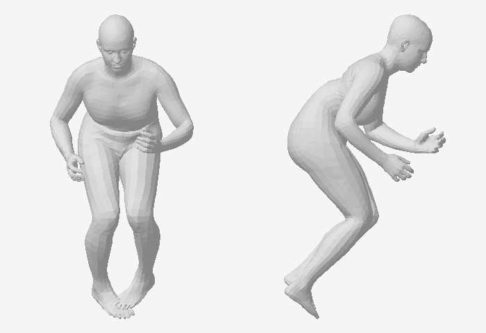](assets/val168.jpg)

### S15 / val178

[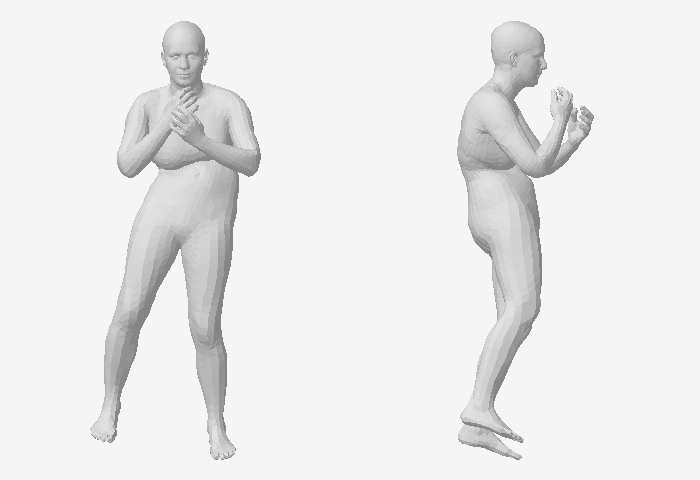](assets/val178.jpg)

### S15 / val181

[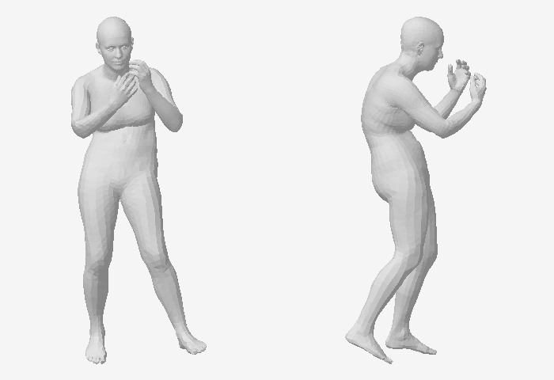](assets/val181.jpg)
