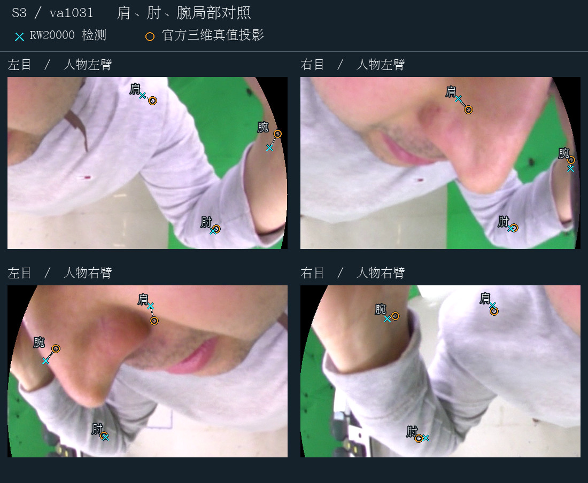
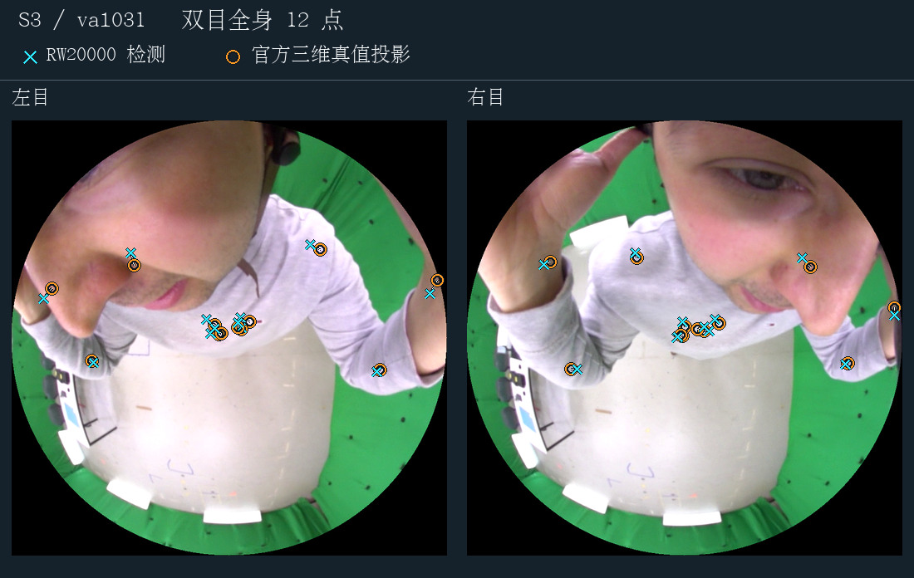

# S3 / val031 检测点与真值投影

青色叉号是 RW20000 身体检测点，橙色空心圆是官方三维关节在相应相机中的二维投影。每个点对之间画了一条细线。左列为左目，右列为右目。局部图的左臂、右臂按人物自身区分。

| 关节 | 左目误差 px | 右目误差 px |
|---|---:|---:|
| 左肩 | 21.8 | 24.6 |
| 左肘 | 7.7 | 5.6 |
| 左腕 | 30.2 | 14.2 |
| 右肩 | 25.7 | 10.4 |
| 右肘 | 3.8 | 11.7 |
| 右腕 | 26.4 | 14.5 |

误差为原图中的欧氏距离。沿用上轮实际用于拟合的 detector 与 projected_all 输入，按各目像素中心仿射的逆变换映射回同帧原图，再同步缩放、裁切底图和标记。原图、拟合输入与相机配置均核对哈希，双目各 12 个点的距离逐点核对上轮证据。局部图独立缩放，误差读原图像素表。[本轮逐点记录](evidence/render.json) · [投影生成与拟合对照](../2026-11-24_gt_projection_elbows/report.md)

运行基线 bbbe42bb118d1645c209480c2469d52603347b5c，工作树含已有无关更改，仅提交本目录。执行命令为 `python -B runs/2026-11-25_val031_point_overlay/render.py`，退出状态见记录。发布前检查工作区、暂存、待推提交和远端，仅包含请求的派生可视化、数值与复现文件，JPEG 无 EXIF；不含原始数据文件、权重、凭据和本机私有路径，单文件均低于 50 MB。[增量自检](evidence/prepush.json)
