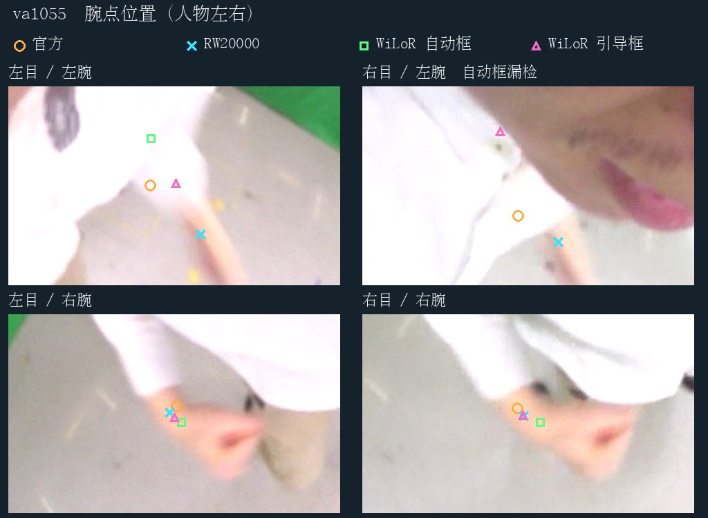
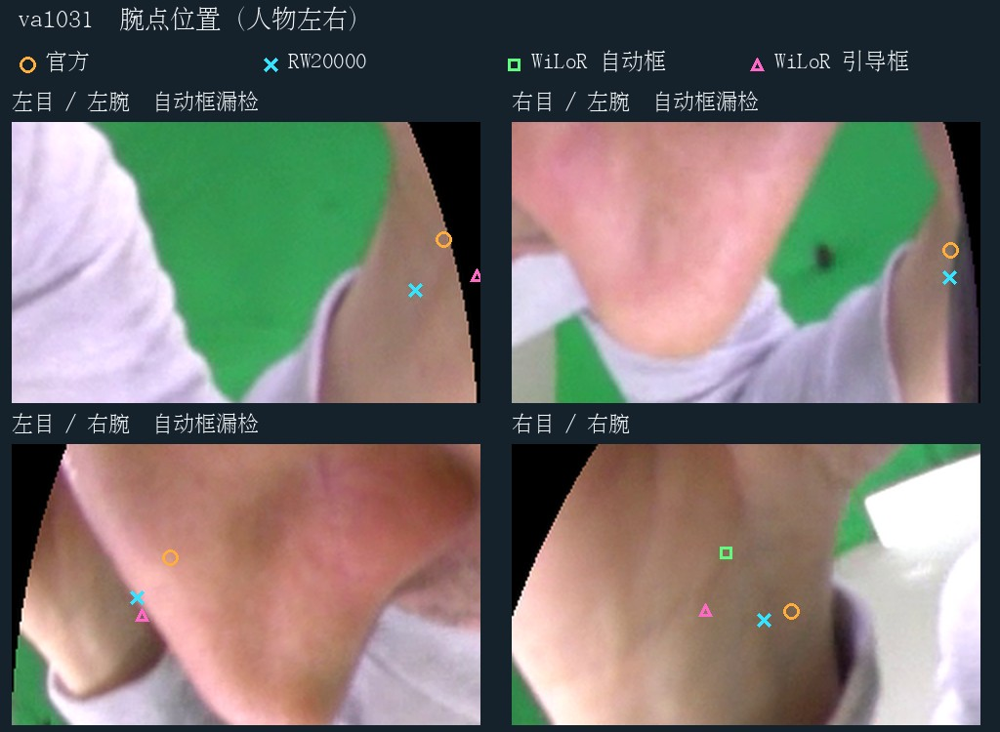

# WiLoR 腕点在 val055 上有多准？

**val055 的人物左腕，WiLoR 改善了左目，右目没有同样的收益。** 自动手框下，左目误差从 50.93 降到 34.33 px，置信度 0.203；右目没有检出左手。用 RW20000 给两眼各提供一个左腕框，左目进一步降到 18.76 px，但右目升到 62.23 px。图中可直接看到右目引导框的预测落在官方点上方。[检测与置信度](evidence/detections.json) · [原图坐标与误差](evidence/scores.json)



## 原图像素误差

以数据集官方二维腕点为参照，报告原图上的欧氏距离。左、右均指人物的解剖侧。“漏检”表示没有同侧输出。自动模式按每张图的预测手别取该侧置信度最高的检测，8 个“人物侧别 × 相机 × 帧”中有 4 个可用，4 个漏检；可用的 4 个里，WiLoR 有 1 个比 RW20000 准。引导模式用 RW20000 的腕点和人物侧别提供框，每个框回归一个腕点。[原始检测摘要](evidence/detections.json) · [引导框输出](evidence/guided.json)

| 帧 | 人物关节 | 相机 | RW20000（px） | WiLoR 自动框（px） | WiLoR 引导框（px） |
|---|---|---|---:|---:|---:|
| val055 | 左腕 | 左目 | 50.93 | 34.33 | 18.76 |
| val055 | 左腕 | 右目 | 34.51 | 漏检 | 62.23 |
| val055 | 右腕 | 左目 | 6.40 | 11.74 | 7.63 |
| val055 | 右腕 | 右目 | 6.76 | 19.01 | 6.41 |
| val031 | 左腕 | 左目 | 30.23 | 漏检 | 25.11 |
| val031 | 左腕 | 右目 | 14.24 | 漏检 | 22.10 |
| val031 | 右腕 | 左目 | 26.39 | 漏检 | 33.05 |
| val031 | 右腕 | 右目 | 14.50 | 44.79 | 43.87 |



## 只替换可用腕点后的三角化与全身拟合

除腕点外，身体观测全部沿用 RW20000，包括双肘。自动框漏检的那一眼保留 RW20000 腕点。因此下表的“自动框”在 val055 左腕使用了左目 WiLoR、右目 RW20000；val031 左腕两眼都用 RW20000。三角化使用项目双鱼眼相机。全身拟合在每一种输入上比较两路：原检测 v3 姿态直接续跑，以及从同一姿态按当前肘腕三角化方向重摆双臂后续跑。每路 1,000 步 Adam，形状、手部、Head、关节上限、掩码和原 v3 损失权重相同。在各组内部按该组输入的最低可行损失选解。下表列出获选结果（这两帧各组均选了方向起点）。[起点与损失](evidence/fit.json) · [全部结果，含未选分支](evidence/scores.json)

| 帧 | 腕点来源 | 三角化左腕误差 mm | 拟合左腕误差 mm | 拟合左前臂误差 ° | 拟合右腕误差 mm | 12 点非 PA mm | 12 点 PA mm |
|---|---|---:|---:|---:|---:|---:|---:|
| val055 | RW20000 | 224.07 | 160.21 | 37.15 | 23.10 | 59.11 | 39.03 |
| | 自动框，漏检回退 | 370.77 | 464.43 | 132.60 | 24.33 | 85.48 | 84.73 |
| | RW 引导框 | 5551.93 | 93.28 | 13.98 | 8.61 | 52.79 | 38.75 |
| val031 | RW20000 | 23.64 | 52.47 | 7.61 | 39.42 | 63.81 | 41.36 |
| | 自动框，漏检回退 | 23.64 | 52.61 | 7.64 | 43.35 | 65.05 | 41.13 |
| | RW 引导框 | 无有效解 | 281.96 | 86.16 | 29.40 | 87.57 | 76.72 |

**val055 暴露出选解问题。** 自动框混合输入、原 v3 起点直接续跑时，左腕误差只有 **70.37 mm**，左前臂偏 **12.59°**。同样的输入，从三角化方向起步却得到了 **464.43 mm、132.60°**。后一姿态的拟合损失反而更低（0.01623 对 0.01734），所以获选。这一帧确实生成过三维更准的解，现有损失对这组有偏观测给出了相反排序。[两个分支的指标](evidence/scores.json) · [评分依据](evidence/fit.json)

**引导框的二维、三角化和全身结果也要分开看。** val055 的左腕直接三角化偏了 5.55 m，双眼预测不足以可靠恢复绝对腕深。全身拟合只让三角化方向参与初始化，之后双臂可转动，骨长受 SMPL-X 约束，最终左腕误差为 93.28 mm。val031 的引导框左腕未通过三角化求解器的有效性检查，左臂沿用原起点；最终左腕比纯 RW20000 差。两帧是已知失败样本，尚不足以决定全量替换腕检测。[三角化实现](../2026-11-24_stereo_forearm_seed/forearm_seed.py) · [逐侧指标](evidence/scores.json)

## 输入与复跑

使用两对原始 872 × 872 图像。自动模式调用仓库的 WiLoR 推理入口，YOLO 阈值 0.20、扩框系数 2.0，输出 MANO 第 0 关节投回原图。官方点只用于评估，未用于框选、手别或可行解选择。引导框是发现自动漏检后新增的独立诊断，所有腕统一以 RW20000 预测为中心，初始方框边长为图宽的 1/8，再使用 WiLoR 的扩框和宽高比处理。两种腕定义分别来自 MANO 和数据集，观测误差包含两者关节中心的可能差异。

在仓库根目录、配置好的 WiLoR 和身体后端环境下依次运行：

```sh
python -B runs/2026-11-25_wilor_wrists/detect.py
python -B runs/2026-11-25_wilor_wrists/guided.py
bash runs/2026-11-25_wilor_wrists/body.sh
python -B runs/2026-11-25_wilor_wrists/overlay.py
```

自动检测需新的本轮 observations 输出目录。资源路径由现有开发机配置解析，权重、后端源码、输入与选解哈希随证据记录。运行起始提交 5cbdec92842e29e3537882b0ea8331aa4a55656d，加本目录新增脚本。运行期间并入独立提交 e62474e，仅新增另一个实验目录。已有无关改动和未跟踪文件排除。执行中的归档标识失败和无效三角化记录见[执行记录](evidence/execution.json)。

发布前检查了工作区、暂存与待推送提交、远端状态。公开内容只含代码、精简数值、标记后的局部图和文档。未纳入权重、数据集、原图、网格、数组、完整日志、本地 provenance、机器路径或凭据。所有文件小于 50 MB。[自检记录](evidence/prepush.json)
