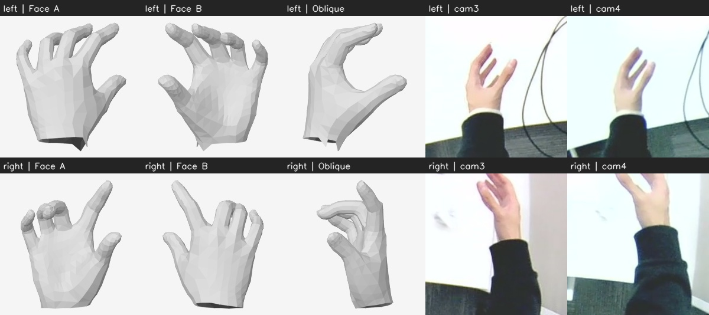
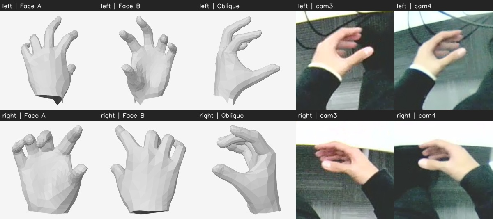

# 最终 OBJ 的双手形状

腕中心回到检测位置后，指间的开合和每根手指弯曲的位置仍值得检查。以下各行依次为同一 OBJ 手部的两个相反视角、斜侧视、cam3 原图和 cam4 原图。模型视角按掌部局部坐标定向，每格单独缩放，适合看指形。腕端的切口来自局部显示时按蒙皮区域截取三角面。相机中的精确配准见[全身投影及叠加图](../2026-11-26_purple_arm_hand_gallery/report.md)。

## 003

右手食指明显伸出，其余三指聚拢并向掌侧折。中指两处相邻指骨的转折约为 54°、17°，食指约为 38°、2°；几何上弯曲集中在中段。右中指尖在两眼分别偏离检测点 71、64 px，是这只手最大的双目指尖偏差。原图的部分指尖靠近画面边缘，具体三维弯曲程度存在不确定性。左手也能看到几根手指在中段弯折后，末节较直。

## 004

两眼里的双手呈半握形，拇指与其余手指围出较圆的开口。左手网格有一根中指明显突出，右手几根手指呈阶梯状弯折。两手中指尖的检测残差分别为左手 54、46 px，右手 51、55 px，而右拇指仅 9、4 px。同一手内的差异说明单个腕点精度不足以描述手形。

角度取相邻指骨方向之间的无符号夹角，沿每根手指由近及远列出，直线为零度。它同时受弯曲与侧偏影响。数值为由最终姿态重建的关节几何，顶点与 OBJ 回读一致。投影残差来自两眼的二维检测，手指遮挡与检测误差会影响归因。[逐指角度、像素距离和网格哈希](evidence/geometry.json)

若继续修手形，优先测试右中指和无名指的分节弯曲，以及其余各指相对中指的张开角。可维持已校正的腕和手臂，用可见的中间指节和轮廓约束手指，同时保留指尖作验证。

## 发布检查

本次仅包含手部局部视图、手部原图裁剪、复现代码和精简证据。核对文件大小、路径、凭据及图像内容。图片仅显示手部与局部环境。模型、数组、视频、完整网格、原始日志和本机路径留在开发机。
