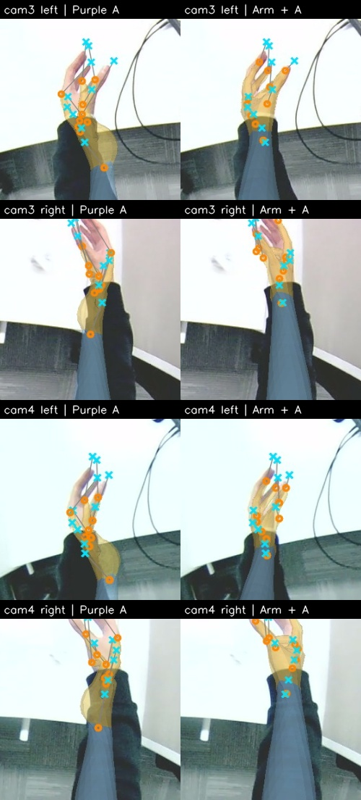
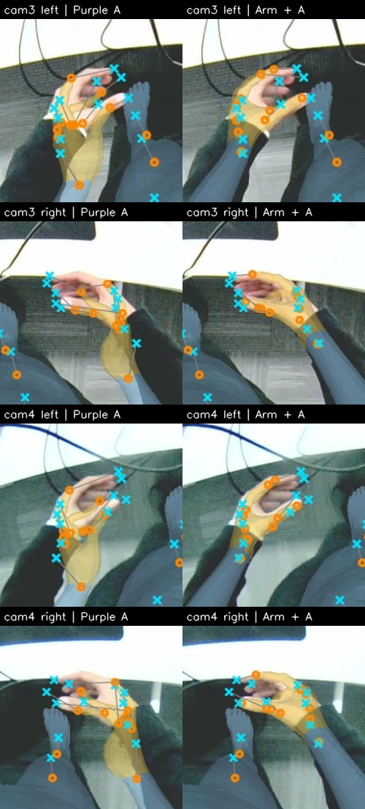

# 紫线平移后，用双目肘腕点重拟合手臂再运行手部 A

两段同步中间帧的腕中心误差均回到原 A 的几像素。004 的腕对齐指尖误差也回到原 A 附近。下列指标为双目、左右手合并的原图像素 RMSE，腕对齐在每眼每手独立进行。指尖全程留出。[计算结果](evidence/metrics.json)

|片段与指标（px）|原 A|紫线 A|紫线肩肘重拟合 + A|
|---|---:|---:|---:|
|003 腕|3.49|51.90|3.23|
|003 指根|7.98|35.31|8.29|
|003 指尖|36.46|70.06|37.13|
|003 腕对齐指尖|37.73|57.22|37.24|
|004 腕|2.50|48.13|2.39|
|004 指根|6.80|27.42|7.14|
|004 指尖|35.25|54.59|35.04|
|004 腕对齐指尖|36.33|70.13|35.55|

每行左列为紫线 A，右列为肩肘重拟合后重新运行的 A。每对使用同一原图窗口和比例，青叉是检测，橙圈是拟合投影，金色是手部网格。

## 拟合及核查

基线提交 2fecadccfdda1f2777c9ad2a00ee55df60fe4fb3，工作区另有既存无关改动。读取上一轮经过哈希核对的紫线掌面起点，复用 v4 标准体型、双目相机、原图分割和固定的脚部姿态。肩肘阶段仅优化两肩和两肘局部旋转。目标使用有效身体肘点和原 A 手部通道的腕点。腕与肘的平方像素损失权重为 4 比 1，局部轴角相对起点的平方变化加权 25。使用相同的 A 优化器、指根、语义轮廓及预算，从重拟合手臂开始优化腕旋转和手指。

003、004 的肘误差分别从 50.72、46.08 px 降到 4.40、4.75 px。肩肘阶段两段头关节位移都为零，上臂和前臂的最大骨长变化分别低于 0.00010 和 0.00007 mm。最终网格回读后，头关节相对紫线目标的差均低于 0.001 mm，头区表面最大差分别为 1.17、1.36 mm。[003 双目肘腕与骨长](evidence/clip003_arm.json) · [004 双目肘腕与骨长](evidence/clip004_arm.json) · [最终网格与逐眼投影核查](evidence/gallery.json)

两帧足以检验本次拟合顺序。剩余约 36–37 px 的腕对齐指尖误差含腕朝向、指姿、投影和检测的不确定性。三维关节角的生理解剖范围、自碰撞与视频时序须另行评估。

## 复现

在开发机仓库根目录，设置 r=runs/2026-11-26_purple_arm_hand_a，依次运行 bash "$r/run.sh" fit 2、bash "$r/run.sh" fit 3、bash "$r/run.sh" metrics、bash "$r/run.sh" render_hands、bash "$r/run.sh" compare_hands。模型和上轮缓存需要在项目约定位置。完整姿态、两份 cam3 米制 OBJ 与压缩包保存在 outputs/purple_arm_hand_a_20261126/。两帧手部优化的退出状态与逐点投影分别见 [003](evidence/clip003.json) 和 [004](evidence/clip004.json)。

## 推送前自检

仅发布本轮源码、文档、精简指标与两张手部裁剪。逐项核对暂存范围、文件大小、文件类型、路径、凭据及远端基线。单文件小于 50 MB，无权重、数据集、视频、数组、完整原始输出、凭据或环境文件。两张裁剪经目视核查，无可识别受试者图像。完整 provenance、原始日志与 patch 留在开发机。其他工作区改动未纳入。
