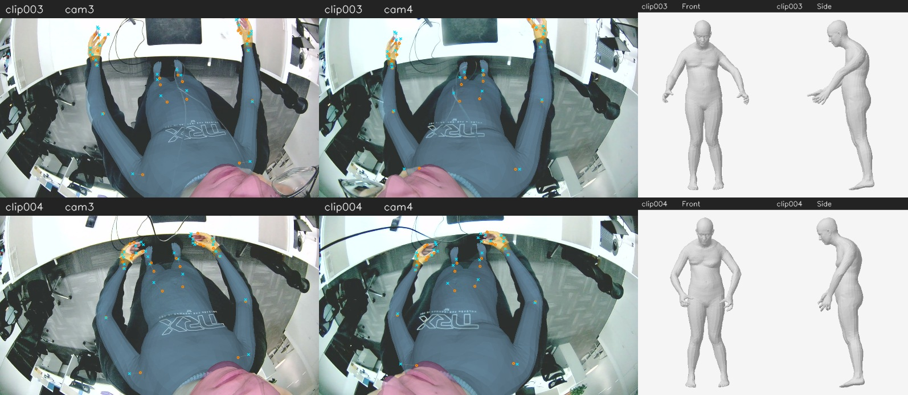

# 003、004 紫线身体、肩肘重拟合与 A 手部图集

每行依次为 cam3 左目、cam4 右目、全身正面、全身侧面。青叉是二维检测点，橙圈是同一全身网格的拟合关节投影，灰线连接对应点。半透明蓝色是身体，紫色是头面部，金色是手。

|片段|纯 mesh 投影|预测点和拟合点|mesh 与点叠加|双手放大|全身 OBJ 正侧视|
|---|---|---|---|---|---|
|003|[左目](assets/clip003_cam3_mesh.jpg) / [右目](assets/clip003_cam4_mesh.jpg)|[左目](assets/clip003_cam3_points.jpg) / [右目](assets/clip003_cam4_points.jpg)|[左目](assets/clip003_cam3_combined.jpg) / [右目](assets/clip003_cam4_combined.jpg)|[双目](assets/clip003_hands.jpg)|[正面、侧面](assets/clip003_obj.jpg)|
|004|[左目](assets/clip004_cam3_mesh.jpg) / [右目](assets/clip004_cam4_mesh.jpg)|[左目](assets/clip004_cam3_points.jpg) / [右目](assets/clip004_cam4_points.jpg)|[左目](assets/clip004_cam3_combined.jpg) / [右目](assets/clip004_cam4_combined.jpg)|[双目](assets/clip004_hands.jpg)|[正面、侧面](assets/clip004_obj.jpg)|

## 投影结果

原图像素 RMSE 合并双目。身体项包括有效的肩、肘、腕、髋、膝和踝；腕和指尖合并左右手。指尖是留出点，未参与 A 手部点位损失。

|片段|身体点|手腕|五指尖|
|---|---:|---:|---:|
|003|27.01|3.23|37.13|
|004|29.96|2.39|35.04|

肩肘根据双目肘点及手部腕点重新拟合，随后运行 A 手部拟合。紫线平移、标准体型及躯干保留。模型、视频帧及网格保存在开发机；两段的正侧视图和双目图均来自各自同一份最终全身 OBJ。生成图时回读网格并核查手部投影与优化器输出。[肩肘与手部实验报告](../2026-11-26_purple_arm_hand_a/report.md) · [逐点与网格核查](../2026-11-26_purple_arm_hand_a/evidence/gallery.json) · [图像与 OBJ 哈希](evidence/manifest.json)

## 推送前核对

发布图像、报告和精简哈希证据。图像为用户要求的双目原图叠加和网格视图。待推增量不含权重、数据集、视频、数组、完整原始输出、凭据、环境文件、完整 provenance 或 patch，单文件小于 50 MB。原始网格保留在开发机；推送前核对远端 HEAD 和增量。
