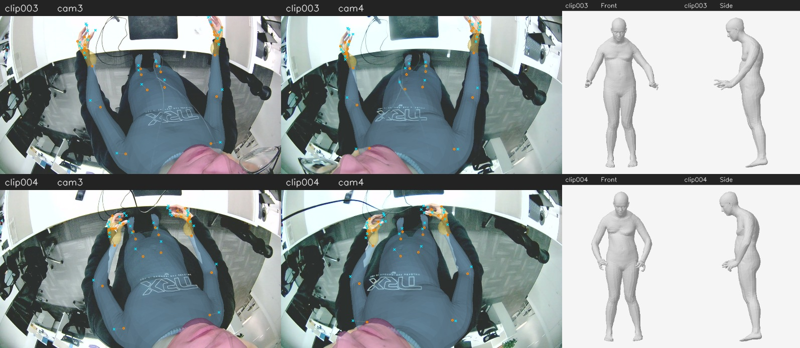

# 003、004 紫线身体与 A 组手部

每行依次为 cam3 左目、cam4 右目、全身正面、全身侧面。青叉是原图二维检测，橙圈是本次拟合关节投回同一张原图的位置，灰线连接同一关节的两个点。半透明蓝色是身体，紫色是头面部，金色是手。

| 片段 | 纯 mesh 投影 | 预测点和拟合点 | mesh 与点叠加 | 双手放大 | 全身 OBJ |
|---|---|---|---|---|---|
| 003 | [左目](assets/clip003_cam3_mesh.jpg) / [右目](assets/clip003_cam4_mesh.jpg) | [左目](assets/clip003_cam3_points.jpg) / [右目](assets/clip003_cam4_points.jpg) | [左目](assets/clip003_cam3_combined.jpg) / [右目](assets/clip003_cam4_combined.jpg) | [双目](assets/clip003_hands.jpg) | [正面、侧面](assets/clip003_obj.jpg) |
| 004 | [左目](assets/clip004_cam3_mesh.jpg) / [右目](assets/clip004_cam4_mesh.jpg) | [左目](assets/clip004_cam3_points.jpg) / [右目](assets/clip004_cam4_points.jpg) | [左目](assets/clip004_cam3_combined.jpg) / [右目](assets/clip004_cam4_combined.jpg) | [双目](assets/clip004_hands.jpg) | [正面、侧面](assets/clip004_obj.jpg) |

## 投影结果

所有误差均为原图像素 RMSE，合并两眼。身体项含有效的肩、肘、腕、髋、膝和踝。手腕与指尖项合并人物左右手，使用手部检测通道。指尖未参与手部拟合的点位损失。原 A 是同一帧在原身体位置的对照。

| 片段 | 本次身体点 | 原 A → 本次腕点 | 原 A → 本次五指尖 |
|---|---:|---:|---:|
| 003 | 40.03 | 3.49 → 51.90 | 36.46 → 70.06 |
| 004 | 40.41 | 2.50 → 48.13 | 35.25 → 54.59 |

紫线平移也改变了腕中心在相机中的位置。A 组保持腕中心固定，允许手腕旋转和手指弯曲，所以手部优化难以补偿这处整体偏移。两段的留出指尖误差均高于同帧原 A。

## 构建与核查

每段使用上轮联合紫线标定的三维平移、标准体型、归档的同帧掌面起点与原 v4 身体。核对掌面起点相对原身体仅修改肘部轴向旋转和手腕姿态，再施加紫线平移。直接复用原 A 优化器的 control 分支、双目四指根、原图分割、正则和 70 步预算，重新选择腕及手指参数。身体、踝及前脚掌保持在该起点。此次未另行细化肩、肘或全身位置。WiLoR 额外轮廓项在 A 中权重为零。各帧 JSON 里的 WiLoR 轮廓诊断字段为占位零，本次未测量该指标。[A 组与腕锚定方法对照](../2026-11-26_realvideo4_wilor_wrist/report.md) · [紫线网格参考](../2026-11-26_realvideo4_pitch_obj/report.md)

从最终参数导出各自的 cam3 米制 OBJ，回读检查顶点与拓扑，双目渲染取鱼眼射线首次命中的表面。身体有效点来自原 v4 输入；手部逐眼展示腕、四个指根和五个留出指尖，核对其模型投影可重现优化器的输出。全身外部视图与双目投影使用同一份 OBJ。局部手部旋转后，两段 Head 关节与紫线目标网格中的 Head 关节差均低于 0.001 mm；比较头区所有顶点，最大差分别约 1.46 和 1.45 mm。[逐点数值与网格核查](evidence/gallery.json) · [003 拟合](evidence/clip003.json) · [004 拟合](evidence/clip004.json)

执行基线 008b5c9a17d32d5ac2f8f3fc626def47f95a99d2。工作树有新 run 和既有无关改动。所需的模型、视频帧、检测、语义分割和输入姿态保存在开发机。压缩包位于仓库的 `outputs/realvideo34_purple_hand_a_20261126/clip003_004_purple_hand_A_OBJ.zip`。[执行记录与渲染重试](evidence/execution.json)

推送前核对工作区、暂存、待推增量与远端，检查单文件小于 50 MB、JPEG 元数据、凭据及机器路径。仅提交本轮代码、报告、派生图像和脱敏数字；原始资产、数组、运行缓存和完整网格保存在开发机。
