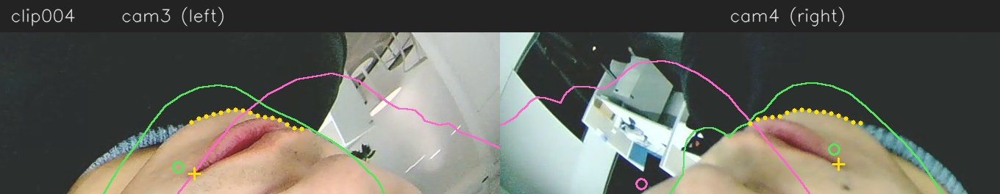

# 真实双目四段视频 · 用脸部出画情况反推 Head

用 003 的两眼嘴角和局部脸缘估计一个佩戴偏移，封存后把同一修正量应用于 004、001 和 002。评估包括固定原姿态的几何回投，以及更换 Head 软锚点后完整重跑黄金 D v4。各片段均取原报告同一对同步中间帧。[原报告和全身叠加图](../2026-11-25_realvideo4_dv4/report.md)

**判断。** 留出的 004 在完整重拟合后，双目嘴角误差由 219.3 降到 22.7 px，支持可见脸部校准。001、002 的非脸区误入面积也下降，但分别仍占人工确认区域的 46.3% 和 36.5%。001 身体投影误差上升最明显。当前证据支持以此作为 003、004 的候选锚点；直接推广成四段统一佩戴常量，仍缺少支持。

## 估计的坐标

坐标原点为 cam3 光心，单位 cm，沿用 OpenCV 相机轴（x 向右、y 向下、z 沿光轴）。该坐标对应 SMPL-X 内部的 Head 关节。

| 量 | x | y | z |
|---|---:|---:|---:|
| 原佩戴锚点 | 6.86 | 13.88 | 0.89 |
| 003 的平移修正 | 1.72 | 3.86 | 8.06 |
| 候选佩戴锚点 | 8.58 | 17.74 | 8.94 |

003 左目人工点取原图 (850, 664) 的近侧嘴角，对应模型解剖左嘴角；右目点取 (485, 655) 的近侧嘴角，对应模型解剖右嘴角。两个点各自使用对应模板点和标定投影。对同一实体点的双目三角化需要两眼都能可靠辨认它，本实验改用已知模板两嘴角的相对位置来解共同平移。

另在两眼标出皮肤与深色衣服对比清楚的下脸边界横向区间，每隔 10 px 取亮度超过 90 且持续 4 个像素的第一处。用完整网格做鱼眼射线首次命中，判定可见头面部。初值由嘴角重投影获得，再等权最小化两眼嘴角像素 RMSE 与脸缘纵向像素 MAE。只估计平移，保留 003 原 v4 的头部朝向、表情和标准脸形。眼镜边缘与图像下边框没有用作天然脸缘。[003 标注、投影与封存参数](evidence/fit003.json)

在 003 上做了点取和朝向敏感性分析。只用两个嘴角时，单个像素坐标扰动 3 px 使估计平移最多变化 1.5 mm；模板绕 cam3 三个轴分别试 ±10° 可引起约 16.5 mm 的最大平移变化。这只是扰动实验，不能给真实 Head 定位误差划出置信区间。

## 嘴角和脸缘

004 单独点取同侧解剖嘴角和可辨脸缘。它的像素没有用于求解或修改候选偏移。四段整体图在实验设计时已看过，004 属于留出画面检查。RMSE 为两眼嘴角二维欧氏误差的均方根；脸缘 MAE 是指定列上观察边界和预测边界的平均纵向像素差。

| 片段 | 嘴角原 / 仅平移 / 重拟合（px） | 脸缘原 / 仅平移 / 重拟合（px） |
|---|---:|---:|
| clip003 | 221.3 / 1.3 / 15.8 | 60.2 / 14.6 / 16.0 |
| clip004 | 219.3 / 23.5 / 22.7 | 58.8 / 25.7 / 26.6 |

## 头部几乎出画的两段

在 cam3 取原图矩形 [800,1250) × [550,706)，在 cam4 取 [30,480) × [550,706)。原图中这些区域是衣服或背景。统计两眼框内，射线首次击中头面部的像素数，越低越好。每帧两框合计 140,400 px。这个量只反映框内假阳性，不能推算真实的头部三维误差。

| 片段 | 原误入像素 | 仅平移 | 完整重拟合 | 重拟合时占两框面积 |
|---|---:|---:|---:|---:|
| clip001 | 89,922 | 49,668 | 64,995 | 46.3% |
| clip002 | 85,072 | 51,567 | 51,229 | 36.5% |

## 对身体拟合的影响

完整重拟合仅换 Head 目标，沿用原图、标定、检测点及其有效掩码、初始化根朝向、分割、权重和手脚锁定。先重新做 20,000 步基础拟合和 v3 候选搜索，再做 v4 的 72 步完整轮廓细化与最终重选。Head 是软锚点，模型最终关节可偏离目标。[身体评分与收敛记录](evidence/body.json)

| 片段 | 身体关节重投影 RMSE 原 → 新（px） | 整体轮廓距离原 → 新（px） | 最终 Head 到新锚点（mm） |
|---|---:|---:|---:|
| clip001 | 13.70 → 18.41 | 12.04 → 13.35 | 4.35 |
| clip002 | 14.31 → 14.44 | 10.84 → 10.58 | 0.25 |
| clip003 | 7.50 → 8.16 | 9.74 → 10.81 | 1.09 |
| clip004 | 9.52 → 10.27 | 10.38 → 10.09 | 1.29 |

基础优化的严格末段稳定性检查通过 0/4；四帧均有可行输出。

## 双目原图底部的回投

紫线为原 v4 预测边界，绿线为新预测边界。003、004 中，两色空心圈为预测嘴角，黄叉为人工点，黄点为可见脸缘。001、002 中，黄框为确定非头部的计数区。左右为 cam3、cam4 的底部裁剪。

| 片段 | 固定原姿态，仅平移 | 完整重拟合 |
|---|---|---|
| clip001 | [查看](assets/clip001.jpg) | [查看](assets/refit_clip001.jpg) |
| clip002 | [查看](assets/clip002.jpg) | [查看](assets/refit_clip002.jpg) |
| clip003 | [查看](assets/clip003.jpg) | [查看](assets/refit_clip003.jpg) |
| clip004 | [查看](assets/clip004.jpg) | [查看](assets/refit_clip004.jpg) |

四帧均无头部三维真值。佩戴变化、相机系中的真实头部朝向和个体脸形都可能影响估计，出画严重的两段只能提供单侧可见性约束。各帧是否适合同一佩戴标定，要同时看脸部、非脸区域和身体的留出误差。此轮候选独立于黄金 D v4 默认配置。

## 复现

运行起点 01726e67a3d06e08f0db0b6f51d88e77b0cd0f36，工作树有本轮文件和既有无关改动。执行期间另一轮独立提交更新了 main；核对其改动仅在该轮手掌实验目录。本轮输入和依赖保持相同。需具有原始图像、相机和 SMPL-X 资源的访问权限。[命令、退出状态与指纹](evidence/execution.json) · [仅平移证据](evidence/check.json) · [完整重拟合证据](evidence/refitted.json)

发布前核对工作树、暂存区、待推提交及远端。仅公开代码、脱敏指标与叠加裁剪图；单文件均小于 50 MB，检查 JPEG 元数据、凭据和机器路径，排除原图、视频、数组、权重、原始网格、环境文件与完整本地 provenance/patch。
