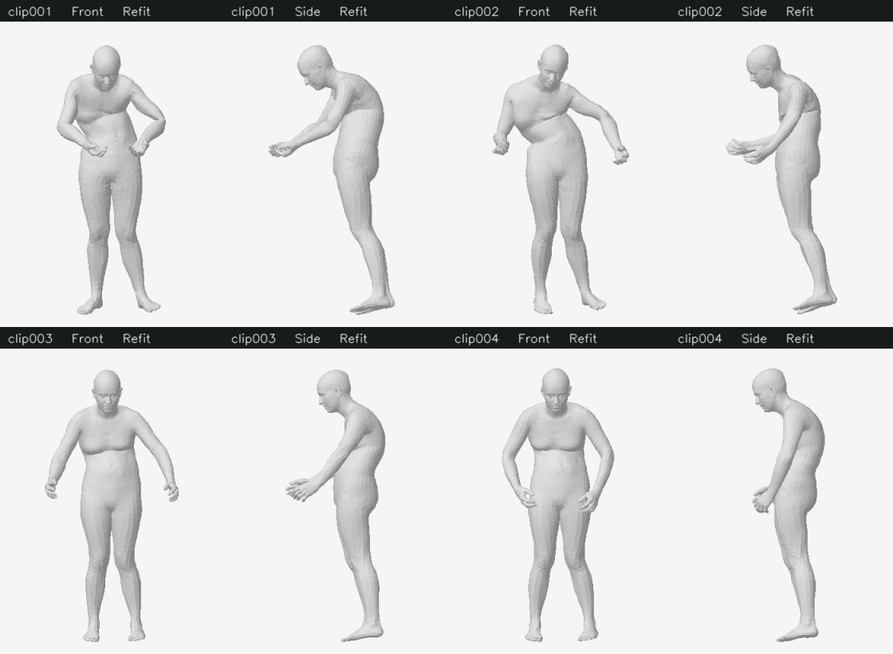
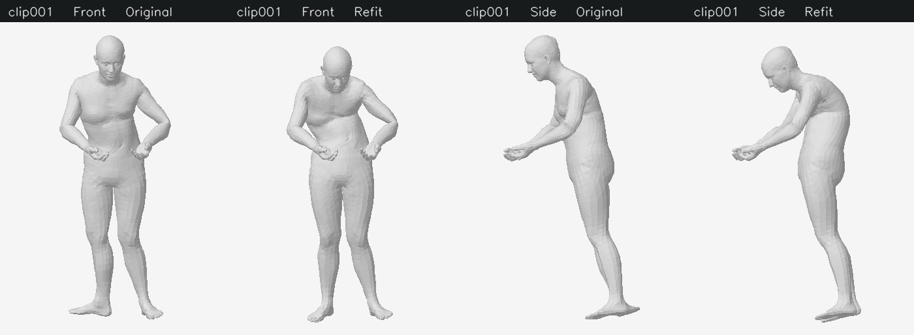
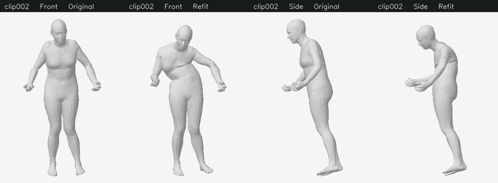
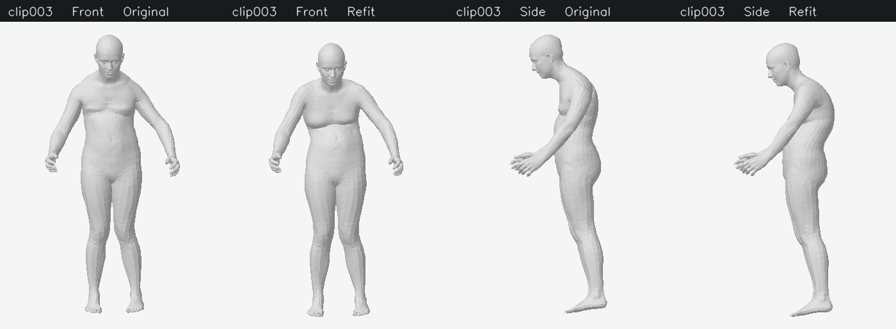
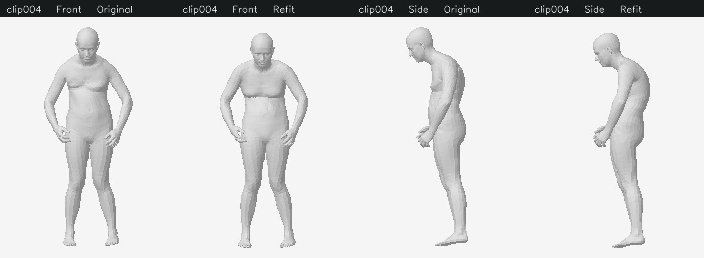

# 更换 Head 后的四段全身 OBJ

四段都采用 003 校准出的候选 Head，并使用各段各自重新拟合的黄金 D v4 姿态。总览中每格左为正面、右为侧面。点图可看大图。

## 同帧原 v4 与新 Head 对照

每张图从左到右依次为原正面、新正面、原侧面、新侧面。同一片段以原 v4 根朝向确定正侧视，在同一视角下共用画面中心与比例，保留网格在相机空间中的相对位移。下方图片可单独放大。

| 片段 | 全身网格对照 |
|---|---|
| 001 |  |
| 002 |  |
| 003 |  |
| 004 |  |

原始相机画面中的头部出画与脸缘对齐可看[双目回投报告](../2026-11-26_realvideo4_head_mount/report.md)。以上正、侧视为外部观察方向。

执行基线 6c068dab49905b2f93334b77fb177dca06df32e2，工作树含本轮新增文件及已有无关改动。从封存参数生成左相机 cam3 米制网格，写入 OBJ 后读回，核对面索引和顶点坐标，再渲染。开发机压缩包位于 `outputs/realvideo4_head_obj_20261126/four_refitted_OBJ_cam3_m.zip`。[逐帧 OBJ、图像与压缩包哈希](evidence/render.json)

推送前按本轮增量核对工作区、暂存区、待推提交和远端；检查所有文件均小于 50 MB、JPEG 元数据、凭据和机器路径。仅发布文档、代码、脱敏核查和渲染预览，完整网格、数组、视频、权重、环境文件及本地 provenance/patch 留在开发机。
