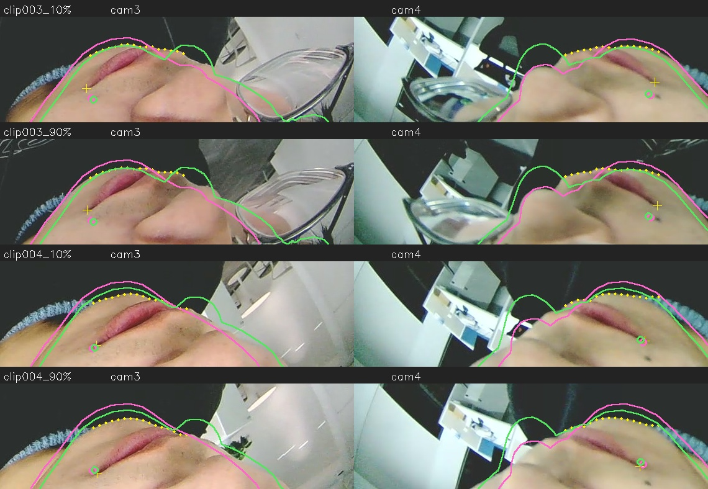
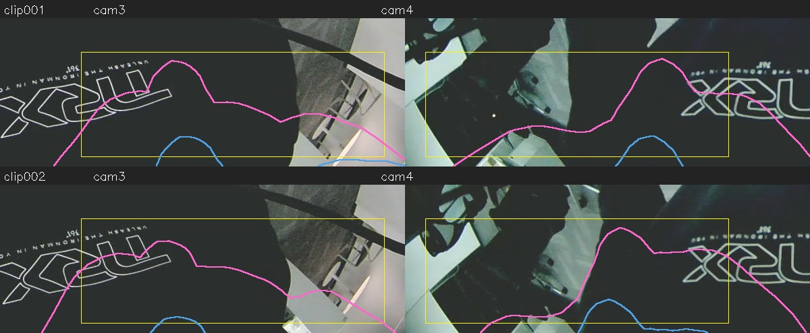

# 两种佩戴状态的俯仰检查

拍摄者确认 003、004 时相机朝脸转动。以各段原黄金 D v4 中间帧的相机空间网格为参考，本轮测试一个额外的俯仰自由度，并允许三维平移。003、004 的留出画面支持用这一修正改善可见下脸缘。001、002 能排除部分角度，但多个不同角度都能完全满足出画观测。输出是一项标定对照，黄金 D v4 默认配置仍沿用既有版本。

## 003、004 的同组留出检查

用两段中间帧的嘴角与下脸缘一起拟合一组共享修正。把三个平移量在每个候选角下重新估计。旋转轴是 cam3 光心指向 cam4 光心的标定基线，通过两光心中点，右手定则，作用在模型上。沿该轴在 −40° 至 +40° 之间每 5° 搜索，训练分数为嘴角 RMSE 与下脸缘 MAE 之和，两段等权。网格上选到 **−10°**。这是对原 v4 头部朝向的等效修正；转动相机和转动模型采取相反的主动旋转约定，也缺少相对眉心的实测零位。

独立于拟合目标帧，按时间戳取两段重叠时长 10% 和 90% 处的同步画面，单独在原图标近侧嘴角，沿与中间帧相同的局部窗口找下脸缘。两眼各用本侧解剖嘴角。每段在留出时刻使用该段中间帧的冻结头形与朝向代理，因此这项检查也包含表情和佩戴微动等误差。下表对四帧逐帧得分等权平均，单位 px。零角对照同样在两段中间帧重估平移。

| 留出观测 | 仅平移 | 加俯仰 |
|---|---:|---:|
| 可见下脸缘 | 13.77 | 7.61 |
| 嘴角 | 13.38 | 14.12 |

四帧的脸缘均改善。嘴角在 003 两个时刻变差，004 两个时刻略好。双目图中黄点为原图脸缘，黄叉为独立点取的嘴角，紫色为仅平移，绿色为加俯仰；圆圈为预测嘴角。颜色接近仅说明相应位置的二维投影接近。[每帧标点、得分与索引](evidence/temporal.json)

另做跨片段留出，单独在一段选角和平移，封存应用到另一段中间帧。003 单段选到 −10°，004 单段选到 −15°。以下误差按“仅平移 → 加俯仰”列出。单用 004 标定再转到 003，两项指标均变差。这限制了把单段最优角推广到另一段的把握。两段分开选到的角度也是网格候选，不能当成真实机械角置信区间。[全部候选及交叉留出误差](evidence/angles.json) · [跨片段叠图](assets/heldout.jpg)

| 拟合 → 检查 | 检查段脸缘 px | 检查段嘴角 px |
|---|---:|---:|
| 003 → 004 | 25.72 → 21.47 | 23.55 → 25.79 |
| 004 → 003 | 10.75 → 16.38 | 23.70 → 27.08 |

## 001、002 的出画约束能分辨什么

抽查四段视频各眼 10%、30%、50%、70%、90% 附近的画面，001、002 的对应底部区域主要是衣服及背景，003、004 可见下脸和嘴角。抽查索引及视频哈希见[输入记录](evidence/angles.json)。001、002 的定量检查仅使用之前人工确认过的中间帧非脸区域，不把抽查推广成全视频逐像素标注。

以仅用 003 校准的候选为起点，围绕双目基线再转动，保留每段自己的原 v4 网格以计算遮挡。两个黄框共 140,400 像素。表中是逐像素射线首次击中头面部的总数，越低越好。角度列相对 003 候选，与前表相对原 v4 的角度采用不同零位。[全分辨率计数](evidence/negative_native.json)

| 相对 003 候选的额外模型旋转 | 001 误入像素 | 002 误入像素 |
|---:|---:|---:|
| 0° | 62,325 | 58,982 |
| −15° | 3,411 | 2,317 |
| −20° | 0 | 7 |
| −25° | 0 | 0 |
| −30° | 0 | 0 |
| −40° | 0 | 0 |

紫、蓝、绿分别是 0°、−15°、−25° 候选的局部头部边界。绿线在裁剪范围内可能只剩少量边缘。元数据另有每隔 4 像素的宽范围扫描及沿 cam3 光轴附加 ±10 mm 的敏感性对照。黄框清空以后，选更大的角度已经得不到更多定位信息。上表的转轴、初始平移和标准脸形都是模型假设；不能从清空角度推导实际转动量的数值下界。[角度和位置联合扫描](evidence/angles.json)

## 双目相对几何和标定优先级

用每对原图上半部的 SIFT 双向比值匹配，记录全部通过外观筛选的对应点到旧标定极线曲线的一阶像素距离，没有用既有外参先筛点。四段中位数依次为 6.79、3.28、4.94、7.16 px。真实画面包含误匹配和运动；这些残差单独不能区分两台相机相对转动、标定偏差、同步或匹配误差。若支架左右镜头能独立转，宜在每种安装状态用双目共同可见的标定板复核相对外参。[全部匹配点及残差](evidence/stereo.json)

003、004 的下一项独立约束可以取嘴和下巴以外的、在原图和模板都能重复定位的面部特征，并继续检查留出帧。001、002 要区分表中同为零的角度，更有信息量的是第一种安装状态的侧面佩戴照，画面同时包含眉心、鼻梁以及可确定光轴方向的相机支架参照；若能复原两档，也可在同一头模上直接量两档的方向差。只有两眼都能识别同一物理点时才使用双目三角化。

## 执行和边界

基线 a24704f162f449ff64ec50f59f098ad26bada724，执行时工作树有本轮新增文件与既有无关改动。只读复用已存的 v4 网格、标准体型、头部区域标签、原鱼眼标定、双目原图和时间戳。沿用原图像分辨率做鱼眼投影，逆变换射线并使用全网格首次命中来计遮挡。标定试验固定各段身体代理，未重拟合躯干和四肢，未测得三维角度、全身 PA 或非 PA 的真值误差。

在仓库根目录顺序运行本目录的 run.sh，参数依次为 stereo、pitch、negative、temporal；需原开发机相应资产与既有 Python 环境。[命令、退出状态和结果哈希](evidence/execution.json)。发布前核对工作区、暂存、待推增量与远端，公开文件为代码、报告、脱敏数值及局部叠图，单文件小于 50 MB。排查机器路径、凭据、JPEG 元数据，原始网格、数据、视频、模型、环境文件与完整本地运行记录保留在开发机。
